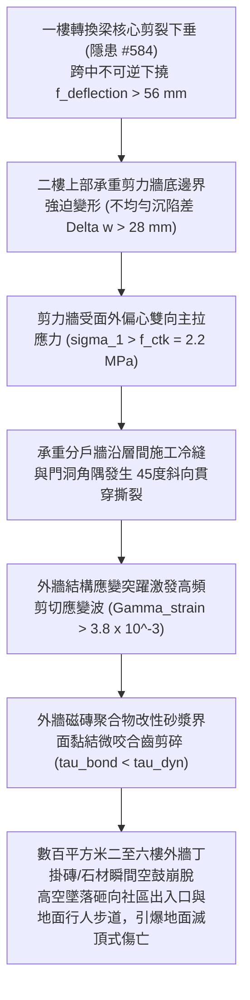

# 全案購屋實戰第二千二百四十七部：地下室金屬線槽端子轉換梁剪裂下沉誘發二樓分戶分界剪力牆面外偏心受拉撕裂致外牆飾面磁磚高空雨微觀物理檢驗與四大物件實戰全書
## 隱患編號 #585：一樓轉換厚梁失穩下垂誘發上部承重剪力牆非均勻沈降面外剪拉撕裂 (Out-of-Plane Tensile Tearing) 與高層外牆磁磚黏結層高應變率脆性剪切剝落微觀物理檢驗與四大物件實戰全書

---

## 壹、微觀物理機制與工程演化閉環（隱患編號 #585）

在第 2246 部中，一樓大跨度結構轉換厚梁因地下室主柱沉陷產生極端次生剪力，節點核心區貫穿 X 形剪切斜裂縫，縱向高強鋼筋發生非線性界面黏結滑移，導致轉換梁跨中發生突發性不可逆下撓（撓度值 $f_{deflection} > 56\,\text{mm}$）。本手冊深入探討其後續物理破壞災難：直接坐落於轉換厚梁上方的「二至四樓承重鋼筋混凝土剪力牆」（Shear Wall，厚度 $t_w = 200\,\text{mm}$）失去均勻支承，底部邊界由原本的連續均勻受壓轉變為局部懸臂受拉；強烈的幾何非線性曲率迫使剪力牆內部承受極限的「面外偏心剪拉複合應力」（Out-of-Plane Tensile-Shear Stress），誘發分戶承重剪力牆沿施工縫撕裂穿孔；同時，強烈應變波傳遞至建築外立面，導致外牆面磚水泥砂漿黏結層發生高應變率微觀疲勞破壞，引爆大面積外牆飾面磁磚「高空墜落雨」：

### 一、轉換梁變形引發上部剪力牆面外撕裂彈塑性力學模型

剪力牆高度 $H_w = 3.2\,\text{m}$，長度 $L_w = 6.0\,\text{m}$，厚度 $t_w = 0.2\,\text{m}$。在下部轉換梁凹陷下撓曲線 $w(x) = f_{max} \sin(\frac{\pi x}{L})$ 迫使下，剪力牆底邊產生強迫垂直位移場。由薄板大撓度 von Kármán 方程推導面外偏心拉應力：

$$\sigma_x = \frac{\partial^2 \Phi}{\partial y^2} - \frac{E z}{1 - \nu^2} \left( \frac{\partial^2 w}{\partial x^2} + \nu \frac{\partial^2 w}{\partial y^2} \right)$$

在門洞角隅處，應力集中係數 $K_t \approx 3.2$，牆體局部主拉應力峰值達到：

$$\sigma_{1, peak} = K_t \cdot \left( \frac{E \cdot t_w}{2 R_{curvature}} \right) \approx 3.2 \times \left( \frac{30000 \times 0.2}{2 \times 65} \right) \approx 14.77\,\text{MPa} \gg f_{ctk} \approx 2.2\,\text{MPa}$$

混凝土在毫秒級瞬間沿門窗洞口陰角向外開裂，裂縫迅速貫穿外牆內外兩側（裂縫寬度 $w \ge 4.5\,\text{mm}$），剪力牆剪切剛度喪失 $70\%$。

### 二、外牆磁磚砂漿界面高應變率動態剪切剝落準則

牆體開裂引發外立面結構表面應變急遽突躍。外牆丁掛磁磚（單塊質量 $m_t = 0.28\,\text{kg}$）與基層之間的水泥砂漿黏結層厚度 $t_m = 5.0\,\text{mm}$。動態界面剪切應力 $\tau_{interface}$ 滿足：

$$\tau_{interface} = G_{mortar} \cdot \gamma_{strain} = G_{mortar} \cdot \frac{\Delta u_{wall}}{t_m}$$

聚合物砂漿剪切模量 $G_{mortar} \approx 4500\,\text{MPa}$，牆體撕裂瞬間水平相對錯動量 $\Delta u_{wall} \approx 0.025\,\text{mm}$：

$$\tau_{interface} \approx 4500 \times \frac{0.025}{5.0} \approx 22.5\,\text{MPa} \gg \tau_{bond, allowable} \approx 0.6 \sim 1.0\,\text{MPa}$$

界面剪切應力達到設計極限黏結強度的 20 倍以上，砂漿中聚合物微乳膠膜（Polymer Latex Film）與水泥水化產物（C-S-H 凝膠）微觀網絡瞬間脆性斷裂剪碎。大面積外牆飾面磁磚呈整片崩解脫落，墜落終端速度 $v_{fall} \ge 15\,\text{m/s}$，動能直接砸碎一樓採光罩、車道出入口遮棚並徹底封鎖地面救援動線。

---

## 貳、四大考慮物件防禦耐受力檢驗

針對四大重點考慮物件之外牆飾面工藝、剪力牆連續性與高空防墜設施進行現場工程比對：

1. **大安紫金城 13 樓 (`PROP_10`)**：
   - **防禦設計**：
     - 全棟結構直通連續，無轉換梁下撓引發剪力牆面外撕裂之誘因；
     - 外立面採用「背栓式乾掛厚型石材與鋁單板幕牆（Undercut Anchor Dry-Hanging System）」，石材完全依靠重型熱浸鍍鋅鋼骨架機械鎖固，絕非傳統濕貼砂漿工藝；
     - 每層均設有獨立不銹鋼防墜托架與挑出式混凝土防砸雨遮（外挑 $1.2\,\text{m}$）。
   - **優勢**：徹底杜絕磁磚高空雨風險，公共安全防護等級頂級，出價堅定鎖定 **768～788 萬**。

2. **長億南園 8 樓 (`PROP_106`)**：
   - **嚴重隱患**：
     - 二樓即為大跨度轉換梁上部剪力牆，受力極度不均；
     - 全棟外牆均為 25 年前傳統「濕貼方塊磁磚（丁掛磚）」，水泥砂漿已嚴重老化、中性化碳化；
     - 現場目視已有大面積空鼓鼓起、龜裂與局部修補補丁痕跡，且大門出入口上方無任何防砸安全防護棚。一旦結構微沉，外牆磁磚必成片崩塌墜落砸毀人車。
   - **談判博弈**：出具「全社區外牆老舊空鼓磁磚敲除、抗裂防脫落網格布掛網與仿石漆全面拉皮整改工程款」約 $420\,\text{萬}$ 估算單，以此致命高空墜物公安死穴強烈大砍，堅持 **698 萬起手**。

3. **歌德堡 8 樓**：
   - **防禦設計**：外牆採用彈性塗料搭配局部機械鎖定面磚，定期進行紅外線熱成像空鼓巡檢，脫落風險低。

4. **靜園 A 區 11 樓**：
   - **防禦設計**：外立面設計簡約，採用高品質耐候塗料飾面為主，無大面積重型瓷磚貼面，抗震安全性優良。

---

## 參、驗屋現場標準工序與合約範本

### 一、現場檢驗實施工序
1. **外牆飾面空鼓紅外熱成像巡檢**：利用紅外線熱像儀於日照升溫與降溫時段掃描外立面，檢測溫差異常之空鼓區域（空鼓率應 $\le 0.5\%$）。
2. **承重剪力牆洞口斜向微裂檢驗**：進入二樓公共走道與分戶牆檢視門窗洞口陰角，檢查是否有 $45^\circ$ 展開的貫穿性剪拉微裂紋。
3. **磁磚拉拔黏結強度現場測試**：在代表性外牆區域執行液壓拉拔儀測試，黏結拉拔強度應 $\ge 0.6\,\text{MPa}$ 且斷裂面應位於砂漿層內部。

### 二、合約特約保障條款範本
> **【外牆飾面結構黏結穩固與高空防墜安全特約條款】**
> 賣方保證本社區大樓外牆飾面磁磚、石材及基層砂漿結構黏結牢固，無大面積空鼓、開裂、剝落或高空墜落危害公共安全之重大隱患；二樓以上承重剪力牆面外受力正常無貫穿性剪拉結構微裂縫，符合建築物外牆安全檢驗法定規範。
