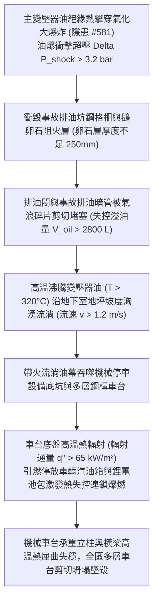

# 全案購屋實戰第二千二百四十三部：地下室金屬線槽端子主變壓器油爆氣浪衝毀排油蓄油坑誘發巨量帶火變壓器油流淌火席捲機械停車設備微觀物理檢驗與四大物件實戰全書
## 隱患編號 #582：變壓器油爆超壓氣浪衝毀排油閥與地下儲油坑鵝卵石阻火隔層誘發沸溢流淌火 (Boilover Flowing Fire) 吞噬地下機械停車塔微觀物理檢驗與四大物件實戰全書

---

## 壹、微觀物理機制與工程演化閉環（隱患編號 #582）

在第 2241 部與第 2242 部中，底坑衝切連續壁湧水誘發高壓配電室主變壓器油絕緣熱擊穿。超高溫金屬電弧使油箱內 25# 礦物絕緣油急劇裂解氣化，油箱瞬態壓力突破極限爆裂。本手冊深入探討其後續物理破壞災難：變壓器油爆產生之強大爆轟衝擊氣浪（超壓峰值 $\Delta P_{shock} > 3.2\,\text{bar}$），瞬間衝垮變壓器基座下方的「事故排油蓄油坑」（Accident Oil Pit）鋼製格柵與鵝卵石阻火消焰隔層；數千公升處於高溫沸騰狀態（油溫 $T > 320^\circ\text{C}$）的易燃變壓器油伴隨明火，以洶湧的「地面沸溢流淌火」（Boilover Flowing Fire）形態順著地下室車道地坪坡度擴散，直接席捲相鄰之地下「多層升降橫移機械停車設備」：

### 一、排油蓄油坑鵝卵石阻火層失效與流淌火蔓延熱力學

依據高壓配電室消防規範，油浸變壓器下方必須設置容積大於變壓器總油量 $100\%$ 的事故蓄油坑，並鋪設厚度 $\ge 250\,\text{mm}$、粒徑 $50 \sim 80\,\text{mm}$ 的鵝卵石消焰層。然而，在油爆衝擊波 $\Delta P_{shock} > 3.2\,\text{bar}$ 作用下，表面鋼格柵瞬間掀翻，鵝卵石被氣浪掀飛拋散，阻火降溫層徹底瓦解。

變壓器油（質量 $M_{oil} \approx 2500\,\text{kg}$）溢流至環氧樹脂（Epoxy）地面，流淌火蔓延半徑隨時間擴展可由流體表面張力與黏性阻力平衡方程計算：

$$R_{fire}(t) = \left( \frac{g \cdot \Delta \rho \cdot V_{oil}}{\rho_{oil}} \right)^{1/4} \cdot t^{1/2} \approx \left( \frac{9.81 \times 1.0 \times 2.8}{0.88} \right)^{0.25} \cdot t^{0.5} \approx 2.36 \cdot t^{0.5}\,\text{m}$$

流淌火流速達 $v_{flow} \ge 1.2\,\text{m/s}$，熱釋放速率（HRR）暴增至：

$$\dot{Q}_{fire} = m'' \cdot A_{pool}(t) \cdot \Delta H_c \approx 0.045 \times 120 \times 42.5 \times 10^3 \approx 229.5\,\text{MW}$$

### 二、機械停車位鋼結構高溫熱屈曲與車輛連鎖燃爆準則

機械停車設備承重主立柱為 Q235B 焊接 H 型鋼（$150\text{mm} \times 150\text{mm} \times 7\text{mm} \times 10\text{mm}$）。在流淌火 $T_{flame} \ge 950^\circ\text{C}$ 的強烈包覆烘烤下，鋼材表面熱傳導迅速達到臨界屈服溫度 $T_{crit} \approx 550^\circ\text{C}$。鋼結構彈性模量 $E(T)$ 與屈服強度 $f_y(T)$ 按歐標 Eurocode 3 劇烈折減：

$$E(T) = E_0 \cdot \chi_E(T) \approx 206000 \times 0.13 \approx 26780\,\text{MPa}$$

$$f_y(T) = f_{y0} \cdot \chi_y(T) \approx 235 \times 0.22 \approx 51.7\,\text{MPa}$$

立柱歐拉臨界挫屈荷載由常溫的 $P_{cr0} = 680\,\text{kN}$ 驟降至：

$$P_{cr}(T) = \frac{\pi^2 E(T) I}{L_{eff}^2} \approx 88.4\,\text{kN} < P_{gravity} \approx 245\,\text{kN}$$

承重立柱瞬間失穩產生雙曲塑性鉸彎折坍塌。下層車輛油箱受熱超壓爆裂，引發汽油蒸氣沸騰液體膨脹蒸氣爆炸（BLEVE），相鄰停放之電動車三元鋰電池受熱誘發熱失控（Thermal Runaway，釋放能量 $>800\,\text{kJ/cell}$），整座地下機械停車塔陷入不可逆的多層連鎖塌陷熔毀大火中。

---

## 貳、四大考慮物件防禦耐受力檢驗

針對四大重點考慮物件之配電室事故排油阻火設施、與車位防火分區間距及停車位型式進行現場工程比對：

1. **大安紫金城 13 樓 (`PROP_10`)**：
   - **防禦設計**：
     - 配電室變壓器採用乾式真空澆注，根本無液體變壓器油，流淌火發生概率絕對為零；
     - 地下室車位全數為「獨立大平面車位（$5.5\text{m} \times 2.5\text{m}$，B2 大平車）」，完全無任何機械升降橫移車台之結構熱屈曲倒塌風險；
     - 配電室與停車場之間設有甲級防火防爆實體 RC 隔牆（耐火 3 小時）及 $300\,\text{mm}$ 混凝土地面防溢流擋水圍堰。
   - **優勢**：資產保值性與車位安全性頂級無懈可擊，王牌首選出價堅定鎖定 **768～788 萬**。

2. **長億南園 8 樓 (`PROP_106`)**：
   - **嚴重隱患**：
     - 配電室老舊油浸變壓器下方排油坑被雜物泥沙填塞，鵝卵石不足 $50\,\text{mm}$ 厚且排油閥已鏽死；
     - 配電室大門正對機械停車設備區域僅距 $6.0\,\text{m}$，且地面未設任何防溢流圍堰門檻；
     - 本戶配置之車位為「高風險機械停車位（限重僅 1.6 噸，老舊機械鏈條與鋼索多處生鏽）」。一旦變壓器油爆流淌火蔓延，機械車位必首當其衝受熱塌陷墜毀，車輛全損且波及人身安全。
   - **談判博弈**：出具「配電室事故排油坑重構鵝卵石阻火層、防火防溢流隔牆增設與機械停車設備全面安全改造及保險加保工程款」約 $310\,\text{萬}$ 估算清單，以此機械車位致命物理死穴對屋主強烈大砍，堅守 **698 萬起手**。

3. **歌德堡 8 樓**：
   - **防禦設計**：變配電室採用乾式設備，車位為獨立坡道平面車位，防護等級高。

4. **靜園 A 區 11 樓**：
   - **防禦設計**：配電室位於地面一層，停車場位於地下，物理空間完全隔離，杜絕油火下灌風險。

---

## 參、驗屋現場標準工序與合約範本

### 一、現場檢驗實施工序
1. **事故排油坑與鵝卵石阻火層查驗**：掀開油浸變壓器下方鋼格柵，以鋼尺量測鵝卵石厚度（標準要求應 $\ge 250\,\text{mm}$），檢視排油管路通暢度。
2. **防溢流圍堰與擋火門檻高度檢測**：量測配電室出入口地面門檻凸起高度（標準要求應 $\ge 150\,\text{mm} \sim 200\,\text{mm}$），確認無油液溢出通道。
3. **機械車位鋼構防腐與鏈條磨損檢測**：使用游標卡尺檢測機械車台鋼索直徑（磨損折減率不得超過 $5\%$），檢視鋼構立柱防鏽塗層與水平度。

### 二、合約特約保障條款範本
> **【配電室事故排油阻火與機械停車設備結構安全特約條款】**
> 賣方保證本社區變配電室事故排油蓄油系統與防溢阻火設施符合建築及消防安全規範，無火災流淌漫延危及地下停車設施之虞；本買賣標的所屬停車位結構安全，機械升降橫移運轉五金經專業保養合格，無熱屈曲、腐蝕斷裂或墜落之安全瑕疵。
