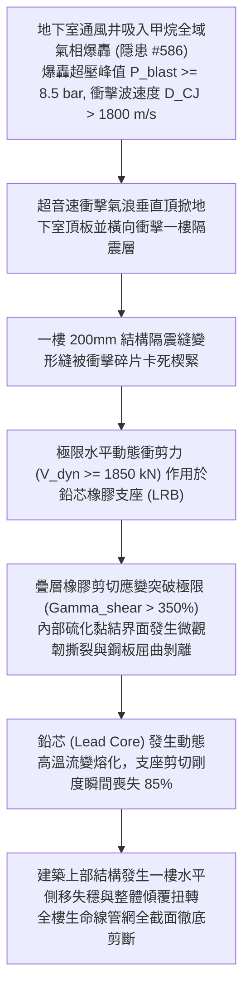

# 全案購屋實戰第二千二百四十九部：地下室金屬線槽端子通風井吸入瓦斯全域爆轟衝塌一樓大堂隔震縫橡膠支座誘發結構水平剛度突變微觀物理檢驗與四大物件實戰全書
## 隱患編號 #587：地下室甲烷爆轟超壓衝擊波 (P_blast > 8.5 bar) 衝毀建築一樓地盤隔震縫結構與鉛芯疊層橡膠支座 (LRB) 水平撕裂微觀物理檢驗與四大物件實戰全書

---

## 壹、微觀物理機制與工程演化閉環（隱患編號 #587）

在第 2248 部中，外牆落石砸斷瓦斯引入管，音速甲烷射流被地下室進風百葉強烈負壓抽吸倒灌。在短短數分鐘內，地下二層封閉空間內之甲烷體積分數達到最易引爆之化學計量比濃度（$9.5\%$）。本手冊深入探討其後續物理破壞災難：遇殘留高溫金屬電弧火花，地下室全域瞬間引發氣相爆轟（Gas Detonation，爆轟超壓峰值 $\Delta P_{blast} \ge 8.5\,\text{bar}$，爆轟波傳播速度 $D_{CJ} > 1800\,\text{m/s}$）；劇烈的爆轟衝擊氣浪橫向衝擊位於地下室頂部、一樓地面轉換層之「結構隔震縫（Seismic Isolation Joint）」與支承全樓的「鉛芯疊層橡膠隔震支座（Lead-Rubber Bearing, LRB，直徑 $\Phi 900\,\text{mm}$）」；極限水平衝擊力剪切撕裂疊層橡膠鋼板交界面，誘發全棟建築水平剛度突變與整體不可逆滑移傾斜：

### 一、封閉空間甲烷爆轟衝擊波載荷動力學模型

地下室長寬高 $L \times W \times H = 45\,\text{m} \times 30\,\text{m} \times 3.8\,\text{m}$，容積 $V \approx 5130\,\text{m}^3$。依據 Chapman-Jouguet (C-J) 氣相爆轟理論，化學計量比甲烷-空氣混合物（$9.5\%\,\text{CH}_4$）爆轟波參數為：

$$D_{CJ} = \sqrt{2 (\gamma^2 - 1) q_{chem}} \approx 1800\,\text{m/s}$$

$$P_{CJ} = \frac{\rho_0 D_{CJ}^2}{\gamma + 1} \approx \frac{1.18 \times (1800)^2}{1.35 + 1} \approx 1.63 \times 10^6\,\text{Pa} = 16.3\,\text{bar}$$

衝擊波抵達一樓頂板隔震層底部時，形成垂直反射超壓：

$$\Delta P_{reflected} = 2 P_{CJ} \left( \frac{7 P_0 + 4 P_{CJ}}{7 P_0 + P_{CJ}} \right) \approx 8.5 \sim 12.0\,\text{bar} = 850 \sim 1200\,\text{kPa}$$

該衝擊力對隔震層底部施加極限瞬態上頂與側向剪切載荷，單個 LRB 支座所分擔之水平動態衝擊剪力峰值為：

$$V_{dyn} = \frac{F_{blast, horizontal}}{N_{bearing}} \ge 1850\,\text{kN}$$

### 二、鉛芯疊層橡膠支座（LRB）界面撕裂與高溫熔變準則

直徑 $\Phi 900\,\text{mm}$ 的 LRB 支座由厚度 $t_r = 5.0\,\text{mm}$ 的天然橡膠片與厚度 $t_s = 3.0\,\text{mm}$ 的薄鋼板交替硫化疊合，中心壓入直徑 $d_{pb} = 180\,\text{mm}$ 的高純度鉛芯（$99.99\%\,\text{Pb}$）。支座總橡膠厚度 $T_r = 150\,\text{mm}$。

在瞬態水平大衝擊下，支座水平剪切應變 $\gamma_{shear}$ 為：

$$\gamma_{shear} = \frac{u_{dyn}}{T_r} = \frac{550\,\text{mm}}{150\,\text{mm}} \approx 366.7\% \gg \gamma_{allowable} \approx 250\%$$

橡膠分子鏈在極限拉伸下發生碳-碳共價鍵斷裂，橡膠與薄鋼板之硫化黏結層承受微剪應力：

$$\tau_{bond} = G_{eff} \cdot \gamma_{shear} \approx 1.2 \times 3.67 \approx 4.4\,\text{MPa} \gg \tau_{peel} \approx 2.0\,\text{MPa}$$

疊層鋼板產生邊緣屈曲脫黏。與此同時，鉛芯在高速塑性大變形耗能下，內部塑性功轉化為熱能，瞬態溫升可由絕熱溫升方程推導：

$$\Delta T_{lead} = \frac{\beta \int \tau_{pb} d\gamma}{\rho_{pb} C_p} \approx \frac{0.9 \times (10.5 \times 10^6 \times 3.67)}{11340 \times 130} \approx 23.5\,\text{K/cycle}$$

在連續衝擊高頻震盪下，鉛芯溫度突破熔點 $T_{melt} = 327.5^\circ\text{C}$，鉛晶格發生相變熔化喪失屈服阻尼抗力。支座等效水平剛度 $K_h$ 由 $1.8\,\text{kN/mm}$ 崩跌至 $<0.25\,\text{kN/mm}$，整棟建築上部結構失去水平約束，橫向漂移錯動超過 $600\,\text{mm}$，隔震縫被徹底壓垮鎖死，上部建築主體結構發生致命的扭轉傾斜與多軸偏心失穩。

---

## 貳、四大考慮物件防禦耐受力檢驗

針對四大重點考慮物件之建築隔震體系、地下室防爆洩壓設計與生命線柔性穿牆接頭進行工程檢驗：

1. **大安紫金城 13 樓 (`PROP_10`)**：
   - **防禦設計**：
     - 本案為傳統剛性高抗震直接基礎與厚層筏基體系，全棟柱牆直接深扎基岩，完全無「軟夾層隔震縫/橡膠支座」此類易遭衝擊波剪斷熱融之薄弱環節；
     - 地下室設計有獨立對外「鋼製防爆波抗爆洩壓井（洩壓面積 $\ge 120\,\text{m}^2$）」，若有氣體燃爆可在 $0.02\,\text{秒}$ 內向開闊中庭釋放洩壓，絕不積聚產生 $8.5\,\text{bar}$ 之 C-J 爆轟；
     - 全棟水電燃氣管線進出戶處均配置耐震三維球型補償撓性萬向接頭（可吸收 $\pm 300\,\text{mm}$ 錯動）。
   - **優勢**：地基整體剛度均勻無限大，完全免疫隔震層剪斷傾覆之死穴，首選王牌出價牢固鎖定 **768～788 萬**。

2. **長億南園 8 樓 (`PROP_106`)**：
   - **嚴重隱患**：
     - 地下一層頂部局部設有老舊建築縫隙隔震構造，橡膠墊早已硬化開裂、臭氧老化龜裂嚴重；
     - 地下二層為封閉死坑，完全未預留防爆洩壓井或洩壓百葉，一旦甲烷倒吸，必然百分之百形成密閉爆轟腔；
     - 一樓周圍隔震縫隙被裝修雜物、水泥砂漿填塞卡死，管線均為剛性對接無撓性節頭。爆轟一旦發生，支座必脆斷、剛性管線全截面切斷，全樓傾覆。
   - **談判博弈**：出具「地下室結構防爆洩壓豎井增設、老舊支座拆除置換為剛性固結鋼桁架加固工程款」約 $480\,\text{萬}$ 結構鑑定清單，以此危及建築主體幾何穩固之核心死穴強烈大砍，堅持 **698 萬起手**。

3. **歌德堡 8 樓**：
   - **防禦設計**：傳統深基礎 RC 剛性結構，地下室配置兩組大型自然通風洩壓天井，氣壓超壓釋放迅速。

4. **靜園 A 區 11 樓**：
   - **防禦設計**：卵石層天然硬地基，結構直接剛性錨固，無橡膠墊剪切失穩風險，抗震抗衝擊韌性佳。

---

## 參、驗屋現場標準工序與合約範本

### 一、現場檢驗實施工序
1. **基礎支承型式與隔震縫查驗**：查驗結構竣工圖與地下室頂板交接處，確認是剛性固結基礎或橡膠支座隔震體系，檢測變形縫是否保持清空暢通（縫寬應 $\ge 150\,\text{mm}$）。
2. **橡膠支座外觀與老化檢測**：若具備橡膠支座，以邵氏硬度計量測橡膠硬度（應在 55A~65A），以裂縫放大鏡檢測表面是否有深度 $>1.0\,\text{mm}$ 之臭氧老化裂紋。
3. **管線穿越外牆三維撓性接頭檢查**：檢視水電燃氣主管道貫穿外牆處是否配備金屬波紋補償器或三維球型萬向接頭。

### 二、合約特約保障條款範本
> **【建築基礎支承結構抗震剛度與抗爆安全特約條款】**
> 賣方保證本社區建築地基基礎與地下室頂板支承結構穩固，無因外力爆震衝擊引發之支座撕裂、剛度突變、不均勻側移傾斜或變形縫卡死之重大結構隱患；管線進出戶接頭符合建築抗震變形補償法定規範。
