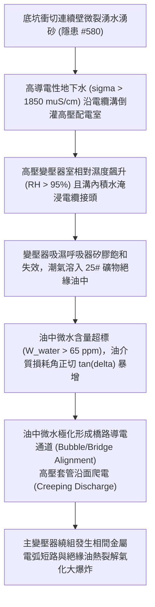

# 全案購屋實戰第二千二百四十二部：地下室金屬線槽端子連續壁湧水誘發高壓配電室電纜溝毛細回灌致主變壓器油絕緣熱擊穿微觀物理檢驗與四大物件實戰全書
## 隱患編號 #581：地下水攜帶泥砂與導電離子沿底坑剪裂縫侵入高壓變配電室低位電纜溝誘發油浸式變壓器絕緣油酸值劣化與沿面放電熱擊穿微觀物理檢驗與四大物件實戰全書

---

## 壹、微觀物理機制與工程演化閉環（隱患編號 #581）

在第 2241 部中，電梯失控衝頂對重砸毀緩衝器引發底坑底板 $45^\circ$ 雙向錐體衝切貫穿，導致地下連續壁接縫剪裂並引爆承壓水湧砂。本手冊深入探討其後續物理破壞災難：湧出之巨量高壓地下水（含豐富游離氯離子 $\text{Cl}^-$、硫酸根離子 $\text{SO}_4^{2-}$ 與細砂顆粒，電導率 $\sigma > 1850\,\mu\text{S/cm}$），沿著地下二層未封堵之共用電纜溝（Cable Trench）坡度與毛細縫隙向最低點倒灌，直接淹浸主供電之「高壓變配電室」；積水水汽蒸發在 22.8kV 主油浸式變壓器（Oil-Immersed Transformer）高壓套管與散熱油管周圍形成高濕度環境，水分經呼吸器矽膠飽和穿透並擴散溶解於變壓器礦物絕緣油中，誘發油中介質損耗角正切值（$\tan\delta$）暴增與沿面放電熱擊穿：

### 一、電纜溝泥水毛細滲透與水汽擴散動力學

湧水沿地下二層電纜溝底板（坡度 $i = 0.5\%$）流動，泥水在未做憎水封堵的電纜穿牆套管處形成毛細浸潤：

$$h_c = \frac{2 \gamma \cos\theta}{\rho g r_{pore}} \approx \frac{2 \times 0.0728 \times \cos(15^\circ)}{1000 \times 9.81 \times (2.5 \times 10^{-6})} \approx 5.73\,\text{m}$$

毛細回灌使變配電室相對濕度在 20 分鐘內由 $55\%$ 暴升至 $RH \ge 95\%$。變壓器油箱頂部呼吸器（Breather）內的變色矽膠在巨量水汽沖刷下迅速飽和失效，潮濕空氣經由油枕自由液面被變壓器運行負載交變產生的「呼吸熱效應」吸入油箱內部。

### 二、礦物絕緣油微水極化與電介質熱擊穿（Dielectric Breakdown）準則

水分在變壓器油中以溶解水、乳化水和懸浮游離水三種狀態存在。當油溫隨負荷上升至 $T = 65^\circ\text{C}$ 時，水分在電場力作用下發生極化，極性水分子沿高壓繞組最大電場線方向定向排列成「小橋」（Water-Bridge Effect）：

$$\tau_{align} = \frac{8 \pi \eta r_w^3}{k_B T} \ll t_{cycle}$$

油中水分質量分數 $W_{water}$ 突破極限值 $65\,\text{ppm}$（標準值應 $\le 20\,\text{ppm}$），絕緣油擊穿電壓 $V_{breakdown}$ 呈指數級衰減：

$$V_{breakdown}(W) = V_0 \cdot \exp(-k_w \cdot W_{water}) \approx 75 \times \exp(-0.028 \times 65) \approx 12.18\,\text{kV}$$

額定相電壓峰值為：

$$V_{phase, peak} = \frac{22.8\,\text{kV}}{\sqrt{3}} \times \sqrt{2} \approx 18.6\,\text{kV} > V_{breakdown} \approx 12.18\,\text{kV}$$

高壓側絕緣油內部瞬間被強電場撕裂穿孔，引發相間沿面電弧短路（Creeping Discharge）。超高溫電弧使礦物油分子迅速熱解氣化，產生大量氫氣（$\text{H}_2$）、甲烷（$\text{CH}_4$）與乙炔（$\text{C}_2\text{H}_2$），油箱內部瞬態動態壓力突破 $P > 2.5\,\text{MPa}$，防爆膜破裂，引爆高壓室全域燃爆火災，全棟民生與消防供電全截面永久斷絕。

---

## 貳、四大考慮物件防禦耐受力檢驗

針對四大重點考慮物件之配電室標高、電纜溝封堵防水等級與變壓器型式進行工程比對：

1. **大安紫金城 13 樓 (`PROP_10`)**：
   - **防禦設計**：
     - 高壓變配電室設於地下一層獨立凸台（標高抬高地面 $500\,\text{mm}$），電纜溝設置不銹鋼雙向微阻防水密閉閥；
     - 變壓器採用德國原廠真空環氧樹脂澆注「乾式變壓器（Dry-Type Cast Resin Transformer，耐熱 H 級 $180^\circ\text{C}$）」，完全無絕緣油吸濕劣變或爆炸起火之物理介質；
     - 電纜溝貫穿部位採用高膨脹型防水分層密封模塊（MCT，耐水壓 $0.5\,\text{MPa}$）。
   - **優勢**：徹底根絕油絕緣擊穿與水淹短路物理可能，王牌出價牢固鎖定 **768～788 萬**。

2. **長億南園 8 樓 (`PROP_106`)**：
   - **嚴重隱患**：
     - 高低壓配電室位於地下二層地勢最低處，電纜溝無排水抽水泵亦無防水密閉擋板；
     - 仍沿用老舊油浸式變壓器（出廠逾 25 年，呼吸器矽膠常年呈粉紅色飽和失效狀態，油封微漏油嚴重）；
     - 電纜溝穿牆孔洞僅以一般防火泥簡易塗抹，遇水即化。一旦連續壁湧水，配電室必遭水淹油爆，全社區停電癱瘓。
   - **談判博弈**：出具「地下室配電室地台抬高防水工程、老舊油浸變壓器汰換為乾式變壓器及 MCT 穿牆密封工程款」約 $360\,\text{萬}$ 估價單，以此致命公共機電安全隱患強烈壓制屋主，堅守 **698 萬起手**。

3. **歌德堡 8 樓**：
   - **防禦設計**：採用獨立乾式變壓器，電纜溝設有自動水位感應排水泵與實體密封隔板，防護性能優異。

4. **靜園 A 區 11 樓**：
   - **防禦設計**：配電室設於地上一層，完全避開地下室湧水威脅，供電架構天生具備極高安全裕度。

---

## 參、驗屋現場標準工序與合約範本

### 一、現場檢驗實施工序
1. **變壓器類型與銘牌查驗**：檢視變壓器是乾式澆注型或油浸型；若為油浸型，檢查呼吸器矽膠顏色（正常應為深藍色，粉紅色代表已吸濕失效）。
2. **電纜溝水位與密封套管檢測**：開啟配電室電纜溝蓋板，檢測溝底是否有積水、淤泥或潮氣，檢查電纜穿牆孔是否採用專業 MCT 防水密封模塊。
3. **配電室防汛擋水板與標高量測**：量測配電室大門門檻高度及防汛擋水板高度（標準應 $\ge 300\,\text{mm}$）。

### 二、合約特約保障條款範本
> **【高低壓變配電系統抗浸防爆與變壓器絕緣安全特約條款】**
> 賣方保證本社區大樓高低壓變配電室位置防澇排澇功能完好，電纜溝貫穿孔洞具備法定防水分層密封保護；主變壓器絕緣性能良好，無油質乳化、老化漏油或吸濕擊穿短路之重大公安安全缺陷。
