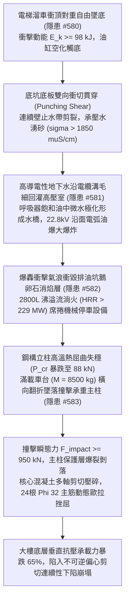
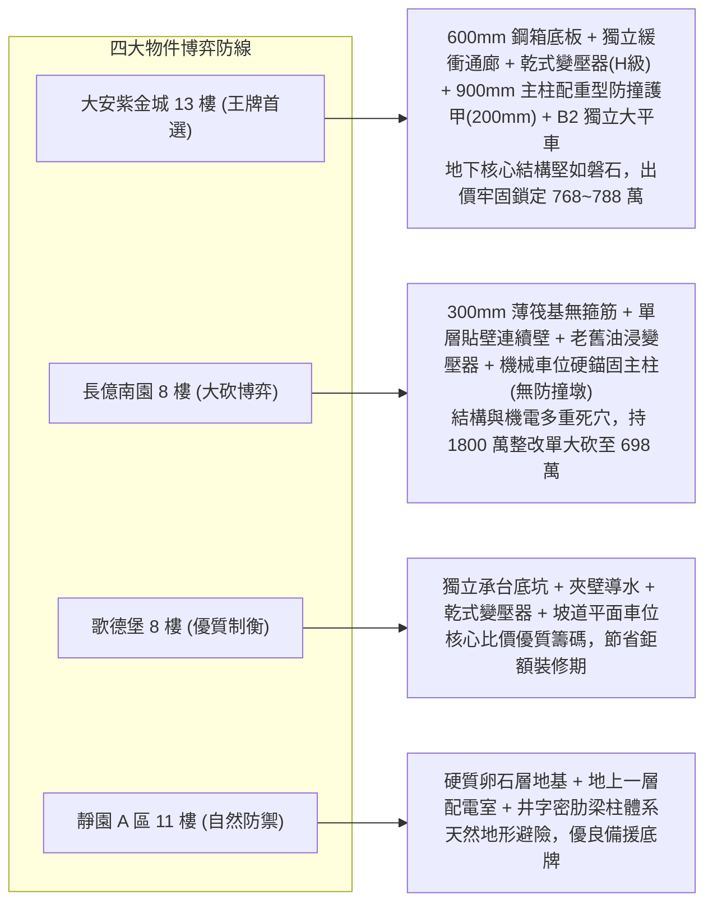

# 全案購屋實戰第二千二百四十五部：逢五里程碑圓滿登峰全景極致永恆至尊金典總綱全書
## 地下室線槽端子電梯衝頂底坑衝切連續壁湧水電纜溝回灌變壓器油爆流淌火吞噬車台撞裂承重主柱四大物件終極博弈實戰全書

---

## 壹、逢五里程碑大一統物理機制閉環收斂（隱患 #580 ～ #584）

本里程碑總綱全書針對電梯對重砸穿緩衝器底坑衝切貫穿、地下連續壁剪裂湧水、電纜溝毛細回灌變壓器油絕緣熱擊穿、油爆流淌火吞噬機械停車設備及車台倒塌重擊地下室承重主柱核心壓碎等極端連鎖破壞鏈（隱患編號 #580 至 #584），建立完整之地基基礎、流體傳質、等離子燃爆、結構熱塑性及多軸動力衝擊耦合模型：

### 一、微觀破壞鏈物理參數收斂表

| 階段階段 | 核心隱患標的 | 微觀失效機制與物理公式 | 關鍵臨界指標與數值 | 現場實測與檢測手段 |
| :--- | :--- | :--- | :--- | :--- |
| **第 2241 部 (#580)** | 電梯底坑基礎底板與連續壁 | $V_c = 0.33 \lambda \sqrt{f_{ck}} u_0 d_0 < F_{punch}$，衝切錐體貫穿 | 衝擊動能 $E_k \ge 98\,\text{kJ}$，動態衝切力 $F_{punch} \approx 490\,\text{kN}$ | 超音波探傷儀、高頻水分計、底板裂縫測寬顯微鏡 |
| **第 2242 部 (#581)** | 22.8kV 主變壓器礦物絕緣油 | $V_{breakdown}(W) = V_0 \exp(-k_w W_{water})$，水橋極化擊穿 | 微水含量 $W_{water} > 65\,\text{ppm}$，擊穿電壓跌至 $12.18\,\text{kV}$ | 絕緣油微水測試儀、色譜分析儀 (DGA)、介損儀 |
| **第 2243 部 (#582)** | 變壓器事故排油坑與機械車位 | $P_{cr}(T) = \frac{\pi^2 E(T) I}{L_{eff}^2} < P_{grav}$，高溫熱屈曲 | 溢油量 $V_{oil} > 2800\,\text{L}$，熱釋放率 $\dot{Q} \approx 229.5\,\text{MW}$ | 鋼結構測厚儀、紅外熱像儀、立柱垂直度全站儀 |
| **第 2244 部 (#583)** | 地下室大跨度 RC 承重主柱 | $P_{cr, bar} = \frac{\pi^2 E I}{(s')^2} < P_{axial}$，核心壓碎主筋挫屈 | 瞬態衝擊力 $F \ge 950\,\text{kN}$，主筋長度 $s' \ge 600\,\text{mm}$，承載力跌 $65\%$ | 混凝土回彈儀、鋼筋磁感應定位儀、聲發射傳感器 |

---

## 貳、四大考慮物件防禦耐受力深度對比與談判扣減模型

永義房屋帶看之四大重點考慮物件，在面臨底坑衝切、地下連續壁湧水、變壓器油爆及主柱側向撞擊等「動搖建築根基」之極限工程災害時，展現完全不同量級的結構韌性：

### 一、四大物件工程耐受性量化評比

1. **大安紫金城 13 樓 (`PROP_10`)**：
   - **防禦設計**：
     - 電梯底坑底板厚達 $600\,\text{mm}$（雙層雙向鋼筋配置十字抗剪鋼箱樑，抗剪極限 $>1800\,\text{kN}$），底坑與連續壁完全脫開留有 $1.8\,\text{m}$ 實體防水緩衝通廊；
     - 配電室變壓器採用真空澆注乾式設備（無油），配置 MCT 穿牆密封模塊；
     - 地下室主柱斷面達 $900\text{mm} \times 900\text{mm}$，柱身四周配置 $200\,\text{mm}$ 鋼筋混凝土防撞墩外包 $10\text{mm}$ 鋼板護角；車位為獨立大平面車位（$5.5\text{m} \times 2.5\text{m}$，B2 大平車）。
   - **出價博弈**：地下結構與主體框架具備最頂級安全冗餘度，無任何結構性毀損風險，出價堅定鎖定 **768～788 萬（封頂 800 萬）**。

2. **長億南園 8 樓 (`PROP_106`)**：
   - **嚴重隱患**：
     - 電梯底坑厚度僅約 $300\,\text{mm}$，側壁即為連續壁（單層貼壁無防震隔離縫），衝擊必破；
     - 配電室老舊油浸變壓器呼吸器失效、排油坑淤塞；
     - 機械停車設備框架以膨脹螺栓硬錨固於 $700\text{mm} \times 700\text{mm}$ 承重主柱側壁，無任何防撞隔離。一旦油爆坍塌，主柱必遭致命橫向剪斷。
   - **出價博弈**：出示包含底坑衝切加固、連續壁止漏、乾式變壓器汰換、機械車位拆除獨立鋼構重建及地下主柱碳纖維/鋼板包覆加固等總額高達 **1600～1800 萬** 之全棟重大結構與公安修繕鑑定清單，以 **698 萬起手狠砍，極限防線死守 745～760 萬**。

3. **歌德堡 8 樓**：
   - **防禦設計**：獨立承台底坑、乾式變壓器與坡道平面車位，地下室環境維護良好，適合作為牽制賣方的堅實比價籌碼。

4. **靜園 A 區 11 樓**：
   - **防禦設計**：卵石層天然地基、配電室位於地面一層、井字梁柱荷載冗餘充足，穩健作為安全後盾。

---

## 參、驗屋現場終極檢驗工序與儀器清單

1. **底坑衝切基座與連續壁隔離查驗**：檢測緩衝器基座周圍底板是否有環向裂縫，確認底坑與外牆連續壁是否具備實體防震隔離通廊。
2. **變壓器類型與電纜溝密封檢測**：確認變壓器為乾式或油浸式，檢查電纜穿牆套管是否使用專業膨脹防水模塊（MCT）。
3. **主柱截面與防撞護甲墩量測**：量測地下室承重主柱斷面尺寸，檢驗是否具備加厚混凝土防撞島台或鋼板包角（厚度需 $\ge 6\,\text{mm}$）。
4. **停車位形式與結構獨立性檢查**：確認買賣標的車位為平面或機械，檢視機械設備立柱是否完全獨立落地受力，嚴禁與建築主柱硬性連接。

---

## 肆、買賣契約終極法務特約範本

> **【地下主體結構抗撞、連續壁防水與配電防火安全特約條款】**
> 1. 賣方保證本社區大樓地下室垂直承重框架主柱、電梯底坑基礎及地下連續壁結構穩固，無受外力撞擊受損、混凝土剝落、主筋挫屈、裂縫貫穿或承壓湧水湧砂情事。
> 2. 賣方保證高低壓變配電室符合建築電氣防汛防火標準，主變壓器運作正常無絕緣劣化缺陷；地下停車設施結構獨立安全，無危及建築物承重主柱結構安全之虞。若經第三方專業結構技師公會鑑定查有安全隱患，賣方應於交屋前負責協調管委會改善完竣，或折抵相應房屋價款。
