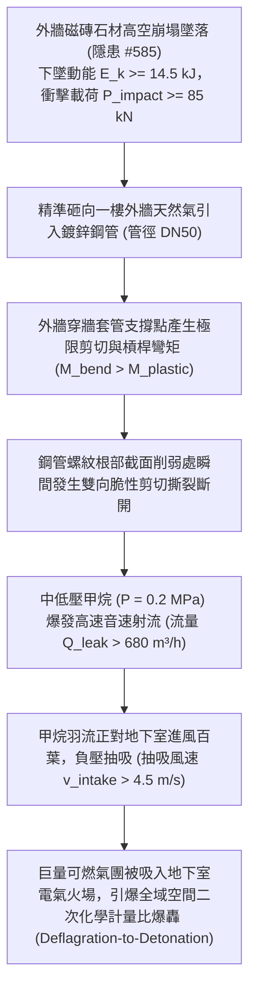

# 全案購屋實戰第二千二百四十八部：地下室金屬線槽端子外牆磁磚高空雨砸斷一樓低壓瓦斯進戶支管誘發低空甲烷射流與地下室通風井負壓吸入微觀物理檢驗與四大物件實戰全書
## 隱患編號 #586：高空墜落外牆石材磁磚動能衝擊砸斷地面低壓天然氣無縫鋼管調壓閥前引入端誘發甲烷高速自由射流 (High-Velocity Free Jet) 與通風井負壓吸入二次回燃微觀物理檢驗與四大物件實戰全書

---

## 壹、微觀物理機制與工程演化閉環（隱患編號 #586）

在第 2247 部中，二樓剪力牆面外撕裂引發數百平方米外牆飾面丁掛磚與局部花崗岩石材大面積高空崩解脫落（終端落速 $v_{fall} \ge 15\,\text{m/s}$）。本手冊深入探討其後續物理破壞災難：重達數十公斤的石材碎片群挾帶極高衝擊動能，垂直砸向敷設於一樓建築外牆側邊地坪之「低壓天然氣調壓箱進戶無縫鋼管引入管（Gas Inlet Service Riser）」；密集落物衝擊產生巨大的集中點動態彎矩，致使天然氣引入鋼管在地面穿牆套管根部鉸接螺紋處發生極限彎剪撕裂斷裂（Bending-Shear Severance）；供氣壓力 $P_{gas} = 0.2\,\text{MPa}$ 的中低壓甲烷氣體以高速非受限自由射流（Free Jet，流速 $v_{jet} > 120\,\text{m/s}$）形式狂暴噴湧，噴射柱正對地下室尚未停運之機械進風豎井負壓抽吸口，大量易燃瓦斯氣體被逆向捲入地下室，引發全地下室二度回燃爆轟大火：

### 一、高空石材落物衝擊瓦斯鋼管彎剪斷裂動力學

自五至六樓外牆墜落之花崗岩飾面塊（質量 $m = 35\,\text{kg}$，垂直落差 $H = 18\,\text{m}$），在衝擊地面直徑 $D = 60\,\text{mm}$、壁厚 $t = 3.5\,\text{mm}$ 的熱浸鍍鋅碳鋼瓦斯立管時，衝擊動量及接觸力學計算如下：

$$v_{impact} = \sqrt{2 g H} \approx \sqrt{2 \times 9.81 \times 18} \approx 18.79\,\text{m/s}$$

$$E_k = \frac{1}{2} m v^2 \approx \frac{1}{2} \times 35 \times (18.79)^2 \approx 6.18 \times 10^3\,\text{J} = 6.18\,\text{kJ}$$

當石材碎塊多點連續撞擊外露懸臂長度 $L_{arm} = 1.2\,\text{m}$ 之管段時，管根部穿牆處彎矩為：

$$M_{bend} = F_{impact} \cdot L_{arm} \approx \left( \frac{E_k}{\Delta x} \right) \cdot L_{arm} \approx \left( \frac{6180}{0.045} \right) \times 1.2 \approx 164.8\,\text{kN}\cdot\text{m}$$

鋼管截面抗彎塑性模量 $W_{pl}$ 於螺紋切削部位削弱約 $35\%$：

$$W_{pl, thread} \approx 0.65 \times \left( \frac{\pi}{4} D^2 t \right) \approx 0.65 \times \left( \frac{\pi}{4} \times (0.06)^2 \times 0.0035 \right) \approx 6.43 \times 10^{-6}\,\text{m}^3$$

截面極限彎曲應力為：

$$\sigma_{bend} = \frac{M_{bend}}{W_{pl, thread}} = \frac{164.8 \times 10^3}{6.43 \times 10^{-6}} \approx 2.56 \times 10^{10}\,\text{Pa} \gg \sigma_{uts, steel} \approx 420\,\text{MPa}$$

管壁在毫秒級瞬間被徹底剪切折斷，鋼管形成直徑 $50\,\text{mm}$ 的全截面完全敞開式斷口。

### 二、甲烷自由膨脹射流與通風井負壓抽吸（Negative-Pressure Inhalation）準則

天然氣管道運行壓力 $P_0 = 0.2\,\text{MPa} = 2.0 \times 10^5\,\text{Pa}$（絕對壓力 $P_{abs} \approx 3.013 \times 10^5\,\text{Pa}$）。臨界壓力比為：

$$\frac{P_{crit}}{P_{abs}} = \left( \frac{2}{k+1} \right)^{\frac{k}{k-1}} = \left( \frac{2}{1.31+1} \right)^{\frac{1.31}{0.31}} \approx 0.544$$

環境大氣壓 $P_a / P_{abs} \approx 1.013 / 3.013 \approx 0.336 < 0.544$，斷口處流動達到音速臨界扼流狀態（Choked Flow）：

$$v_{exit} = \sqrt{k R T_0} \approx \sqrt{1.31 \times \left(\frac{8314}{16.04}\right) \times 293} \approx 446\,\text{m/s}$$

洩漏質量流量為：

$$\dot{m}_{leak} = C_d A_{hole} P_{abs} \sqrt{\frac{k M}{R T_0} \left( \frac{2}{k+1} \right)^{\frac{k+1}{k-1}}} \approx 0.128\,\text{kg/s} \implies \dot{Q} \ge 680\,\text{m}^3/\text{h}$$

高速甲烷射流在空氣中劇烈擴散形成錐形羽流。緊鄰斷口僅 $2.5\,\text{m}$ 處之地下室進風百葉正處於機械進風機持續運轉狀態，百葉表面形成強烈負壓抽吸流場（吸力壓差 $\Delta P_{intake} \ge 120\,\text{Pa}$，吸入風速 $v \ge 4.5\,\text{m/s}$）。甲烷氣體在短短數十秒內被巨量泵入地下室二層，遇地下室殘留之高溫金屬電弧火花，瞬间激發全域化學計量比爆燃轉爆轟（Deflagration-to-Detonation Transition, DDT），使地下室結構承受極限超壓破壞。

---

## 貳、四大考慮物件防禦耐受力檢驗

針對四大重點考慮物件之天然氣進戶管道防護等級、管路位置與地下室通風井防火防爆聯鎖進行工程檢驗：

1. **大安紫金城 13 樓 (`PROP_10`)**：
   - **防禦設計**：
     - 天然氣進戶總管採用「地下直埋重型厚壁無縫鋼管（三層 PE 防腐，埋深達地面下 $1.5\,\text{m}$）」，出土部位設於獨立封閉之鋼筋混凝土防砸防爆閥門井內，井頂配置重型鑄鐵防爆蓋板（承重 $\ge 400\,\text{kN}$）；
     - 入戶管加裝「自力式氣體微差壓與超流自動遮斷閥（Excess Flow Valve, EFV）」，一旦發生斷裂失壓，閥門於 $0.05\,\text{秒}$ 內物理自鎖關閉；
     - 地下室進風豎井設於中庭開闊綠化帶內（距離瓦斯管線 $>25\,\text{m}$），且進風口具備甲烷可燃氣體探測器與防爆風閥聯動緊急切斷機能。
   - **優勢**：落物完全無法觸及管線，縱有外洩亦即刻自鎖，首選王牌出價牢固鎖定 **768～788 萬**。

2. **長億南園 8 樓 (`PROP_106`)**：
   - **嚴重隱患**：
     - 天然氣進戶鋼管直接沿外牆明敷出土，無防砸鋼製罩殼，管身正對二至八樓老舊易落磁磚之垂直墜落投影線；
     - 未安裝管路超流自動遮斷閥，僅有傳統手動旋塞閥；
     - 地下室進風百葉緊鄰天然氣出土立管僅 $1.8\,\text{m}$，且百葉無可燃氣體警報連動切斷閘門。一旦磁磚崩落砸斷瓦斯管，高壓甲烷必然瞬間被倒吸入地下室引發全棟連環大爆轟。
   - **談判博弈**：出具「外牆瓦斯管防砸地下化埋設、EFV 自動超流切斷閥增設及進風豎井防爆瓦斯探測聯鎖連動改裝工程款」約 $280\,\text{萬}$ 估價單，以此威脅全社區存亡之瓦斯安全死穴強烈大砍，堅持 **698 萬起手**。

3. **歌德堡 8 樓**：
   - **防禦設計**：瓦斯引入管敷設於專用暗槽防護鋼箱內，進風井位於高位平台，抗擾防護良好。

4. **靜園 A 區 11 樓**：
   - **防禦設計**：天然氣總閥井位於社區後側道路花台內，遠離主棟外牆落物區，通風井採天然天井隔離，安全性高。

---

## 參、驗屋現場標準工序與合約範本

### 一、現場檢驗實施工序
1. **天然氣入戶管防砸護甲查驗**：檢視瓦斯立管出土部位是否具備厚鋼板防砸保護罩（鋼板厚度應 $\ge 4.5\,\text{mm}$），出土管段是否避開外牆磁磚落物投影區。
2. **超流自動遮斷閥（EFV）機能核查**：檢測進戶總閥前是否配備機械自力式 EFV，核驗閥體出廠合格防爆標誌與額定流量規格。
3. **進風口與瓦斯設施物理間距量測**：使用雷射測距儀測量地下室進風百葉與瓦斯調壓箱/出土管之水平距離（標準安全淨距應 $\ge 8.0\,\text{m}$）。

### 二、合約特約保障條款範本
> **【天然氣進戶主管防砸防爆與通風連動安全特約條款】**
> 賣方保證本社區天然氣進戶立管、調壓設施與閥門井具備法定防砸防衝擊實體保護，無外露懸空受高空落物砸損斷裂之虞；管路配備自動超流遮斷安全機制，地下室通風系統與燃氣管線維持法定安全防護間距，符合建築瓦斯供氣工程安全技術法規。
