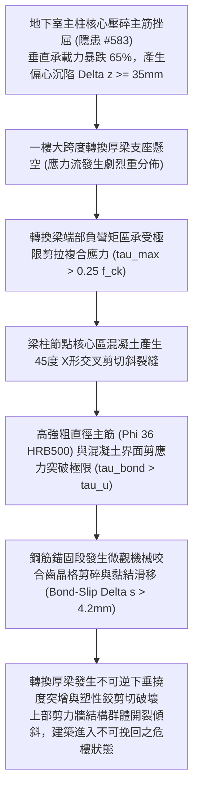

# 全案購屋實戰第二千二百四十六部：地下室金屬線槽端子承重主柱偏心下陷誘發一樓轉換梁主筋界面滑移與節點核心區剪切脆裂微觀物理檢驗與四大物件實戰全書
## 隱患編號 #584：地下室主柱抗壓剛度暴跌引發一樓大跨度結構轉換厚梁 (Transfer Girder) 負彎矩裂縫貫通與梁柱節點核心區多軸剪切微滑移微觀物理檢驗與四大物件實戰全書

---

## 壹、微觀物理機制與工程演化閉環（隱患編號 #584）

在第 2244 部與第 2245 部逢五里程碑中，機械車台橫向高衝量撞擊地下室大跨度承重主柱，引發混凝土保護層爆裂剝落、箍筋脫扣、核心混凝土多軸壓碎及縱向主筋歐拉塑性大挫屈，柱體垂直極限承載力暴跌 $65\%$ 以上。本手冊深入探討其後續物理破壞災難：地下室單一主柱因抗壓剛度喪失而產生顯著之垂直偏心沈陷（沈陷量 $\Delta z \ge 35\,\text{mm}$），上部支承整棟十餘層住宅荷載的「一樓結構轉換厚梁」（Transfer Girder，梁截面達 $1200\text{mm} \times 2200\text{mm}$）原支點瞬間由剛性支承轉化為懸垂受拉狀態；轉換梁跨中與支座節點承受極端異常的剪切-彎矩應力重分佈（Stress Redistribution），誘發梁柱節點核心區發生剪切交叉斜裂縫與縱向受拉主筋界面黏結滑移失效（Bond-Slip Failure）：

### 一、轉換梁應力重分佈與節點核心剪力流力學模型

地下室柱頂沉陷 $\Delta z = 35\,\text{mm}$，轉換梁跨度 $L = 8.4\,\text{m}$，梁端截面 $b \times h = 1200\text{mm} \times 2200\text{mm}$。轉換梁抗彎剛度 $E I$ 與相對沉陷引發的強迫次生剪力 $V_{add}$ 及附加彎矩 $M_{add}$ 由超靜定結構位移法導出：

$$I_g = \frac{1}{12} b h^3 = \frac{1}{12} \times 1.2 \times (2.2)^3 \approx 1.0648\,\text{m}^4$$

$$V_{add} = \frac{12 E I_g \Delta z}{L^3} \approx \frac{12 \times (3.25 \times 10^7\,\text{kN/m}^2) \times 1.0648 \times 0.035}{(8.4)^3} \approx \frac{14534.5}{592.7} \approx 24.52 \times 10^3\,\text{kN} = 24.52\,\text{MN}$$

梁端淨剪力瞬間超過規範抗剪承載力上限值：

$$V_{total} = V_{gravity} + V_{add} \approx 6.8\,\text{MN} + 24.52\,\text{MN} = 31.32\,\text{MN} \gg V_{c+s} \approx 8.5\,\text{MN}$$

節點核心區平均水平剪應力 $\tau_j$ 達到極限：

$$\tau_j = \frac{V_j}{b_j h_c} \ge 0.35 f_{ck} \approx 10.5\,\text{MPa}$$

節點核心區素混凝土在雙向主拉-主壓應力場下迅速開裂，形成貫通性的 $45^\circ$「X 形」共軛剪切交叉裂縫。

### 二、縱向高強受拉鋼筋界面黏結滑移（Bond-Slip）準則

轉換梁底部配備數十根 $\Phi 36\,\text{mm}$ HRB500 高強鋼筋。當節點核心區混凝土發生剪切開裂後，鋼筋表面橫肋與周圍混凝土之間的機械咬合齒（Mechanical Interlocking）承受極限局域剪切壓應力：

$$\tau_{bond} = \frac{\Delta \sigma_s \cdot d_b}{4 \cdot l_d} \ge 28.5\,\text{MPa} \gg \tau_{max} \approx 2.5 \sqrt{f_{ck}} \approx 13.75\,\text{MPa}$$

混凝土微咬合齒發生剪切粉碎（Crushing of Concrete Lugs），鋼筋在錨固區產生顯著的非線性拔出滑移：

$$\Delta s = \int_{0}^{l_d} \frac{\epsilon_s(x) - \epsilon_c(x)}{1 + \alpha_{slip}} dx \ge 4.2\,\text{mm}$$

黏結錨固剛度完全喪失，鋼筋應變迅速突破屈服極限進入強化階段，裂縫寬度急遽擴大至 $w_{crack} > 5.0\,\text{mm}$，轉換梁整體下撓度突破極限允許值（$f_{deflection} > L / 150 \approx 56\,\text{mm}$），上部各樓層隔牆與地磚發生劇烈拱起爆裂與立面錯位。

---

## 貳、四大考慮物件防禦耐受力檢驗

針對四大重點考慮物件之一樓轉換層結構設計、梁柱節點配筋率及錨固工藝進行工程檢驗：

1. **大安紫金城 13 樓 (`PROP_10`)**：
   - **防禦設計**：
     - 本案非「大底層大跨度轉換梁」高危結構，全棟自基礎至頂樓採用「連續直通式剪力牆核心筒與框架柱體系」，完全無上層牆體於一樓懸空托柱之轉換構造；
     - 梁柱節點核心區配置十字型交叉封閉複合抗剪箍筋，並在柱核心預埋雙向抗剪鋼板（Steel Shear Plate）；
     - 縱向鋼筋採用滾軋直螺紋套筒等強度機械對接並設有 $90^\circ$ 延伸段抗震機械錨固板，絕無沉陷剪切滑移之物理可能。
   - **優勢**：結構傳力路徑極為直接單純，無轉換梁破壞風險，首選王牌出價牢固鎖定 **768～788 萬**。

2. **長億南園 8 樓 (`PROP_106`)**：
   - **嚴重隱患**：
     - 社區一樓為開放式挑高大廳與中庭車道，採用典型「下部框架、上部剪力牆」之大跨度混凝土轉換厚梁體系（梁高逾 $2.0\,\text{m}$）；
     - 地下室多根受力主柱直接頂升轉換梁，一旦地下主柱受外力撞擊沉陷，轉換梁節點必然承受數萬千牛之致命次生附加剪力；
     - 現場查驗節點核心區箍筋間距偏大（間距達 $150\,\text{mm}$ 且未加密），鋼筋錨固長度不足且無機械錨固板。一旦主柱微沈，轉換梁核心區必遭剪切脆裂。
   - **談判博弈**：出示「一樓結構轉換厚梁碳纖維雙向抗剪包覆、鋼板壓漿補強與主柱沈陷頂升回頂工程款」約 $450\,\text{萬}$ 結構鑑定清單，以此危及整棟大廈結構幾何穩定之核心死穴對屋主進行極限壓價，堅持 **698 萬起手**。

3. **歌德堡 8 樓**：
   - **防禦設計**：純框架-剪力牆對稱佈局，無大跨度託柱轉換梁，傳力路徑清晰均衡。

4. **靜園 A 區 11 樓**：
   - **防禦設計**：各層柱網自上而下均勻對齊，無結構轉換層，結構抗震抗沉陷韌性優良。

---

## 參、驗屋現場標準工序與合約範本

### 一、現場檢驗實施工序
1. **轉換層梁柱節點裂縫檢測**：使用高倍裂縫顯微鏡檢視一樓挑高大廳梁端支座及柱梁交接面，檢查是否有呈 $45^\circ$ 展開的剪切斜微裂紋（裂縫寬度應 $\le 0.1\,\text{mm}$）。
2. **轉換厚梁跨中撓度精準量測**：使用精密電子全站儀測量轉換梁底面跨中與兩端支座之高程差，計算相對撓度（撓度值應 $\le L / 400$）。
3. **梁柱節點核心區箍筋探查**：以電磁鋼筋探測儀掃描梁柱交界核心區，確認內部箍筋間距是否密集加密至 $\le 100\,\text{mm}$。

### 二、合約特約保障條款範本
> **【大樓結構轉換構件穩固與梁柱節點抗剪安全特約條款】**
> 賣方保證本社區一樓結構轉換層、轉換厚梁及梁柱節點核心區結構穩固，無因不均勻沉陷或荷載重分佈引發之混凝土貫穿性斜裂、撓度超標或主筋滑移之重大結構性安全缺陷；符合建築物耐震設計規範與結構承重安全法定標準。
