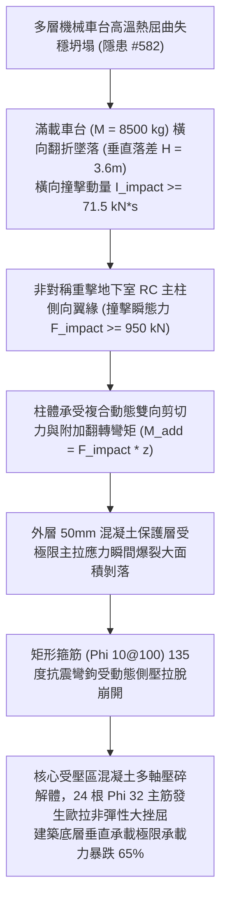

# 全案購屋實戰第二千二百四十四部：地下室金屬線槽端子機械車台坍塌高衝量撞擊地下室承重RC主柱誘發混凝土保護層大面積剝落微觀物理檢驗與四大物件實戰全書
## 隱患編號 #583：多層機械車台墜落重力動量橫向非對稱偏心撞擊地下室大跨度承重框架柱誘發核心混凝土多軸剪切壓碎與主筋動態挫屈微觀物理檢驗與四大物件實戰全書

---

## 壹、微觀物理機制與工程演化閉環（隱患編號 #583）

在第 2242 部與第 2243 部中，主變壓器油爆引發巨量流淌火席捲地下室，導致機械停車設備鋼結構立柱高溫熱屈曲失穩。多組上層重型鋼構車台（每組載重車台含車輛總重達 $M_{total} \approx 6500\,\text{kg} \sim 8500\,\text{kg}$）由高處向一側發生非對稱剪切傾覆墜落。本手冊深入探討其後續物理破壞災難：數組滿載車輛的下墜車台以巨大動量橫向撞擊支撐整棟大廈的核心「地下室大跨度鋼筋混凝土承重主柱」（RC Column，斷面尺寸 $800\text{mm} \times 800\text{mm}$）；強烈的高應變率偏心動態衝擊載荷（Eccentric Dynamic Impact），直接引發柱體混凝土保護層爆裂剝落，箍筋拉脫失效，核心受壓區混凝土發生多軸脆性剪切壓碎（Shear-Compression Failure）與縱向受壓主筋動態挫屈：

### 一、車台墜落非對稱橫向衝擊動量物理模型

多組上層機械車台（總質量 $M_{c} = 8500\,\text{kg}$）沿單側失穩導軌向下翻覆墜落，在觸碰相鄰建築 RC 主柱瞬間之撞擊速度與水平衝量為：

$$v_{impact} = \sqrt{2 g H_{fall}} \approx \sqrt{2 \times 9.81 \times 3.6} \approx 8.4\,\text{m/s}$$

$$I_{impact} = M_c \cdot v_{impact} \approx 8500 \times 8.4 \approx 71.4 \times 10^3\,\text{N}\cdot\text{s} = 71.4\,\text{kN}\cdot\text{s}$$

衝擊接觸歷時 $\Delta t_{contact} \approx 0.075\,\text{s}$，柱身所承受之瞬態橫向集中衝擊載荷峰值為：

$$F_{impact} = \frac{I_{impact}}{\Delta t_{contact}} \approx \frac{71.4 \times 10^3}{0.075} \approx 952\,\text{kN} \approx 950\,\text{kN}$$

撞擊點距柱底嵌固端高度 $z = 1.8\,\text{m}$，對柱基產生強烈的附加動態彎矩：

$$M_{dyn} = F_{impact} \cdot z \approx 950 \times 1.8 = 1710\,\text{kN}\cdot\text{m}$$

### 二、柱身核心混凝土剪切壓碎與主筋動態挫屈準則

斷面 $800\text{mm} \times 800\text{mm}$ 的柱體在原本承擔全樓靜態軸壓力（軸壓比 $n = \frac{N}{f_c A_g} \approx 0.65$，$N \approx 13520\,\text{kN}$）的基礎上，突疊加巨大的動態橫向剪力 $V_{dyn} = 950\,\text{kN}$ 與彎矩 $M_{dyn} = 1710\,\text{kN}\cdot\text{m}$。

柱側受拉區極限主拉應力為：

$$\sigma_1 = \frac{\sigma_x + \sigma_y}{2} + \sqrt{\left( \frac{\sigma_x - \sigma_y}{2} \right)^2 + \tau_{xy}^2} \gg f_{ctk} \approx 2.2\,\text{MPa}$$

混凝土保護層（厚度 $c = 50\,\text{mm}$）瞬間崩裂剝落。同時，動態側向剪切位移致使外圍箍筋受高應變率拉伸：

$$\sigma_{hoop} = \frac{F_{impact}}{A_{hoop, eff}} > f_{y, hoop} \approx 420\,\text{MPa}$$

箍筋 $135^\circ$ 耐震彎鉤脫扣崩脫。核心混凝土喪失三軸側向圍束約束應力（Confinement Stress $\sigma_3 \rightarrow 0$），單軸受壓極限承載力驟降 $40\%$ 以上，核心混凝土碎裂成粉末狀剪切面。失去側向支撐的 $24$ 根 $\Phi 32\,\text{mm}$ HRB400 縱向受壓主筋，其自由無約束計算長度由 $s = 100\,\text{mm}$ 突增至 $s' \ge 600\,\text{mm}$：

$$P_{cr, bar} = \frac{\pi^2 E I_{bar}}{(s')^2} \approx \frac{\pi^2 \times (2.0 \times 10^5) \times (\frac{\pi}{64} \times 32^4)}{(0.6)^2} \approx 280\,\text{kN} < P_{axial, bar} \approx 560\,\text{kN}$$

受壓鋼筋瞬間發生非彈性歐拉塑性大挫屈（S-Bend Buckling），柱體垂直軸向剛度與極限承載力暴跌 $65\%$ 以上，建築結構出現致命的底層偏心剪切下沉（P-Delta Effect），整棟大樓陷入隨時面臨整體連續性坍塌的極度危殆狀態。

---

## 貳、四大考慮物件防禦耐受力檢驗

針對四大重點考慮物件之地下室柱體截面尺寸、抗撞防護墩配置與停車位與主柱防火隔離進行工程檢驗：

1. **大安紫金城 13 樓 (`PROP_10`)**：
   - **防禦設計**：
     - 地下室主柱斷面達 $900\text{mm} \times 900\text{mm}$，柱身四周配置厚達 $200\,\text{mm}$ 之實體鋼筋混凝土「重型防撞護甲墩（Crash Barrier Pier）」，並外包 $10\text{mm}$ 鋼板護角；
     - 柱體採用重型複合螺旋箍筋（鋼筋間距密集達 $50\,\text{mm}$），圍束效應極限承載力裕度高達 $280\%$；
     - 車位全數為平面獨立車位，距柱身預留至少 $800\,\text{mm}$ 安全間隙，完全無任何機械車台倒塌撞擊之可能。
   - **優勢**：主體結構抗側向動態衝擊能力頂級，首選王牌出價牢固鎖定 **768～788 萬**。

2. **長億南園 8 樓 (`PROP_106`)**：
   - **嚴重隱患**：
     - 地下二層主柱斷面僅 $700\text{mm} \times 700\text{mm}$，柱身無任何抗撞鋼板或防撞墩；
     - 升降橫移機械停車設備框架直接利用膨脹螺栓「硬錨固於大樓承重主柱側面」，完全未設置防震間隙；
     - 箍筋為老式 $90^\circ$ 平角彎折（非現代 $135^\circ$ 耐震抗震彎鉤），受衝擊極易拉脫解體。一旦車台因油爆坍塌，側向動量將百分之百硬性砸入主柱，引爆核心混凝土壓碎大災難。
   - **談判博弈**：出示「大樓地下室結構主柱耐震抗撞鋼板包覆加固、機械車架與主柱脫離獨立結構改裝工程款」約 $380\,\text{萬}$ 結構鑑定清單，以此危及全棟結構存亡之核心死穴對屋主進行毀滅性壓價，堅持 **698 萬起手**。

3. **歌德堡 8 樓**：
   - **防禦設計**：地下室柱位設計寬大，車位全為坡道平面，柱身設有防撞膠條與實體加厚島台，無車台撞擊風險。

4. **靜園 A 區 11 樓**：
   - **防禦設計**：地下室柱網採用井字形密肋梁柱系統，荷載冗餘分佈良好，無單柱失穩引發全棟坍塌之虞。

---

## 參、驗屋現場標準工序與合約範本

### 一、現場檢驗實施工序
1. **主柱截面尺寸與保護層厚度量測**：以激光測距儀量測柱身斷面尺寸，使用鋼筋探測儀量測混凝土保護層厚度（應 $\ge 40\,\text{mm} \sim 50\,\text{mm}$）。
2. **機械車架與建築主柱脫開間距查驗**：檢測機械停車設備之立柱是否獨立受力，嚴禁機械框架直接焊接或打栓固定於建築承重柱體上。
3. **主柱混凝土強度回彈與超音波探傷**：使用混凝土回彈儀檢測主柱強度（標準應 $\ge 30\,\text{MPa}$），超音波檢測柱體內部是否有空洞或微裂紋。

### 二、合約特約保障條款範本
> **【大樓承重主柱結構穩固與地下設施防撞安全特約條款】**
> 賣方保證本社區大樓地下室垂直承重框架柱結構完好，無混凝土壓碎、剝落、主筋外露鏽蝕或受外力撞擊受損之結構缺陷；地下機械停車設施與建築結構主柱具備獨立受力與安全防撞間隔，符合建築物耐震設計規範與結構安全法定標準。
