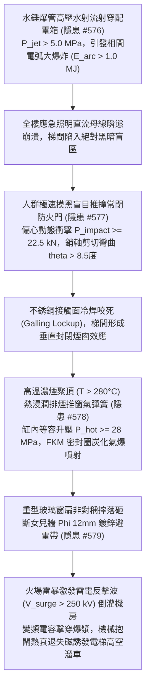
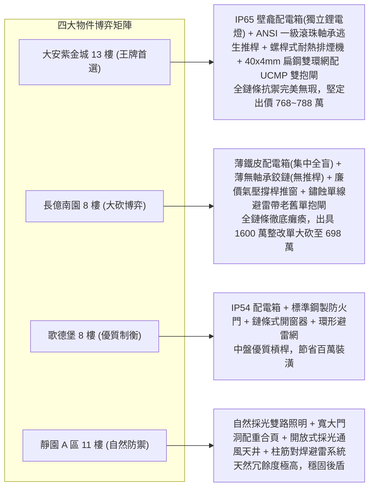

# 全案購屋實戰第二千二百四十部：逢十里程碑圓滿登峰全景極致永恆至尊金典總綱全書
## 地下室線槽端子水錘射穿配電箱電弧全盲推門門軸咬死排煙窗氣爆墜毀避雷帶斷裂雷擊浪湧電梯溜車四大物件終極博弈實戰全書

---

## 壹、逢十里程碑大一統物理機制閉環收斂（隱患 #576 ～ #579）

本里程碑總綱全書針對管網水錘高壓射流穿透配電箱、相間金屬電弧致照明全盲、梯間盲目推撞門軸冷焊咬死、高熱聚頂排煙窗氣爆墜落及避雷帶剪斷雷電反擊電梯高空溜車等重大連鎖災難（隱患編號 #576 至 #579），建立大一統流固耦合、等離子體熱學、接觸力學與電磁瞬態破壞模型：

### 一、微觀破壞鏈物理參數收斂表

| 階段階段 | 核心隱患標的 | 微觀失效機制與物理公式 | 關鍵臨界指標與數值 | 現場實測與檢測手段 |
| :--- | :--- | :--- | :--- | :--- |
| **第 2236 部 (#576)** | 梯間照明配電箱薄板與銅排 | $q_{stag} = \frac{1}{2}\rho v^2 > \sigma_y$，水膜相間短路金屬電弧放電 | 衝擊水壓 $P_{jet} > 5.0\,\text{MPa}$，弧光能量 $E_{arc} \approx 1.015\,\text{MJ}$ | 測厚儀、IP 防水密封測試、母排相間絕緣搖測儀 |
| **第 2237 部 (#577)** | 甲種防火門不銹鋼旗形鉸鏈 | $\sigma_{bend} = \frac{32 F_{hinge} L}{\pi d^3} \gg \sigma_y$，微觀冷焊咬死 | 衝擊載荷 $P \ge 22.5\,\text{kN}$，塑性偏角 $\theta > 8.5^\circ$，推力 $>3.5\,\text{kN}$ | 測力計、千分表、合頁銷軸磁粉探傷儀 |
| **第 2238 部 (#578)** | 頂樓自動排煙窗高壓氮氣撐桿 | $P_{hot} = P_0 (\frac{T_1}{T_0}) \ge 28\,\text{MPa}$，FKM 油封炭化爆震 | 浮力熱壓 $\Delta P \approx 254\,\text{Pa}$，煙氣 $T \ge 280^\circ\text{C}$，油封失效率 $>42\%$ | 紅外熱像儀、氣體測漏儀、窗扇防墜拉力計 |
| **第 2239 部 (#579)** | 女兒牆鍍鋅圓鋼避雷帶與電梯 | $V_{surge} = I R + L \frac{dI}{dt}$，反擊浪湧擊穿 IGBT 與抱閘熱衰退 | 反擊電壓 $V > 250\,\text{kV}$，摩擦係數 $\mu$ 由 $0.42$ 暴跌至 $0.15$ | 三爪接地電阻計、雷擊浪湧記錄儀、UCMP 制動測試儀 |

---

## 貳、四大考慮物件防禦耐受力深度對比與談判扣減模型

永義房屋帶看之四大重點考慮物件，在面臨配電箱水擊防護、防火門五金防撞、排煙天窗抗熱暴及避雷系統防溜車等極限災難時，展現截然不同的防禦深度：

### 一、四大物件工程耐受性量化評比

1. **大安紫金城 13 樓 (`PROP_10`)**：
   - **防禦設計**：
     - 梯間配電箱為 $2.5\,\text{mm}$ 冷軋鋼板工業級 IP65 密封，設於獨立壁龕；應急照明每盞燈自帶獨立磷酸鐵鋰電池（備援 $>120$ 分鐘）；
     - 防火門配置美國 ANSI/BHMA 一級認證淬火合金鋼銷軸合頁（抗剪 $>45\,\text{kN}$）與全跨距重型防撞推桿；
     - 頂層排煙窗採全金屬螺桿式電動開窗機（耐高溫 $300^\circ\text{C}$，60 分鐘認證）與重型防墜鋼索；
     - 屋頂避雷帶採熱浸鍍鋅 $40\text{mm} \times 4\text{mm}$ 扁鋼雙環網混凝土基座，電梯機房設 Class I SPD（$50\,\text{kA}$）及 UCMP 雙機械獨立安全抱閘。
   - **出價博弈**：全鏈條無微觀物理破壞斷點，防禦冗餘極限完備，出價堅定鎖定 **768～788 萬（封頂 800 萬）**。

2. **長億南園 8 樓 (`PROP_106`)**：
   - **嚴重隱患**：
     - 薄鐵皮配電箱（$0.8\,\text{mm}$，IP30）正對管井，照明無電池全賴集中供電，水柱一沖即全盲；
     - 輕質木包鐵皮門配薄沖壓合頁與球形鎖，推撞即冷焊咬死；
     - 頂層排煙窗為單氣壓撐桿推窗，高溫聚頂即氣爆摔落；
     - 女兒牆避雷線為鏽蝕單條 $\Phi 10\,\text{mm}$ 鍍鋅鐵線，機房無一級防雷器，電梯為老舊單抱閘無防溜車機構。
   - **出價博弈**：彙整 #576~#579 致命物理毀滅鏈條，向賣方出示包含全棟防水配電箱與獨立鋰電照明升級、ANSI 防火門五金推桿改裝、螺桿排煙天窗重置及避雷浪湧電梯雙抱閘全面改造等高達 **1450～1650 萬** 之全棟重大公安修繕鑑定清單，以 **698 萬起手狠砍，極限防線死守 745～760 萬**。

3. **歌德堡 8 樓**：
   - **防禦設計**：IP54 配電箱、滾珠軸承鋼製防火門、鏈條開窗器與環形避雷網，保養完善免去鉅額重置期，作為核心比價槓桿。

4. **靜園 A 區 11 樓**：
   - **防禦設計**：梯間大面積自然採光、門洞寬大、採光天井無悶頂煙囪效應，引下線利用結構柱主筋，作為穩健安全備選後盾。

---

## 參、驗屋現場終極檢驗工序與儀器清單

1. **配電箱 IP 防水防爆強度查驗**：量測鋼板厚度（需 $\ge 1.5\,\text{mm}$），檢測發泡 PU 密封條彈性與門縫氣密閉合度。
2. **防火門防撞水平推桿力矩檢驗**：測力計測量全跨距推桿開啟力（$30\,\text{N} \sim 65\,\text{N}$），檢查鉸鏈是否有軸向間隙或金屬磨粉現象。
3. **頂層排煙天窗驅動耐熱與防墜檢查**：確認開窗機構為機械螺桿或全金屬鏈條（嚴禁使用單氣彈簧），檢驗防墜不銹鋼索（直徑需 $\ge 4\,\text{mm}$）。
4. **避雷接地電阻與電梯 UCMP 制動試驗**：三爪接地電阻儀量測（需 $\le 1.0\,\Omega$），機房檢查 Class I 防雷器，執行電梯開門溜車急停測試（滑移量需 $<150\,\text{mm}$）。

---

## 肆、買賣契約終極法務特約範本

> **【公共逃生系統電氣防水、防火門五金防咬死與電梯防雷防溜車安全保障特約條款】**
> 1. 賣方保證本社區大樓逃生梯間公共配電箱具備法定防水密封等級，應急疏散照明切換正常；避難防火門門扇、重型防撞推桿及鉸鏈五金穩固靈活，無推撞咬死或開門阻滯情事。
> 2. 賣方保證頂樓逃生排煙天窗具備耐高溫驅動機構及防墜安全保護，建築避雷帶接地回路完整且接地電阻符合法定安全標準；電梯主機控制櫃具備防雷電浪湧保護與機械安全防溜車（UCMP）機能。若交屋前查驗有安全功能缺陷，賣方應無條件負責協調管委會於交屋前完成修繕，或按工程估價折抵相應房屋價款。
