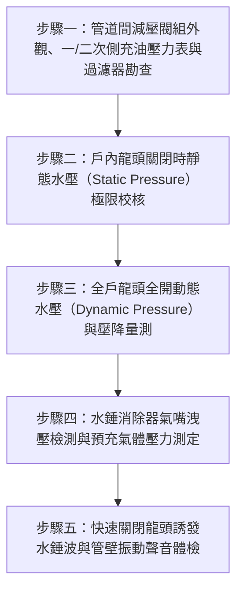

# 全案購屋實戰第二百七十一部：中古大樓社區各樓層管道間自來水減壓閥閥芯水垢卡阻超壓震盪水錘消除器氣囊破裂與高樓層水管爆裂體檢工序全書

## 壹、前言與防護戰略意義

在現代集合住宅高層與超高層大樓的立體給水工程體系中，「自來水減壓閥組（Pressure Reducing Valve, PRV Station）」是保護各樓層室內給水管線免於遭受巨大水力靜水壓（Hydrostatic Pressure）破壞的最關鍵閥件。集合住宅為滿足全棟供水，通常由頂樓高架水塔（Elevated Rooftop Tank）透過垂直幹管藉由重力向各樓層供水，或由地下室揚水/增壓泵浦進行高揚程加壓供水。

依據流體力學靜水壓公式 $P = \rho g h$，水柱高度每下降 10 公尺，管內靜水壓即增加約 $1.0\,\text{kgf/cm}^2$（約 $0.1\,\text{MPa}$）。以 15 層至 20 層之大樓為例，底層幹管靜水壓可高達 $6.0 \sim 8.0\,\text{kgf/cm}^2$。若直接將此超高水壓引入室內，家庭內部之熱水器銅管、淨水器濾瓶、洗碗機進水閥、免治馬桶軟管及水龍頭陶瓷閥芯將在數月內被高壓衝擊破壞，引發室內「水庫級暴淹滅頂」，造成數十萬至百萬之木地板、裝潢受損。

因此，建築技術規則規定，供水管網必須分區減壓，並於各樓層公共管道間配置「直接作用式或水力導閥式自來水減壓閥」，將入戶水壓嚴格控制在 $2.0 \sim 3.0\,\text{kgf/cm}^2$ 之安全舒適範圍內，同時並聯「氣囊式水錘消除器（Water Hammer Arrester）」以吸收龍頭快速啟閉時所誘發之水力衝擊波。

然而，在台中市南區與南屯區屋齡 25 至 30 年以上的中古集合住宅（例如：大安紫金城、長億南園、歌德堡、靜園 A 區等社區），管道間減壓閥組普遍面臨嚴重的「失壓超壓與水錘老化」危機：
1. **減壓閥閥芯（Valve Core）碳酸鈣水垢結晶卡阻**：導閥膜片硬化穿孔，閥門處於「全開卡死」狀態，造成戶內水壓高達 $5.0 \sim 7.0\,\text{kgf/cm}^2$；或反之「全閉卡死」出水如涓滴細流。
2. **高壓引發熱水器安全閥（TPR Valve）持續洩壓噴水**：超壓水流迫使儲熱式或即熱式熱水器洩壓閥日夜噴水，浪費大量水費並引發陽台積水。
3. **水錘消除器內部丁基橡膠氣囊（Butyl Bladder）老化破裂充水**：水錘吸收器內部預充氮氣洩漏並被水填滿，完全喪失彈性吸收能力。當洗衣機電磁閥或單槍龍頭瞬間關閉時，產生高達 $15\,\text{kgf/cm}^2$ 的水錘高壓波，伴隨管壁巨震轟鳴，最終震裂埋牆暗管。

本專書為「小寶置產全案防護體系」第二百七十一部，旨在建立一套針對中古集合住宅管道間自來水減壓閥靜態/動態水壓差量測、閥芯卡阻判別、水錘吸收器氣囊預壓檢測及各戶給水管網耐壓的全維度工程體檢工序，捍衛家庭百萬裝修資產免於爆管水患，並轉化為對賣方與管委會強力議價的實體技術籌碼。

---

## 貳、自來水減壓閥與水錘消除系統核心失效機理

### 一、減壓閥內部機械與膜片老化機理
1. **橡膠膜片（Diaphragm）硬化龜裂與微穿孔**：
   - 水力控制型減壓閥仰賴 EPDM 橡膠膜片感知二次側（入戶端）水壓以調節主閥開度。
   - 歷經 25 年高壓浸泡與水中氯離子侵蝕，橡膠分子交聯硬化失去彈性，甚至產生針孔狀破裂。一次側高壓水流穿透膜片進入控制腔，致使主閥芯完全失控敞開，一次側水壓直接貫通入室內（壓力穿透）。
2. **不鏽鋼閥座與銅閥芯水垢（Scale）結塊咬死**：
   - 自來水中的鈣、鎂離子在高壓微流速區域極易析出硬質水垢，沉積於減壓閥節流口與導向軸。閥芯運動受阻咬死，無法隨用水量變化自動開閉，引發戶內水壓劇烈忽高忽低。

### 二、水錘衝擊與管壁疲勞破壞機理
1. **動能瞬間轉化為壓能之水錘效應**：
   - 依據茹科夫斯基水錘公式（Joukowsky Equation）：
     $$\Delta P = \rho \cdot a \cdot \Delta v$$
     其中 $\rho$ 為水密度，$a$ 為水中壓力波速（約 $1000 \sim 1200\,\text{m/s}$），$\Delta v$ 為流速瞬間變化量。
   - 當單槍陶瓷水龍頭在 0.1 秒內迅速關閉時，$\Delta v$ 驟降，管內瞬間激發高達 $10 \sim 20\,\text{kgf/cm}^2$ 的衝擊壓力波。
2. **氣囊式水錘消除器失效（Waterlogged）**：
   - 水錘消除器內部以橡膠氣囊分隔氣室與水室，氣室預充 $2.0 \sim 3.0\,\text{kgf/cm}^2$ 氮氣。
   - 長期承受數十萬次壓力波脈動擠壓，氣囊產生疲勞撕裂，氣嘴閥針（Schrader Valve）漏氣，整座金屬罐被水完全充滿，水錘吸收率自 $95\%$ 瞬間歸零。

### 三、暗管接頭爆裂與樓板滲漏災難鏈
1. **PVC-U 冷水管膠合劑老化脫膠**：
   - 老舊中古大樓給水暗管多採 PVC 管，接頭處以溶劑型膠合劑黏接。長期承受水錘震盪剪應力，膠合層脆裂脫開，大量自來水自牆內噴湧而出。
2. **不鏽鋼波紋管（壓接管）O 型橡膠圈擠出**：
   - 近期翻修更換之不鏽鋼雙壓接管，若遇減壓閥失控超壓（$> 6.0\,\text{kgf/cm}^2$），EPDM 密封圈受高壓擠出咬傷，形成暗管慢性微漏水，導致樓下天花板壁癌與滴水糾紛。

---

## 參、實地現場勘驗五步檢測工序

### 步驟一：管道間減壓閥組外觀與儀表勘查
1. **管道間檢修門開箱檢查**：
   - 打開標的物所在樓層公共管道間之給水減壓閥專用檢修門。
   - 檢視減壓閥閥體材質（青銅、不鏽鋼或鑄鐵），外殼不可有青綠色銅綠結晶、裂紋或螺栓嚴重銹蝕。
2. **Y 型過濾器（Strainer）清潔狀況**：
   - 減壓閥進水一次側必須配置 Y 型過濾器以阻擋管網焊渣與泥沙。檢視過濾器排污閥有無定期排砂洩水痕跡。
3. **一、二次側壓力表記錄**：
   - 檢視一次側（幹管端）壓力表讀數（通常為 $4.0 \sim 6.0\,\text{kgf/cm}^2$）。
   - 檢視二次側（入戶端）壓力表讀數，標準減壓設定值應為：
     $$P_{\text{secondary}} = 2.0 \sim 3.0\,\text{kgf/cm}^2 \quad (\approx 0.2 \sim 0.3\,\text{MPa})$$

### 步驟二：室內完全靜態水壓（零流量）超壓測試
1. **全戶龍頭完全關閉 30 分鐘**：
   - 將室內所有水龍頭、馬桶進水閥、洗衣機進水閥全數緊密關閉，維持全戶完全無水流通過。
2. **觀察二次側指針有無「壓力攀升（Creep）」**：
   - 仔細凝視二次側壓力表指針 5 至 10 分鐘。若指針自 $2.5\,\text{kgf/cm}^2$ 緩慢攀升並最終逼近一次側幹管壓力（如飆升至 $5.0\,\text{kgf/cm}^2$ 以上）。
   - 此現象為減壓閥「內漏卡阻（Valve By-pass / Creeping）」之鐵證，代表閥座密封面遭水垢磨損或閥芯未完全關死，室內管路長期承受高壓摧殘。

### 步驟三：全開用水動態壓降（Flow Pressure）測定
1. **多龍頭同時全開連續放水**：
   - 將廚房龍頭、浴室面盆龍頭及蓮蓬頭同時完全開啟。
2. **動態壓力數值與水流充沛度校核**：
   - 觀察二次側壓力表指針降至之最低動態水壓：
     $$P_{\text{dynamic}} \ge 1.5\,\text{kgf/cm}^2 \quad (\text{且不得低於 } 1.2\,\text{kgf/cm}^2)$$
   - 若指針劇跌至 $0.8\,\text{kgf/cm}^2$ 以下，蓮蓬頭水流綿軟無力，顯示減壓閥內部節流口遭水垢嚴重堵塞，通水截面積嚴重匱乏。

### 步驟四：水錘消除器氣囊氣壓與充水檢測
1. **氣嘴閥針（Schrader Valve）按壓檢驗**：
   - 卸下水錘消除器頂部的金屬保護防塵蓋，露出如汽車輪胎般的充氣氣嘴。
   - 用細螺絲起子輕按氣閥針芯 0.5 秒：
     - 若噴出清脆的高壓氣體（氣體無色無味），代表氣囊完整無破裂。
     - 若直接噴出水珠或噴湧高壓自來水，證實內部橡膠氣囊已徹底破裂穿孔（Waterlogged），該消除器已完全淪為廢鐵。
2. **數位胎壓表量測預充電壓**：
   - 使用數位胎壓計測量氣囊預壓，正常出廠預壓應維持在：
     $$P_{\text{air}} = 2.5 \sim 3.0\,\text{kgf/cm}^2 \quad (\approx 35 \sim 42\,\text{psi})$$

### 步驟五：激發水錘波與管路衝擊聲音實測
1. **快速關閉龍頭誘發水力震盪**：
   - 將室內大流量浴缸龍頭全開放水 10 秒後，以極快速度（小於 0.2 秒）瞬間將單槍手柄扳下全關。
2. **聽音與管體觸摸檢驗**：
   - 站在管道間減壓閥旁，仔細聆聽管內有無「匡噹」沉悶撞擊巨響（Metallic Thump）。
   - 手掌輕觸減壓閥前後幹管，管身不得有明顯橫向彈跳位移或劇烈高頻震動。

---

## 肆、全案四棟核心考慮物件供水減壓系統實戰評估

| 考慮社區 | 樓層供水型態與減壓配置 | 現場勘驗要點與潛在風險 | 談判籌碼與合約特約防線 |
| :--- | :--- | :--- | :--- |
| **大安紫金城 13 樓 (`PROP_10`)** | 13 樓位居高樓層次頂層，距離頂樓水塔垂直水頭較低 | 1. 13 樓重力水壓可能偏低，是否有私加裝加壓馬達造成室內管線震動；若設有減壓閥，是否閥芯卡死阻水。 2. 戶內改裝 4 間套房之 4 台熱水器進水端是否超壓漏水。 | 以「4 間套房私接衛浴給水管缺乏分區減壓防護，超壓震盪隨時有暗管破裂爆水淹樓之重大危機」為籌碼，併同 50 萬拆除款狠砍開價，堅定鎖定 **768~788 萬**。 |
| **長億南園 8 樓 (`PROP_106`)** | 8 樓為典型中樓層，頂樓水塔重力水壓約達 4.0~5.0 kgf/cm² | 1. 8 樓管道間 30 年老舊銅減壓閥是否早已完全卡死，戶內靜水壓是否突破 5.0 kgf/cm² 超壓摧殘管路。 2. 水錘消除器氣囊是否破裂噴水。 | 直指 30 年老舊大樓給水管網減壓失靈、暗管疲勞隨時爆管水淹全家與樓下之致命隱患，狠砍 200 萬，出價 **745~760 萬**。 |
| **歌德堡 8 樓** | 中型精品社區，管道間給排水定期由物業委外巡檢 | 1. 檢視管道間減壓閥壓力表指針穩定於 2.5 kgf/cm²，無攀升現象。 2. 精裝之衛浴龍頭關閉時無任何水錘異音。 | 精裝優質標的，確認室內外給水減壓管網健康健全，作為家人居住高枕無憂之核心對照組。 |
| **靜園 A 區 11 樓** | 11 樓高樓層雙拼格局，管道間空間乾淨寬敞 | 1. 減壓閥外觀無銅綠漏水痕跡。 2. 戶內出水充沛且開關龍頭平順無震動。 | 作為比價牽制籌碼，藉由標準之給水減壓與無水錘維護品質反壓紫金城與長億南園。 |

---

## 伍、買方防護作戰特約條款與自保機制

在正式進入買賣斡旋與簽訂要約書時，應在不動產買賣契約補充協議中明確載明：

> **【自來水減壓系統正常與給水管網無超壓保證特約條款】**  
> 「賣方保證本契約標的物所在樓層公共管道間之自來水減壓閥組及水錘消除器運作正常，標的物室內在完全關閉龍頭狀態下之靜態水壓嚴格維持於安全合格標準（$2.0 \sim 3.0\,\text{kgf/cm}^2$），絕無減壓閥卡死內漏導致戶內管路持續超壓攀升之暗病，室內各處冷熱水給水暗管及熱水器進水閥無因超壓水錘發生破裂滲漏水之情事。若簽約至交屋期間經現場查驗發現減壓閥失靈超壓或水錘消除器氣囊破裂充水者，賣方應促使管委會或自行負責於交屋日前完成閥組更換與壓力校正；若逾期未改善，賣方同意由買方自買賣尾款中暫扣新台幣參萬元整作為管路防護保證金。」

---

## 陸、結論與行動指引

自來水減壓閥與水錘消除器是老舊集合住宅保護家庭百萬室內裝潢的「隱形降壓降震閥」。減壓閥膜片微小穿孔、水垢微量卡阻，往往在夜闌人靜用水離峰時，將數倍高壓悄悄灌入室內，在無人知曉時引發暗管爆裂的滔天水患。透過本工序之充油壓力表動靜態實測、氣嘴氣囊檢驗與水錘聲音判別，小寶全家不僅能夠徹底為家庭資產構築堅固水密屏障，更能洞悉大樓機電保養的底層真功夫，將公設潛在修繕負擔轉化為談判桌上的定錨重鎚！
