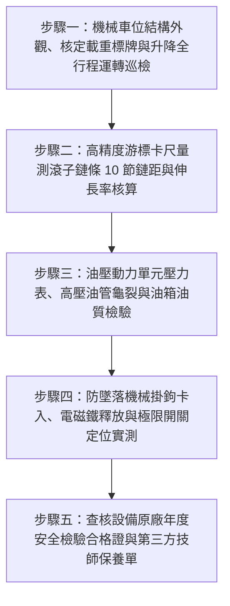

# 全案購屋實戰第二百七十七部：中古大樓社區地下室機械停車設備滾子鏈條伸長疲勞油壓防爆閥卡塞與微動極限開關失調體檢工序全書

## 壹、前言與防護戰略意義

在現代集合住宅高層建築的地下停車空間配置中，「機械式停車設備（Mechanical Parking Systems）」是建商為滿足法定停車位數量（獎勵容積與建蔽率）而廣泛採用的高密度停車手段。常見型態包括二層至三層「升降橫移式（Puzzle Parking）」與「坑道式升降昇降機（Pit-Type Stacker）」。此類設備仰賴三相感應馬達、高壓油壓動力單元（Hydraulic Power Unit, HPU）、多排精密滾子鏈條（Roller Chains）、油壓升降油缸（Hydraulic Cylinders），以及配置於各極限位置的「安全微動開關（Limit Switches）」維持日常運作。

機械車位承載著家庭數百萬之愛車與人員上下車之生命安全，其設計荷重通常僅標定為 $1600 \sim 2000\,\text{kgf}$。然而，在台中市南區與南屯區屋齡 25 至 30 年以上的中古集合住宅（例如：長億南園、大安紫金城周邊同級社區等），機械停車設備歷經數十年高強度碾壓與地下室潮濕環境侵蝕，普遍陷入嚴重的「結構金屬疲勞與崩塌隱患」：
1. **多排滾子傳動鏈條伸長變形超過極限（$> 2.5\% \sim 3\%$）**：鏈條節距（Pitch）因磨損拉長，在鏈輪（Sprocket）齒頂產生劇烈跳齒與啃齒，隨時有整條鏈條斷裂、車台連車帶人自數米高空直接「斷索墜底粉碎」之恐怖危機。
2. **油壓缸底部「防爆破裂安全閥（Hose Burst Valve / Velocity Fuse）」卡阻失靈**：當高壓液壓油管因老化爆裂失壓時，防爆閥若遭油泥雜質卡死無法瞬間閉鎖截斷油路，車台將在 0.5 秒內自由落體墜毀。
3. **上升/下降極限微動開關與防夾安全感知器接點氧化走位**：車台升降超越安全行程，導致車頂直接撞向天花板混凝土大樑或擠壓底坑設備，引發整台機械骨架扭曲報廢。

本專書為「小寶置產全案防護體系」第二百七十七部，旨在建立一套針對中古集合住宅機械停車設備鏈條伸長率卡尺測量、油壓防爆閥動態截斷響應、極限微動開關定位精度及鋼構鏽蝕疲勞的全維度工程體檢工序，捍衛家庭資產與乘員生命安全，並轉化為對賣方與管委會強力議價的實體技術鐵證。

---

## 貳、機械停車設備核心失效機理與災難路徑

### 一、滾子鏈條節距磨損拉長與斷裂機理
1. **鏈銷（Pin）與套筒（Bush）邊界潤滑乾涸**：
   - 機械車位鏈條多採重型 ANSI 80 或 100 號雙排/三排滾子鏈條。鏈條承受車台與車輛之重力交變剪應力。
   - 地下室粉塵與水氣滲入鏈條關節，專用高黏度潤滑油硬化脫落，銷軸與套筒處於乾磨狀態，內孔擴大磨損，導致「表觀伸長（Apparent Elongation）」。
2. **伸長率超標引發之「跳齒與剪斷」災難**：
   - 依據機械傳動安全標準，滾子鏈條伸長率臨界極限為：
     $$\Delta L / L_0 \le 2.0\% \sim 2.5\%$$
   - 當伸長率超過 $3\%$ 時，鏈條節距無法吻合鏈輪齒距，鏈條被頂推至齒頂（Tip-Riding），在重載提升瞬間產生劇烈單側衝擊，引發鏈板（Link Plates）沿銷孔撕裂性瞬斷，車台單邊傾覆墜落。

### 二、油壓動力單元與破裂防爆閥失效機理
1. **油壓軟管（Hydraulic Hoses）脈動疲勞老化**：
   - 高壓橡膠軟管承受 $140 \sim 210\,\text{kgf/cm}^2$（$14 \sim 21\,\text{MPa}$）的脈動壓力。25 年老舊軟管內部鋼絲編織層生鏽脆斷，外層橡膠鼓包龜裂，隨時可能發生爆管失壓。
2. **防爆破裂閥（Velocity Fuse）閥芯積垢黏死**：
   - 螺紋直接旋入油缸油口之防爆閥，設計原理是當油管爆裂流速驟增超過設定值（如 $1.5 \times$ 額定流速）時，藉由差壓推動閥芯瞬間關閉截斷油流。
   - 老舊油壓系統內部之油泥、金屬磨屑與氧化油膠，使防爆閥內部滑閥（Spool）死死黏結卡阻，爆管時完全無法閉合，油缸液壓油於數秒內全數噴空。

### 三、微動極限開關與機械防墜落落鎖機構卡死
1. **機械式防墜落安全掛鉤（Mechanical Safety Pawls）卡滯**：
   - 車台上升就位後，防墜落電磁鐵釋放，機械掛鉤必須在重力或彈簧作用下精準卡入立柱支撐孔，將負載自鏈條/油壓缸轉移至結構鋼柱。
   - 長期受油污與灰塵包覆，掛鉤卡死在收起狀態，車台常年處於「無機械防墜保護」之危險吊掛狀態。
2. **超程極限開關（Overtravel Limit Switch）受潮短路**：
   - 上下極限微動開關滾輪手臂變形或內部接點黏連，致使馬達在到頂後持續強行拉扯，扯斷立柱螺栓。

---

## 參、實地現場勘驗五步檢測工序

### 步驟一：車台結構、載重標示與動態試車
1. **銘牌載重規格與車輛尺寸核對**：
   - 檢視車台柱面張貼之「中華民國立體停車設備協會」或政府核發之安全檢查合格證。
   - 核實標示之最大容許尺寸：長、寬、高（通常限高 $150 \sim 155\,\text{cm}$）與最大載重（通常僅 $1600\,\text{kgf}$）。
   - 實地比對現代主流純電休旅車（重量普遍達 $2000 \sim 2400\,\text{kgf}$），確認本車位是否具有「結構性停不下」之致命缺陷。
2. **空載與重載全行程運轉測試**：
   - 操作按鈕進行完整上升、下降、橫移循環。
   - 觀察運轉全程是否平穩，立柱與橫樑有無扭曲變形、有無刺耳金屬摩擦劇烈異音。

### 步驟二：滾子鏈條節距伸長率精密測量
1. **游標卡尺跨節距量測法（Pitch Measurement）**：
   - 將車台停於檢修位置，截取受力最均勻之 10 節（10 Pitches）鏈條長度。
   - 使用精密數位游標卡尺量測第 1 支滾子外緣至第 11 支滾子外緣之距離（$L_{\text{measured}}$）。
2. **伸長率百分比計算與判定**：
   - 計算標準理論長度 $L_0 = 10 \times P$（例如 ANSI 80 鏈條 $P = 25.4\,\text{mm}$，$L_0 = 254.0\,\text{mm}$）。
   - 計算伸長率：
     $$\text{Elongation (\%)} = \frac{L_{\text{measured}} - L_0}{L_0} \times 100\%$$
   - 評定標準：
     - 健康狀態：$< 1.5\%$。
     - 警戒狀態：$1.5\% \sim 2.0\%$（需半年內複測）。
     - 強制報廢淘汰：$> 2.5\%$（必須立即全面停用並更換整組新鏈條）。

### 步驟三：油壓系統、防爆閥與油質檢驗
1. **高壓油管外層鋼絲檢查**：
   - 檢視升降油缸兩端之高壓橡膠油管，橡膠表面不可有網狀龜裂、鼓泡變形，金屬壓接接頭周圍不可有液壓油滲出潮濕痕跡。
2. **防爆破裂安全閥外觀與安裝位置**：
   - 防爆閥必須以剛性鋼管直接旋緊於油壓缸進出油口基座上（絕不可安裝於軟管下游），確保軟管爆裂時第一時間鎖住油缸內部油壓。
3. **油箱液壓油質化驗（ISO 46 耐磨油）**：
   - 抽取油箱液壓油 $50\,\text{mL}$，油液應呈透明金黃色；若變黑發臭或呈乳白色渾濁狀，代表嚴重污染，必須全數更換。

### 步驟四：機械防墜掛鉤與極限開關定位測試
1. **防墜安全掛鉤咬合動作檢驗**：
   - 車台上升至定位瞬間，側邊機械安全爪必須在彈簧拉力下發出清脆「卡嗒」聲，完全咬入立柱安全孔口。
   - 手動微點動下降測試，確認車台完全由機械鋼爪承托住，鏈條/油壓缸處於卸載放鬆狀態。
2. **極限開關（Limit Switch）動作精度量測**：
   - 檢視上升定位開關與超程保護極限開關之金屬碰塊（Striker）。
   - 開關滾輪手臂在撞擊碰塊後行程餘量必須大於 $3\,\text{mm}$，接點導通靈敏，定位誤差不得超過 $\pm 5\,\text{mm}$。

### 步驟五：查核保養合約與年度安全許可證
1. **年度建築物機械停車設備安全許可證**：
   - 檢視該組機械車位是否張貼內政部營建署指定協會核發之最新年度有效安全許可證。
2. **每月法定維護保養紀錄單**：
   - 查核管委會與合法專業保養廠商簽訂之每月保養單，重點檢核鏈條潤滑、煞車來令片厚度及油壓管更換週期（原廠建議高壓軟管每 5 年必須強制更換）。

---

## 肆、全案四棟核心考慮物件機械車位深度對比

| 考慮社區 | 停車位型態與配設狀況 | 現場勘驗要點與潛在風險 | 談判籌碼與合約特約防線 |
| :--- | :--- | :--- | :--- |
| **大安紫金城 13 樓 (`PROP_10`)** | **配置獨立 B2 大平面車位（全平車）** | 1. 毫無老舊機械車位故障墜落、鏈條斷裂或限重 1.6 噸之噩夢。 2. 擁有獨立權狀或清晰分管協議，車位寬敞停放休旅車極從容。 | **全案最具升值與居住舒適的核心王牌**！以「大安紫金城附帶完美大平車」之巨大優勢，反向無情輾壓長億南園之機械車位缺點，作為談判終極底牌。 |
| **長億南園 8 樓 (`PROP_106`)** | **配置坡道機械停車位（老舊機械台）** | 1. 30 年老舊機械車位載重上限僅 1.6 噸，停不下現代主流休旅車與電動車。 2. 鏈條節距伸長超標、油壓軟管老化隨時爆裂，每月需負擔額外機械保養維修費。 | **直指老舊機械車位為致命硬傷，隨時有數十萬維修分攤或愛車砸毀風險**，以此為核彈級理由狠砍 200 萬，將開價 998 萬強力定錨於 **745~760 萬**。 |
| **歌德堡 8 樓** | 配設車位動線平順，設備維護紀錄齊全 | 1. 檢視保養紀錄均按月簽核，防墜機構動作清脆。 2. 車台表面防滑鋼板無凹折銹穿。 | 精裝優質標的，確認停車設施安全運作良好，作為比價之高品質對照組。 |
| **靜園 A 區 11 樓** | 車道進出平緩，地下室通風明亮 | 1. 停車設備操作面板標示清晰無短路。 2. 車位升降平穩無震顫。 | 作為比價牽制籌碼，藉由標準之車位維護品質反壓長億南園之機械劣勢。 |

---

## 伍、買方防護作戰特約條款與自保機制

在正式進入買賣斡旋與簽訂要約書時，應在不動產買賣契約補充協議中明確載明：

> **【機械停車設備安全合格與車輛容納尺寸保證特約條款】**  
> 「賣方保證本契約標的物所附隨之機械停車位（車位編號：___）系統運作正常，具備主管機關核發之有效安全許可證，且機械結構、傳動鏈條、油壓動力單元、防爆安全閥及極限微動開關均符合法定安全標準，絕無鏈條嚴重伸長變形、油壓漏油失壓、車台傾斜或安全防墜機構故障之情事。賣方保證該車位能完全容納買方現有之車輛規格（車長：___公分、車寬：___公分、車高：___公分、車重：___公斤），並能順暢完成完整升降橫移操作。若簽約至交屋期間經原廠專業技師檢驗發現該車位存在重大機械安全瑕疵、結構斷裂隱患或因規格限制無法停放買方車輛者，買方得主張自買賣尾款中扣除新台幣伍拾萬元整（折合車位價值折損），或主張解除買賣契約，賣方不得異議。」

---

## 陸、結論與行動指引

機械停車設備是集合住宅中「乘載全家生命與愛車資產的機械升降機」。鏈條微小的節距伸長磨損、防爆閥微量油泥卡塞，在重達上千公斤的車輛高懸空中時，就是能否平安落地的生死之門。透過本工序之游標卡尺鏈距實測、防爆閥防墜結構檢驗與容許尺寸嚴格比對，小寶全家不僅能夠徹底掌握停車設施的真實安全性，更能精準掌握「大安紫金城大平車 vs 長億南園老舊機械車位」的千萬元級定價差距，在談判桌上以絕對優勢擊潰賣方開價，實現最高性價比置產！
