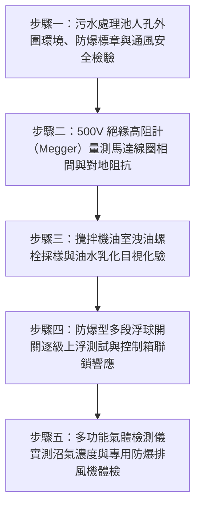

# 全案購屋實戰第二百七十三部：中古大樓社區地下室污水處理池曝氣沉水攪拌機軸封漏油線圈進水絕緣擊穿與惡臭沼氣防爆型浮球開關體檢工序全書

## 壹、前言與防護戰略意義

在現代集合住宅高層建築的深層機電工程體系中，「地下室生活污水處理設施（Sewage Treatment Facility / Septic Pit System）」是處理全棟上百戶家庭日常糞便、洗滌廢水與生活污水的底層淨化核心。為了符合國家放流水標準並防止厭氧發酵產生致命劇毒的「硫化氫（$\text{H}_2\text{S}$）」與易燃易爆之「甲烷（$\text{CH}_4$）沼氣」，污水調節池與曝氣池內部必須配置常態浸沒於強腐蝕液體中的「沉水式曝氣攪拌機（Submersible Aerator / Mixer）」。

沉水攪拌機仰賴水下電動機經由雙重「機械軸封（Mechanical Seals）」阻絕導電污水滲入馬達內部，並透過「防爆型液位浮球開關（Explosion-Proof Float Switches）」精準感知池內液位變化，以連鎖啟閉攪拌與排污沉水泵浦。

然而，在台中市南區與南屯區屋齡 25 至 30 年以上的中古集合住宅（例如：大安紫金城、長億南園、歌德堡、靜園 A 區等社區），地下室污水處理設施長年隱匿於筏基最深處，環境極度惡劣陰暗，普遍面臨極度凶險的「機電絕緣崩潰與沼氣爆炸危機」：
1. **碳化鎢雙重機械軸封老化磨損、潤滑油室（Oil Chamber）乳化漏油**：含有高濃度油脂與洗劑之污水侵蝕軸封密封面，腐蝕性污水突破屏障滲入馬達定子線圈，引發絕緣耐壓擊穿（Insulation Breakdown），引發地下室配電盤大跳電甚至漏電傷人。
2. **液位浮球開關水銀/微動開關外殼破裂、表面遭厚重油脂包裹卡死**：浮球無法隨液位自由起伏翻轉，造成攪拌機乾燒空轉燒毀，或反之液位暴漲無法啟動抽排，引發黑臭糞水溢流淹沒整個地下室停車場。
3. **未採用合格防爆等級（Ex d IIB T4）電器**：高濃度沼氣瀰漫的密閉水池上方，若採用普通無防爆等級之接線盒與電纜穿孔，電驛動作產生的微弱電火花極易引燃甲烷氣體，釀成整座大樓地底「結構粉碎性大爆炸」。

本專書為「小寶置產全案防護體系」第二百七十三部，旨在建立一套針對中古集合住宅地下室污水曝氣攪拌機絕緣阻抗、油室乳化油質採樣、防爆浮球靈敏度及沼氣濃度安全聯鎖的全維度工程體檢工序，捍衛全棟大樓地底公共安全與家人衛生健康，並轉化為對賣方與管委會強力議價的實體技術鐵證。

---

## 貳、污水池沉水攪拌機與防爆控制核心失效機理

### 一、機械軸封磨損與馬達線圈水下擊穿機理
1. **碳化矽/碳化鎢動靜環（SiC/TC Rings）摩擦磨損**：
   - 沉水攪拌機浸沒於含有大量毛髮、固體砂礫與化學有機物的污水中。動環（旋轉）與靜環（固定）密封面仰賴油室內部之白色藥用石蠟油（Mineral Oil）潤滑散熱。
   - 歷經數萬小時運轉，細微砂粒嵌塞於密封端面造成拉傷劃痕，潤滑油外洩且污水長驅直入油室，形成黃白色乳化泥狀液體（Water-in-Oil Emulsion）。
2. **定子繞組（Stator Winding）耐水絕緣漆崩潰**：
   - 當油室內部「水分洩漏探頭（Moisture Probe）」老化失效時，污水進一步滲過下軸承進入馬達腔體。
   - Class F 或 Class H 級漆包線在導電污水浸泡下，相間絕緣電阻在數秒內自數百兆歐（$\text{M}\Omega$）暴跌至零，產生相間短路或接地故障（Ground Fault），引發接地過電流電驛（51G）跳脫。

### 二、浮球開關油污包覆與機械卡死
1. **油脂固化凝結（Fat, Oil, Grease - FOG 結塊）**：
   - 廚房排放之油脂隨廢水進入沉砂調節池，降溫後凝固成白色硬塊，包裹在懸掛的浮球外殼與信號電纜上。
   - 浮球比重由原本的 $0.6 \sim 0.8$ 劇增至接近 $1.0$ 以上，即使污水已滿溢至池頂，浮球仍如秤砣般沉在水底無法上浮仰角，控制盤判定為「低水位」拒絕啟動泵浦。
2. **微動開關接點電弧碳化與進水漏電**：
   - 傳統水銀浮球若外殼老化龜裂，池內酸性污水滲入浸潤接點，引發短路誤報，造成攪拌機 24 小時不間斷空轉，軸承過熱燒融。

### 三、密閉空間沼氣集聚與電氣防爆破口
1. **甲烷爆炸極限（Explosive Limits, 5%~15%）之累積**：
   - 污水池內部厭氧菌分解排泄物產生大量甲烷（$\text{CH}_4$）。當池頂通風不良時，空氣中甲烷體積濃度極易落在 $5\% \sim 15\%$ 的極度危險爆炸範圍內。
2. **非防爆接線盒（Junction Box）與電氣穿線破口**：
   - 早期老舊社區維修時，廠商便宜行事採用普通塑膠防水盒代替鑄鋁耐壓防爆接線盒（Ex d），電纜穿孔未灌注防爆密封膠（Sealing Fitting）。電驛吸合或線頭鬆動產生之微小電火花直接接觸沼氣，引發地底毀滅性氣爆。

---

## 參、實地現場勘驗五步檢測工序

### 步驟一：安全進入與防爆控制盤巡檢
1. **防爆環境評估與氣體初檢**：
   - 靠近地下室污水處理區，以多用氣體檢測儀檢測周邊環境，確認硫化氫 $< 10\,\text{ppm}$、甲烷濃度為 $0\%\,\text{LEL}$。
2. **防爆電氣規格核對**：
   - 檢視池頂吊掛攪拌機之電纜接線箱，外殼必須具備國家防爆認證標章（如 Ex d IIB T4 或以上等級），箱體防爆螺栓必須全數鎖齊，無鏽蝕缺損。

### 步驟二：馬達線圈絕緣電阻精密量測
1. **控制箱斷電解線（LOTO）**：
   - 在污水控制箱內將沉水攪拌機專用無熔線斷路器切斷，拆開馬達動力線（U, V, W）與接地線（PE）。
2. **500V/1000V 數位絕緣高阻計（Megger）測試**：
   - 分別量測相間（U-V, V-W, W-U）及對地（U-PE, V-PE, W-PE）之絕緣電阻值：
     - 全新/健康狀態：$> 20\,\text{M}\Omega$。
     - 允許最低警戒值：$\ge 2.0\,\text{M}\Omega$。
     - 嚴重絕緣崩潰：$< 1.0\,\text{M}\Omega$（線圈已進水或絕緣漆碳化，嚴禁通電以防接地短路爆炸）。

### 步驟三：機械軸封油室油質採樣與乳化檢驗
1. **起吊攪拌機至檢修導軌頂部**：
   - 搖動不鏽鋼起吊絞盤，沿著垂直導軌（Guide Rail）將水下攪拌機平穩起吊出水面，懸停於檢修平台上。
2. **油室檢驗螺栓（Inspection Screw）旋開採樣**：
   - 放置乾淨透明玻璃量杯於油室下方，旋開排油螺栓取樣 $50\,\text{mL}$ 潤滑油。
   - 油質狀態判定：
     - 清澈透明/微黃淡色：軸封完全水密，無洩漏。
     - 呈乳白色牛奶狀或奶茶色渾濁液：軸封已嚴重磨損進水，必須立即更換雙重機械軸封。
     - 直接流出黑色污水無油質：軸封已徹底碎裂，馬達內部恐已全數進水泡毀。

### 步驟四：防爆液位浮球動作與清除測試
1. **浮球表面厚重油垢清除**：
   - 檢查懸掛於池內的 3 至 4 支防爆浮球（停機、啟動、雙開、高水位警報）。
   - 若浮球表面結滿油脂硬塊，必須使用高壓熱水或專用清洗劑刮除乾淨，恢復其原始設計浮力。
2. **手動上浮傾斜動作測試**：
   - 徒手逐一將浮球自垂直向下位置向上抬起至傾斜 $45^\circ$。
   - 觀察內部接點導通瞬間，控制箱指示燈應同步亮起，攪拌機/排污泵浦在 3 秒內平順啟動；降下時在設定延遲後平穩停機。

### 步驟五：沼氣濃度安全聯鎖與防爆排風體檢
1. **密閉空間甲烷（CH4）動態連續監測**：
   - 將氣體偵測採樣管伸入池頂人孔內部，量測甲烷與硫化氫動態累積濃度。
   - 當甲烷濃度達到 $10\%\,\text{LEL}$ 或硫化氫達到 $15\,\text{ppm}$ 時，污水專用防爆排風機必須自動強制啟動通風。
2. **防爆排風機葉輪防火花（Non-Sparking）檢驗**：
   - 檢視排風機外殼與葉輪材質，必須採用鋁合金或黃銅防爆無火花結構，防範葉輪碰撞擦出火花誘發氣爆。

---

## 肆、全案四棟核心考慮物件污水設施深度評估

| 考慮社區 | 地下室污水處理設施配置型態 | 現場勘驗要點與潛在风险 | 談判籌碼與合約特約防線 |
| :--- | :--- | :--- | :--- |
| **大安紫金城 13 樓 (`PROP_10`)** | 附屬之獨立 B2 大平面車位緊鄰地下機電與污水處理區 | 1. B2 車位周邊是否有濃烈刺鼻之沼氣糞臭味，污水池排風風道是否老化漏氣。 2. 戶內改 4 間套房之 4 套衛浴排污量翻倍，是否加重地下室污水泵浦負荷。 | 以「地下室污水池沼氣外洩油污淤塞、沉水攪拌機絕緣老化需高額修繕分攤」為籌碼，併同 4 間套房拆除款，狠砍開價，強烈鎖定 **768~788 萬**。 |
| **長億南園 8 樓 (`PROP_106`)** | 社區屋齡達 30 年，污水池深埋於地下機械車位坑道旁 | 1. 30 年老舊污水攪拌機馬達是否早已燒毀停擺，池底長年沉積黑泥厭氧發臭。 2. 浮球開關油污包覆嚴重，暴雨時是否有污水溢流倒灌停車場紀錄。 | 直指老舊大樓污水處理設備癱瘓、沼氣集聚存地底氣爆重大公共危險之致命傷，狠砍 200 萬，出價 **745~760 萬**。 |
| **歌德堡 8 樓** | 中型社區管理嚴密，地下室空氣清新無任何異味 | 1. 檢視污水處理設備由專業環保公司定期每季巡檢簽單。 2. 防爆電氣與浮球開關保養完好。 | 精裝優質標的，確認地下衛生環境乾淨安全，作為家庭健康無憂之核心對照組。 |
| **靜園 A 區 11 樓** | 雙拼格局住戶單純，地下室通風良好 | 1. 污水池排氣管直通頂樓高空排放，地下室無異味滯留。 2. 攪拌機運轉平穩無雜音。 | 作為比價牽制籌碼，藉由標準之地下衛生環境反壓紫金城與長億南園。 |

---

## 伍、買方防護作戰特約條款與自保機制

在正式進入買賣斡旋與簽訂要約書時，應在不動產買賣契約補充協議中明確載明：

> **【地下公共污水處理設施運作正常與無沼氣危害保證特約條款】**  
> 「賣方保證本契約標的物所屬社區大樓地下室之生活污水處理池、沉水曝氣攪拌機、排污泵浦、防爆液位浮球及專用通風防爆排氣系統運作正常，且完全符合現行環保排放標準與消防防爆安全規範。地下停車空間（特別是附屬車位周邊）絕無沼氣惡臭瀰漫、污水溢流回湧或設備漏電跳電之情事。若簽約至交屋期間經現場查驗發現污水攪拌設備損壞停擺、馬達絕緣擊穿或經環保局稽查放流水質超標開罰列管者，賣方應促使管委會立即完成設備檢修更換與水質改善；若逾期未改善，賣方同意由買方自買賣尾款中暫扣新台幣參萬元整作為公共衛生修繕保證金。」

---

## 陸、結論與行動指引

地下室生活污水處理池與沉水曝氣攪拌機是大樓維持地下環境潔淨與呼吸健康的「地下淨化之肺」。軸封漏油線圈進水雖隱蔽於污濁黑水深處，卻是引發全棟停電與馬達燒毀的致命病灶；沼氣防爆失效更關乎整座大樓地底的生死存亡。透過本工序之高阻計絕緣精密量測、油室採樣檢驗與防爆浮球實測，小寶全家不僅能夠徹底為居家安全掃除隱形威脅，更能精準洞察大樓物業機電維護之底層硬實力，將公設潛在修繕負擔轉化為談判桌上的定錨重鎚！
