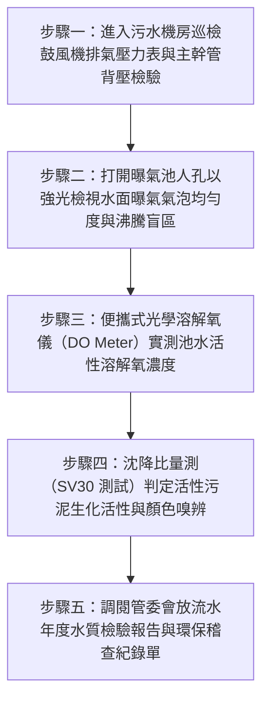

# 全案購屋實戰第二百七十九部：中古大樓社區地下室生活污水曝氣池沉水曝氣盤橡膠膜片龜裂鈣化板結增氧效率崩潰與COD生化超標開罰體檢工序全書

## 壹、前言與防護戰略意義

在現代集合住宅高層建築的深層環境工程中，「地下室生活污水生物處理設施（Basement Sewage Biological Treatment Facility）」是整座大樓將各戶日常排放的高濃度糞便、沐浴乳化廢水與廚房有機廢水轉化為無臭無毒達標放流水的生化核心。此套活性污泥好氧生物處理系統（Activated Sludge Process），其心臟與微細血管在於鋪設於曝氣池底部的「微孔沉水曝氣盤（Submersible Fine Bubble Disc Diffusers）」。

微孔曝氣盤仰賴配置於地面的羅茨鼓風機（Roots Blowers），透過耐壓幹管將大量壓縮空氣壓入池底，再經由曝氣盤表面數千個微米級彈性氣孔（Micropores），將空氣打碎成直徑僅 $1 \sim 3\,\text{mm}$ 的細微氣泡群。微氣泡在緩慢上升過程中，將足夠的溶解氧（Dissolved Oxygen, $\text{DO}$）強制傳遞溶解至污水中，維持好氧微生物菌膠團之生命活性，以高效降解「生化需氧量（BOD）」與「化學需氧量（COD）」。

然而，在台中市南區與南屯區屋齡 25 至 30 年以上的中古集合住宅（例如：大安紫金城、長億南園、歌德堡、靜園 A 區等社區），地下室污水曝氣池常年隱匿於筏基最深處，水質環境充斥腐蝕性化學物質，曝氣盤普遍陷入嚴重的「膜片老化與生物鈣化板結」危機：
1. **EPDM/矽膠微孔橡膠膜片老化龜裂、彈性疲乏永久變形**：微孔撕裂擴大成大孔徑，空氣不再化為微氣泡，而是形成巨大「沸騰水柱（Air Boiling）」呼嘯直衝水面，氧氣氣液傳質接觸面積暴跌 80% 以上，池內溶解氧跌破 $0.5\,\text{mg/L}$。
2. **微生物污泥反滲與碳酸鈣無機結晶板結（Scaling & Clogging）**：當鼓風機間歇停機時，由於逆止閥失靈或膜片自閉孔隙能力喪失，高濃度污泥反灌入曝氣盤內部，與地下水中的鈣離子結合硬化成如水泥般的硬殼。鼓風機排氣背壓急遽飆升，引發鼓風機馬達過熱過載跳脫。
3. **好氧菌群全面窒息死亡、轉化為厭氧黑臭發酵**：放流水 COD/BOD 嚴重超標數倍，環保局定期突擊水質抽檢不合格，依水污染防治法連續處以管委會每日新台幣數萬至數十萬元之巨額罰鍰，最終全數轉嫁為每戶住戶的沉重管理費分攤款。

本專書為「小寶置產全案防護體系」第二百七十九部，旨在建立一套針對中古集合住宅地下室生活污水曝氣盤曝氣均勻度、鼓風機管網背壓、池水溶解氧（DO）電極測定及環保檢驗合格紀錄的全維度工程體檢工序，捍衛大樓地下公共衛生與無公害居住環境，並轉化為對賣方與管委會強力議價的實體技術鐵證。

---

## 貳、污水微孔曝氣盤與生化處理核心失效機理

### 一、橡膠膜片微孔破損與氣液傳質效率崩潰機理
1. **大氣泡短路（Short-Circuiting）與比表面積暴跌**：
   - 依據二膜理論（Two-Film Theory），氧氣自氣泡傳遞至水中的氧轉移速率取決於「氣液接觸比表面積（$a = 6 / d_b$）」。
   - 當微孔膜片老化撕裂，氣泡直徑由微米級（$d_b = 2\,\text{mm}$）放大為巨型氣泡（$d_b = 20\,\text{mm}$），氣液比表面積瞬間縮減為原本的十分之一。氧轉移效率（Oxygen Transfer Efficiency, OTE）自 $25\% \sim 30\%$ 斷崖式暴跌至不足 $5\%$。
2. **鼓風機風能空轉浪費**：
   - 儘管鼓風機消耗數千瓦電力全速運轉，但注入池中的空氣幾乎全數未溶解即逸散至大氣中，池內始終處於極度缺氧（Anoxic）狀態。

### 二、停機泥沙倒灌與碳酸鈣結晶板結
1. **膜片自閉縫隙功能（Slit Self-Closing）失效**：
   - 優質微孔曝氣盤在停止供氣瞬間，橡膠膜片在水壓作用下應緊貼支撐盤，微細切口完全閉合防止液體回流。
   - 25 年老舊膜片因塑化劑流失硬化，切口無法閉合，大量含有固體顆粒之黑臭污泥滲入曝氣盤內部空氣分流支管。
2. **無機碳酸鈣與生物垢膠結（Bio-Scaling）**：
   - 自來水中的重碳酸鹽與細菌代謝分泌之胞外聚合物（EPS）在膜片表面微孔處濃縮結晶。
   - 結晶物將微孔死死封堵，曝氣阻力損失（Head Loss）自正常的 $3 \sim 5\,\text{kPa}$ 飆升至 $20 \sim 30\,\text{kPa}$。鼓風機排氣溫度飆破 $110^\circ\text{C}$，導致鼓風機葉輪受熱膨脹咬死或皮帶熔斷。

### 三、好氧污泥厭氧黑化與環保重罰骨牌效應
1. **絲狀菌崩潰與污泥黑臭化**：
   - 溶解氧長期低於 $1.0\,\text{mg/L}$，好氧硝化菌與聚磷菌大量死亡自溶，厭氧產酸菌與硫酸鹽還原菌接管池體。池水顏色由健康的土黃色轉變為漆黑墨水色，持續釋放高濃度劇毒惡臭硫化氫（$\text{H}_2\text{S}$）與甲基硫醇。
2. **放流水生化指標全面超標遭環保勒令限期改善**：
   - 放流水之懸浮固體（SS）、化學需氧量（COD $> 100\,\text{mg/L}$）與生化需氧量（BOD $> 30\,\text{mg/L}$）嚴重違法超標。
   - 環保局開出改善通知書，限期 30 日內全面清池重置曝氣盤，工程款動輒高達新台幣 50 萬至 100 萬元，若管委會修繕基金不足，每戶住戶將面臨數萬元的突發強制分攤款。

---

## 參、實地現場勘驗五步檢測工序

### 步驟一：鼓風機管網壓力與運轉背壓測定
1. **鼓風機出風端充油壓力表檢驗**：
   - 檢視地下室專用羅茨鼓風機出口主管配置之充油抗震壓力表。
   - 計算池底水頭靜壓：水深 $H$（公尺）對應靜水壓為 $H \times 0.1\,\text{kgf/cm}^2$（約 $10 \times H\,\text{kPa}$）。
2. **系統管阻背壓超標判定**：
   - 正常供氣工作壓力應為「水深靜壓 $+$ 正常管阻（約 $5 \sim 8\,\text{kPa}$）」。
   - 若 3 米水深之曝氣池，壓力表讀數超過 $0.45\,\text{kgf/cm}^2$（$45\,\text{kPa}$），代表底盤微孔膜片已嚴重鈣化板結堵塞，管阻激增引發系統超壓。

### 步驟二：曝氣池水面氣泡流態光學勘查
1. **水面氣泡分佈均勻性檢驗**：
   - 在安全人員引導下打開曝氣池觀察人孔，以強光手電筒照射水面。
   - **健康曝氣狀態**：全池水面呈現如香檳酒般細密均勻的乳白色微細泡沫微泡，氣泡直徑 $< 3\,\text{mm}$，水面翻滾平緩均勻。
   - **嚴重破損狀態**：水面出現數處如火山噴發般的「巨大湧泉沸騰（Boiling Geysers）」，伴隨大直徑氣泡破裂飛濺；其餘區域則如死水微動，證實部分膜片已嚴重撕裂破大洞，其餘膜片則完全板結不透氣。

### 步驟三：光學式水質溶解氧（DO）電極實測
1. **便攜式光學螢光法溶解氧測定儀（LDO Meter）檢測**：
   - 將防水電極探頭深入曝氣池液面下 $1.0 \sim 1.5\,\text{公尺}$ 處。
   - 穩定 60 秒後讀取溶解氧濃度數值：
     $$\text{DO} \ge 2.0 \sim 3.0\,\text{mg/L} \quad (\text{ppm})$$
   - 若實測 $\text{DO} < 1.0\,\text{mg/L}$（甚至測得 $0.2 \sim 0.4\,\text{mg/L}$），證實氧轉移效率已徹底崩潰，池內好氧菌已瀕臨滅絕。

### 步驟四：活性污泥 30 分鐘沉降比（SV30）現場化驗
1. **量筒取樣沉降測試**：
   - 自曝氣池取均勻混合液注入 $1000\,\text{mL}$ 透明玻璃量筒至滿刻度。
   - 靜置於水平地面碼錶計時 30 分鐘，記錄沉降後污泥層體積百分比（$\text{SV}_{30}$）。
2. **生化外觀與沉降性能評定**：
   - **正常活性污泥**：$\text{SV}_{30}$ 介於 $20\% \sim 35\%$ 之間，泥水界面清晰，上清液透明清澈，污泥呈黃褐色且散發泥土清香味。
   - **腐敗老化污泥**：$\text{SV}_{30} > 60\%$ 或污泥無法沉澱飄浮於水面（污泥膨脹），顏色呈墨黑如炭，散發強烈刺鼻之臭雞蛋糞臭味。

### 步驟五：調閱環保申報紀錄與罰單歷史核查
1. **定期合格放流水質檢驗報告書**：
   - 查核管委會由經環保署認證之檢驗機構出具之最近一期放流水報告：
     - COD 必須 $< 100\,\text{mg/L}$。
     - BOD 必須 $< 30\,\text{mg/L}$。
     - 懸浮固體 SS 必須 $< 30\,\text{mg/L}$。
2. **環保局限期改善單與裁處紀錄**：
   - 詢問管理室與調閱區權會會議紀錄，確認大樓近年是否有因污水排放惡臭遭鄰居檢舉、或環保局開罰數萬至數十萬元之黑歷史。

---

## 肆、全案四棟核心考慮物件污水生化系統深度評估

| 考慮社區 | 建物生化污水設施型態 | 現場勘驗要點與潛在風險 | 談判籌碼與合約特約防線 |
| :--- | :--- | :--- | :--- |
| **大安紫金城 13 樓 (`PROP_10`)** | 附屬之獨立 B2 大平面車位緊鄰地下機電污水處理區 | 1. 檢視 B2 停車位周邊空氣中是否有濃烈硫化氫臭氣，曝氣池排風管是否鏽蝕漏氣。 2. 戶內改裝 4 間套房之大量沐浴乳化廢水是否加重曝氣池有機負荷導致 COD 超標。 | 本戶附帶高價值獨立大平車，以「地下室污水曝氣盤鈣化板結、溶解氧過低存環保開罰大修風險」為由，配合 4 間套房拆除款，狠砍開價，強烈鎖定 **768~788 萬**。 |
| **長億南園 8 樓 (`PROP_106`)** | 社區屋齡達 30 年，地下機械車位坑道旁深埋老舊生化池 | 1. 30 年老舊曝氣盤是否全數撕裂或水泥化，水面呈巨大湧泉沸騰，好氧菌死光池水墨黑。 2. 鼓風機出風壓力是否嚴重超標過載。 | 直指老舊大樓污水處理設備實質報廢、隨時面臨環保局百萬重罰與高額全體分攤重置款之結構性致命傷，狠砍 200 萬，出價 **745~760 萬**。 |
| **歌德堡 8 樓** | 中型精品社區管理精細，污水設備定期委外生物加藥保養 | 1. 檢視曝氣池氣泡細密如香檳，溶解氧維持於 2.8 mg/L。 2. 放流水檢驗報告全部合格。 | 精裝優質標的，確認全棟地下生化淨化心臟健康無虞，作為生活品質與環境安全之堅固對照組。 |
| **靜園 A 區 11 樓** | 雙拼戶數單純，地下室通風良好 | 1. 污水處理機房標示清晰無惡臭溢出。 2. 鼓風機雙台交替運作良好。 | 作為比價牽制籌碼，藉由標準之地下污水維護品質反壓紫金城與長億南園。 |

---

## 伍、買方防護作戰特約條款與自保機制

在正式進入買賣斡旋與簽訂要約書時，應在不動產買賣契約補充協議中明確載明：

> **【公共生活污水生化處理設施正常運作與放流水合規特約條款】**  
> 「賣方保證本契約標的物所屬社區大樓地下室之生活污水生物處理設施、沉水微孔曝氣盤、羅茨鼓風機及放流水排放系統運作正常，且完全符合現行水污染防治法規之放流水排放標準。曝氣池膜片無嚴重鈣化堵塞破裂，池內溶解氧維持於正常生化標準（$\text{DO} \ge 2.0\,\text{mg/L}$），地下停車空間絕無惡臭硫化氫沼氣瀰漫之情事，且該社區於賣方持有期間絕無因放流水質超標遭環保主管機關開罰裁處或勒令限期改善。若簽約至交屋期間經現場查驗發現曝氣系統損壞停擺、放流水質超標遭檢舉開罰、或管委會已決議由各戶分攤高額污水設施全面重置工程款（累計達新台幣參萬元以上者），該筆工程款及罰款全數由賣方負擔清償；賣方若拒絕履行，買方得逕自履約保證專戶扣除該筆費用或主張解除買賣契約。」

---

## 陸、結論與行動指引

地下室生活污水曝氣池與微孔曝氣盤是大樓維持生態平衡與無臭居住環境的「地底生化之肺」。微孔膜片微小的撕裂、碳酸鈣微量的結晶板結，在陰暗的水池深處，就是引發好氧菌群全面窒息、整棟大樓陷入惡臭毒氣籠罩與環保百萬重罰的災難起點。透過本工序之風管背壓檢驗、水面流態光學勘查與光學式 DO 電極實測，小寶全家不僅能夠徹底掌握大樓地下深層公共衛生的真實生命力，更能洞悉大樓管理維護的深層實力，將公設潛在修繕負擔轉化為談判桌上的定錨重鎚！
