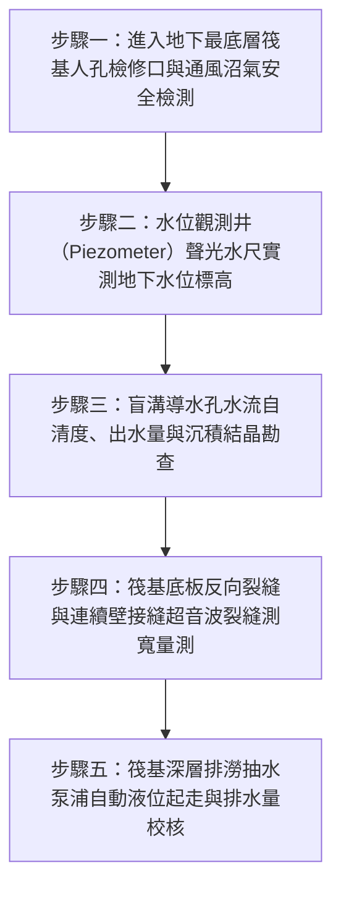

# 全案購屋實戰第二百七十二部：中古大樓社區地下室筏基連續壁觀測井地下水位上升浮力超標結構上浮微裂縫與盲溝降壓排水體檢工序全書

## 壹、前言與防護戰略意義

在現代集合住宅高層建築的地下基礎結構工程中，「筏式基礎（Raft Foundation）」與「地下連續壁（Diaphragm Wall）」是承載整棟數萬噸大樓重量、並抵禦地底龐大側向土壤壓力與地下水水壓的最核心基石。地下水文環境並非一成不變，隨著都市降雨型態轉變、周邊大型建案抽水排樁施工或區域地下水回升，地下室地底承受之「地下水浮力（Uplift Hydrostatic Pressure）」會產生動態劇烈變化。

依據阿基米德浮力定律，地下結構物所受之垂直向上總浮力 $F_{\text{buoyancy}} = \gamma_w \cdot V_{\text{submerged}}$，其中 $\gamma_w$ 為水單位重（$1.0\,\text{tf/m}^3$），$V_{\text{submerged}}$ 為地下室浸入地下水位以下的總排開體積。在地下 2 層至 4 層之深開挖大樓中，該垂直向上抬升力常高達數千噸甚至上萬噸。

為確保建物不被地底地下水「頂起」或「拉裂」，建築結構設計在基礎底板必須施作足夠之壓重抗浮力、設置錨碇地錨（Ground Anchors），並於筏基底層配置「地下水位觀測井（Piezometer / Observation Well）」與「深層盲溝減壓排水系統（Sub-slab Relief Drainage System）」，透過將過剩之承壓地下水導入沉砂集水坑後抽出，將地底孔隙水壓嚴格壓制在安全閾值以下。

然而，在台中南區與南屯區屋齡 25 至 30 年以上的中古集合住宅（例如：大安紫金城、長億南園、歌德堡、靜園 A 區等社區），筏基底層常年封閉無人進入，普遍陷入極度嚴重的「結構抗浮力危機」：
1. **盲溝透水濾管（Perforated Drain Pipe）淤泥鈣化板結**：地下水攜帶之碳酸鈣結晶與砂泥將盲溝孔隙完全封死，地下承壓水無法順暢排入集水井，底板下方水頭壓力急遽攀升。
2. **地下水位觀測井管口泥沙淤塞或遭雜物封蓋**：管委會喪失對地下水位的監控能力，完全不知地底浮力已逼近結構設計臨界極限。
3. **浮力超標誘發筏基大底（Mat Slab）與連續壁接縫拉裂**：當垂直向上水浮力大於建物自重安全係數時，筏基混凝土底板產生向上隆起微變形，連續壁公母接頭（Stop-end Joints）被剪應力撕開，產生致命的剪力貫穿微裂縫與高壓湧水，嚴重破壞整棟大樓的長期抗震整體性。

本專書為「小寶置產全案防護體系」第二百七十二部，旨在建立一套針對中古集合住宅地下室筏基觀測井地下水標高實測、底板水壓降壓盲溝透水性、連續壁抗浮力微裂縫內視鏡探測及集水坑抽排連鎖的全維度工程體檢工序，捍衛大樓地基永恆穩固，並轉化為對賣方與管委會強力議價的實體技術鐵證。

---

## 貳、地下室筏基結構抗浮力與連續壁核心失效機理

### 一、地下水浮力超標與結構上浮微位移機理
1. **抗浮力安全係數（Factor of Safety against Uplift）跌破安全線**：
   - 依據建築物基礎構造設計規範，建築物在常時地下水位下，其抗浮力安全係數應滿足：
     $$\text{FS} = \frac{W_{\text{total}}}{F_{\text{buoyancy}}} \ge 1.2 \sim 1.5$$
     其中 $W_{\text{total}}$ 為建物總自重（含結構體、回填土與地下室設備）。
   - 當連續暴雨或周邊地下水位急遽暴漲時，若盲溝降壓系統癱瘓，$F_{\text{buoyancy}}$ 大幅飆升致使 $\text{FS} < 1.0$，整棟大樓產生微米至毫米級之非均勻垂直向上抬升位移。
2. **筏基底板反向彎矩與剪力貫穿（Punching Shear）**：
   - 地下水向上頂托之均布水壓使厚達 $1.0 \sim 1.5\,\text{m}$ 的筏基大底承受巨大的反向彎矩。柱基周圍產生斜向 $45^\circ$ 之剪力微裂縫，地下高壓水夾帶泥沙沿微裂縫噴湧而出，引發混凝土中性化與主筋嚴重鏽蝕。

### 二、盲溝減壓排水系統失效機理
1. **土工不織布（Geotextile）生物黏泥與碳酸鈣淤塞**：
   - 埋設於基礎級配層中之開孔透水管，外包透水濾布用以阻擋砂土。
   - 地下水中溶解之高濃度碳酸氫鈣在減壓釋出二氧化碳時析出白色碳酸鈣結晶，與地下土壤中的厭氧菌生物黏泥結合，將濾布孔隙完全膠結硬化成不透水硬殼，降壓功能徹底歸零。
2. **單向逆止減壓閥（Pressure Relief Valve）閥瓣卡死**：
   - 穿越底板之直接減壓閥若受鐵鏽與泥泥卡死，地底超壓無法透過閥門自動洩壓至明溝，水壓直接施加於混凝土結構體上。

### 三、連續壁施工縫剪應力錯動與高壓滲水
1. **單元接頭（Panel Joints）微位移開裂**：
   - 連續壁係由數十個單元槽段（Panels）透過公母接頭施作。在不均勻浮力與土壓推擠下，相鄰單元產生微小剪切錯動，早期施工預埋之橡膠止水帶（Waterstop）撕裂。
2. **湧水帶砂（Boiling & Piping）淘空地基**：
   - 高水壓經由連續壁微縫滲漏時，若伴隨流砂現象，將持續淘空壁外土壤，導致大樓四周人行道與道路產生淘空塌陷，威脅整棟大樓結構安全。

---

## 參、實地現場勘驗五步檢測工序

### 步驟一：安全進入筏基底層與環境巡檢
1. **局限空間作業安全檢測（LOTO & Gas Detection）**：
   - 打開地下室最底層（B2 或 B3）通往筏基層之不鏽鋼人孔蓋。
   - 伸入便攜式複合氣體檢測儀，檢測氧氣濃度（必須 $\ge 19.5\%$）、可燃性氣體（甲烷 $\text{CH}_4 \le 10\%\,\text{LEL}$）及硫化氫（$\text{H}_2\text{S} \le 10\,\text{ppm}$），並架設軸流風機強制送風 15 分鐘後始得進入。
2. **筏基各隔艙（Compartments）地面積水巡檢**：
   - 穿著防水雨靴巡視各隔艙，檢視底板是否有局部異常隆起、大面積積水或混濁泥水滲流。

### 步驟二：水位觀測井聲光鋼帶水尺量測
1. **觀測井管口保護與防護檢查**：
   - 尋找穿越筏基底板深入地底砂礫層之專用地下水位觀測管（通常為 2 吋至 3 吋 PVC 或不鏽鋼管）。
   - 管口應有防塵保護蓋並標明管口基準標高（$EL$）。
2. **聲光水位計（Water Level Meter）深度測定**：
   - 緩慢將聲光探頭垂入觀測井中，當探頭接觸地下水面瞬間，儀表發出蜂鳴聲並點亮指示燈。
   - 自管口基準點讀取鋼帶尺刻度，計算當前地下水位標高（$GWL$）：
     $$GWL = EL_{\text{pipe}} - \text{Depth}_{\text{reading}}$$
   - 核對原結構設計圖之「設計最高地下水位線」。若實測水位高於設計抗浮力水位，代表結構正處於超額浮力高危狀態。

### 步驟三：盲溝降壓導水管透水性檢測
1. **出水口水流與水頭壓降檢驗**：
   - 檢視四周連續壁底部引流至盲溝之各個導水孔出水口。
   - 正常降壓狀態下，出水口應有連續微量清澈水流排入集水明溝，無高壓噴濺，且水質清澈無夾帶黃泥細砂（流砂淘空指標）。
2. **結晶沉澱刮取檢測**：
   - 檢視出水口四周是否有厚達數公分之白色硬質碳酸鈣結霜或結晶結塊；若導水孔已被結晶完全封死，必須以高壓水刀或弱酸進行化學疏通。

### 步驟四：筏基底板與連續壁微裂縫精密量測
1. **光學裂縫測寬儀（Crack Width Gauge）量測**：
   - 沿著連續壁單元接頭施工縫及筏基柱腳四周，以強光手電筒搜尋微裂縫。
   - 使用 40 倍光學顯微測寬儀量測裂縫寬度：
     - 安全微裂縫：$w < 0.2\,\text{mm}$（無滲水）。
     - 警戒結構裂縫：$0.2\,\text{mm} \le w \le 0.4\,\text{mm}$（具白華汗水滲透）。
     - 危險結構裂縫：$w > 0.4\,\text{mm}$（具動態滴水或噴水，需實施環氧樹脂高壓灌漿補強）。
2. **超音波混凝土探傷深層微裂縫比對**：
   - 針對疑似隆起之底板區域進行非破壞性超音波波速測試，確認混凝土內部無分層剝離（Delamination）。

### 步驟五：筏基深層排污泵浦起抽與備援測試
1. **集水坑多段式浮球開關動作測試**：
   - 手動拉動筏基集水坑內之雙迴路液位浮球，確認泵浦在啟動水位時能順暢起走，並在 3 分鐘內將坑內水位抽降至停機位置。
2. **雙泵自動交替控制器功能核實**：
   - 確認 1 號泵與 2 號備援泵能自動交替運轉，且控制箱故障警報接點與一樓中央監控室連線正常。

---

## 肆、全案四棟核心考慮物件地基抗浮力深度評估

| 考慮社區 | 地下室開挖深度與結構型態 | 現場勘驗要點與潛在風險 | 談判籌碼與合約特約防線 |
| :--- | :--- | :--- | :--- |
| **大安紫金城 13 樓 (`PROP_10`)** | 地下開挖至 B2，配備獨立 B2 大平面車位，地處南區地勢平緩區 | 1. B2 車位地坪底板是否有微裂縫反潮或結晶白華，連續壁接縫是否有高壓滲水。 2. 筏基地下水位觀測井是否有定期量測紀錄。 | 本戶附帶高價值獨立 B2 平車，以「地下室連續壁接縫防潮與筏基抗浮力安全驗收」為核心防線，併同 4 間套房拆除款，狠砍開價，強烈鎖定 **768~788 萬**。 |
| **長億南園 8 樓 (`PROP_106`)** | 地下室附設機械停車設備，下坑（Pit）直逼筏基大底頂部 | 1. 30 年老舊大樓機械車位底坑是否常年積聚地下滲水與廢機油泥。 2. 筏基盲溝是否完全鈣化淤塞，地下水浮力是否導致底板微隆起。 | 直指老舊大樓地下室抗浮力降壓系統嚴重失修、地基長期受地下水浮力威脅之結構性硬傷，狠砍 200 萬，出價 **745~760 萬**。 |
| **歌德堡 8 樓** | 中型社區地下室空間乾爽，筏基排水維護定期執行 | 1. 檢視連續壁外觀乾爽無白華滲水，觀測井水位處於安全低位。 2. 筏基排澇泵浦雙迴路運作良好。 | 精裝優質標的，確認大樓地基與地下結構防潮抗浮力無懈可擊，作為資產保值之堅定對照組。 |
| **靜園 A 區 11 樓** | 地基土質良好，地下室通風明亮 | 1. 連續壁單元施工縫密合度良好。 2. 地下排水順暢無淘空泥沙。 | 作為比價牽制籌碼，藉由標準之地基結構維護水準反壓紫金城與長億南園。 |

---

## 伍、買方防護作戰特約條款與自保機制

在正式進入買賣斡旋與簽訂要約書時，應在不動產買賣契約補充協議中明確載明：

> **【大樓基礎結構安全與地下連續壁無結構性滲漏保證特約條款】**  
> 「賣方保證本契約標的物所在社區大樓之地下筏基結構、地下連續壁及地基基礎承載力安全無虞，且絕無因地下水位異常上升、水浮力超標導致建物產生不均勻沉陷、傾斜、結構性上浮裂縫、或連續壁單元接縫發生嚴重湧水淘空之情事。賣方保證地下室停車空間（特別是附屬車位區域）無湧水滲漏或嚴重反潮等重大結構瑕疵。若簽約至交屋期間經公正第三方土木技師或結構技師公會鑑定發現社區大樓地下基礎存在重大抗浮力不足或連續壁嚴重結構性滲水破壞者，買方得無條件主張解除本買賣契約，賣方及仲介方應即刻全額無息退還買方已付之全數價金。」

---

## 陸、結論與行動指引

地下室筏基抗浮力與連續壁結構是托起全棟大樓家庭生命與財富的「地底定海神針」。地下水浮力看不見、摸不著，卻擁有能夠頂起數萬噸混凝土巨塔的恐怖水力破壞力。盲溝淤塞微小細節，往往是引發整棟大樓底板剪力撕裂的致命根源。透過本工序之觀測井標高精確量測、導水盲溝透水檢驗與超音波微裂縫探測，小寶全家不僅能夠徹底掌握大樓結構根基的絕對安全，更能洞悉建物地底深處的真實抗震實力，將潛在結構風險精準化為談判桌上的定錨重鎚！
