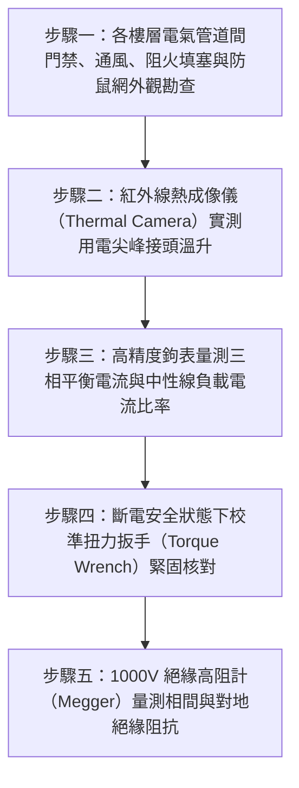

# 全案購屋實戰第二百七十五部：中古大樓社區各樓層電氣管道間低壓配電幹線分歧接頭氧化鬆脫熱成像溫升過載跳脫與絕緣包覆體檢工序全書

## 壹、前言與防護戰略意義

在現代集合住宅高層建築的重電生命線中，「垂直電氣管道間（Electrical Shaft / Pipe Chase）」是將台電地下變壓器引入之三相四線 $220\text{V}/380\text{V}$ 或單相三線 $110\text{V}/220\text{V}$ 低壓大電力，由地下總配電室垂直貫穿輸送至各樓層住戶專用電表箱與戶內配電盤的唯一動脈。該垂直幹線通常採用大截面積重型電力電纜（如 $100\,\text{mm}^2 \sim 250\,\text{mm}^2$ XLPE 銅芯交連聚乙烯電纜）或低壓金屬封閉匯流排槽（Busway）。

在每一樓層的電氣管道間內部，垂直貫穿的大幹線必須透過「分歧端子座（Distribution Blocks）」、「絕緣刺破型穿刺線夾（IPC Clamp）」或「壓接型 T 型分歧套管」進行電力引出，將動輒數十安培至上百安培的供電電流分流至該層各戶獨立分戶無熔線斷路器（NFB）與台電瓦時電表。

然而，在台中市南區與南屯區屋齡 25 至 30 年以上的中古集合住宅（例如：大安紫金城、長億南園、歌德堡、靜園 A 區等社區），電氣管道間平時鐵門深鎖、空氣不對流且長年處於高溫高載狀態，普遍面臨極度凶險的「電氣火災與接點熔毀危機」：
1. **分歧壓接銅端子螺栓鬆脫、接觸面電化腐蝕氧化**：受各戶高功率家電（冷暖氣、瞬熱電熱水器、IH爐、烘衣機）啟動時的大電流冷熱膨脹循環衝擊，螺栓扭力衰退鬆動，接觸電阻（Contact Resistance）急遽暴增。
2. **焦耳熱（Joule Heating, $Q = I^2 R t$）引發熱失控熔融**：接點溫度在用電尖峰時段飆破 $120^\circ\text{C} \sim 200^\circ\text{C}$，絕緣 PVC 膠帶碳化自燃，引燃管道間內部灰塵與相鄰電纜，形成直通整棟大樓的「垂直火龍煙囪效應」。
3. **分相三相負載嚴重不平衡引發中性線（N相）過載燒斷**：老舊大樓各戶私自加裝高耗電設備未重新平衡相序，導致公共中性線電流超過相線電流，中性線端子過熱燒斷時引發「浮動中性點（Floating Neutral）」，戶內 $110\text{V}$ 插座瞬間突波飆升至 $190\text{V} \sim 220\text{V}$，將全家所有插電家電（冰箱、電視、電腦、音響）瞬間燒燬毀滅。

本專書為「小寶置產全案防護體系」第二百七十五部，旨在建立一套針對中古集合住宅各樓層電氣管道間幹線接頭紅外線熱成像掃描、接點扭力磅手校核、三相電流不平衡度檢測及絕緣電阻耐壓的全維度工程體檢工序，捍衛家庭用電絕對安全與貴重家電壽命，並轉化為對賣方與管委會強力議價的實體技術鐵證。

---

## 貳、電氣管道間幹線分歧系統核心失效機理

### 一、接觸電阻惡性循環與焦耳熱失控機理
1. **微觀接觸面積收縮與應力鬆弛（Stress Relaxation）**：
   - 銅接頭表面在微觀下為凹凸不平的粗糙面。螺栓施加的緊固力使微凸起產生塑性變形，形成有效導電斑點（a-spots）。
   - 歷經 25 年長期的電流交變溫度循環，銅材與鋼製螺栓產生熱應力鬆弛，緊固預壓力量衰退 $30\% \sim 50\%$。導電斑點數量劇減，接觸電阻 $R_c$ 呈現倍數暴增。
2. **電化學氧化銅綠與熱失控正回饋（Thermal Runaway）**：
   - 地下室與管道間濕氣促進銅端子表面生成導電率極差之氧化亞銅（$\text{Cu}_2\text{O}$）與碳酸銅薄膜。
   - 依據焦耳定律，產熱量 $P = I^2 R_c$。高溫進一步加速銅金屬氧化，氧化又推升接觸電阻，形成不可逆的「惡性升溫正回饋」，最終導致端子銅排紅熱融化、產生劇烈相間電弧爆炸（Arc Flash）。

### 二、中性線（Neutral Wire）斷線與電壓偏移災難
1. **三次諧波與單相負載集中效應**：
   - 現代家庭充斥大量非線性負載（變頻家電、電腦電源、LED驅動器），產生大量零序三次諧波電流（$180\,\text{Hz}$），在三相平衡系統中無法抵消，而在中性線上疊加。
   - 老舊集合住宅設計之中性線截面積常僅為相線的一半（Reduced Neutral），導致中性線長年處於超額過載發熱狀態，端子碳化最為嚴重。
2. **中性線燒斷引發之過電壓破壞**：
   - 當公共三相四線系統之中性線端子一旦燒斷燒斷脫開，各戶負載形成串聯於 $220\text{V}$ 線電壓之間。
   - 用電負載較小之住戶（高阻抗端），其室內插座電壓被分壓推升至 $160\text{V} \sim 200\text{V}$，瞬間擊穿各類家電內部之濾波電容、變壓器與電路板，引發連環爆炸起火。

### 三、絕緣材料熱降解與相間短路
1. **PVC/XLPE 絕緣被覆碳化導電**：
   - 傳統分歧接頭外層包覆之電氣絕緣膠帶或熱收縮套管，長期承受 $90^\circ\text{C}$ 以上高溫烘烤，塑化劑揮發乾裂變脆，在高溫炭化後本身轉變為半導體碳化層。
2. **貫穿樓板開孔引燃垂直延燒**：
   - 若電氣管道間樓板穿越孔洞未嚴格施作 UL 認證之阻火防火填塞（Firestopping），分歧接頭起火噴出的高溫銅水與火花將沿管道間向上引燃各樓層，摧毀整棟大樓電力網。

---

## 參、實地現場勘驗五步檢測工序

### 步驟一：電氣管道間環境與阻火防鼠巡檢
1. **管道間防護門與通風條件檢查**：
   - 檢視各樓層電氣管道間鋼質防火檢修門是否維持常時上鎖，門框無大於 $3\,\text{mm}$ 縫隙。
   - 管道間頂端應有自然排氣百葉或專用排氣管，內部乾爽無積塵蛛網，無潮濕水滴滴落痕跡。
2. **貫穿樓板阻火泥（Firestop Mortar）密封度**：
   - 以強光手電筒檢視垂直電纜穿過上下樓層混凝土樓板開孔處，必須以厚度達 $10\,\text{cm}$ 以上之無機防火泥或防火枕完全填死密封，杜絕煙囪效應。

### 步驟二：用電尖峰時段紅外線熱成像溫升掃描
1. **熱成像儀量測時機與環境設定**：
   - 選擇大樓用電最高峰時段（夏季晚間 19:00 至 22:00，各戶冷氣全開時）進行現場檢測。
   - 將工業級紅外線熱像儀（NETD $< 40\,\text{mK}$，解析度 $\ge 320 \times 240$）輻射率（Emissivity）設定為銅氧化面之 $0.75 \sim 0.85$。
2. **溫升評定標準（依據 NETA / IEEE 規範）**：
   - 掃描各相幹線接頭、分歧穿刺線夾、電表端子座及 NFB 螺栓連接處：
     - **正常狀態**：接點溫度與周圍導線溫差 $\Delta T < 10^\circ\text{C}$，表面溫度 $< 60^\circ\text{C}$。
     - **輕度警戒**：$\Delta T$ 介於 $10^\circ\text{C} \sim 20^\circ\text{C}$（需排程緊固清潔）。
     - **重度危險**：$\Delta T$ 介於 $21^\circ\text{C} \sim 40^\circ\text{C}$（隨時有跳脫風險）。
     - **極度危急**：$\Delta T > 40^\circ\text{C}$ 或絕對溫度 $> 90^\circ\text{C}$（必須立即斷電更換接頭與端子）。

### 步驟三：三相電流不平衡度與中性線電流測定
1. **三相四線分相電流測定**：
   - 使用真有效值（True RMS）交直流數位鉤表，分別量測 R 相、S 相、T 相幹線之運行電流（$I_R, I_S, I_T$）。
   - 計算電流不平衡率（Current Unbalance Rate）：
     $$\text{Unbalance (\%)} = \frac{\max(|I_R - I_{\text{avg}}|, |I_S - I_{\text{avg}}|, |I_T - I_{\text{avg}}|)}{I_{\text{avg}}} \times 100\%$$
   - 合格標準應小於 $10\%$；若超過 $20\%$，代表單相用電嚴重偏載，需重新調配各戶相序。
2. **中性線（N 相）電流比值檢驗**：
   - 量測中性線電流 $I_N$，在平衡系統下 $I_N$ 應接近於零。若 $I_N > 0.5 \times I_{\text{avg}}$，顯示非線性諧波污染嚴重或單相超載發熱。

### 步驟四：接點螺栓緊固扭力校核（斷電維護驗收）
1. **校準預置式扭力扳手（Torque Wrench）檢測**：
   - 於停電檢修作業時，依據端子螺栓規格（如 M8, M10, M12）核對標準緊固扭矩：
     - M8 鍍鋅高碳鋼螺栓：$15 \sim 18\,\text{N}\cdot\text{m}$。
     - M10 螺栓：$30 \sim 35\,\text{N}\cdot\text{m}$。
     - M12 螺栓：$50 \sim 55\,\text{N}\cdot\text{m}$。
2. **蝶形彈簧墊圈（Belleville Washers）平整度檢視**：
   - 高品質接點應配置彈簧華司以吸收冷熱脹縮。檢視彈簧墊圈是否已被壓平變形失效。

### 步驟五：幹線絕緣電阻耐壓檢驗
1. **1000V 數位絕緣高阻計（Megger）測試**：
   - 在全線斷電並卸除電子儀表保護狀態下，對垂直幹線實施 1000V DC 絕緣測試。
   - 量測相間（R-S, S-T, T-R）及各相對地（R-PE, S-PE, T-PE, N-PE）絕緣電阻值：
     $$R_{\text{insulation}} \ge 5.0\,\text{M}\Omega \quad (\text{健康線路通常 } > 50\,\text{M}\Omega)$$
   - 若測得阻抗低於 $1.0\,\text{M}\Omega$，代表電纜絕緣層已吸濕受潮或內部碳化，存在隨時相間弧光短路引發大爆炸之重大公安瑕疵。

---

## 肆、全案四棟核心考慮物件電氣管道間深度評估

| 考慮社區 | 建物型態與電氣幹線配置 | 現場勘驗要點與潛在風險 | 談判籌碼與合約特約防線 |
| :--- | :--- | :--- | :--- |
| **大安紫金城 13 樓 (`PROP_10`)** | 13 樓位居高樓層次頂層，垂直供電幹線最末端 | 1. 13 樓原屋主改裝成 4 間學生套房，用電量暴增 4 倍（4 台冷氣+4 台電熱水器+4 台冰箱），分歧端子是否嚴重超載溫升發黑。 2. 管道間電表箱是否因超載頻繁跳脫。 | 以「4 間套房私接高耗電線路導致電氣管道間分歧端子超載過熱、需耗費數十萬重新重置大容量電表箱與專用防火分線盤」為由，併同 50 萬拆除款狠砍開價，堅定鎖定 **768~788 萬**。 |
| **長億南園 8 樓 (`PROP_106`)** | 社區屋齡達 30 年，管道間電纜與分歧接頭管齡極老 | 1. 30 年老舊氧化黑鐵端子盒是否產生嚴重高溫氧化，絕緣膠帶是否脆化脫落。 2. 管道間貫穿樓板開孔是否完全未封堵防火泥。 | 直指老舊大樓垂直電氣幹線老化絕緣衰退、隨時引發整棟電氣火災的結構性致命傷，狠砍 200 萬，出價 **745~760 萬**。 |
| **歌德堡 8 樓** | 中型社區維護精良，公共電氣設備定期委由甲級電氣承裝業熱掃描 | 1. 檢視管道間整潔乾爽，接頭熱像圖溫差均在 5°C 以內。 2. 阻火填塞扎實完備。 | 精裝優質標的，確認全棟低壓供電中樞安全健全，作為家人用電無憂之核心對照組。 |
| **靜園 A 區 11 樓** | 雙拼戶數單純，每層僅兩戶電表，負載平衡度高 | 1. 分歧端子箱標示清晰，三相負載均勻。 2. 電纜外皮無老化龜裂。 | 作為比價牽制籌碼，藉由標準之公共電氣維護水準反壓紫金城與長億南園。 |

---

## 伍、買方防護作戰特約條款與自保機制

在正式進入買賣斡旋與簽訂要約書時，應在不動產買賣契約補充協議中明確載明：

> **【公共電氣管道間供電安全與線路無超載保證特約條款】**  
> 「賣方保證本契約標的物所在樓層公共電氣管道間之供電幹線、分歧端子接頭、電表箱及專用分戶斷路器運作正常，且完全符合現行用戶用電設備裝置規則與消防安全規範。幹線分歧接頭在用電尖峰時段無異常高溫過熱（溫差 $\Delta T < 10^\circ\text{C}$）、無螺栓鬆脫氧化、絕緣包覆無碳化自燃隱患，管道間穿越樓板孔洞均施作合格防火阻火填塞，且標的室內無因前屋主改裝高耗電設備引發公共線路超載跳脫之情事。若簽約至交屋期間經專業紅外線熱成像檢驗發現接點高溫危險或絕緣阻抗不足者，賣方應促使管委會或自行負責於交屋日前完成接頭翻新緊固與絕緣整修；若逾期未改善，賣方同意由買方自買賣尾款中暫扣新台幣伍萬元整作為電氣安全修繕準備金。」

---

## 陸、結論與行動指引

電氣管道間與低壓幹線分歧接頭是集合住宅隱藏於水泥牆壁後方的「無形能量主動脈」。端子螺栓微小的應力鬆弛、微米級的氧化薄膜，在高達數十安培的日常大電流灌注下，就是引發電弧噴湧、電線走火與整棟大樓斷電滅頂的致命火種。透過本工序之紅外線熱成像高精度掃描、三相不平衡度量測與扭力扳手實測，小寶全家不僅能夠徹底掌握大樓供電動脈的絕對真實健康度，更能洞悉管委會機電維護的底層深層功力，將公設重電隱蔽風險精準化為談判桌上的定錨重鎚！
