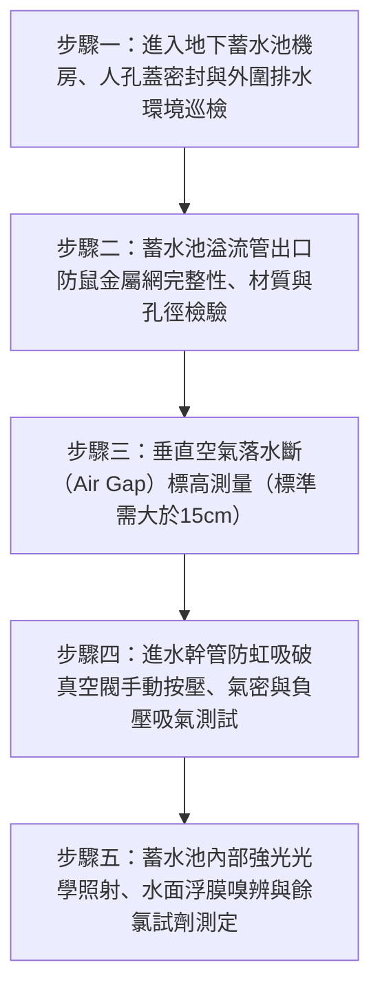

# 全案購屋實戰第二百七十八部：中古大樓社區地下室生活蓄水池溢流管防鼠銅網脫落防虹吸破真空閥閥芯硬化水質二次污染體檢工序全書

## 壹、前言與防護戰略意義

在現代集合住宅高層建築的深層民生衛生工程中，「地下室自來水生活蓄水池（Basement Potable Water Storage Tank / Reservoir）」是整座大樓抵禦自來水事業處乾旱停水、水壓不足與供水管網調蓄的核心蓄水命脈。全棟上百戶家庭每日清晨刷牙漱口、孩童洗澡、長輩泡茶與廚房烹飪之每一滴飲用水，均在該地底水槽中儲存靜置數小時至十數小時後，方被揚水泵浦抽送至各戶端。

依據自來水法、建築技術規則建築設備編及自來水用戶用水設備標準，地下蓄水池屬於封閉式飲用水衛生管理重地，其溢流與通氣設計必須建立兩道絕對不可逾越的「物理隔離防線」：
1. **溢流管與排水管末端重型防鼠不鏽鋼/黃銅細孔濾網（Anti-Vermin Mesh Screen）**：封堵暴雨時過剩溢流自來水排出之通道，同時徹底阻絕老鼠（溝鼠、屋頂鼠）、蟑螂、蛾蚋及壁虎等害蟲經由溢流管逆行鑽入水池內部。
2. **進水幹管之「防虹吸破真空閥（Vacuum Breaker / Anti-Siphon Valve）」與「物理空氣隔斷（Air Gap）」**：當市政自來水幹管水壓驟降或停水產生瞬間管網負壓（負壓抽吸）時，破真空閥必須毫秒級自動開啟吸入空氣，破除管內真空虹吸效應，防止受水池內部之水質或外來回湧污水被「逆向抽吸」回流污染。

然而，在台中市南區與南屯區屋齡 25 至 30 年以上的中古集合住宅（例如：大安紫金城、長億南園、歌德堡、靜園 A 區等社區），地下生活蓄水池常年處於陰暗封閉、無人進入的放任盲區，普遍存在極為駭人的「水質二次重大污染」衛生慘況：
1. **溢流管口防鼠銅網氧化鏽斷、整片脫落遺失**：老鼠沿著地下室排污暗溝循著自來水清香，自大口徑（通常為 4 吋至 6 吋）溢流管自由鑽入蓄水池內部。老鼠在水池浮球管線攀爬時失足落水溺斃腐爛，死鼠屍體被自來水加氯消毒藥劑溶解，全棟住戶長達數週甚至數月「天天飲用屍水」，引發致命鉤端螺旋體病（Leptospirosis）、漢他病毒及沙門氏菌大爆發。
2. **防虹吸破真空閥內部橡膠閥芯硬化黏死、進氣孔被泥砂封死**：破真空功能完全歸零，當市政管網搶修停水時，管網負壓將鄰近化糞池或地下積水自微漏點倒吸入潔淨蓄水池中。
3. **溢流管直接硬接插入地下室污水排水溝（無間接排水斷）**：大樓施工偷工減料，溢流管未保留法規規定的「間接排水空氣間隔（Air Gap $\ge 15\,\text{cm}$）」，當暴雨地下水溝積水或污水管回湧時，混濁糞水與高濃度沼氣沿溢流管直衝生活蓄水池，造成全棟自來水完全毒化。

本專書為「小寶置產全案防護體系」第二百七十八部，旨在建立一套針對中古集合住宅地下生活蓄水池溢流管防鼠網完整性、防虹吸破真空閥動作氣密性、空氣落水斷尺寸及池水生菌數水質檢驗的全維度工程體檢工序，捍衛全家每日飲用水的絕對生命健康，並轉化為對賣方與管委會強力議價的實體技術鐵證。

---

## 貳、生活蓄水池溢流管與防虹吸系統核心失效機理

### 一、防鼠銅網電化腐蝕脫落與生物入侵機理
1. **酸性沼氣與潮濕環境引發之電化腐蝕（Galvanic Corrosion）**：
   - 蓄水池溢流管口通常排入地下室集水坑或排水溝。溝內殘留之硫化氫（$\text{H}_2\text{S}$）與潮濕空氣結合形成稀硫酸。
   - 早期採用的薄銅絲網或鐵絲網在酸性蒸氣熏蒸下，短短 5 至 8 年金屬絲徑自 $1.0\,\text{mm}$ 腐蝕變細斷裂，網面中心產生直徑大於 $5\,\text{cm}$ 的破洞或整圈脫落。
2. **囓齒動物逆行入侵與屍體自溶污染鏈**：
   - 溝鼠與家鼠具備極強之攀爬與游水能力。只要孔隙大於 $1.2\,\text{cm}$（鉛筆直徑大小），老鼠即可縮骨鑽入管內。
   - 鑽入蓄水池之老鼠在水池四壁光滑的瓷磚或不鏽鋼板上無法脫困，最終體力耗盡溺斃水底。自來水中的次氯酸根將鼠肉蛋白水解自溶，池水總生菌數（CFU）瞬間飆破數萬倍，大腸桿菌群嚴重超標數百倍。

### 二、防虹吸破真空閥硬化與負壓倒吸機理
1. **閥芯矽膠/EPDM 橡膠墊高溫氧化黏死**：
   - 破真空閥長年處於水氣蒸發與靜止閉合狀態。水中鈣鎂離子在閥座邊緣沉澱析出硬垢，橡膠閥塞與黃銅閥座緊密黏結。
   - 當進水管網發生水切或主幹管爆管洩壓產生 $-0.5 \sim -0.8\,\text{kgf/cm}^2$ 的負壓時，大氣壓力無法克服黏結阻力推開閥芯吸氣，管內虹吸真空持續存在，將外部污水強行吸入自來水供水系統。
2. **通氣大氣吸氣孔被油泥蛛網堵塞**：
   - 破真空閥頂部之多孔防塵罩積滿地下室油污粉塵，吸氣截面積萎縮，破真空響應時間由小於 0.1 秒延遲至數秒以上，喪失瞬間破除虹吸功能。

### 三、無間接排水斷（Air Gap）引發之污水倒灌
1. **直接剛性連通（Direct Cross Connection）的致命違規**：
   - 依據給排水法規，蓄水池溢流管出水口與受納水體（排水漏斗、截水溝最高水位）之間，必須保持至少溢流管管徑 2 倍、且絕對不得小於 $15\,\text{cm}$ 之垂直物理淨空（Air Gap）。
   - 早期老舊水電師傅為求美觀或防止濺水，直接將 4 吋溢流管插入排水明溝深處。當地下室暴雨排澇不及時，排水溝內混雜泥沙、化糞池外溢排泄物與機油之黑水，在毛細作用與連通管原理下，直接經由溢流管倒流灌入生活蓄水池中。

---

## 參、實地現場勘驗五步檢測工序

### 步驟一：安全進入與蓄水池外圍環境檢查
1. **蓄水池外觀與人孔蓋防水防污檢查**：
   - 檢視地下生活受水池頂板，四周不可有污水管、化糞管或雨水管直接橫越其上方（嚴禁橫越飲用水池上方以防滴漏污染）。
   - 混凝土蓄水池之人孔座必須高出地面至少 $20\,\text{cm}$，人孔蓋必須有氣密防雨橡膠墊圈並加鎖管理。

### 步驟二：溢流管出口防鼠金屬網檢驗
1. **防鼠網材質與耐腐蝕規格確認**：
   - 沿蓄水池側壁尋找直徑 4 吋至 6 吋之溢流管（Overflow Pipe）與底部排空清洗管（Drain Pipe）出水口。
   - 出水口必須安裝堅固之 SUS316/SUS304 不鏽鋼防鼠金屬網罩或黃銅螺紋過濾網框，嚴禁使用劣質鐵絲網或尼龍紗網。
2. **網孔目數與網面破孔檢查**：
   - 使用游標卡尺量測防鼠網孔徑：孔徑大小必須介於 $1.0 \sim 1.5\,\text{mm}$ 之間（網目約 16~20 目）。
   - 戴上手套用力扳動網框邊緣，網罩必須牢固焊接或以不鏽鋼螺栓壓扣緊固於管口，不可有任何破損、鬆脫脫落或邊緣超過 $5\,\text{mm}$ 之縫隙。

### 步驟三：物理空氣隔斷（Air Gap）尺寸量測
1. **落水垂直淨空高差測定**：
   - 使用鋼捲尺垂直測量溢流管管口最低下緣，至下方排水明溝或受納排水漏斗最高溢流邊界之垂直距離（$H_{\text{gap}}$）。
2. **法規標準比對**：
   $$H_{\text{gap}} \ge 2 \times D_{\text{pipe}} \quad (\text{且絕對不得小於 } 15\,\text{cm})$$
   - 例如：4 吋（DN100）溢流管，$H_{\text{gap}}$ 必須 $\ge 20\,\text{cm}$。
   - 若溢流管直接插進排水管或浸入水中，即屬重大二級衛生缺失，必須立即截斷管路補足空氣隔斷。

### 步驟四：防虹吸破真空閥動作與水密性實測
1. **閥芯手動推動與靈敏度檢驗**：
   - 在蓄水池進水浮球閥上游找到防虹吸破真空閥（通常口徑為 $1/2$ 吋至 1 吋）。
   - 用手指按壓破真空閥頂部閥芯頂針，彈簧回彈應輕盈靈敏、無任何卡澀感；卸除保護蓋檢視內部進氣通道無蜘蛛網與厚積乾泥。
2. **進水動態運轉與停水負壓測試**：
   - 在蓄水池進水時，破真空閥大氣吸氣口應完全水密、不可有水流外噴洩漏。
   - 人為手動關閉進水總閥，製造瞬間管網水壓驟降，耳貼閥體可聽見清脆的「嘶」一聲吸氣動作聲，證實大氣迅速吸入破除虹吸。

### 步驟五：池內水質光學檢視與現場化驗
1. **高流明防爆強光手電筒水體透射檢視**：
   - 在安全管理員陪同下打開水池人孔（配戴防護口罩），以強光垂直照射水槽底層。
   - 水體應清澈見底、呈淡藍色或透明，水底不可有厚層黃褐色沉泥、黑色腐植質，水面絕不可有漂浮油膜、泡沫、動物毛髮或死昆蟲。
2. **水質 DPD 餘氯與 pH 值現場測定**：
   - 取池內水樣加入 DPD 餘氯試劑與廣用試劑測定：
     - 有效自由餘氯：應嚴格維持在 $0.2 \sim 1.0\,\text{ppm}$（$\text{mg/L}$）。
     - pH 酸鹼值：應介於 $6.5 \sim 8.5$ 之間。
   - 若餘氯測得 $< 0.1\,\text{ppm}$ 甚至為零，代表自來水在池內停滯時間過長、或氯氣已被大量細菌有機物消耗殆盡，飲用水極度不安全。

---

## 肆、全案四棟核心考慮物件生活供水水質深度評估

| 考慮社區 | 建物蓄水設施型態 | 現場勘驗要點與潛在風險 | 談判籌碼與合約特約防線 |
| :--- | :--- | :--- | :--- |
| **大安紫金城 13 樓 (`PROP_10`)** | 附屬之獨立 B2 大平面車位緊鄰地下生活蓄水池機房 | 1. 檢視地下蓄水池人孔蓋是否牢固密封，溢流管防鼠銅網是否完整更新為不鏽鋼 SUS316。 2. 戶內改裝 4 間套房之水質清澈度與出水餘氯含量實測。 | 本戶位居高樓層，以「地下生活蓄水池防鼠網破損與防虹吸閥老化、每日飲用水質安全存疑」為切入點，要求出示最新合格水質化驗單，併同 50 萬拆除款狠砍開價，堅定鎖定 **768~788 萬**。 |
| **長億南園 8 樓 (`PROP_106`)** | 社區屋齡達 30 年，地下蓄水池深埋於老舊機械車位油污坑旁 | 1. 30 年老舊蓄水池溢流管是否直接插進地下截水溝，防鼠銅網早已爛光，老鼠蟑螂長年進出。 2. 垂直自來水鍍鋅立管老化出黃水鏽泥。 | 直指 30 年老舊大樓飲用水設施嚴重污染、全棟面臨天天喝死鼠污染水之重大衛生健康醜聞，狠砍 200 萬，出價 **745~760 萬**。 |
| **歌德堡 8 樓** | 中型精品社區，管委會每半年定期委託合格廠商洗水塔蓄水池 | 1. 檢視蓄水池溢流管防鼠網如新，空氣間隙標準達 20cm。 2. 水質清澈見底，餘氯含量維持於 0.4 ppm。 | 精裝優質標的，確認全家每日飲用水安全無虞，作為生活品質與家人健康之堅固對照組。 |
| **靜園 A 區 11 樓** | 雙拼格局環境單純，地下蓄水池管理嚴謹上鎖 | 1. 人孔凸台標高達 25cm，破真空閥運作良好。 2. 戶內水質甘甜無異味。 | 作為比價牽制籌碼，藉由標準之飲用水公設維護水準反壓紫金城與長億南園。 |

---

## 伍、買方防護作戰特約條款與自保機制

在正式進入買賣斡旋與簽訂要約書時，應在不動產買賣契約補充協議中明確載明：

> **【公共地下生活蓄水池衛生安全與飲用水質合格特約條款】**  
> 「賣方保證本契約標的物所屬社區大樓地下室之生活自來水蓄水池及頂樓水塔系統運作正常，且完全符合現行自來水法與飲用水水質標準。蓄水池溢流管及通氣管口均裝設完整無破損之不鏽鋼防鼠防蟲濾網，溢流管出水端具備大於 15 公分之標準空氣隔斷，進水幹管防虹吸破真空閥運作靈敏無內漏，池水清澈無異味且自由餘氯維持於合格標準（$0.2 \sim 1.0\,\text{ppm}$），且賣方持有期間社區絕無因外來生物溺斃、污水倒灌引發之水質污染情事。若簽約至交屋期間經現場查驗發現溢流管防鼠網脫落破孔、空氣間隙不足或經 SGS 檢驗水質大腸桿菌群超標者，賣方應促使管委會立即完成全池抽空清洗消毒、防鼠網更新與水質複檢合格；若逾期未改善，賣方同意由買方自買賣尾款中暫扣新台幣伍萬元整作為公共水質衛生修繕保證金。」

---

## 陸、結論與行動指引

地下生活蓄水池與溢流管防鼠網是保護全家每日飲水健康的「第一道水密防線」。防鼠網微小的一個破洞、溢流管微小的間隙不足，在陰暗潮濕的地底，往往就是引發整棟大樓陷入飲用死鼠細菌水、爆發嚴重群聚感染的罪惡開端。透過本工序之防鼠網材質實測、空氣隔斷鋼尺量測與現場餘氯化驗，小寶全家不僅能夠徹底為居家生命健康構築最堅實的堡壘，更能洞悉大樓物業對公共衛生的真實管理水準，將潛在公設修繕負擔轉化為談判桌上的定錨重鎚！
