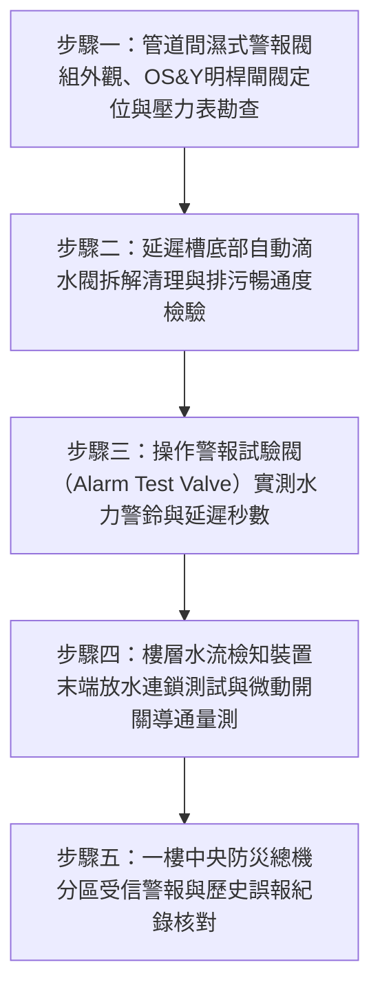

# 全案購屋實戰第二百七十六部：中古大樓社區各樓層消防撒水管網警報逆止閥延遲槽積泥誤報水流檢知裝置微動開關接點氧化體檢工序全書

## 壹、前言與防護戰略意義

在集合住宅高層與超高層建築的被動與主動消防滅火體系中，「濕式自動撒水警報閥組（Wet Alarm Check Valve Station）」與各樓層之「水流檢知裝置（Water Flow Detector / Flow Switch）」是火災發生時第一時間感知水流動態、敲響水力機械警鈴、並將分區火警信號精準傳送至一樓中央防災監控總機的神經末梢樞紐。

當某樓層室內高溫使閉式撒水頭之玻璃球破裂噴水滅火時，水流推開警報逆止閥閥瓣（Clapper），高壓水流分流注入「延遲槽（Retard Chamber）」並衝擊水力警鈴（Water Motor Gong）發出刺耳機械敲擊聲；同時，各樓層管道間水流檢知裝置之漿片（Paddle）受水流衝擊偏轉，驅動微動開關閉合，向中央總機發出該特定樓層的緊急火警定位信號。

然而，在台中市南區與南屯區屋齡 25 至 30 年以上的中古集合住宅（例如：大安紫金城、長億南園、歌德堡、靜園 A 區等社區），消防撒水警報系統常年處於死水浸泡狀態，普遍陷入極度嚴重的「誤報疲勞與信號失聯」雙重危機：
1. **警報閥延遲槽內部積泥結垢、自動滴水球閥（Automatic Drip Valve）堵死**：管網正常微小水壓波動所滲入的微量水流無法經由滴水閥排空，延遲槽常年積滿死水。每逢清晨自來水幹管加壓波動，延遲槽在毫無火警下直接觸發壓力開關，造成全棟住戶於睡夢中頻繁遭遇「假火警狼來了」之精神折磨。
2. **管委會因不堪其擾「私自拔線關閉水力警鈴與總機警報」**：社區物業或住戶因頻繁誤報，便宜行事將警報閥控制小閥全數關閉，或在總機背板將該迴路跳線切除，導致真實火災爆發時系統陷入「全盲全啞狀態」。
3. **水流檢知裝置微動開關接點氧化發黑、延遲氣囊（Pneumatic Dashpot）硬化**：歷經數十年管道間高濕度腐蝕，微動開關接點電阻暴增至數千歐姆；或延遲阻尼器硬化卡死，即使管內高壓水全速噴湧，水流開關依舊紋風不動，中央消防隊與物業完全無法知曉起火樓層。

本專書為「小寶置產全案防護體系」第二百七十六部，旨在建立一套針對中古集合住宅濕式警報閥延遲槽自動排污能力、水流檢知器槳片靈敏度、微動開關阻抗測定及消防總機連動響應的全維度工程體檢工序，捍衛家庭成員免於假火警騷擾與真火災失聯的生死威脅，並轉化為對賣方與管委會強力議價的實體技術鐵證。

---

## 貳、警報逆止閥與水流檢知裝置核心失效機理

### 一、延遲槽積泥與自來水管網水壓波動誤報機理
1. **自動滴水球閥（Auto Drip Valve）黃銅滾珠卡死**：
   - 延遲槽底部設有一組重力式自動滴水球閥。在正常微小水流滲入時，球閥處於常開狀態，將水排入排水斗，防止誤報。只有當大量連續滅火水流湧入時，水流動壓方能將滾珠推上閥座封閉排水，使延遲槽蓄滿壓力推動壓力開關。
   - 老舊社區消防管網充斥鐵鏽渣與泥沙，滴水閥內部滾珠被硬化鏽泥死死黏住，排污孔完全堵塞。即使一次側供水管網僅產生 $0.5\,\text{kgf/cm}^2$ 的微小自來水壓力波動，微量水流在延遲槽內無法排出，數秒內即引發水力警鈴鳴響與總機發報。
2. **延遲時間（Retard Time）嚴重失準**：
   - 正規延遲槽之水力物理延遲時間應嚴格落在 $15 \sim 45\,\text{秒}$ 之間。延遲槽內部容量因鐵鏽沉積而縮水 50% 時，延遲時間驟降至不足 5 秒，對任何水錘脈動喪失過濾能力。

### 二、水流檢知裝置機械與電氣失效機理
1. **柔性塑膠槳片（Vane / Paddle）老化脆斷或泥沙卡塞**：
   - 插入撒水水平幹管之半圓形塑膠槳片，長年受高壓水浸泡硬化變脆。當遭遇管網水錘衝擊時，槳片沿根部撕裂脫落，被水流沖走，水流開關喪失力學感知傳感器。
   - 另一極端是管底沉泥厚達數公分，將槳片下緣死死埋住卡阻，水流通過時槳片無法向前偏轉推動連桿。
2. **氣動延遲阻尼器（Pneumatic Dashpot）膜片老化**：
   - 水流指示器內部設有機械式氣動延遲器（防止管內水晃動誤報，可調 $0 \sim 60\,\text{秒}$）。阻尼器橡膠皮碗硬化或微調針閥孔堵塞，導致連桿行程完全鎖死。
3. **雙組微動開關接點氧化（Contact Oxidation）**：
   - 水流檢知裝置配備兩組單刀雙擲（SPDT）微動開關（一組報消防總機，一組連鎖水力警鈴或監控閥門）。接點覆蓋厚層氧化銅或硫化膜，閉合時接觸電阻 $> 100\,\Omega$，總機判定為線路未導通。

### 三、閥組常開閘閥擅關與人為屏蔽災難鏈
1. **外螺紋明桿閘閥（OS&Y Valve）違規關閉**：
   - 物業管理員因夜間水力警鈴頻繁怪叫，擅自將警報閥上游之 OS&Y 控制閘閥旋緊關閉，或關閉警報管路小考克。
2. **全棟滅火防線實質瓦解**：
   - 控制閥一旦關閉，該樓層數十支撒水頭管網完全斷水。若室內發生走火，撒水頭爆裂後無水可噴，而消防總機亦收不到任何報警信號，釀成整層住戶於熟睡中被火海包圍之滅頂慘劇。

---

## 參、實地現場勘驗五步檢測工序

### 步驟一：警報閥組與控制閥上鎖巡檢
1. **OS&Y 控制閘閥開度與防篡改監視**：
   - 檢視警報閥下方之一次側明桿閘閥，外露螺桿長度應達最大值（全開狀態）。
   - 閥門手輪必須以鐵鍊加重型鋼鎖上鎖，或裝設防篡改微動開關（Tamper Switch）連線至總機，確保無人能擅自關閉。
2. **一、二次側壓力對比記錄**：
   - 讀取一次側（進水端）與二次側（管網端）壓力表。二次側水壓應大於或等於一次側（正常約 $5.0 \sim 8.0\,\text{kgf/cm}^2$）。若二次側水壓低於一次側超過 $1.0\,\text{kgf/cm}^2$，顯示內部逆止閥瓣密封不嚴或管網暗漏。

### 步驟二：延遲槽與自動滴水閥排泥體檢
1. **自動滴水球閥滴漏測試**：
   - 檢視延遲槽下方之滴水閥出水口。待命狀態下，出水口應乾爽無持續滴水（若持續噴水代表警報逆止閥閥座內漏）。
2. **輕推滴水閥滾珠檢驗**：
   - 使用細螺絲起子自滴水閥開口輕推內部不鏽鋼滾珠，滾珠應能自由活動、手感輕盈無阻滯；若內部溢出大量黑黏鐵鏽泥漿，必須旋下滴水閥以高壓水槍沖洗。

### 步驟三：警報試驗管路動作實測
1. **開啟警報試驗閥（Alarm Test Valve）**：
   - 旋開警報閥組專用之 $1/2$ 吋旁通試驗球閥，模擬撒水頭爆裂連續出水。
2. **計時測定延遲時間與警鈴聲響**：
   - 啟動碼錶計時：自閥門開啟瞬間至水力機械警鈴開始敲響之時間間隔，必須嚴格落在：
     $$15\,\text{秒} \le t_{\text{delay}} \le 45\,\text{秒}$$
   - 水力警鈴敲擊頻率應清脆密集，距離 3 公尺處音量必須達到 $85\,\text{dB(A)}$ 以上。若超過 60 秒無聲，代表延遲槽管路堵死或警鈴葉輪卡塞。

### 步驟四：樓層水流檢知裝置連動與電阻量測
1. **末端查驗管放水觸發測試**：
   - 前往標的物所在樓層（如 13 樓或 8 樓）之撒水末端查驗閥，全開出水。
2. **微動開關導通電阻量測**：
   - 當管內水流流速達到 $0.4 \sim 0.7\,\text{m/s}$ 時，觀察水流開關連桿動作。
   - 使用數位三用電表量測微動開關 NO 接點閉合時之電阻：
     $$R_{\text{contact}} \le 0.5\,\Omega \quad (\text{若 } > 2.0\,\Omega \text{ 即屬接點嚴重氧化})$$
   - 實測連桿推動至開關導通之延遲時間（通常調整為 20~30 秒，防止水流晃動誤動作）。

### 步驟五：一樓消防總機連動響應與歷史紀錄核實
1. **總機分區定位核對**：
   - 樓層末端放水時，與一樓管理室無線電通訊：消防總機上該樓層「撒水水流檢知」指示紅燈應精準點亮，液晶螢幕顯示該樓層正確房號與區域。
2. **調閱總機歷史事件紀錄清單（Event Log）**：
   - 要求調閱消防總機過去 6 個月之歷史告警紀錄。
   - 若該分區每月頻繁出現「撒水動作後 10 秒內自復（Reset）」的紀錄，即為延遲槽堵塞或水流開關阻尼失效引發之典型「管網水壓震盪誤報」。

---

## 肆、全案四棟核心考慮物件撒水警報系統深度評估

| 考慮社區 | 建物型態與撒水警報配置 | 現場勘驗要點與潛在風險 | 談判籌碼與合約特約防線 |
| :--- | :--- | :--- | :--- |
| **大安紫金城 13 樓 (`PROP_10`)** | 13 樓位居 11 樓以上高危撒水防護區，原屋主隔成 4 間學生套房 | 1. 13 樓管道間水流檢知裝置微動開關是否因套房頻繁用水震盪誤報而被私自斷線拔除。 2. 戶內改裝之撒水頭移位是否造成管內積存空氣，激發假警報。 | 以「13 樓撒水水流開關接點氧化斷線、火災時無法通報總機之致命公安盲點」為籌碼，併同 50 萬拆除復原款，狠砍開價，強烈鎖定 **768~788 萬**。 |
| **長億南園 8 樓 (`PROP_106`)** | 社區屋齡達 30 年，地下機械車位配置大型濕式警報閥組 | 1. 地下室警報逆止閥延遲槽是否長年沉積黑泥，導致水力警鈴三天兩頭半夜誤鳴。 2. 社區是否因誤報頻繁而將警報閥控制閥偷關閉。 | 直指 30 年老舊消防警報系統失修癱瘓、全棟陷入無警報火海之重大結構性管理失能，狠砍 200 萬，出價 **745~760 萬**。 |
| **歌德堡 8 樓** | 中型精品社區，機電消防每年由專業甲級消防承裝業定檢 | 1. 延遲槽滴水閥清潔乾淨無堵塞。 2. 水流檢知裝置回傳總機定位精準零誤報。 | 精裝優質標的，確認全棟火警預警與自動滅火神經完好無缺，作為家庭生命高枕無憂之核心對照組。 |
| **靜園 A 區 11 樓** | 11 樓雙拼高樓層，管道間採光通風良好 | 1. 11 樓水流檢知器外殼無氧化銹蝕，微動開關動作靈敏。 2. OS&Y 控制閥加鎖落實。 | 作為比價牽制籌碼，藉由標準之消防警報維護品質反壓紫金城與長億南園。 |

---

## 伍、買方防護作戰特約條款與自保機制

在正式進入買賣斡旋與簽訂要約書時，應在不動產買賣契約補充協議中明確載明：

> **【公共消防撒水警報系統正常運作與無頻繁誤報保證特約條款】**  
> 「賣方保證本契約標的物所在樓層及社區公共之濕式自動撒水警報閥、延遲槽、水力警鈴、各樓層水流檢知裝置及中央消防受訊總機連鎖系統運作正常，且完全符合現行消防法規標準。警報閥控制閘閥常時全開上鎖，延遲槽無泥沙淤塞致管網壓力波動頻繁引發假警報誤鳴之情事，且標的所在樓層水流開關能在末端放水時於 30 秒內精準向消防總機發報。若簽約至交屋期間經現場查驗發現水流開關接點氧化失靈、延遲槽堵塞或管委會因誤報私自切斷警報連線者，賣方應促使管委會立即完成閥組清洗與開關更新；若逾期未改善，賣方同意由買方自買賣尾款中暫扣新台幣參萬元整作為公共安全修繕準備金。」

---

## 陸、結論與行動指引

濕式自動撒水警報閥與水流檢知裝置是大樓遭遇暗夜惡火時「唯一能自主呼救與引導救援的立體神經系統」。滴水閥微小的泥沙淤塞、微動開關微米級的氧化層，輕則引發全棟住戶夜不能寐的刺耳假警報，重則在真正火災降臨時將求救信號徹底掐死。透過本工序之滴水閥拆檢、延遲秒數實測與總機歷史日誌核驗，小寶全家不僅能夠徹底掌握大樓火災預警系統的真實生命力，更能洞悉大樓物業管理對消防公安的真實敬畏度，將潛在消防危機轉化為談判桌上的定錨重鎚！
