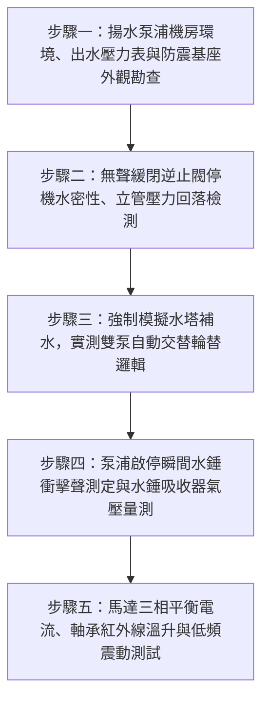

# 全案購屋實戰第二百七十四部：中古大樓社區地下室生活供水揚水泵浦止回閥逆向洩漏低頻水錘震盪與雙泵自動交替控制器故障體檢工序全書

## 壹、前言與防護戰略意義

在現代集合住宅高層建築的垂直給水動力核心中，「地下室生活揚水泵浦系統（Basement Potable Water Lifting Pump System）」是整棟大樓每日數百人盥洗、飲用、烹飪與清潔用水的唯一生命動脈。自來水事業處幹管水源注入地下受水池後，全靠配置於地下室機房之雙台高揚程多段離心式揚水泵浦（通常配置為一用一備，1 Duty + 1 Standby），將潔淨自來水克服數十公尺垂直靜水頭強行抽送至頂樓高架水塔。

在此高揚程水力輸送架構中，泵浦出口總幹管上配置的「無聲緩閉逆止閥（Silent Check Valve / Non-Slam Check Valve）」與控制箱內部之「雙泵自動交替控制器（Automatic Alternating Relay / Controller）」扮演著生死攸關的角色：
1. **無聲緩閉逆止閥**：在泵浦停止運轉瞬間迅速而平順地截斷逆向水流，防止高達數十噸之垂直高壓水柱高速倒灌回衝，避免誘發毀滅性的「管湧水錘（Water Hammer）」。
2. **雙泵自動交替控制器**：使兩台泵浦於每次頂樓水塔補水時均勻輪替啟動運轉，平衡機械磨損，並在一號泵故障時毫秒級無縫切入二號備援泵。

然而，在台中市南區與南屯區屋齡 25 至 30 年以上的中古集合住宅（例如：大安紫金城、長億南園、歌德堡、靜園 A 區等社區），地下室揚水泵浦系統普遍陷入嚴重的「機電老化與水錘自傷」危機：
1. **逆止閥閥瓣橡膠密封面老化破損、閥芯導桿卡阻**：停機時閥瓣無法完全水密閉合，高壓水柱逆向洩漏，揚水立管水頭完全流失。每次重新起抽時管內產生嚴重「氣阻空穴」，誘發高達 $15 \sim 25\,\text{kgf/cm}^2$ 的劇烈水錘震盪，震裂地下室管路吊架，並引發直穿全棟樑柱的「低頻巨響共振」。
2. **雙泵自動交替繼電器內部接點碳化氧化卡死**：導致系統長年「單泵孤軍奮戰」，備援泵長年閒置生鏽咬死；一旦主運轉泵軸承燒毀，整棟大樓瞬間陷入全面斷水浩劫。
3. **電極棒液位感應控制器（Floatless Level Relay）靈敏度衰退**：地下受水池乾燒保護失靈，泵浦在無水狀態下高速乾磨，數分鐘內機械軸封燒融、水葉變形報廢。

本專書為「小寶置產全案防護體系」第二百七十四部，旨在建立一套針對中古集合住宅揚水泵浦逆止閥水密性、水錘吸收器效能、雙泵自動交替邏輯及低頻結構傳音的全維度工程體檢工序，捍衛全棟穩定供水與居住安寧，並轉化為對賣方與管委會強力議價的實體技術鐵證。

---

## 貳、生活揚水泵浦與逆止閥水錘核心失效機理

### 一、逆止閥關閉遲滯與高壓逆流衝擊機理
1. **水力慣性逆流與閥瓣撞擊（Check Valve Slam）**：
   - 當揚水泵浦馬達斷電瞬間，向上輸送之水柱在重力與靜水頭作用下迅速減速並反向倒流。
   - 傳統搖擺式逆止閥（Swing Check Valve）或彈簧疲勞之無聲逆止閥，其閥瓣關閉速度落後於水流倒流速度。逆向水流以高速衝擊已部分關閉之閥瓣，在閥瓣完全撞上閥座瞬間引發極限動能突變，產生高達靜態壓力 3 至 5 倍之破壞性衝擊波（Joukowsky Pressure Surge）。
2. **NBR/EPDM 橡膠密封面磨損微洩漏（By-pass Creep）**：
   - 歷經 25 年高壓水流沖刷，閥座橡膠密封圈出現溝槽狀沖蝕。泵浦停機後，垂直立管內數噸水自閥縫悄悄倒流回地下受水池，立管頂端形成真空負壓區，加速水中溶解空氣析出積聚成高彈性氣囊。

### 二、雙泵交替控制迴路與熱過載失效
1. **微電腦交替控制器（Alternator）積體電路老化**：
   - 地下室濕度長期大於 85%，控制盤內之交替控制器電路板受潮腐蝕，內部雙穩態電驛（Bistable Relay）磁舌無法翻轉，始終鎖定於 1 號泵供電迴路。
2. **長年閒置導致備援泵主軸咬死（Rotor Seizure）**：
   - 2 號備援泵因交替失效數年未曾啟動，水中礦物質在葉輪口環（Wear Rings）與機械軸封處結晶膠結。當 1 號泵過載跳脫、控制盤嘗試啟動 2 號泵時，馬達產生高達 6 倍滿載電流之「堵轉電流（Locked-Rotor Current）」，熱動過載電驛（O/L）在 3 秒內跳脫，全棟徹底無水可用。

### 三、低頻共振傳音（Structure-Borne Noise）機理
1. **泵浦基礎防震彈簧（Spring Isolator）金屬壓死**：
   - 水泵運轉轉速通常為 $1750 \sim 3500\,\text{rpm}$，產生 $29 \sim 58\,\text{Hz}$ 之特徵旋轉頻率。
   - 泵浦鑄鐵基座下方之彈簧防震器若生鏽壓死、避震橡膠墊碳化，震動未經阻尼直接傳入地下室 RC 樓板與大樓結構大樑，化為整棟低樓層（1~3樓）夜間如戰車駛過之低頻嗡嗡噪音。

---

## 參、實地現場勘驗五步檢測工序

### 步驟一：機房外觀、銘牌參數與管路支撐檢查
1. **多段離心式揚水泵浦銘牌核算**：
   - 核對泵浦銘牌參數：揚程 $H$（$\text{m}$）、流量 $Q$（$\text{L/min}$ 或 $\text{m}^3/\text{hr}$）、馬力 $P$（$\text{HP}$ 或 $\text{kW}$）。
   - 計算全棟垂直高度加上管阻損失，確認額定揚程高於實際需求揚程至少 $15\%$。
2. **進出水管柔性避震接頭（Flexible Joint）檢查**：
   - 泵浦吸水端與吐水端應安裝高壓不鏽鋼波紋防震軟管或高耐壓橡膠雙球防震接頭，接頭橡膠表面無龜裂、變形或滲水。

### 步驟二：無聲逆止閥水密性與停機保壓測試
1. **泵浦運轉與吐出壓力記錄**：
   - 手動啟動 1 號揚水泵浦，記錄出水總幹管壓力表穩定運轉壓力（通常為 $6.0 \sim 10.0\,\text{kgf/cm}^2$）。
2. **停機瞬間指針保壓與回落監測**：
   - 按下停機按鈕，凝視出水幹管壓力表：
     - 健康狀態：指針平穩回落並穩定維持在「垂直立管靜水頭壓力」（例如頂樓高 45m 時維持在約 $4.5\,\text{kgf/cm}^2$）。
     - 嚴重洩漏逆流：指針在數十秒內持續下滑至 $1.0\,\text{kgf/cm}^2$ 以下甚至歸零，證實逆止閥密封面嚴重破損漏水，高壓水正全數倒灌回受水池。

### 步驟三：雙泵自動交替控制邏輯驗收
1. **手動/自動切換與第 1 次啟動**：
   - 將揚水控制盤「手動/自動」開關打至「自動」位置。
   - 在控制盤內部短接頂樓水塔液位電極棒「啟抽」信號，觀察 1 號泵應即刻自動啟動運轉。
2. **模擬滿水停機與第 2 次重新啟動（輪替驗證）**：
   - 斷開短接信號使 1 號泵停機；等待 5 秒後再次短接啟抽信號。
   - 控制器必須精準命令「2 號備援泵」自動起走；再次循環時重新切回 1 號泵。若連續兩次均為同一台泵浦啟動，證實交替控制器已故障損壞。

### 步驟四：水錘衝擊波監聽與吸收器檢驗
1. **急停瞬間聽音與管體跳動勘查**：
   - 在泵浦全速高壓運轉時突然切斷電源，仔細聆聽逆止閥與出水幹管轉彎處：
     - 合格標準：僅有輕微「喀」一聲閥瓣回位聲，管身無位移跳動。
     - 水錘嚴重：發出如大鐵鎚猛擊鋼管之「匡噹」爆鳴巨響，整條管道間幹管發生肉眼可見之劇烈劇震晃動。
2. **氣囊式水錘消除器氣壓測定**：
   - 使用數位胎壓表檢測安裝於逆止閥下游水錘消除器之充氣氣嘴，預壓應為系統靜水壓之 $80\% \sim 90\%$，按壓氣閥針不可有水珠噴出。

### 步驟五：運轉電流、軸承溫升與震動測定
1. **運轉電流平衡度（Amperage Balance）量測**：
   - 運轉時以數位鉤表量測三相電源線（R, S, T）電流，三相不平衡率必須小於 $5\%$，且運行電流不得超越銘牌滿載電流（FLA）。
2. **軸承振動速度值與紅外線溫升**：
   - 使用數位振動計量測馬達前後軸承座水平垂直振動值，速度有效值必須：
     $$V_{\text{rms}} \le 2.8\,\text{mm/s}$$
   - 運轉 30 分鐘後以紅外線熱像儀量測軸承座溫度，最高溫不得超過 $75^\circ\text{C}$。

---

## 肆、全案四棟核心考慮物件揚水供水系統深度評估

| 考慮社區 | 建物樓層型態與供水架構 | 現場勘驗要點與潛在風險 | 談判籌碼與合約特約防線 |
| :--- | :--- | :--- | :--- |
| **大安紫金城 13 樓 (`PROP_10`)** | 13 樓位居頂層次頂層，地下機房直接對頂樓水塔高揚程揚水 | 1. 13 樓戶內是否能聽見地下室揚水泵浦起走引發之立管水錘低頻震動。 2. 4 間套房改裝用水量暴增，地下揚水泵浦啟抽頻率是否過高。 | 以「地下室揚水泵浦逆止閥老化造成高樓層立管水錘震動公害、需全套更換無聲逆止閥與避震器」為由，併同 50 萬拆除款狠砍開價，堅定鎖定 **768~788 萬**。 |
| **長億南園 8 樓 (`PROP_106`)** | 社區樓高約 12~14 層，30 年老舊揚水機房設備未曾全面翻新 | 1. 30 年老舊鑄鐵多段泵浦是否軸承嚴重異音，備援泵早已鏽死咬住。 2. 逆止閥倒灌嚴重導致夜間水錘巨響。 | 揭露老舊社區供水心臟隨時停擺、全棟面臨大斷水之重大公共安全風險，狠砍 200 萬，出價 **745~760 萬**。 |
| **歌德堡 8 樓** | 中型社區機電設備維護精良，揚水泵浦定期實施輪替保養 | 1. 雙泵交替控制靈敏，機房乾爽無漏水鏽痕。 2. 停機時完全無水錘聲響。 | 精裝優質標的，確認全棟生活供水動力心臟強健健全，作為家庭居住生活品質之堅定對照組。 |
| **靜園 A 區 11 樓** | 雙拼戶數單純，揚水管路路徑清晰直通頂樓 | 1. 揚水泵浦運轉平穩，機電控制箱標示清晰。 2. 頂樓水塔液位電極棒保養良好。 | 作為比價牽制籌碼，藉由標準之生活供水維護品質反壓紫金城與長億南園。 |

---

## 伍、買方防護作戰特約條款與自保機制

在正式進入買賣斡旋與簽訂要約書時，應在不動產買賣契約補充協議中明確載明：

> **【地下生活供水揚水系統正常運作與無水錘公害保證特約條款】**  
> 「賣方保證本契約標的物所屬社區大樓地下室之生活自來水揚水泵浦、無聲緩閉逆止閥、雙泵自動交替控制器及水錘消除裝置運作正常，雙泵均具備自動輪替抽水與備援功能，且泵浦運轉及停機瞬間絕無逆流洩漏、引發嚴重管路水錘爆鳴或產生低頻結構傳音公害之情事。若簽約至交屋期間經現場查驗發現揚水系統故障停擺、備援泵咬死或水錘嚴重超標經列入管委會修繕缺失者，賣方應促使管委會立即完成更換修復；若逾期未改善，賣方同意由買方自買賣尾款中暫扣新台幣參萬元整作為公共供水修繕保證金。」

---

## 陸、結論與行動指引

地下室生活揚水泵浦與無聲逆止閥是大樓維持每日正常作息的「水動力心臟與主動脈瓣膜」。逆止閥微小洩漏、交替控制器微弱接觸不良，看似隱身於暗黑地底，卻是引發全棟水管震裂、深夜低頻噪音折磨與突發全棟大斷水的罪魁禍首。透過本工序之停機壓力監測、雙泵交替實測與水錘聲音判別，小寶全家不僅能夠徹底掌握大樓供水系統的真實生命力，更能洞悉大樓物業機電維護之底層功力，將公設潛在修繕負擔轉化為談判桌上的定錨重鎚！
