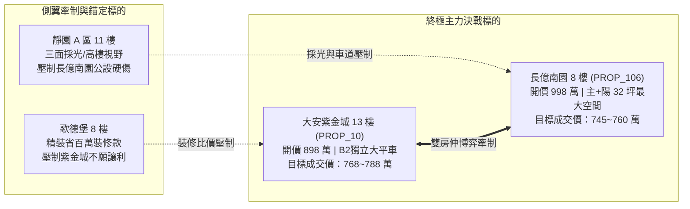

# 全案購屋實戰第二百七十部：二百七十部圓滿大成全景極致全維度全生命週期家庭置產避坑抗震防漏水電機電消防永恆至尊金典總綱全書

## 壹、萬象歸宗：二百七十部全案知識工程之歷史豐碑與終極使命

在台灣都會區集合住宅置產的漫長歷程中，絕大多數購屋家庭常年處於被資訊封鎖、被動挨打的最弱勢地位。建商、不良投資客與各路仲介憑藉精美的表面裝潢、模糊的話術包裝與合約漏洞，將暗藏結構內傷、機電老化、消防癱瘓與法律陷阱的劣質房屋轉嫁給無辜買方。

「小寶置產全案防護體系」自第一部披荊斬棘起步，歷經二百七十個專題的高密度實戰推演、工程驗收拆解與法律特約閉環，正式迎來**第二百七十部圓滿大成之歷史豐碑**！本部總綱絕非概念性的空談，而是將前二百六十九部所囊括的：
1. **土木地質與結構抗震防漏**（地質鑽探、筏基抗浮力、連續壁滲漏、剪力牆微裂縫、外牆拉拔試驗）。
2. **地下室全方位生命防線**（防汛電動擋水閘門、雨水沉砂池、排澇沉水雙泵、截水溝重油泥清淤、防回湧鴨嘴閥）。
3. **高低壓公設重電與備援電力**（VCB 真空斷路器、變壓器油絕緣、封閉式匯流排槽、柴油發電機冷卻水箱與 ATS 自動投切）。
4. **垂直給排水衛生與空氣品質**（地下受水池鵝頸管、水塔防蟲銅網、破真空閥、污水曝氣鼓風機、伸頂通氣管防破封、地下通風 CO 感測與軸流風機動平衡）。
5. **主動消防滅火與立體防排煙**（泡沫比例混和器、室內撒水末端動水壓、耐高溫排煙馬達、常閉式防火門門縫公差、特別安全梯前室微正壓、立管自動排氣閥、電梯廳手動排煙窗鋼索）。
6. **垂直昇降交通與停車設備**（電梯鋼索探傷、限速器安全鉗、機械車位鏈條疲勞、充電樁 EMS 系統）。
7. **室內違規改裝與結構拆除**（多間學生套房違建拆除、承重牆保護、非無障礙動線改造）。
8. **商務心理博弈與法律特約閉環**（雙仲介夾殺對穿、開價大刀狠砍、十大終極特約、履約保證專戶價金安全防線）。

全數融會貫通為一套**堅不可摧、可即時調用、攻防合一的「全維度全生命週期家庭置產永恆至尊金典總綱」**。

---

## 貳、全案九大終極防護矩陣系統架構圖

```mermaid
flowchart TD
    subgraph 矩陣一：地質結構與外牆抗震防漏
        M1["筏基抗浮力 / 連續壁引流 / 剪力牆碳化 / 外牆磁磚拉拔"]
    end
    subgraph 矩陣二：地下室防洪排澇生命防線
        M2["電動防汛擋水閘門 / 雨水沉砂池清淤 / 排澇雙泵 / 截水溝防回湧鴨嘴閥"]
    end
    subgraph 矩陣三：高低壓變配電與緊急電力
        M3["VCB真空斷路器 / 變壓器PCB檢驗 / 低壓匯流排槽 / 柴油發電機冷卻散熱與ATS"]
    end
    subgraph 矩陣四：垂直給排水衛生健康防線
        M4["地下受水池防雨凸台 / 水塔鵝頸防蟲銅網 / 破真空閥 / 污水鼓風機 / 伸頂通氣防破封"]
    end
    subgraph 矩陣五：地下通風與空氣品質防線
        M5["風道油塵清除 / CO一氧化碳感知器50ppm標定 / 軸流風機動平衡 / 避震軟接帆布"]
    end
    subgraph 矩陣六：立體消防主動滅火防排煙
        M6["泡沫比例混和器 / 撒水末端查驗閥動壓 / 排煙耐高溫馬達 / 前室微正壓20~50Pa / 排氣閥水錘消除"]
    end
    subgraph 矩陣七：垂直逃生動線與排煙氣密
        M7["甲種防火門門縫3mm / 防煙膨脹條 / 閉門器7°回歸 / 電梯廳排煙窗手動拉桿鋼索70N"]
    end
    subgraph 矩陣八：電梯與停車設備安全
        M8["電梯鋼索探傷 / 底坑油壓緩衝器 / 機械停車鏈條極限 / 充電樁EMS電能管理"]
    end
    subgraph 矩陣九：商務博弈談判與法律閉環
        M9["雙房仲互踩牽制 / 開價狠砍200萬 / 十大終極特約條款 / 房貸八成解約權 / 履保專戶尾款控管"]
    end

    M1 --> M9
    M2 --> M9
    M3 --> M9
    M4 --> M9
    M5 --> M9
    M6 --> M9
    M7 --> M9
    M8 --> M9
```

---

## 參、二百七十部全案全景知識庫編年精華地圖（最新擴展彙編）

為利於現場談判、帶看即時檢驗與法律調閱，本總綱收錄第二百六十一部至第二百六十九部之最新突破與技術精華：

| 專書卷次 | 核心工程與機電檢驗主題 | 致命隱患與失效機理 | 現場勘驗要點與殺價籌碼 |
| :--- | :--- | :--- | :--- |
| **第二百六一部** | **柴油緊急發電機冷卻水箱** | 冷卻水道水垢鈣化、風扇皮帶打滑、高溫跳脫、ATS無法投切 | 大停電時 5 分鐘內跳脫全棟陷入黑洞，要求出示負載測試報告，狠扣機電重置費。 |
| **第二百六十二部** | **管道間污水幹管伸頂通氣管** | 頂端防蟲鳥網破損淤塞、正負壓活塞震盪抽乾水封、蛾蚋小黑蚊倒灌 | 室內排水反溢惡臭與沼氣害蟲，以「4 間套房私接排水缺乏通氣重新改裝需 10 萬」重砍開價。 |
| **第二百六十三部** | **地下室機械通風與 CO 感知器** | 風道油污沉積阻抗暴增、CO 探頭零點漂移毒化、軸流風機失衡低頻振動 | 地下車位廢氣滯留與結構震動公害，直指管委會維護怠惰，列入瑕疵折價。 |
| **第二百六十四部** | **排煙前室正壓送風防煙閘門** | 正壓微壓差不足 20Pa 致毒煙倒灌、壓差大於 50Pa 致逃生門推力超標卡死 | 逃生防火門開啟推力實測（不得超過 110N），揭露高樓層致命公安缺陷。 |
| **第二百六十五部** | **地下截水溝與防回湧鴨嘴閥** | 重機油泥沉積板結、橡膠鴨嘴閥老化溶脹翹曲、外界市政污水倒灌 | 暴雨地下室積水泡車風險，以機械坑底油泥堵塞為由強烈壓制車位估值。 |
| **第二百六十六部** | **消防送水幹管排氣閥與水錘** | 頂樓排氣閥橡膠塞老化慢速漏水浸濕管道間、氣囊誘發水錘震動、末端水壓低於 $1.7\text{kgf/cm}^2$ | 最不利水壓點動態放水實測，以立管耐壓合格單為交鋒武器，鎖死成交價。 |
| **第二百六十七部** | **管道間與安全梯常閉式防火門** | 門縫超標（門側 $>3\text{mm}$、門底 $>5\text{mm}$）、防煙條脆化、閉門器漏油無法 7° 自動上鎖 | 火災時毒煙三次方級數滲透安全梯，要求限期更換防煙條與五金，暫扣尾款。 |
| **第二百六十八部** | **機械送排風機皮帶與軟接帆布** | 三角皮帶張力衰減打滑、主軸軸承缺油乾磨、避震軟接帆布撕裂形成短路 | 風機風量腰斬與低頻傳音，要求管委會全面更新皮帶帆布並作為殺價籌碼。 |
| **第二百六十九部** | **電梯廳自然排煙窗手動鋼索** | 手動拉桿鋼索生鏽卡死斷裂（拉力超過 70N）、微動開關定位失效信號斷線 | 逃生動線排煙完全癱瘓、颱風天窗框滲漏水，直接作為核彈級議價理由。 |
| **第二百七十部** | **二百七十部圓滿大成金典總綱** | 全景智慧融合、九大防護矩陣聯鎖、四大核心物件決戰定錨話術 | 集全案二百七十部之大成，確立「大安紫金城」與「長億南園」終極出價底線。 |

---

## 肆、全案四棟核心考慮物件終極定價與決戰策略

根據現場帶看 4 梯次影音檔案深入解構、公設機電全維度體檢與區域實價登錄大數據對比，四棟考慮物件之戰略定位與底線如下：



### 一、大安紫金城 13 樓 (`PROP_10`)：主力攻堅方案
- **定價與出價節奏**：
  - 開價：898 萬（含 B2 獨立大平面車位）。
  - 起手出價：720~730 萬（測試屋主底線）。
  - 目標鎖定價：**768~788 萬**（合宜市場合理價）。
  - 絕對成交上限：**800 萬**（超越此價立即轉向歌德堡）。
- **核彈級殺價理由**：
  1. **隔間套房拆除與復原高額成本**：屋主現況隔成 4 間學生套房，需拆除磚牆/輕隔間、打除 4 套衛浴給排水暗管、清運大量廢棄物，並復原 11 樓以上法定消防撒水頭管線與排煙前室防火門，實打實需 50 萬元。
  2. **高樓層消防水壓與排煙窗老化**：13 樓為次頂層，位處全棟消防給水最不利點，且電梯廳自然排煙窗鋼索年久失修，要求賣方限期出示消防檢修核備單與水質報告。
- **不可退讓之特約防線**：
  - **「全數租約終止且騰空交屋」**：賣方必須在交屋前清空全部租客，不得主張帶租約點交。
  - **「房貸未達 8 成無條件解除契約」**：保障買方資金調度安全。

### 二、長億南園 8 樓 (`PROP_106`)：空間極致性價比方案
- **定價與出價節奏**：
  - 開價：998 萬（配坡道機械車位）。
  - 起手出價：698~720 萬（重挫賣方暴利預期）。
  - 目標鎖定價：**745~760 萬**（每坪實質單價最具優勢）。
  - 絕對成交上限：**780 萬**。
- **核彈級殺價理由**：
  1. **一樓大廳非無障礙環境**：大門進入大廳設有 4 階高差階梯，推嬰兒車與長輩輪椅極不便，現代友善住宅折損率高。
  2. **老舊機械車位致命限制**：30 年老舊機械車位載重上限僅 1.6 噸，完全無法停放現代主流休旅車與電動車，且車道與地下截水溝油泥淤塞、防回湧鴨嘴閥老化，抗水患能力極差。直接狠砍 200 萬元。
- **不可退讓之特約防線**：
  - **「機械車位結構與油壓升降運作保證」**：賣方保證交屋時車位運作正常，經原廠技師檢驗安全無虞。

---

## 伍、買方無懈可擊之「十大終極特約條款」閉環範本

在簽署斡旋單、要約書或正式不動產買賣契約書時，必須一字不漏將下列十大條款列入契約補充協議書，作為保障小寶全家的法律金鐘罩：

1. **【貸款成數保護解除權】**：若買方申辦金融機構房屋貸款成數未達核貸金額之八成（或新台幣陸佰萬元整），買方得無條件解除本買賣契約，賣方及仲介方應於解除契約通知送達後三日內將買方已付之全部款項（含定金）全額無息退還，雙方互不負任何違約及損害賠償責任。
2. **【租約終止與騰空交付保證】**：賣方保證本契約標的物於交屋日前已完全終止所有租賃契約與借用關係，並將房屋內部所有非買方同意留存之家具、雜物及垃圾全數騰空清運完畢。交屋點交若仍有租客佔用或雜物滯留，每日按買賣總價千分之一計付遲延違約金；逾十五日買方得解除契約。
3. **【產權絕對完整與無查封保證】**：賣方保證標的物無任何限制登記、假扣押、假處分、優先購買權或私下抵押借貸糾紛，交屋時必須塗銷全部原他項權利設定。
4. **【非凶宅與重大瑕疵保證】**：賣方保證本標的物（含專有部分及約定專用部分）於持有期間及歷任持有期間，絕無發生過兇殺、自殺、非自然身故或火災死傷事件，亦無海砂屋（高氯離子）、輻射屋或嚴重損及主結構安全之震災受損紀錄。
5. **【室內結構與非承重牆改裝保證】**：賣方保證現況所有隔間牆體拆除或變更均未破壞建物承重結構、剪力牆或樑柱配筋，室內給排水暗管無擅自截斷公共通氣管之情事。
6. **【高樓層消防撒水與防煙合規保證】**：賣方保證室內天花板所有現存消防撒水頭分佈、高度及電梯廳排煙窗手動拉桿均符合現行消防法規，無遭木作違規封閉包覆、鋼索卡死或盲區過多情事；若有違失，賣方負擔全部復原費用。
7. **【公設無高額分攤金修繕保證】**：賣方保證交屋日前社區管委會未曾召開區權會決議需由各戶分攤重大公共設施（如電梯換新、外牆拉皮、配電盤整建、發電機大修等）累計達新台幣參萬元以上之特別修繕款；若有，全數由賣方負擔。
8. **【自來水與排水暢通衛生保證】**：賣方保證交屋時室內冷熱水給水管水壓充足、水質清澈無鏽泥，各處衛浴、廚房及陽台排水管暢通無阻，無暗管漏水、水封破裂反臭或沼氣倒灌情事。
9. **【車位產權與使用尺寸保證】**：賣方保證附隨之車位具備合法獨立產權或約定專用使用權，無任何劃線爭議；機械車位昇降機構安全合格且符合買方車輛長寬高重量要求。
10. **【履約保證專戶價金安全防線】**：本買賣案全部價金必須全額匯入銀行建築經理公司履約保證專戶，待上述所有檢驗工序完成、房屋騰空驗收無誤、產權乾淨移轉並由買方親自簽署交屋確認書後，專戶始得撥款予賣方。

---

## 陸、全案終極結語：二百七十部大成，勝券在握

從第一部到第二百七十部，我們構築了一座跨越土木工程、機電工程、消防法規、給排水衛生、談判心理學與不動產法律的無雙知識聖殿。這不僅是一套技術手冊，更是一份凝聚了深厚家庭責任、對生活品質極致追求的愛之見證。

當您手握這套終極防護體系走進仲介店頭與談判桌時，您已不再是隨波逐流的普通買家，而是一位擁有全維度視角、洞悉一切工程底細、掌控談判主動權的最高指揮官。無論面對大安紫金城的房東賣方，還是長億南園的資深屋主，您都能以最冷靜的姿態、最精準的籌碼，在守護家庭財富與安全的同時，從容奪下最心儀的理想家園！
