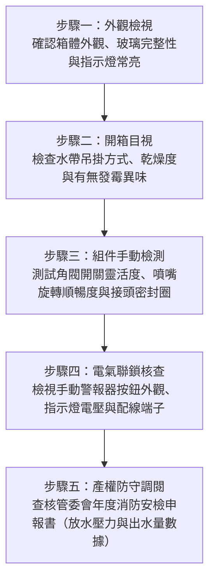

# 全案購屋實戰第二百九十一部：中古大樓社區各樓層消防栓箱體水帶老化發霉噴嘴卡死與消防水壓出水量體檢工序全書

## 壹、核心查驗宗旨與前言

在家庭購屋挑選中古大樓的實地勘查與管委會公共設施健檢中，「樓層室內消防栓系統」（Indoor Fire Hydrant System）是居家發生火警初期、第一時間進行自主滅火壓制火勢的最關鍵生命防線。消防栓系統若平時疏於定期維護、放水檢測與乾燥保養，極易在各樓層梯廳消防栓箱內衍生水帶霉爛脆化、銅質噴嘴氧化卡阻、放水閥閥桿生鏽抱死、減壓孔板水垢堵塞，以及啟動按鈕線路斷路導致地下室消防加壓泵浦無法連鎖啟動等重大隱患。

一旦不幸遭遇梯間火警或鄰戶火災，居民或義消拉開消防箱卻發現水帶爆裂、閥門扳不開、或出水壓力形同水槍滴尿，將瞬間失去黃金逃生與滅火時機。本手冊專門為買方打造一套全維度、無死角的「各樓層消防栓系統及零組件全生命週期體檢工序」，教導購屋者如何透過目視、手動觸摸、管委會申報書核驗與特約條款設計，徹底把關公設消防救命設施。

---

## 貳、中古大樓室內消防栓系統構造原理與四大常見致命隱患

### 一、標準室內消防栓箱（第一種與第二種）核心組件架構
1. **消防出水栓（Angle Valve）**：通常為口徑 40mm（1.5 吋）或 65mm（2.5 吋）青銅角閥，連接消防立管，承受高達 7~10 kgf/cm² 之管網靜水壓。
2. **消防水帶（Fire Hose）**：橡膠內襯帆布水帶或聚氨酯（PU）雙層夾網高壓水帶，長度標準為 15 米至 20 米，平時以蛇形吊掛（Hose Rack）或捲盤（Hose Reel）方式收納。
3. **多功能消防水霧/直線噴嘴（Nozzle）**：具備直流沖刷與水霧降溫阻煙雙段切換旋轉把手。
4. **火警手動報警機（Manual Call Point）與遠端啟動指示燈**：按下即連鎖啟動地下室消防主泵浦，指示燈亮起代表泵浦已運轉加壓。
5. **減壓裝置（Orifice Plate / Pressure Reducing Valve）**：低樓層因重力靜水壓過高（若超過 7 kgf/cm² 易造成水帶爆裂及反作用力傷人），法規要求設置減壓孔板或專用減壓閥，維持放水壓力在 1.7 ~ 7.0 kgf/cm² 之間。

### 二、中古社區常見之四大致命病灶
1. **水帶長期受潮發霉與橡膠層水解脆化**：梯間濕度高或曾有清潔工誤開水閥微漏，帆布水帶受潮孳生黑黴，內部硫化橡膠脆化黏連。一旦遭遇 3 kgf/cm² 以上水壓衝擊，立即縱向爆裂，無法出水。
2. **放水角閥閥芯生鏽卡死與迫緊橡膠硬化**：多年未做放水測試，自來水礦物質鈣化形成堅硬水垢，青銅閥桿咬死，徒手完全無法轉開；或迫緊墊圈脆化，平時微滲滴漏導致箱體底板鏽蝕穿孔。
3. **直流噴嘴旋轉環銅綠氧化卡死**：黃銅噴頭表面覆蓋厚重銅綠，噴嘴切換軸心卡死在關閉位，強行扭轉導致手柄斷裂。
4. **手動啟動訊號線氧化斷路與泵浦無反應**：按鈕內部銅微動開關接點長年受潮氧化阻抗無窮大，按下後地下室主泵浦毫無動靜，僅靠樓頂重力水箱微弱水壓出水，射程不足 3 公尺。

---

## 參、買方現場看屋與公設消防栓箱五步專業體檢工序

### 一、步驟一：外觀檢視
- **箱門啟閉平順度**：輕輕開啟消防栓箱門，確認鉸鏈無鏽蝕咬死、磁吸扣或門鎖卡掣靈敏，不需暴力破壞即可 3 秒內打開至 150 度以上。
- **指示燈常亮狀態**：箱頂紅色「消防栓指示燈」必須常亮，若熄滅代表該迴路電源故障、保險絲燒毀或斷線。

### 二、步驟二：開箱目視與水帶品檢
- **水帶展開收納狀況**：合格的水帶應折疊整齊懸掛於活動架上，接頭自然朝外。
- **乾燥與氣味判斷**：伸手觸摸水帶表面帆布，確認完全乾燥、無潮濕黏膩感；嗅聞箱內空氣，若有濃烈霉爛臭味，代表內部早已受潮變質。
- **水帶標籤查驗**：檢視水帶上之「消防安全設備審核認可標籤」與出廠耐壓年限（標準使用壽命通常為 10 年，若已逾 15 年未更換，必須要求管委會編列預算更新）。

### 三、步驟三：金屬配件與閥體動態手動測試
- **角閥轉輪空手微轉**：順時針與逆時針輕轉放水閥手輪 1/4 圈，感受閥芯是否順暢無金屬卡阻摩擦感（切勿全開以免意外噴水）。
- **快拆接頭（Machino Coupling）檢查**：檢查公母接頭之卡爪彈簧回彈是否俐落，內置橡膠墊圈（O-Ring）是否平整飽滿、無乾裂脆化脫落。
- **噴嘴切換測試**：手動旋轉水霧/直線切換環，應阻尼適中且檔位清晰。

### 四、步驟四：消防電氣與減壓構件查驗
- **減壓孔板配置**：高層建築之 1 至 5 樓消防栓箱內，角閥出水口處應安裝黃銅減壓孔板（銘牌標示孔徑如 $\phi 12\text{mm}$），防止低樓層瞬間超壓造成水帶反打人員骨折。
- **泵浦連鎖啟動按鈕**：檢視按鈕保護蓋是否完整、玻璃片無破碎、背後導線無脫落外露。

### 五、步驟五：管委會消防安全設備檢修申報書關鍵數據覆核
買方應請仲介或管委會出示由「消防設備士/師」簽證之最近一期《消防安全設備檢修申報書》：
1. **靜水壓（Static Pressure）**：各樓層應落於 $1.7 \sim 7.0\text{ kgf/cm}^2$。
2. **放水壓力（Discharge Pressure）**：末端消防栓放水壓力必須 $\ge 1.7\text{ kgf/cm}^2$。
3. **出水量（Flow Rate）**：第一種室內消防栓出水量必須 $\ge 130\text{ L/min}$。
4. **缺失改善單（Form B）**：確認申報書後附之複查紀錄表，有無「水帶破損、放水栓漏水、消防主泵浦加壓不良」等被消防局列管之限期改善項目。

---

## 肆、商務談判博弈：消防缺失轉化為殺價籌碼話術

當勘查發現梯廳消防栓箱有嚴重老化缺失（如全棟水帶過期硬化、角閥滲水、管檢申報列為不合格）時，買方應以公共安全重大隱憂為由，對屋主與管委會採取攻防壓價：

> **談判實戰話術範本：**
> 「屋主您好、周小姐您好：
> 我們非常喜歡貴戶的室內規劃，但在調閱管委會最近一期的消防設備檢修申報書並現場勘查梯廳後，發現本棟 8 樓及多個樓層的消防栓箱內，水帶出廠年份已超過 18 年，表面明顯發霉龜裂，且減壓閥與角閥接頭有嚴重水垢滲漏痕跡。
> 根據消防設備技師評估，這棟大樓的消防水帶與各樓層閥體早已超過法定折舊年限，全棟更換與管線壓力測試需要管委會動支至少數十萬元的公共維修基金；萬一發生意外，保險公司極可能因『消防設備未依法維護』而拒賠延燒損失。
> 這屬於嚴重的集合住宅公設安全瑕疵。為了我們全家老小的生命財產安全，我們購入後必須自費在梯間補強家用高效滅火設備與投保高額火險，並需承擔未來社區被消防局連續開罰與分攤昂貴公設修繕費的風險。因此，我們主張在總價中折讓 **15 至 20 萬元** 的安全補貼款，否則我們無法承擔這種致命的公共安全黑洞。」

---

## 伍、買賣契約特約防守條款專用字軌

為杜絕交屋時因消防栓系統不合格引發糾紛，買方必須在《不動產買賣契約書》特約條款中明文增列以下保護條文：

> **【室內消防栓系統與全棟消防安檢合格保證條款】**
> 1. **公設消防申報合法保證**：賣方保證本買賣標的所在社區之公共安全消防設備，包含各樓層室內消防栓系統、自動撒水系統、火警自動警報系統及地下室消防加壓泵浦，於交屋日前經主管機關（消防局）指定檢修機構檢驗申報合格，無任何受限期改善、勒令停用或處以罰鍰之列管缺失。若交屋前仍有消防列管缺失未結案，賣方應無條件負責督促管委會修繕完成，或由賣方按戶數產權比例負擔修繕清償費用。
> 2. **本樓層消防栓功能完整性驗收**：雙方同意於交屋驗收當日，買方得會同賣方及社區總幹事開啟本專有部分所在樓層之梯廳消防栓箱，確認箱內水帶完好乾燥無發霉、角閥無洩漏卡死、接頭無脆化、指示燈正常點亮。若有組件損壞或缺件，賣方應於交屋前負責修復或由尾款中扣除修復費用（每組新台幣壹萬貳仟元整）。
