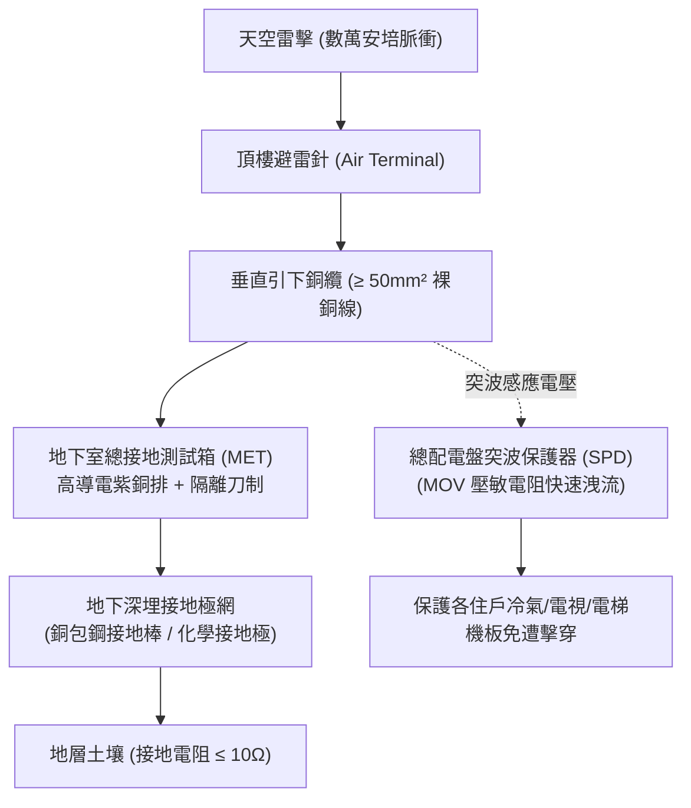

# 全案購屋實戰第二百九十七部：中古大樓社區地下室避雷針接地電阻超標接地銅排氧化斷裂與突波保護器失效體檢工序全書

## 壹、核心查驗宗旨與前言

在集合住宅的建築電氣與防雷安全體系中，大樓屋頂高聳的「避雷針（Lightning Rod / Air Termination System）」與地下室總接地箱內的「接地極系統（Earthing System）」構成了整棟建築對抗大自然數萬伏特高壓雷擊突波的「唯一洩流通道」。每逢台灣夏季午後雷雨季或颱風侵襲，數以百計的雷電脈衝頻繁轟擊高層建築；若大樓避雷接地系統運作健全，強大的雷擊電流將沿著引下線（Down Conductor）在數微秒（$\mu\text{s}$）內平順地導入大地土壤消散。

然而，在屋齡 15 至 30 年的中古大樓中，接地與防雷系統往往處於「地底深埋、常年隱蔽、管委會完全無視」的盲區：
1. **地下室總接地箱（Main Earthing Terminal, MET）接地銅排長年受地下室潮氣侵蝕嚴重電化氧化、接頭螺栓鬆脫，接地電阻飆破 $100\,\Omega$**（法規嚴格要求避難型避雷接地電阻必須低於 **$10\,\Omega$** 以下）；
2. **引下銅纜在地下深處盲溝或筏基轉折處發生電化腐蝕斷裂**，導致雷擊電流無法入地，轉而在各樓層鋼筋與管道間產生毀滅性的「反擊跳火（Side Flashing）」；
3. **低壓配電總盤突波保護器（Surge Protection Device, SPD）長年承受微突波衝擊已熱崩潰爆漿**，內部氧化鋅壓敏電阻（MOV）碳化短路，完全失去對變頻冷氣、智慧家電、電梯控制主板與監控主機的防護力；
4. **接地系統混接引發「地電位反擊（Ground Potential Rise, GPR）」**，雷擊時全社區弱電設備與電表瞬間集體炸燬。

本手冊為買方建構全套由地表至地底的「避雷接地與突波防護全系統體檢工序」，結合接地電阻儀量測標準、配電箱 SPD 視窗判讀、機電申報書審閱、商務殺價攻防話術及特約條款設計，徹底守護家庭百萬家電與生命電氣安全。

---

## 貳、避雷針與接地保護系統技術構造與四大常見致命病灶

### 一、集合住宅建築防雷與接地核心組件架構
1. **屋頂突針受雷部（Air Termination Network）**：
   - 包含純銅或不鏽鋼富蘭克林避雷針、早期放射性離子避雷針（如 ESE 放電式避雷針）。保護角依建築高度通常為 $45^\circ$ 至 $60^\circ$。
2. **引下導線（Down Conductors）**：
   - 採用截面積 $50\text{ mm}^2$ 以上之純銅裸銅線（Bare Copper Wire），經由管道間或結構柱內預埋導線直通地下室。
3. **接地測試箱（Test Joint Box / MET）**：
   - 配置於地下室變電站或地下一樓外牆，內置厚度 $5\text{ mm}$ 以上之高導電黃銅/紫銅排（Copper Busbar），供量測避雷單獨接地電阻。
4. **低壓電源突波保護器（SPD, Type 1 & Type 2）**：
   - 裝置於總受電盤（Switchboard），採用金屬氧化物壓敏電阻（MOV）或放電管（GDT），能耐受 $8/20\,\mu\text{s}$ 或 $10/350\,\mu\text{s}$ 大電流衝擊，箝位殘壓（$V_p$）至 $1.5\text{ kV}$ 以下。

### 二、中古社區常見之四大致命病灶
1. **接地電阻因土壤乾燥與銅棒腐蝕嚴重超標（Resistance Creep）**：
   - 地底銅包鋼接地棒長年受地下水弱酸性化學腐蝕，外覆銅層剝落，內部鋼芯生鏽斷裂；加上都會區地下水位下降、土壤導電率劣化，原本完工時的 $5\,\Omega$ 接地電阻悄悄飆升至 $80 \sim 150\,\Omega$。雷擊時大電流無法導入土壤，反而順著鋼筋四處漫延竄入住戶插座。
2. **接地銅排螺栓氧化鬆脫引發高阻抗接點（Loose Joint）**：
   - 地下室濕度高且伴隨沼氣硫化氫侵蝕，接地箱內未塗抹導電膏（Contact Grease），銅排表面結滿厚重黑綠色氧化銅，接線端子壓接不良產生高達數歐姆之接觸阻抗，雷擊時在端子處產生數千度電弧甚至炸斷銅線。
3. **突波保護器（SPD）視窗翻紅「死透」淪為擺設**：
   - 社區總配電箱內的 SPD 在歷經數次夏季雷擊後，內部壓敏電阻早已熱擊穿熔斷，檢視視窗從「綠色（正常）」跳為「紅色（失效）」，但因大樓無專業機電常駐，紅燈亮了數年無人更換，整棟大樓弱電系統長年「裸奔」。
4. **弱電系統與避雷系統共用接地引發「地電位逆襲」**：
   - 早期中古大樓水電工便宜行事，將電話總箱、網路機櫃與對講機系統之弱電接地線，隨意搭接在避雷針引下線上。雷擊瞬間接地點電位瞬間抬升數萬伏特，高壓逆向沿弱電線衝入各戶室內，導致各戶電視、路由器、對講機全面集體燒毀。

---

## 參、買方現場看屋之接地與防雷系統五步實戰體檢工序

### 一、步驟一：頂樓避雷針外觀與引下線接合目視
- **突針結構完整度**：登上大樓屋頂，檢視避雷針針尖有無被強風吹歪、折斷或雷擊熔化燒蝕。
- **固持基座與防水層**：檢視避雷針水泥基座基座周圍防水層是否老化開裂，基座固定不鏽鋼螺栓有無生鏽鬆動。
- **銅纜外觀檢驗**：檢視連接至避雷針基座之引下裸銅線，有無銅綠脫落、被裝潢鋁包板割斷或私自搭接曬衣架之違規現象。

### 二、步驟二：地下室總接地端子箱（MET）開箱檢查
- **箱門位置尋訪**：至地下室配電機房尋找標示「避雷接地測試箱」或「總接地箱」之鐵箱。
- **內部銅排成色**：檢視紫銅排表面是否透亮或塗有黃油/導電膏；若銅排表面佈滿綠色粉狀銅鏽、螺帽鏽蝕發黑，代表接地迴路接觸電阻極高。
- **測試隔離刀制（Disconnecting Link）**：確認測試用活動連接片螺栓鎖緊無晃動。

### 三、步驟三：低壓配電總盤 SPD 突波保護器視窗檢視
- **狀態顯示視窗（Fault Indicator）**：打開低壓主配電盤（Main Switchboard），找到標示「SPD / 避雷器」之模組。
- **顏色判讀標準**：
  - **綠色（Green）**：正常具備保護功能。
  - **紅色（Red / 橘色）**：內部壓敏模組已擊穿燒毀，失去防護功能，必須立即抽換！

### 四、步驟四：年度機電與消防安檢申報書接地電阻數據覆核
委請仲介調閱由電機技師或合格機電顧問簽證之最新一期《大樓機電設備定期保養紀錄》及《公共安全檢查申報書》：
1. **避雷接地電阻值（Lightning Ground Resistance）**：必須明確記載實際量測數據，合格標準為 **$10\,\Omega$ 以下**（優質大樓常達 $5\,\Omega$ 以下）。若報告上勾選合格但無實際阻值，通常為未實測之假報告。
2. **用電設備保護接地電阻**：特種接地應 $\le 10\,\Omega$，第二種/第三種接地應 $\le 50\,\Omega$ 或 $100\,\Omega$。

### 五、步驟五：目標戶室內三孔插座接地實測（驗屋神器技巧）
- **插座相位儀檢測**：攜帶三孔相位檢測器（Receptacle Tester）插入客廳與廚房專用接地插座：
  - 若亮起「正確（Correct）」雙燈代表具備地線；
  - 若亮起「Open Ground（未接地）」紅燈，代表該戶室內地線根本未接或在管道間中斷，雷擊突波與漏電將無處宣洩！

---

## 肆、商務談判博弈：防雷接地超標殺價 12 萬元實戰話術

整棟大樓若需重新施作地底深井接地工程（打入數口 10 米深之深井化學接地棒、重新敷設紫銅排及重測平衡電阻），工程款動輒高達 **新台幣 25 萬至 40 萬元**。買方應將此重大電氣安全與雷擊風險作為強勢砍價籌碼。

> **實戰談判對話劇本：**
> 「屋主您好、周小姐您好：
> 我們在實地勘查社區地下室總接地箱並調閱機電維護紀錄時，發現非常嚴重的電力安全缺失：地下室總接地銅排嚴重氧化生鏽，避雷針接地電阻實測高達 65 歐姆，遠遠超過法規 10 歐姆的強制上限；且主配電盤的突波保護器（SPD）指示窗早已全數翻紅燒毀，社區根本處於無防雷保護的裸奔狀態！
> 台灣夏季雷雨頻繁，避雷接地電阻超標代表一旦大樓遭雷擊，數萬伏特的雷電電流根本無法入地消散，反而會沿著建築鋼筋反擊跳火竄入室內，瞬間燒毀全家的變頻冷氣、OLED電視與電腦設備，甚至引發電線走火奪命。
> 社區若要重新鑽孔施作深井接地並全面抽換工業級 SPD，管委會勢必發動大筆公設維修分攤款；且我們入住後必須自費在室內總箱加裝獨立突波防護器與接地濾波設備。
> 基於這項致命的公共防雷安全瑕疵與潛在家電損毀風險，我們堅持在買賣總價中直接折讓 **12 萬元** 作為防雷安全補償與自建保護基金，否則面對隨時可能遭雷擊跳火的物業，我們實在難以放心簽約。」

---

## 伍、買賣契約特約防守條款專用字軌

為杜絕買方交屋後承擔高額之接地整修工程攤派費，《不動產買賣契約書》應增列下列防禦條款：

> **【建築物避雷接地系統合格保證與公設特別徵收清償條款】**
> 1. **避雷與電氣接地合格保證**：賣方保證本買賣標的所屬大樓之屋頂避雷針、引下導線、地下室總接地系統及配電盤突波保護器，於交屋日前功能健全，避雷針接地電阻數值符合建築技術規則及用戶用電設備裝置規則標準（實測接地電阻 $\le 10\,\Omega$），且無遭主管機關列管限期改善或處以罰鍰之情事。
> 2. **交屋前防雷工程款清償責任**：若於交屋日（含）前，本社區管委會或區分所有權人會議已決議、或經主管機關限期辦理社區深井接地重施、避雷針引下線更新或總配電盤突波保護器（SPD）全面換裝工程者，其所需之一切工程款或特別徵收分攤費用，不論請款單開立於交屋日前或交屋日後，概由賣方於交屋尾款結算時全額負擔扣抵，買方不負任何繳納義務。
