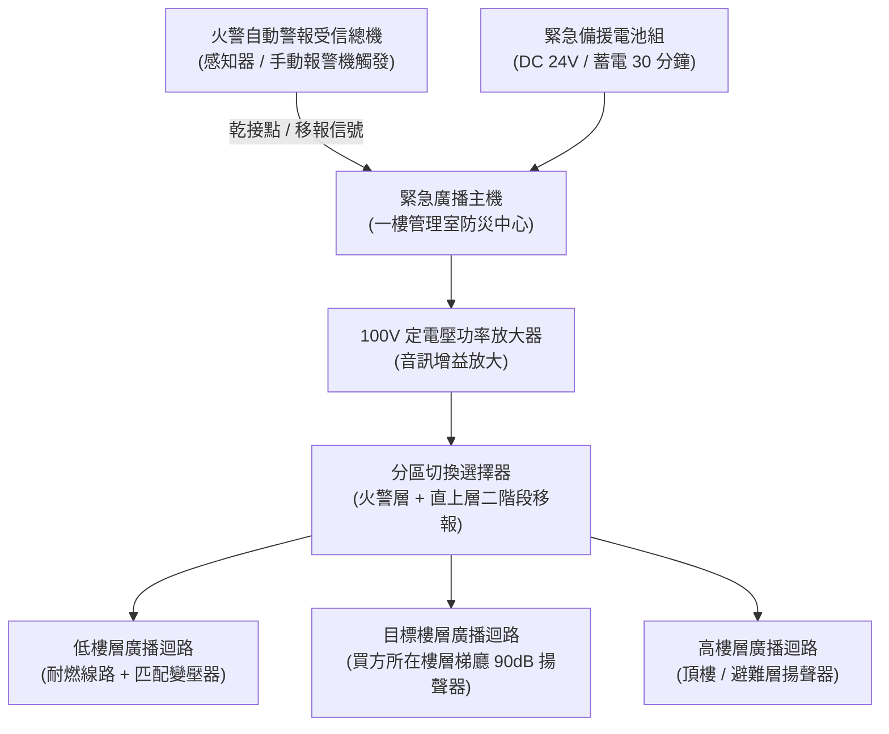

# 全案購屋實戰第二百九十三部：中古大樓社區各樓層緊急廣播設備音壓衰減揚聲器線路短路斷路主機功率放大器燒毀與火警分區移報體檢工序全書

## 壹、核心查驗宗旨與前言

在集合住宅的消防安全與避難逃生體系中，火警發生時的「訊息傳遞即時性」是決定全體住戶能否全員生還的關鍵樞紐。許多高樓火災悲劇中，受困住戶往往是在濃煙已經灌入梯廳、甚至門縫冒出火光時才驚覺大難臨頭，追查原因均直指同一項致命公設盲點——**「社區各樓層緊急廣播設備（Emergency Public Address System）全面失靈或音壓嚴重不足」**。

在 15 至 30 年的中古大樓中，緊急廣播系統常見病灶包括：
1. **主機功率放大器（Power Amplifier, PA）老化燒毀或電晶體擊穿**，火警觸發時主機空轉無聲；
2. **各樓層緊急廣播揚聲器（Loudspeaker）音圈受潮發霉、錐盆破裂**，廣播聲音嘶啞微弱或完全無聲；
3. **廣播迴路因裝潢施工剪線、老鼠啃咬或受潮引發「短路（Short Circuit）或斷路（Open Circuit）」**，造成整棟垂直分區廣播癱瘓；
4. **火警受信總機與廣播主機之間的「分區移報連鎖接點（Interlocking Relay）」氧化失效**，無法實現「二階段鳴動（先鳴動起火層及其直上層）」。

本手冊專為購屋者建構全套專業且深入的「緊急廣播設備全系統實地健檢工序」，結合管委會檢修申報書審閱、現場音壓與線路量測技巧、商務殺價壓判話術，以及特約條款保障，徹底防範生命安全漏洞與昂貴公設修繕分攤風險。

---

## 貳、緊急廣播系統技術架構與中古社區四大常見故障死穴

### 一、集合住宅緊急廣播系統技術配置
1. **緊急廣播受信總機（PA Master Control Unit）**：配置於一樓管理室或中央防災監控室，內含火警語音合成晶片、緊急電源切換電路、分區矩陣選擇器及監聽喇叭。
2. **定電壓功率放大器（Constant Voltage Amplifier）**：消防法規要求採用 $70\text{V}$ 或 $100\text{V}$ 高阻抗定電壓輸出架構，使音訊信號在長距離垂直配線傳輸時降低電流損耗。
3. **各樓層吸頂式/壁掛式揚聲器（Ceiling/Wall Speaker）**：內部包含阻抗匹配變壓器（Matching Transformer）與動圈式紙盆單體，規範要求任一位置音壓必須達 $90\text{ dB}$ 以上。
4. **耐燃/耐熱導線配管（Fire-Resistant Cables）**：法規規定緊急廣播幹線必須採用通過認可之耐熱電線（如 $840^\circ\text{C}$ 耐燃電纜），貫穿防火區劃處須以防火泥確實封堵。

### 二、中古社區常見之四大故障死穴
1. **功率放大器（AMP）長期不通風過熱燒毀**：
   - 管理室廣播主機機櫃堆滿雜物，散熱風扇卡死，放大模組長年處於高溫環境，濾波電容乾涸爆漿、功率電晶體熱擊穿，平時社區尋人廣播尚有蚊子叫聲，一旦全棟火警連鎖全開，功放立即保護跳脫或冒煙燒燬。
2. **揚聲器紙盆風化與變壓器受潮燒毀**：
   - 梯間因潮濕水氣侵蝕，吸頂喇叭之紙質音盆（Paper Cone）吸水發霉變形、懸邊脆裂，或是天花板冷氣冷凝水滴漏直接滲入變壓器，導致初級線圈短路。
3. **單戶裝潢施工剪線引發全迴路「一損俱損」**：
   - 傳統中古大樓多採「串聯分歧並聯迴路」，若某戶屋主裝潢敲除天花板時將室內廣播線直接剪斷且未妥善絕緣包紮，裸露銅線碰觸輕鋼架接地，將導致該樓層甚至整棟公共廣播迴路瞬間短路跳脫，整區靜音。
4. **火警連鎖二階段語音播報移報故障**：
   - 總機連鎖繼電器接點氧化，感知器警報響起時，廣播主機無任何動作，仍需管理員手動按下廣播鍵；或語音合成晶片記憶體故障，火警發生時僅發出尖銳蜂鳴雜音，無法正確播報「現在幾樓發生火警，請依避難指示逃生」之語音訊息。

---

## 參、買方看屋與公設緊急廣播實務體檢工序

### 一、步驟一：管理室廣播主機面板與燈號檢核
- **電源狀態指示燈**：檢視主機面板「交流電源（AC ON）」綠燈是否恆亮，確認未拔掉插頭運作。
- **斷線/短路故障指示燈（Line Fault Indicator）**：檢驗面板各分區指示燈，若發現有任何一區亮起「紅燈」或「橘黃燈」，代表該區迴路存在斷線或線路短路，管委會可能因雜音吵鬧而將警報音量旋鈕歸零。
- **後備蓄電池檢核**：打開主機下層電池箱，檢視鉛酸蓄電池出廠年份，標準壽命為 **3 年**，若已超過 5 年未換或電瓶外殼澎脹鼓起，停電時主機將直接斷電無法廣播。

### 二、步驟二：目標戶梯廳與走廊揚聲器外觀巡檢
- **揚聲器配置密度**：檢視買方目標戶所在樓層梯廳，自大門走出至逃生梯間，依規定行走距離每 **25 米** 應至少配置一顆揚聲器。
- **本體外觀狀況**：抬頭目視吸頂喇叭護網是否有生鏽、發霉黃斑，或被後續天花板油漆全面噴死透音網孔。
- **衰減器（Attenuator）檢查**：部分豪宅或進階社區各戶室內設有音量調節開關（三線式衰減器），確認其具備「火警自動強制全音量跳脫（3-Wire Bypass）」功能，防止住戶平時關閉音量導致火災時聽不到警報。

### 三、步驟三：實地廣播語音與音壓量測（現場測試技巧）
- **管理室定時公播核驗**：利用下午或傍晚管理室進行例行性包裹、里鄰公告測試播音時，於梯廳與目標戶室內（緊閉大門狀態下）親身體驗：
  1. 咬字清晰度（Speech Transmission Index, STI）是否良好，有無嚴重金屬破音或電流雜音；
  2. 使用手機音壓計 App（如 Sound Meter）量測音量，室內關門狀態下音壓必須仍能達到 **$65\text{ dB}$ 以上**，梯廳走廊必須達到 **$90\text{ dB}$ 以上**，足以在深夜熟睡中喚醒家人。

### 四、步驟四：消防檢修申報書與改善通知書調閱
買方應委請仲介調閱由消防安全設備檢修機構簽證之最新一期《消防安全設備檢修申報書》：
1. **緊急廣播設備檢查表**：核對「綜合檢查」項下之各樓層「音壓數值（dB）」與「鳴動方式（二階段鳴動連鎖）」。
2. **缺失項目列管表**：確認申報書備註欄是否載明「第 X 樓廣播迴路斷線」、「功率放大器模組輸出不足」等違規待修紅字。

---

## 肆、商務談判博弈：廣播設備缺失殺價籌碼話術

緊急廣播系統若需全棟重新穿線、換裝耐燃線路並抽換中央功率放大主機，工程款動輒高達 **新台幣 30 萬至 60 萬元**。買方應將此致命的避難逃生公設缺失作為壓制總價的殺手鐧。

> **實戰議價談判對話劇本：**
> 「屋主您好、周小姐您好：
> 我們在仔細勘驗社區公設及目標樓層梯廳時，發現公共緊急廣播系統存在重大安全隱患：梯廳揚聲器網孔被油漆封死且內部受潮破裂，我們向管理員借閱消防申報書更發現，本棟高樓層廣播迴路長期處於線路短路跳脫狀態，管理室廣播主機的擴大機模組亦已老化輸出嚴重衰減！
> 廣播系統是全棟唯一能在火災初期喚醒住戶逃生的『救命神經』。如今系統形同虛設，一旦深夜其他樓層起火，我們在緊閉氣密窗的室內根本聽不到任何火警逃生廣播，全家生命安全暴露於極高風險中。
> 社區若要全面重拉各樓層耐燃音訊線路並更換防災廣播主機，管委會勢必發動大筆公設維修特別徵收款；且買方入住後必須自行在室內加裝獨立式連動感煙偵測警報器以彌補公設缺陷。
> 基於這項重大公共安全瑕疵，我們堅持在成交總價中直接扣除 **12 萬元** 作為安全折讓與自建警報系統基金，否則面對這種隨時可能喪失逃生先機的物業，我們實在難以放心簽約。」

---

## 伍、買賣契約特約防守條款專用字軌

為防止買方在交屋後被迫承擔管委會重修廣播線路的鉅額公費攤派，《不動產買賣契約書》應增列下列防守條款：

> **【公共消防緊急廣播系統合格保證與公設特別徵收清償特約條款】**
> 1. **緊急廣播系統正常運作保證**：賣方保證本買賣標的所在樓層及社區公共區域之緊急廣播設備（包含管理室防災主機、功率放大器、緊急備用電源、各樓層分區廣播線路及梯廳揚聲器），於交屋日前具備正常播音與火警連鎖鳴動功能，音壓符合各類場所消防安全設備設置標準，且無遭主管消防機關列管限期改善或處以罰鍰之情事。
> 2. **交屋前廣播修繕徵收款清償責任**：若於交屋日（含）前，本社區管委會或區分所有權人會議已決議、或經消防主管機關限期辦理全棟緊急廣播主機更新、線路短路檢修重拉等工程者，其所需之一切工程分攤款，不論繳款期日為何，概由賣方於交屋尾款結算時全額負擔扣抵，買方概不承擔任何交屋日前之既有維修債務。
