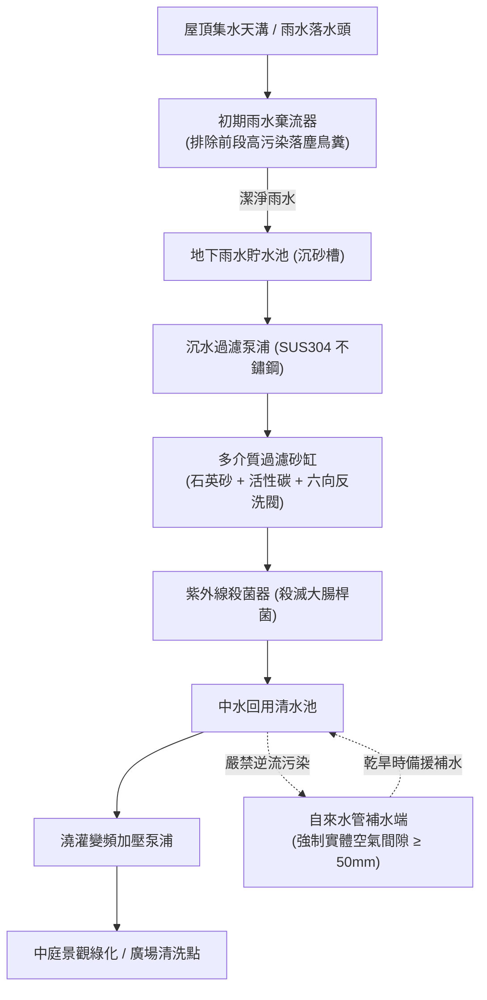

# 全案購屋實戰第二百九十九部：中古大樓社區地下室雨水回收系統過濾砂缸板結沉水抽水泵浦空轉燒毀與回水管防虹吸倒灌體檢工序全書

## 壹、核心查驗宗旨與前言

在現代集合住宅倡導綠建築與節能減碳的趨勢下，許多屋齡在 10 至 25 年之間的中古大樓社區，均在地下室規劃配置了「雨水回收利用系統（Rainwater Harvesting & Reuse System）」。該系統將屋頂及中庭收集的天然雨水，匯流至地下雨水蓄水池，經由沉砂池、石英砂過濾器（Media Sand Filter）及紫外線殺菌設備淨化後，供作全社區「中庭景觀綠化澆灌、公共廣場清洗、地下車道截水溝沖洗」甚至「低樓層公用廁所沖廁」之非飲用雜用水水源。

然而，在中古大樓的長年實際運轉中，雨水回收系統卻往往是管委會最不願面對、故障率極高且衍生嚴重衛生惡臭的「公設爛尾黑洞」：
1. **雨水初沉砂過濾池淤積板結、多介質石英砂缸內部「生物泥膜鈣化結塊」**，過濾阻力無限飆升，導致水流無法穿透；
2. **沉水式加壓抽水泵浦（Submersible Pump）因浮球開關油污卡阻發生「無水乾抽（Dry Run）」**，機械軸封摩擦高溫燒毀、馬達線圈熱擊穿短路；
3. **回收水配管與自來水系統交接處「防虹吸破真空閥（Vacuum Breaker）與雙止回閥失效」**，一旦自來水管網負壓，極易引發「污穢雨水倒灌逆流污染全棟自來水」的集體中毒重大衛生危機；
4. **地下雨水蓄水槽缺乏定期清淤曝氣，藻類滋生厭氧發酵產生劇毒硫化氫（H₂S）與惡臭沼氣**，藉由透氣管逆灌至一樓中庭或地下停車位。

本手冊專為購屋者建構全方位「雨水回收全系統實地體檢工序」，結合地下過濾機房檢查、水質濁度與氣味辨識、防逆流裝置檢核、商務砍價話術及特約條款設計，徹底避免交屋後遭受全棟水質污染威脅與昂貴公設整修攤派負擔。

---

## 貳、雨水回收再利用系統技術構造與四大致命故障病灶

### 一、集合住宅雨水回收利用核心組件架構
1. **雨水收集與初期雨水棄流裝置（First Flush Diverter）**：
   - 屋頂與露台雨水初期沖刷帶有大量落塵、鳥糞與落葉，前 $2 \sim 3\text{ mm}$ 之高污染降雨必須自動導流排放至公共污水管，後期較潔淨雨水才進入貯水槽。
2. **地下雨水原水貯存池（Raw Rainwater Cistern）**：
   - 包含沉砂沉澱隔槽，去除大顆粒泥沙碎石。
3. **多介質過濾砂缸（Sand & Carbon Multi-Media Filter）**：
   - 內裝石英砂、無煙煤與活性碳，配置手動/自動六向反洗多路閥（Multi-port Backwash Valve），去除水中懸浮固體（SS）。
4. **變頻澆灌加壓供水泵浦與紫外線殺菌器（UV Sterilizer）**：
   - 加壓輸送至中庭各處取水點，紫外線燈管破壞大腸桿菌 DNA 防止綠化噴灌時氣膠吸入引發退伍軍人症。
5. **自來水雙重補水防倒灌防護裝置（Reduced Pressure Zone, RPZ Backflow Preventer）**：
   - 當雨水不足時自動切換自來水補水，法規要求必須保持「完全實體空氣間隙（Air Gap $\ge 50\text{mm}$）」或雙止回防倒流器，嚴防雨水倒流。

### 二、中古社區常見之四大致命病灶
1. **過濾砂缸長年未反洗導致「濾料板結成岩」**：
   - 社區管理員完全不知如何操作過濾砂缸的「Backwash（反洗）」功能。砂層內部沉積厚重泥漿、藻類生物膜與碳酸鈣結晶，石英砂嚴重板結成堅硬石塊，過濾進水壓力表飆升至 $4.5\text{ kgf/cm}^2$ 以上，水流無法流通，內部管路與布水器受壓爆裂。
2. **沉水泵浦浮球受油污卡阻引發無水乾燒**：
   - 地下原水池環境惡劣，浮球開關（Float Switch）電纜被落葉或油泥纏繞卡死在上浮狀態。當池底雨水早已抽乾，微電腦依然判定有水，沉水泵浦在無水冷卻狀態下長時間空轉，內部碳化矽軸封燒熔爆開，水份侵入線圈引發相間短路燒燬。
3. **自來水補水管防虹吸失效引發「全棟自來水污染」**：
   - 雨水清水池自來水補水管未依法設置空氣間隙，而是將自來水軟管直接插入池水中。一旦地震造成台電停電或自來水幹管維修產生負壓虹吸，池內滿是細菌與有機物的雨水被直接抽吸吸入全棟住戶之生活飲用水管道，造成住戶水龍頭流出黑臭黃水、集體腹瀉。
4. **紫外線殺菌燈石英套管結垢黑化徹底失效**：
   - UV 殺菌器內部的石英玻璃套管超過 2 年未曾拆洗，表面附著一層厚厚的鐵鏽水垢，紫外線穿透率幾乎為零；且 UV 燈管壽命（標準約 8,000 小時）早已過期衰減，中水噴灌時含有超標萬倍之大腸桿菌，危害住戶與孩童健康。

---

## 參、買方現場看屋之雨水回收系統五步實戰體檢工序

### 一、步驟一：地下雨水處理機房氣味與池體外觀核查
- **機房環境氣味判別**：走入地下雨水設備機房，嗅聞是否有強烈腐敗沼氣、臭雞蛋味（硫化氫）或發酵霉臭味；若異味刺鼻，代表蓄水池沉砂長年腐敗且缺乏通氣循環。
- **人孔蓋密封與防墜網**：檢視雨水池水泥人孔蓋是否密合、有無加裝密封橡膠墊圈；開啟時內部是否裝設不鏽鋼防墜網與防蚊蟲紗網。

### 二、步驟二：多介質過濾砂缸與壓差表檢核
- **過濾缸壓力表讀數**：檢視砂缸頂部之進出水壓力表：
  - 正常潔淨砂層壓力應在 **$0.8 \sim 1.5\text{ kgf/cm}^2$** 之間；
  - 若指針超過 **$2.5 \sim 3.0\text{ kgf/cm}^2$**（指針進入紅色危險區），代表內部濾砂已完全堵塞板結。
- **多向閥操作柄狀態**：檢查六向反洗閥手柄是否靈活、視窗玻璃（Sight Glass）是否清晰透亮；若視窗內部滿是黑泥，代表長年未做反洗排污。

### 三、步驟三：自來水補水端防倒灌「空氣間隙」實物查驗
- **實體空氣間隙（Air Gap）距離量測**：走到雨水清水槽上方的自來水補水管出水口：
  - 出水口法規強制要求必須高於溢流液位（Overflow Level）**至少出水管徑之 2 倍以上且不得小於 50mm**；
  - **嚴格檢視是否有「水管浸入池水中」的違規安裝**！若自來水管直接沒入水中，屬於極度危險之重大公害瑕疵。

### 四、步驟四：中庭澆灌水龍頭實地放水水質目視
- **水質外觀透明度**：行至中庭綠化澆灌栓或公共景觀洗手台，轉開雨水回收栓出水，以透明玻璃杯或寶特瓶盛裝：
  1. 觀察出水是否有肉眼可見的懸浮泥沙、綠色藻類碎屑；
  2. 湊近嗅聞出水是否有沼氣腥臭味；
  3. 檢視出水加壓水壓是否充沛平穩。

### 五、步驟五：管委會設備維護合約與水質檢驗報告調閱
委請仲介向管委會調閱：
1. **雨水蓄水池清洗紀錄**：法規規定蓄水池每 **半年至一年** 應委託合格水池清洗廠商進行一次高壓水刀清淤消毒。
2. **中水水質檢驗報告**：檢核報告中之「大腸桿菌群（Coliform Group）」與「濁度（Turbidity）」，大腸桿菌必須 $\le 10\text{ CFU/100mL}$，濁度必須 $\le 5\text{ NTU}$。若管委會拿不出任何水質檢驗單，代表該系統已形同廢棄私搭。

---

## 肆、商務談判博弈：雨水公設故障殺價 12 萬元實戰話術

整棟大樓地下雨水回收系統若需進行原水池清淤清泥、過濾砂缸更換全新石英砂濾料、抽換 2 台不鏽鋼沉水泵浦並更換紫外線燈管組，翻新報價高達 **新台幣 20 萬至 35 萬元**。買方應將此潛在的公設衛生與維修風險化為砍價殺手鐧。

> **實戰談判對話劇本：**
> 「屋主您好、周小姐您好：
> 我們在實地勘查社區地下室雨水回收機房並調閱管委會保養紀錄後，發現非常嚴重的公設維護盲點：地下雨水過濾砂缸壓力表早已飆破紅線、內部濾料嚴重泥化板結，沉水抽水泵浦更是頻繁空轉跳脫；更致命的是，機房瀰漫強烈的硫化氫沼氣惡臭，自來水補水管居然沒有依法保持空氣間隙，直接插在髒水池裡！
> 這項缺失極度危險！一旦自來水管因停水產生負壓虹吸，充滿大腸桿菌與腐敗泥漿的雨水將直接倒灌進全社區的自來水管網，全家人每天喝水、刷牙、洗澡都有集體化學與細菌中毒的重大風險；且沉水泵浦與砂缸全面損壞，全棟每戶勢必面臨龐大的修繕公費攤派。
> 為了承擔這項重大的公共衛生安全風險與未來必然發生的設備翻新攤派款，並保障我們入住後在室內自費加裝高規生飲級雙向逆止閥與全戶濾水系統，我們堅持在買賣總價中直接扣除 **12 萬元** 的安全補貼款，否則面對一個可能倒灌污水的物業，我們實在不敢承擔家庭健康風險。」

---

## 伍、買賣契約特約防守條款專用字軌

為保障買方交屋後免受社區雨水系統倒灌污染及公設修繕分攤債務困擾，《不動產買賣契約書》應增列下列防禦條款：

> **【公共雨水回收系統衛生安全保證與公設特別徵收清償條款】**
> 1. **雨水回收設備衛生合格保證**：賣方保證本買賣標的所屬大樓地下室之雨水回收再利用系統（包含原水池、沉砂池、過濾砂缸、紫外線殺菌設備及自來水補水防倒流裝置），於交屋日前運作健全，其補水管路符合自來水法防逆流與物理空氣間隙規定，無任何雨水逆灌污染自來水管網之情事，且無遭主管機關列管限期改善或處以罰鍰。
> 2. **交屋前雨水公設整修工程款清償義務**：若於交屋日（含）前，本社區管委會或區分所有權人會議已決議、或經主管機關限期辦理地下雨水蓄水池全面清淤、過濾砂缸濾料更新、沉水泵浦更換等工程者，其所需之一切工程款或特別徵收分攤費用，不論請款單開立於交屋日前或交屋日後，概由賣方於交屋尾款結算時全額負擔扣抵，買方不負任何繳納義務。
