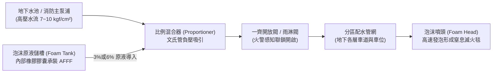

# 全案購屋實戰第二百九十二部：中古大樓社區地下室消防泡沫滅火設備原液槽沉澱變質泡沫原液混合器卡死與噴頭阻塞體檢工序全書

## 壹、核心查驗宗旨與前言

在現代集合住宅大樓的地下停車場中，由於大量停放燃油車輛（汽柴油油箱）、機車以及近年暴增的油電混合車與純電動車（具備大型鋰電池組），地下室一旦發生車輛起火事故，屬於極度危險之「B類（液體或可熔化固體火災）及電氣火災」。傳統單純以水滅火不僅無法撲滅浮在水面燃燒的汽油或機油，反而極易造成「沸溢（Boilover）」與火勢隨水流漫延。

因此，建築技術規則與各類場所消防安全設備設置標準明定地下停車場必須配置「消防泡沫滅火系統」（Foam Fire Extinguishing System）。然而，中古大樓社區因數十年未曾真正觸發火警，地下室泡沫滅火系統往往淪為「公設管理黑洞」：
1. **泡沫原液槽（Foam Tank）內部原液沉澱固化、水解酸化變質，喪失發泡成膜能力**；
2. **比例混合器（Proportioner / Foam Eductor）閥芯金屬電化腐蝕抱死，無法吸取原液**；
3. **泡沫放射噴頭（Foam Sprinkler Head）常年被地下室車輛廢氣油煙、粉塵堵塞**；
4. **管網內壁嚴重結垢鏽蝕，一旦放水瞬間堵死噴嘴孔口**。

本手冊為買方提供全套深入且專業的「地下室消防泡沫滅火設備完整體檢工序」，指導購屋者在實地巡檢地下車位、調閱管委會設備保養清單與簽訂買賣契約時，徹底避開數百萬元公設維修分攤陷阱與生命財產風險。

---

## 貳、地下室消防泡沫滅火系統運作原理與四大致命故障病灶

### 一、泡沫滅火系統核心技術構造
1. **泡沫加壓原液儲槽（Diaphragm Foam Concentrate Tank）**：通常為立式或臥式碳鋼壓力容器，內部裝設耐油耐腐蝕的氯丁橡膠或丁腈橡膠膠囊（Bladder），外部為水壓擠壓室，膠囊內部裝填 3% 或 6% 型「水成膜泡沫原液（AFFF, Aqueous Film-Forming Foam）」或合成界面活性劑泡沫液。
2. **壓差比例混合器（Ratio Flow Proportioner）**：利用文氏管效應（Venturi effect），藉由消防主泵浦導入之高壓水流產生局部低壓，將膠囊內的泡沫原液精確按比例（3% 或 6%）吸入主管網混合成「泡沫混合液」。
3. **一齊開放閥（Deluge Valve）與泡沫分區控制閥**：常時由電磁閥或感熱火警撒水感知管網控制保持關閉，火警感知觸發後瞬間全面開閥送水。
4. **泡沫噴頭（Foam Head / Foam Water Nozzle）**：安裝於車位上方頂板，分為吸氣型發泡噴頭（Air-Aspirating Head）與非吸氣型衝擊式噴頭，將混合液與空氣高速碰撞形成緻密厚重的滅火泡沫毯（Foam Blanket），隔絕氧氣與抑制油氣蒸發。

### 二、中古大樓常見之四大滅頂病灶
1. **泡沫原液逾期未換、分層結晶酸化**：
   - 標準化學合成水成膜原液有效保存年限為 **8 至 10 年**。許多 20 年以上的中古社區管委會從未更新過原液。
   - 原液長期受地下室溫濕度變化與重力影響，產生沉澱物、膠質分層或結晶板結，pH 值大幅酸化（呈強酸性）。一旦加壓，酸性結晶雜質會直接卡死比例混合器的孔板。
2. **膠囊破裂導致原液稀釋失效**：
   - 槽內橡膠隔膜老化脆化破孔，外圍加壓水滲透進入膠囊內部，導致泡沫原液被自來水大量稀釋；或者原液逆流外洩至加壓水室，從排氣閥微漏，造成儲槽內根本沒有足夠濃度的有效原液。
3. **比例混合器計量閥（Metering Valve）與逆止閥銹死**：
   - 水與濃縮液交界處極易產生嚴重的雙金屬電化腐蝕，不鏽鋼球閥與黃銅座體氧化咬死，文氏管無法抽吸原液，噴頭噴出的全是普通清水，完全無滅油火能力。
4. **車位頂部噴頭被油污油漆封死與配管鏽穿**：
   - 社區過去進行地下室天花板噴漆或車位重劃標線時，未對泡沫噴頭進行保護包覆，導致噴嘴出水孔與吸氣網格被噴漆覆蓋；加上管內長期無水防腐不良，管壁內層剝落的鐵鏽碎屑在開閥瞬間集中衝向噴頭孔口造成集體堵塞。

---

## 參、買方現場看屋之泡沫系統五級穿透式體檢工序

### 一、步驟一：巡視地下室消防機房與泡沫原液槽體
- **儲槽外觀與防腐塗裝**：檢視紅色泡沫儲槽本體有無大面積起泡、脫漆或嚴重鐵鏽穿孔，銘牌標示容量（常見為 500L、1000L 或 2000L）與充填日期。
- **液位計（Sight Gauge）確認**：若為透明管液位計，檢視管內液面高度是否達到滿載標線（Full Line），液體顏色是否透亮（水成膜通常為透明微黃或琥珀色，若呈現渾濁黑褐色、帶有懸浮絮狀物或凝膠狀，代表原液已嚴重劣質沉澱）。
- **底部排污閥微檢**：觀察原液儲槽底部排污閥與管路接頭，是否有黃褐色黏稠液體滲漏痕跡。

### 二、步驟二：檢視比例混合器與連鎖閥門狀態
- **閥門開閉位置定位**：核對比例混合器進水閥、原液吸入閥是否處於「常開且加鎖（Normally Open & Padlocked）」狀態。若發現原液吸入管路上的閥門被私下緊閉，通常是管委會為了掩飾管路內漏而蓄意關閉。
- **壓力表檢視**：檢查混合器前之進水壓力表，管網維持的靜態維持水壓是否落在標準綠區（約 6~8 kgf/cm²）。

### 三、步驟三：實地車位上方泡沫噴頭與管網目視
- **噴頭外觀完整度**：走至買方考慮購買之車位（例如大安紫金城 B2 平車或長億南園機械車位上方），抬頭檢視每顆泡沫噴頭：
  1. 噴嘴周圍是否有油漆殘渣包覆；
  2. 金屬本體是否覆蓋厚重黑油煙灰；
  3. 泡沫感熱撒水頭之玻璃球（紅液）是否完好未破裂。
- **水平配管防震支架**：泡沫消防管多為口徑 50mm 至 100mm 之熱浸鍍鋅鋼管，確認管夾（Clevis Hanger）牢固，無嚴重變形下垂或鏽蝕滴水痕跡。

### 四、步驟四：一齊開放閥（雨淋閥）手動手柄與排水閥查驗
- **控制箱外觀**：尋找地下室各分區之「泡沫一齊開放閥控制箱（Deluge Valve Cabinet）」，確認箱內緊急手動拉柄（Manual Pull Station）未被鐵絲綁死，封印完整。
- **警報試驗閥管路**：檢視放水試驗管旁之排水孔，是否有經常性漏水造成的青苔或白色水垢結晶。

### 五、步驟五：管委會消防安全設備申報書原液檢驗報告調閱
調閱由合格消防設備師出具的年度消防檢修申報書及「泡沫原液發泡倍率與析液時間檢驗報告」：
1. **原液發泡倍率（Expansion Ratio）**：低倍數泡沫發泡倍率標準必須落於 **5 倍至 20 倍之間**。
2. **25% 析液時間（Drainage Time）**：水成膜 AFFF 的 25% 析液時間通常必須大於 **1 分鐘（60 秒）**，析液時間過短代表泡沫抗燒持久力差，無法維持油面密封。
3. **更換年限與改善紀錄**：確認報告內是否被技師註記「泡沫原液已過期未更換」、「比例混合器動作不良」等列管紅字。

---

## 肆、商務談判博弈：地下室泡沫設備瑕疵殺價策略與話術

地下室泡沫滅火系統若整套翻新（包含更換 1000 公升進口 AFFF 泡沫原液、比例混合器拆修、噴頭清洗管路沖洗），工程報價通常高達 **新台幣 25 萬至 50 萬元**。買方應將此嚴重的公共安全隱患作為談判砍價之核彈級籌碼。

> **談判實戰對話劇本：**
> 「屋主您好、周小姐您好：
> 我們仔細實地勘查了地下室停車場的消防設施，並調閱了管委會的消防設備申報書。我們發現地下機房的消防泡沫原液槽自大樓完工迄今已逾 20 年從未換過原液，原液內部嚴重沉澱變質，且比例混合器閥門已有電化腐蝕鏽死跡象。更危險的是，我們購買的這個車位正上方，多顆泡沫噴頭在過去油漆施工時已被油漆徹底封死孔口！
> 現在地下室停放越來越多昂貴車輛及電動車，萬一發生任何火燒車事故，泡沫系統無法啟動噴出滅火泡沫毯，地下室的高溫濃煙將直接沿著電梯梯廳往上倒灌至高樓層住戶，甚至引發全棟延燒毀滅。
> 社區管委會若要全面改善地下室泡沫原液與噴頭管網，整棟住戶勢必得大筆分攤公設修繕基金；且該瑕疵直接削弱了本車位的安全性與未來轉手價值。
> 我們購屋後必須自費在車位周邊加裝防暴型乾粉及二氧化碳滅火器作為個人自衛補強，並需承擔公設大規模抽換維修的高額分攤款。因此，我們要求在買賣總價中直接扣減 **15 萬元** 的消防修復補償金，否則此等重大公安隱憂我們實在不敢冒險承接。」

---

## 伍、買賣契約特約防守條款專用字軌

為保障買方權益，防止日後管委會因消防局列管開罰而強行向買方追繳大筆修繕分攤金，《不動產買賣契約書》應增訂以下專用條款：

> **【地下停車場消防泡沫系統合法性與公設特別徵收清償特約條款】**
> 1. **地下室消防泡沫設備合格保證**：賣方保證本買賣標的所屬大樓地下室全區之消防泡沫滅火設備（包含泡沫原液儲槽、比例混合器、一齊開放閥、分區感熱感知管路及本買賣標的停車位上方之泡沫噴頭），於簽約日前功能健全，符合現行消防法規標準，且無遭直轄市主管消防機關列管限期改善或處以停用、罰鍰之情事。
> 2. **既有公設修繕工程款由賣方全額清償**：若於交屋日（含）前，本社區區分所有權人會議或管委會已決議、或經主管機關限期辦理地下室消防泡沫原液抽換、設備管網整修工程者，無論其繳款通知開立日期為交屋日前或交屋日後，該筆分攤款均屬賣方持有期間所生之負擔，概由賣方於交屋尾款結算時全額清償扣除，買方不負任何繳納義務。
> 3. **車位上方噴頭暢通點交**：點交時，賣方應確保配置予買方之停車位上方所有消防泡沫噴頭本體外觀清潔、無油漆包覆或機械外力撞擊變形，感熱元件完好，確認無妨礙正常噴灑作業之物理阻礙。
