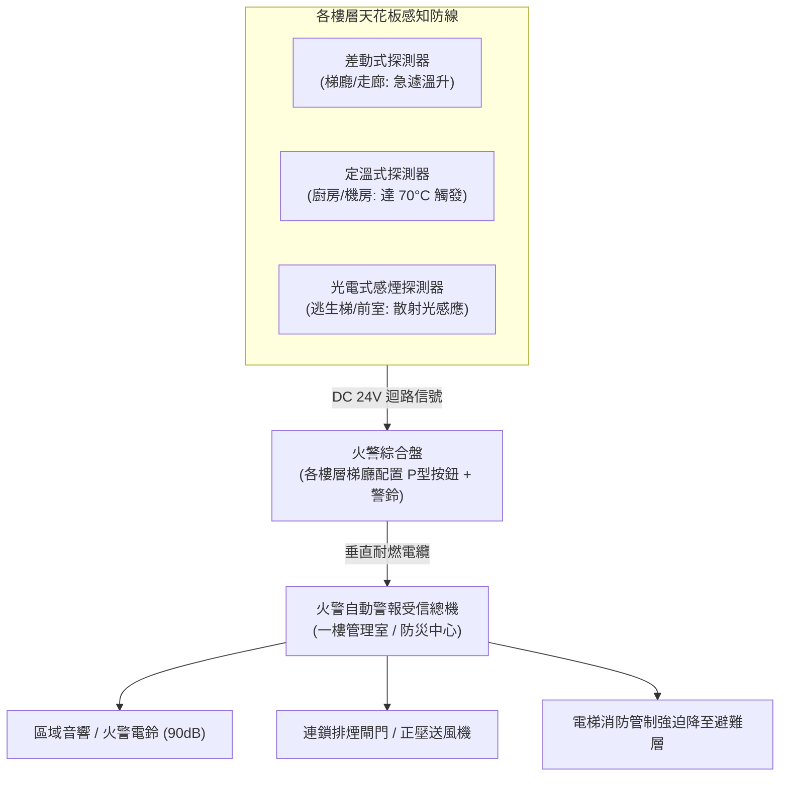

# 全案購屋實戰第二百九十五部：中古大樓社區各樓層火警綜合盤差動定溫感煙探測器老化誤報放射線游離室失效與警鈴短路體檢工序全書

## 壹、核心查驗宗旨與前言

在集合住宅的火災初期預警架構中，各樓層梯廳、公共走廊與住宅專有部分內部天花板配置的「火警探測器（Fire Detector）」與「火警綜合盤（Fire Alarm Station Panel）」，是全天候 24 小時守護全棟住戶生命財產安全的第一道「電子眼與神經末梢」。任何一場暗夜火災，能否在濃煙初起、溫度微升的數分鐘「黃金初萌期」即時發出警報，完全取決於探測器的感應靈敏度與線路迴路的健康狀態。

然而，在屋齡 15 至 30 年的中古大樓中，火警探測器與綜合盤經常演變成社區管理員與住戶最頭痛、最危險的「虛設死穴」：
1. **差動式分布探測器金屬膜片疲勞老化或漏氣孔堵塞**，造成稍有日照升溫即頻繁「幽靈誤報（False Alarm）」，管委會為了夜間安寧乾脆直接拔除線路或關閉總機警鈴；
2. **早期游離型感煙探測器（Ionization Smoke Detector）內部放射源（鋂-241, Am-241）衰變衰減或游離室受潮積塵**，對致命陰燃濃煙毫無反應；
3. **火警綜合盤內火警警鈴（Fire Bell）馬達線圈氧化燒毀、局部打鈴機構卡死**，火警發生時只有指示燈閃爍卻無聲響；
4. **探測器底座迴路終端電阻（EOL Resistor）脫落或配線氧化**，導致整層樓甚至垂直分區的火警感知完全斷線失效。

本手冊為買方建構全套由淺入深的「火警探測與綜合警報全系統體檢工序」，結合實地看屋目視查核、感煙/感溫試驗工具原理、管委會申報書覆核、商務砍價談判話術與專用買賣契約特約，杜絕交屋後陷入「火災不報、深夜亂響、全棟公設被消防局連續開罰」的危險陷阱。

---

## 貳、火警探測系統運作架構與中古社區四大致命病灶

### 一、集合住宅火警探測與警報核心組件架構
1. **火警綜合盤（Fire Alarm Station Panel）**：
   - 包含 **手動火警報警機（P型按鈕）**、**火警確認指示燈（紅燈LED）**、**警報音響（火警電鈴/DC 24V 電子蜂鳴器）** 及電話插孔（Fire Phone Jack）。
2. **差動式探測器（Rate-of-Rise Heat Detector）**：
   - 通常安裝於梯廳、臥室、客廳。利用空氣室受熱膨脹壓迫金屬波紋膜片接觸接點，兼具慢速自然升溫之漏氣孔（Leakage Hole）平衡機制。
3. **定溫式探測器（Fixed Temperature Heat Detector）**：
   - 安裝於廚房、地下室發電機房與瓦斯表間。利用雙金屬片（Bimetallic Strip）或低熔點合金，當環境溫度達到臨界閥值（如 $70^\circ\text{C}$ 或 $90^\circ\text{C}$）時瞬時閉合接點。
4. **光電式/游離式感煙探測器（Photoelectric/Ionization Smoke Detector）**：
   - 安裝於逃生梯間、電梯梯廳與高樓層走廊。光電式利用紅外線受煙霧微粒散射（Light Scattering）接收器受光導通；游離式利用鋂-241 使空氣電離，煙霧進入導致離子電流下降觸發警報。

### 二、中古社區常見之四大致命病灶
1. **探測器內部集塵氧化與頻繁誤報（False Alarm）導致系統被「人為閹割」**：
   - 中古大樓探測器超過 10 年未清洗，內部光學迷宮（Sensing Chamber）被蚊蟲死屍、蜘蛛網與厚重灰塵覆蓋，稍有濕氣即產生散射觸發警報。管理員因不勝其煩，常私自將受信總機上該樓層之迴路開關「扳至 OFF」或將主音響關閉，使整棟大樓形同無防護狀態。
2. **游離室鋂-241 衰變與放射性老化失效**：
   - 25 年以上老舊社區仍沿用第一代游離型感煙探測器。放射性同位素長期衰變與電離電極氧化腐蝕，電離電流早已漂移失真，就算濃煙籠罩亦無法觸發導通。
3. **綜合盤火警電鈴小馬達燒毀與敲擊錘卡塞**：
   - 梯廳綜合盤內的機械式警鈴長年受潮，旋轉微型馬達軸承油泥硬化，或敲擊金屬鈴碗的金屬錘生鏽抱死。火災發生時，電壓雖已送達，警鈴卻僅發出「嗡嗡」微弱悶響，完全達不到法規規定的 $90\text{ dB}$ 警示音量。
4. **室內裝潢亂拆亂移導致「終端電阻（EOL）斷路」**：
   - 前手屋主進行天花板裝潢或木作包樑時，水電木工不諳消防法規，將消防探測器隨意剪線外移甚至直接封在矽酸鈣天花板內，造成迴路斷線，使得總機長期顯示「斷線黃燈」，喪失整排住戶之警報連鎖。

---

## 參、買方現場看屋之火警探測與綜合盤五步體檢工序

### 一、步驟一：目標戶梯廳火警綜合盤外觀核查
- **確認指示燈（LED）常態**：走至看屋物件門外梯廳，檢視火警綜合盤外觀。面板上方之紅色圓形指示燈應「常亮」（代表 DC 24V 電源正常供應）；若熄滅，代表該樓層綜合盤電源斷線或總機保險絲燒斷。
- **P型手動報警機外觀**：檢視按鈕保護壓克力玻璃是否完整無裂紋，有無被張貼廣告貼紙封死，壓扣機構平整無下陷卡死。
- **箱體與電話插孔防腐狀況**：打開綜合盤箱門（若為組合箱），檢視內置警鈴接線端子有無綠色銅鏽、消防專用電話插孔插座有無生鏽粉化。

### 二、步驟二：目標戶內外探測器外觀與年限品檢
- **外觀成色判別**：抬頭檢視梯廳與客廳天花板探測器。合格外殼應為乳白色；若塑膠外殼已嚴重「發黃、泛黑或表面沾滿噴漆油漆」，通常已使用超過 15 年以上，感應元件早已衰減。
- **探測器底座密合度**：觀察探測器與天花板底座是否牢固旋緊，有無鬆脫垂吊或縫隙露線。
- **出廠標籤核驗**：若有梯子或延伸工具，檢視外殼側面之「內政部消防署審核認可標籤」與出廠年份，探測器法定檢修週期標準建議每 **10 年** 批次汰換。

### 三、步驟三：管理室火警受信總機燈號「無死角掃描」
看屋時務必藉故至一樓管理室，藉由與管理員交談觀察「火警受信總機（Fire Alarm Control Panel）」面板：
1. **「火警（Fire）」紅燈**：平時必須熄滅。
2. **「注意/斷線（Trouble/Disconnection）」黃燈**：面板若有多顆黃燈恆亮，仔細閱讀旁邊對應的樓層標籤（如「8F探測器斷線」、「B1手動報警機故障」），代表管委會怠於修復感知回路。
3. **「主音響/分區音響停動開關」**：檢查總機面板上的「音響停止（Alarm Silence）」按鈕是否被按下或切至 OFF。若被關閉，代表該社區常態性誤報，管理員蓄意關閉聲音！

### 四、步驟四：消防安全設備檢修申報書「綜合檢查數據」覆核
委請仲介調閱最新一期由消防設備師簽證之《消防安全設備檢修申報書》：
- **感知度試驗（Sensitivity Test）**：查核申報書中「差動/感煙探測器加煙/加熱試驗」合格率，依規定加煙後應於 **30 秒內** 動作，加熱後應於 **30 秒至 40 秒內** 動作。
- **警報音壓（Sound Level）**：各樓層警鈴音壓於距警鈴中心 1 公尺處必須達到 **$90\text{ dB}$ 以上**。
- **列管缺失表**：確認是否有「探測器不良 XX 只待換」、「火警電鈴故障無聲」等消防局列管紅字。

---

## 肆、商務談判博弈：火警系統缺失砍價 10 萬元實戰話術

火警自動警報系統若需針對老舊大樓全面清查短路斷路、全棟更換高靈敏光電式探測器並抽換火警綜合盤，工程款動輒 **新台幣 20 萬至 40 萬元**。買方應將此致命的公設盲點作為議價談判籌碼。

> **實戰談判對話劇本：**
> 「屋主您好、周小姐您好：
> 我們在實地勘查目標戶天花板並檢視管理室火警總機時，發現非常嚴重的安全隱患：我們考慮的這層樓火警綜合盤指示燈根本不亮，總機面板上該樓層長年顯示『斷線故障黃燈』，且管理員坦承因為過去常常幽靈誤報，早已將大樓警鈴主開關關閉！
> 火警探測器是全家暗夜保命的第一道神經末梢。如今探測器全面老化斷線、警鈴失靈，萬一深夜發生電氣火災或鄰戶起火，全家人根本無法在第一時間得到警訊逃生，這屬於極其嚴重的公共安全瑕疵。
> 社區若要委託消防公司進行全棟回路抓漏重拉，並全面抽換合格的光電式感煙探測器，每戶都得面臨額外的修繕基金分攤；且我們入住後必須自費在全室加裝獨立式連動偵煙警報器以補足公設缺失。
> 為了承擔這項重大公安修復風險與家庭生命防護成本，我們堅持在買賣總價中直接折讓 **10 萬元** 作為火警修復與自建自衛消防基金，否則面對一個火災警報全盲的物業，我們實在不敢下定簽約。」

---

## 伍、買賣契約特約防守條款專用字軌

為杜絕買方交屋後承擔既有火警系統損壞之修繕分攤金，《不動產買賣契約書》應增列下列防禦條款：

> **【火警自動警報與綜合盤設備合格保證與公設特別徵收清償條款】**
> 1. **火警探測與警報設備正常運作保證**：賣方保證本買賣標的專有部分室內天花板及所在樓層梯廳之火警探測器（含差動式、定溫式、感煙式）、火警綜合盤（含手動報警機、火警確認指示燈、火警警鈴），於簽約日前功能健全，能正常與一樓中央受信總機連鎖信號連線，且無遭主管消防機關列管限期改善或處以罰鍰之情事。
> 2. **交屋前火警公設重大修繕清償義務**：若於交屋日（含）前，本社區管委會或區分所有權人會議已決議、或經主管機關限期辦理全棟火警受信總機更新、各樓層火警迴路重新穿線、探測器全面批次更換等工程者，其所需之一切工程款或特別徵收分攤費用，不論請款單開立於交屋日前或交屋日後，概由賣方於交屋尾款結算時全額負擔扣抵，買方不負任何繳納義務。
