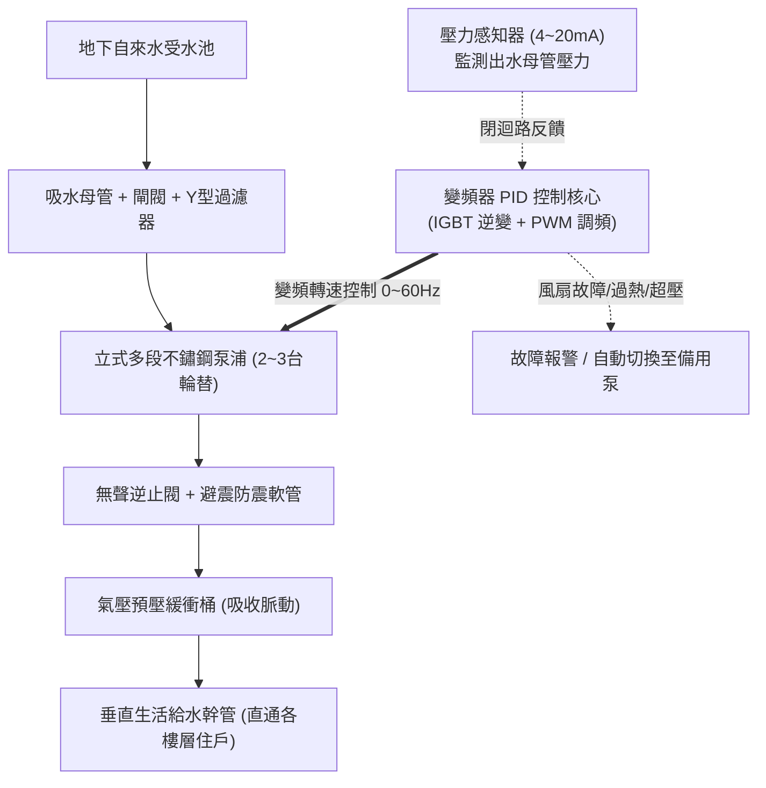

# 全案購屋實戰第二百九十八部：中古大樓社區地下室給水加壓變頻泵浦變頻器IGBT模組老化散熱風扇卡死與水壓驟降水錘衝擊體檢工序全書

## 壹、核心查驗宗旨與前言

在集合住宅的日常自來水生活給水體系中，維持全天候 24 小時出水水壓恆定、龍頭即開即有充足水量，全仰賴地下室給水機房內的「變頻恆壓生活給水泵浦機組（Variable Frequency Constant Pressure Water Booster Pump System）」。這套系統透過壓力感知器（Pressure Transducer）與變頻器（Inverter / VFD, Variable Frequency Drive）的精密 PID 閉迴路控制，動態調節泵浦馬達轉速，既能在深夜微量用水時節省電能，又能在早晚全棟用水尖峰時自動提高輸出頻率，維持住戶端約 $2.0 \sim 3.5\text{ kgf/cm}^2$ 的舒適水壓。

然而，在屋齡 15 至 30 年的中古大樓中，生活給水變頻系統往往處於「高溫高濕、長年重載運轉、機電忽視保養」的崩潰邊緣：
1. **變頻器核心功率半導體 IGBT 模組（絕緣閘雙極電晶體）長年熱疲勞老化，散熱膏乾涸固化、散熱風扇卡死**，在夏季用水尖峰頻繁觸發「過熱保護（Overheat Trip, OH）」或直接電弧擊穿爆開；
2. **直流母線平滑電解電容（DC Bus Capacitors）容量乾涸衰減、漏液爆漿**，輸出 PWM 弦波失真引發馬達劇烈高頻嘯叫、震動與線圈絕緣擊穿；
3. **壓力傳訊器（Pressure Sensor 4-20mA）陶瓷膜片水垢結晶卡阻**，量測信號漂移導致變頻器誤判，造成水管超壓爆裂或頻繁水壓驟降；
4. **變頻切換旁路接觸器（Bypass Contactor）接點跳火燒融，停機減速斜率（Deceleration Time）設定錯誤引發毀滅性水錘（Water Hammer）**，震裂整棟垂直給水鑄鐵管網與各戶衛浴進水軟管。

本手冊專為購屋者建構一套全維度、高穿透力的「地下室給水變頻泵浦全系統實地體檢工序」，結合控制箱內部電子元件檢核、水壓表動態讀數、管委會機電維護紀錄審核、商務砍價談判話術，以及買賣契約特約保障，徹底杜絕交屋後遭遇「深夜無水洗澡、尖峰水壓滴尿、全棟管網爆管重修」的崩潰夢魘。

---

## 貳、變頻恆壓給水系統技術構造與四大常見致命病灶

### 一、集合住宅變頻給水泵浦核心組件架構
1. **多段式立式離心泵浦（Vertical Multistage Centrifugal Pump）**：通常配置 2 至 3 台（1用1備或2用1備，交替運轉），泵體與葉輪採用 SUS304/SUS316 不鏽鋼材質。
2. **三相感應馬達 / 永磁同步馬達（IE3/IE4 高效率馬達）**：耐溫等級 F 級，配置防水防塵外殼。
3. **微電腦變頻控制箱（VFD Control Panel）**：
   - 內置微處理器 PID 控制器、IGBT 逆變功率模組、直流母線電容濾波組、散熱散流風扇及液晶操作面板。
4. **隔膜式氣壓預壓桶（Diaphragm Expansion Tank）**：
   - 內置耐用丁基橡膠氣囊，吸收系統微漏水時的水壓脈動，提供微量補償，避免變頻器在夜間頻繁啟停（Hunting）。
5. **逆止閥（Check Valve）與無聲水錘吸收器（Silent Check Valve & Water Hammer Arrestor）**：
   - 防止加壓水逆流衝擊葉輪並吸收急停時的動能波。

### 二、中古社區常見之四大致命病灶
1. **散熱風扇卡死導致 IGBT 模組熱擊穿（Thermal Runaway）**：
   - 地下泵浦機房長年潮濕、灰塵棉絮堆積，變頻器散熱排導熱片（Heat Sink）被污垢堵死，小型軸流冷卻風扇軸承乾涸抱死。當大樓用水尖峰來臨，IGBT 晶片溫度瞬間飆破 $125^\circ\text{C}$，內部雙極電晶體熱擊穿炸裂，控制盤噴出火花跳電，全棟供水瞬間斷絕。
2. **直流母線電解電容乾涸爆漿失容**：
   - 變頻器內部大型濾波電解電容標準使用壽命僅約 **5 至 7 年**。中古社區運轉超過 15 年從未更換，高溫使電解液乾涸、頂部防爆閥鼓起甚至噴漿腐蝕 PCB 印刷電路板，導致輸出直流電壓紋波過大，馬達發出尖銳刺耳的磁震異音並異常發燙。
3. **氣壓緩衝桶隔膜破裂充氣嘴漏氣**：
   - 膨脹桶內部橡膠隔膜疲勞破孔，內部預充氮氣洩漏殆盡，整座桶體被自來水完全充滿失去彈性緩衝功能。只要住戶關閉水龍頭，管內水壓瞬間暴升引發巨響水錘，震裂各樓層管道間減壓閥與接頭。
4. **控制邏輯錯亂引發多泵「頻繁震盪搶水（Hunting）」**：
   - 壓力傳送器訊號線未採用雙絞屏蔽線或接地不良，受到馬達變頻 PWM 載波強烈干擾，壓力讀數在 $1.5 \sim 4.0\text{ kgf/cm}^2$ 之間劇烈跳動。兩台泵浦忽開忽停、忽快忽慢，造成高樓層住戶蓮蓬頭水流忽冷忽熱、水壓忽大忽小。

---

## 參、買方現場看屋之變頻給水泵浦五步實戰體檢工序

### 一、步驟一：地下室給水機房控制箱外觀與面板讀數檢核
- **變頻操作面板（Keypad）顯示確認**：
  - 走入地下室揚水泵浦機房，檢視給水控制箱液晶螢幕。
  - 檢視「設定壓力（SV, Set Value）」與「當前實測壓力（PV, Present Value）」是否穩定重合在 **$2.5 \sim 3.5\text{ kgf/cm}^2$** 之間，無劇烈數值狂跳現象。
- **運轉頻率檢視**：觀察待機時變頻器是否能順利降頻至「休眠頻率（約 20~25Hz）」或完全進入休眠（Sleep Mode）；若無人用水時馬達仍全速 60Hz 狂轉，代表系統嚴重漏水或傳感器失效。
- **故障記錄清單（Alarm History）調閱**：若陪同技師在場，調閱變頻器歷代警報代碼，檢視是否頻繁出現「OH（過熱）」、「OC（過電流）」、「OV（過電壓）」之潛在病灶。

### 二、步驟二：盤內散熱風扇與電解電容目視（需請機電人員開啟）
- **散熱出風口風力檢測**：伸手至變頻器頂部排風口，感受散熱風扇是否有強勁風流排出；若風扇靜止或有「喀喀」異音，代表風扇已卡死。
- **母線電解電容外觀**：檢視盤內圓柱狀大電容頂部防爆刻痕，是否有明顯隆起凸起、底部黑色橡膠塞是否有漏液乾涸白色結晶痕跡。

### 三、步驟三：多段離心泵體與無聲逆止閥動態檢驗
- **運轉震動與軸承噪音**：在泵浦運轉時，靠近聆聽馬達軸承聲音，應為均勻順暢旋轉聲，無砂礫磨擦聲或金屬敲擊異音；用掌心輕觸泵體底座，震動感應微弱平順。
- **軸封（Mechanical Seal）洩漏檢驗**：目視馬達與泵體交接處之機械軸封部位，標準應完全乾燥，若有水滴以每分鐘超過 5 滴之頻率持續下滲，代表軸封陶瓷面已磨損需大修更換。
- **壓力表微振阻尼**：檢視出水母管上的耐震充油壓力表，表針應平穩微幅指示，若劇烈晃動代表管內存在空氣或水錘氣蝕。

### 四、步驟四：目標戶室內全開水龍頭動態水壓實測
- **尖峰壓降測試**：走入看屋物件室內廚房與主衛浴，同時將廚房水龍頭、浴室面盆與淋浴蓮蓬頭轉至全開：
  1. 觀察出水水量是否維持充沛飽滿、水柱有力；
  2. 觀察出水量是否有週期性「忽大忽小、出水斷續」的喘振現象；
  3. 瞬間關閉水龍頭，側耳聆聽管道間是否有「咚！」之金屬巨響水錘聲。

### 五、步驟五：機電維護合約與保養工單覆核
委請仲介向管委會調閱最新一期《機電設備定期維護檢驗單》：
1. **變頻器出廠與更新年份**：變頻機板若已超過 **10 年** 未曾整套更新，隨時面臨零件停產斷料的置換風險。
2. **預壓緩衝桶預充氣壓（Pre-charge Pressure）**：標準應為系統設定壓力的 **$0.7 \sim 0.8$ 倍**，確認保養單上是否有定期洩水測量胎壓記錄。

---

## 肆、商務談判博弈：給水變頻設備老化殺價 15 萬元話術

地下室生活給水機房若全面抽換 2 台不鏽鋼多段泵浦、更換進口工業級變頻器控制盤（如 Danfoss 或 ABB 品牌）並重置管路水錘吸收桶，整套工程款高達 **新台幣 30 萬至 50 萬元**。買方應將此致命的公設供水缺陷作為狠砍總價的重磅籌碼。

> **實戰談判對話劇本：**
> 「屋主您好、周小姐您好：
> 我們在實地勘查社區地下室給水機房並在室內實測出水時，發現攸關全家人日常生活的水電設施有重大隱憂：地下室生活給水變頻控制盤已使用超過 15 年，變頻器散熱風扇卡死、面板頻繁跳出過熱報警，且出水壓力在用水時大幅劇烈波動，管道間更伴隨嚴重的水錘撞擊巨響！
> 變頻給水泵浦是全棟大樓維持水壓的唯一心臟。變頻機板隨時可能因電容爆漿而徹底燒毀，一旦斷電罷工，全棟住戶將瞬間陷入停水斷水危機，高樓層水塔根本無法補水，洗澡、如廁全面癱瘓；且水錘震盪持續下去，極易震裂專有部分管道接頭造成室內大淹水。
> 社區管委會若要整套抽換不鏽鋼泵浦與變頻智能控制箱，每戶都要分攤大筆修繕特別公費；且我們交屋入住後必須自費在室內進水端加裝專用高壓水錘吸收器與增壓保護閥。
> 為了承擔這項嚴重的給水公設修復風險與家庭用水安全保障，我們堅持在買賣總價中直接扣除 **15 萬元** 的給水設備修復補貼款，否則面對一個隨時可能全棟斷水的物業，我們實在不敢貿然簽約。」

---

## 伍、買賣契約特約防守條款專用字軌

為保障買方交屋後免受公設給水系統故障攤派大筆維修費的困擾，《不動產買賣契約書》應增列下列防禦條款：

> **【公共生活給水變頻泵浦系統健全保證與修繕工程清償條款】**
> 1. **全棟給水變頻設備正常供水保證**：賣方保證本買賣標的所屬大樓地下室之生活給水加壓變頻泵浦機組、變頻控制箱、壓力感知器及氣壓緩衝桶，於交屋日前運轉健全，專有部分室內龍頭出水壓力平穩無劇烈震盪或水錘異音，且無因設備故障引發停水之重大瑕疵。
> 2. **交屋前給水設備更新工程款清償義務**：若於交屋日（含）前，本社區管委會或區分所有權人會議已決議、或經主管機關限期辦理地下室給水泵浦抽換、變頻控制盤更新、給水立管水錘消除工程者，其所需之一切工程款或特別徵收分攤費用，不論請款單開立於交屋日前或交屋日後，概由賣方於交屋尾款結算時全額負擔扣抵，買方不負任何繳納義務。
