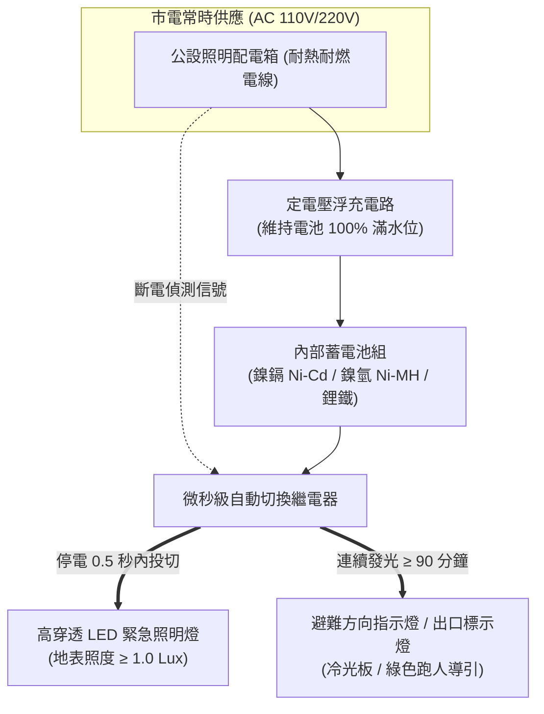

# 全案購屋實戰第二百九十六部：中古大樓社區各樓層緊急照明燈與出口避難方向標示燈電池老化蓄電不足冷光板衰減與耐燃迴路體檢工序全書

## 壹、核心查驗宗旨與前言

在集合住宅發生火災、地震或大規模停電時，建築物內部往往瞬間陷入「斷電、漆黑、濃煙密布」的三重絕境。此時，各樓層梯廳、公共走廊、安全梯轉折處以及專有部分玄關上方配置的**「緊急照明燈（Emergency Lighting）」**與**「出口/避難方向指示燈（Exit & Directional Signs）」**，是引領全家老小在慌亂中摸索逃生方向、避開墜落障礙並安全抵達避難層地面戶外的「唯一光明燈塔」。

然而，在屋齡 15 至 30 年的中古大樓中，緊急照明與避難標示設備極易淪為管委會公設管理的盲區與「假象公設」：
1. **內置鎳鎘（Ni-Cd）或鉛酸蓄電池長年高溫浮充，電極硫化板結、蓄電容量幾近於零**，市電一斷僅能微亮 10 秒即徹底熄滅（法規嚴格要求必須持續點燈 **30 至 90 分鐘以上**）；
2. **早期高壓冷陰極冷光板（CCFL）或傳統螢光燈管電極發黑老化、發光亮度嚴重衰減**，在微量煙霧籠罩下穿透力為零；
3. **充電控制機板整流變壓器高溫燒熔、充電指示燈長亮紅燈卻充不進電**；
4. **裝潢天花板變更時，避難指示燈被木作包覆、挪移位置或切換迴路未採用「消防專用耐熱/耐燃線纜」**，火災初起高溫即遭燒斷斷電。

本手冊為買方建構一套標準化、高穿透力的「各樓層緊急照明與避難標示燈全系統實地體檢工序」，結合現場斷電模擬手動測試、電池健康度判讀、管委會消防申報書覆核、商務談判殺價籌碼，以及買賣契約特約保障，徹底杜絕黑暗受困與高額公設修繕分攤風險。

---

## 貳、緊急照明與避難引導系統技術原理與四大致命故障病灶

### 一、集合住宅緊急照明與標示燈核心規格架構
1. **緊急照明燈（Emergency Luminaire）**：
   - 配置於走廊、樓梯間與電梯前室。法規要求在斷電狀態下，地板面水平照度必須達到 **$1.0\text{ Lux}$ 以上**（地下室或複雜動線建議 $\ge 2.0\text{ Lux}$）。
2. **出口標示燈（Exit Sign）與避難方向指示燈（Directional Sign）**：
   - 區分為「A級（大型，步行距離 40m 可見）」、「B級（中型，步行距離 30m 可見）」及「C級（小型，步行距離 15m 可見）」。標示面亮面平均輝度通常需達 $100\text{ cd/m}^2$ 以上。
3. **智慧型定電壓浮充電路（Float Charger）與後備電池組**：
   - 常時接駁於公用照明迴路充電，當感知市電中斷（AC Off）時，內部繼電器在 **0.5 秒內** 瞬間切換至電池放電供電。標準蓄電容量必須確保全載連續點燈 **至少 90 分鐘**（依法規最低標準為 30 分鐘）。

### 二、中古社區常見之四大致命病灶
1. **蓄電池「假充飽、秒斷電」的虛假蓄電現象（Memory Effect & Sulfation）**：
   - 燈具長年接電浮充，社區從未進行定期放電維護。鎳鎘電池產生嚴重記憶效應，極板被粗大硫酸鉛結晶覆蓋，面板「充電綠燈」常亮，看似充飽，一旦切斷市電，電池電壓在 3 秒內雪崩式暴跌至截止電壓以下，照明瞬間熄滅。
2. **燈罩內部整流器高溫硬化與外殼發黃粉化**：
   - 早期燈具採用鐵芯變壓器或阻容降壓電路，熱損耗極高，使得密閉燈殼內部常年維持在 $50^\circ\text{C}$ 以上高溫，導致電解電容漏液爆漿、阻燃 ABS 塑膠外殼嚴重黃化脆裂，甚至成為引發電器火災的隱患。
3. **老舊冷光板輝度嚴重衰減與黑化**：
   - 中古大樓仍大量殘留第一代 CCFL 或 EL 冷光片出口燈，使用超過 8 至 10 年後，標示板四角發黑、亮度僅剩出廠時的 $10\%$，在濃煙環境下根本無法提供視覺導引。
4. **裝潢改裝時未採用耐燃線路導致「高溫熔斷」**：
   - 梯間天花板翻修或住戶大門玄關裝潢時，施工團隊隨意使用普通 PVC 花線串接緊急照明燈，火災發生時梯間溫度達到 $200^\circ\text{C}$ 即軟化短路，失去供電。

---

## 參、買方現場看屋之緊急照明與避難指示燈五步實戰體檢工序

### 一、步驟一：外觀巡檢與充電指示燈判讀
- **目標樓層梯廳燈具狀態**：檢視看屋物件大門外梯廳、安全梯門口及電梯口之緊急照明燈與出口標示燈。
- **指示燈狀態確認**：
  - **「電源/充電燈（綠燈/紅燈）」**：必須常態長亮；若燈號熄滅，代表該迴路跳脫或燈具內部電路已完全燒毀。
  - **「故障/異常指示燈（黃燈）」**：若有亮起，代表電池已失效斷線。

### 二、步驟二：手動測試按鈕（Test Switch）按壓實測
- **單擊手動測試鈕**：多數合格緊急照明燈具下方均設有小型「測試按鈕（TEST Button）」或拉繩開關。
- **實地測試技巧**：購屋者可用指尖長按「TEST」鍵 5 至 10 秒：
  1. 檢視燈光是否立即切換亮起；
  2. 觀察燈光是否有閃爍、亮度驟降或微弱發黃現象；若按下瞬間燈光亮一下隨即熄滅，代表內部電池早已徹底死亡！

### 三、步驟三：逃生動線視野與地表照度評估
- **避難動線連續性**：站在目標物件大門口往逃生安全梯方向望去，確認「避難方向指示燈（箭頭符號）」無被各戶鞋櫃、雜物或裝潢凸出物遮蔽，視線應能無死角連續辨識。
- **照度目測檢驗**：若手動點亮照明燈，光線應能清晰照亮地面台階與門檻邊界，光束無死角。

### 四、步驟四：室內專有部分玄關緊急照明查驗
- **專有部分配置確認**：依規定高層集合住宅室內玄關或主臥走道應配置專用緊急照明燈。
- **插座形式與鬆動檢核**：確認室內緊急照明燈是固定式配線還是插座式，插座必須為「消防常時通電專用插座」，插頭無鬆脫接觸不良。

### 五、步驟五：消防安全設備檢修申報書「放電試驗數據」調閱
委請仲介向管委會調閱最新一期由消防設備師簽證之《消防安全設備檢修申報書》：
1. **連續點燈時間試驗（Duration Test）**：核對申報書「緊急照明設備」檢查表中的放電測試紀錄，合格標準必須大於 **30 分鐘**（優良大樓要求 $\ge 60$ 分鐘）。
2. **不良燈具列管數量**：確認申報書備註欄有無「第 X 樓緊急照明燈電池不良 XX 組」、「出口標示燈冷光板損壞 XX 組」等待修列管缺失。

---

## 肆、商務談判博弈：公共照明失效殺價 10 萬元實戰話術

全棟大樓若需將老舊緊急照明燈與出口避難標示燈全面汰換為高亮度、低功耗之合格節能 LED 鋰鐵電池燈具（單顆連工帶料約 1,200 至 2,000 元，整棟數十顆至上百顆），總工程款高達 **新台幣 15 萬至 30 萬元**。買方應將此致命的逃生盲區轉化為議價折讓籌碼。

> **實戰談判對話劇本：**
> 「屋主您好、周小姐您好：
> 我們在實地勘查目標樓層的逃生動線時，親手測試了門外梯廳與逃生梯口的緊急照明燈與出口標示燈，發現按下測試鍵後燈光在 2 秒內就完全熄滅，內部電池早已徹底死透！翻閱管委會的消防申報書更顯示，全社區有超過半數的照明燈蓄電能力根本不符法定 30 分鐘的標準。
> 火災發生時往往伴隨著高壓跳電與濃煙遮蔽，緊急照明與避難方向燈是全家人暗夜逃生的『救命眼睛』。如今設備全面失靈，一旦發生火警，全家摸黑根本找不到逃生梯門，極易吸入濃煙致命！
> 社區管委會若要全面更換全棟老舊燈具與配線，每戶都將面臨修繕公費攤派；且買方入住後必須在室內所有動線自費加裝高規不斷電照明系統。
> 基於這項重大的公共避難安全瑕疵，我們堅持在總價中折讓 **10 萬元** 作為公共照明補貼與自購避難設備基金，否則承擔暗夜逃生全盲的巨大風險，我們實在難以貿然簽約。」

---

## 伍、買賣契約特約防守條款專用字軌

為保障買方交屋後免受公設消防照明違規開罰與攤派維修款之困擾，《不動產買賣契約書》應增列下列防禦條款：

> **【公共避難緊急照明與標示設備合格保證與公設特別徵收清償條款】**
> 1. **緊急照明與標示設備功能保證**：賣方保證本買賣標的專有部分室內及所屬樓層梯廳、公共走廊、逃生安全梯之緊急照明燈與出口避難方向標示燈，於交屋日前具備正常蓄電與自動切換功能，停電時持續點燈時間符合消防法規標準（$\ge 30$ 分鐘），且無遭直轄市消防主管機關列管限期改善或處以罰鍰之情事。
> 2. **交屋前照明設備修繕工程款清償義務**：若於交屋日（含）前，本社區管委會或區分所有權人會議已決議、或經主管機關限期辦理全棟緊急照明設備、出口標示燈全面抽換或線路整修工程者，其所需之一切工程款或特別徵收分攤費用，不論請款單開立於交屋日前或交屋日後，概由賣方於交屋尾款結算時全額負擔扣抵，買方不負任何繳納義務。
