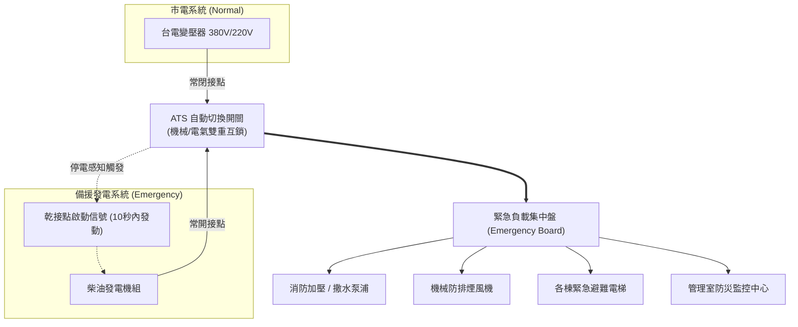

# 全案購屋實戰第二百九十四部：中古大樓社區地下室緊急柴油發電機ATS自動切換開關接觸器跳火燒蝕與停電連鎖失靈體檢工序全書

## 壹、核心查驗宗旨與前言

在集合住宅的電力防災體系中，市電中斷（如颱風致饋線跳脫、電網大停電或火災初期台電斷電）時，「自動電源切換開關（Automatic Transfer Switch, ATS）」是連結「台電市電系統」與「緊急柴油發電機備援系統」的關鍵心臟神經。當市電瞬斷時，ATS 必須在法規嚴格要求的 **10 至 12 秒內**，自動感知斷電、送出發電機乾接點啟動信號，並在發電機建立穩定額定電壓（380V/220V）及頻率（60Hz）後，安全平順地將關鍵負載切換至發電機端。

然而，在 15 至 30 年的中古大樓中，ATS 往往是地下室配電盤內最隱蔽、最脆弱且極易引發災難性停擺的重災區：
1. **主動力接觸器（Contactor）電氣接點長年跳火（Arcing）碳化與金屬熔融燒蝕**，導致大停電時接觸器無法閉合或缺相供電；
2. **機械與電氣雙重互鎖機構（Mechanical & Electrical Interlock）卡阻變形**，引發市電與發電機兩路電源「短路併聯炸機」的滅頂風險；
3. **ATS 電子邏輯控制板（Control Controller PCB）濾波電容爆漿與電壓感測繼電器失效**，停電時發電機雖然咆哮運轉，但 ATS 遲遲不切換，全棟公設陷入永夜；
4. **消防火警緊急連鎖負載投切失控**，導致排煙風機、消防撒水泵浦與緊急電梯在停電火災中集體癱瘓。

本手冊專為購屋者建構全方位「ATS 自動切換開關全系統實地健檢工序」，結合配電盤斷電目視、熱成像與接點碳化檢測、管委會申報書覆核、商務砍價話術及特約條款設計，徹底避開數十萬元公設修繕債務與深夜受困電梯之致命危機。

---

## 貳、ATS 自動切換開關運作原理與四大致命故障病灶

### 一、集合住宅 ATS 配電架構與連鎖邏輯
1. **雙迴路電源輸入端**：
   - **Normal 常用側（N側）**：來自台電低壓配電變壓器二次側（三相四線 $380\text{V}/220\text{V}$ 或三相三線 $220\text{V}$）。
   - **Emergency 緊急側（E側）**：來自地下室柴油發電機輸出無熔絲開關（MCCB）。
2. **中央負載輸出端（Load 側）**：供電給社區關鍵「緊急與消防負載盤（Emergency Panel）」，包含：
   - 消防栓加壓泵浦、自動撒水泵浦、泡沫混合泵浦；
   - 地下室排煙機、梯間正壓送風防煙風機；
   - 各棟緊急客梯（火災管制專用電梯）；
   - 各樓層避難逃生方向指示燈、緊急照明與管理室防災監控中心。
3. **三態切換機構（Two-Position or Three-Position Transition）**：
   - 優良 ATS 具備「中性斷開位置（Off-Position / Center-Off）」，提供 0.5 至 2 秒之弧光熄滅延遲（Arc Quenching Delay），防止高感抗馬達（如電梯、排煙風機）因殘餘逆電動勢反饋導致跳火爆盤。

### 二、中古社區常見之四大致命病灶
1. **接點氧化跳火碳化與缺相供電（Single-Phasing）**：
   - 早期中古大樓使用開閉式磁力接觸器（Contactor Type ATS）。發電機每月試車負載切換時，銀合金接點產生高溫電弧（Arc），日積月累造成接觸面凹凸不平、嚴重積碳。接觸電阻劇增引發異常高溫，甚至其中一相接點熔斷，導致緊急電梯馬達或消防泵浦在停電切換時「缺相運轉燒毀」。
2. **機械互鎖銷變形引發「雙電源短路爆盤」**：
   - 為防止市電與發電機同時閉合發生相角不一致短路，ATS 設有金屬連桿機械互鎖。老舊社區連桿生鏽變形或轉軸鬆脫，一旦互鎖失效，台電與發電機兩股巨大短路電流相撞，將引發電弧爆炸、整座配電盤炸毀並釀成火災。
3. **控制板突波吸收器燒毀與控制繼電器（Relay）卡死**：
   - 台灣夏季多雷擊，地下配電室防雷突波吸收器老化失效，雷擊突波直接擊穿 ATS 電子控制板（Controller PCB）上的整流二極體與微處理器。大停電時，控制板完全無邏輯輸出，發電機獨自空轉，負載端持續全黑斷電。
4. **控制蓄電池電壓低落無法驅動分激跳脫線圈（Shunt Trip）**：
   - ATS 切換需仰賴內部操作線圈瞬間通電推動切換機構。若控制迴路專用 24V 蓄電池老化失水、內阻升高，放電瞬間電壓驟降，操作線圈吸力不足，切換機構卡在半途中間位置，全棟陷入癱瘓。

---

## 參、買方實地看屋與配電盤五步專業體檢工序

### 一、步驟一：外觀目視與指示燈判讀
- **正常供電指示燈**：在地下室發電機房或總配電室，找到標示「ATS 切換盤」之控制箱。檢視箱面「常用電源（NORMAL）」綠燈應常亮，「緊急電源（EMERGENCY）」紅燈應熄滅。
- **切換模式選擇開關**：確認旋鈕位於「自動（AUTO）」位置。若發現旋鈕被轉至「手動（MANUAL）」甚至貼有「故障待修」膠帶，代表自動控制回路早已癱瘓，停電時需總幹事摸黑跑進地下室手動扳動開關。

### 二、步驟二：盤內目視檢查（需由陪同人員開啟盤門）
- **氣味與金屬燒焦痕跡**：打開 ATS 盤門，嗅聞是否有絕緣塑膠燒焦味或臭氧味；目視主接觸器（Contactor）滅弧罩周圍有無噴濺的黑色金屬飛沫或黃銅碳化物。
- **主接線端子溫升外觀**：檢視連接至 ATS 上下兩側之大線（銅排或 PVC 耐燃線纜），絕緣包覆有無因高溫變色（白色變黃、黑色脆裂）、熱縮套管有無捲曲收縮。

### 三、步驟三：手動切換機構與互鎖連桿手動試摸
- **連桿機構靈活度（安全停電條件下）**：若社區正進行保養，觀察技師手動操作切換柄，互鎖機構咬合應清脆俐落、絕無卡頓或虛位晃動。
- **滅弧室（Arc Chute）完好度**：檢視陶磁或絕緣鋼片滅弧柵，確認無斷裂碎屑掉落。

### 四、步驟四：年度消防檢修申報書與發電機帶載切換紀錄調閱
買方應請仲介或管委會出示最新一期《消防安全設備檢修申報書》及《發電機季保養維護紀錄》：
1. **ATS 切換時間（Transfer Time）**：市電斷電至發電機啟動供電時間，標準必須在 **10 至 12 秒內完成**。
2. **復電反向切換時間（Retransfer Delay Time）**：市電恢復後，ATS 應延遲 2 至 5 分鐘確認市電穩定後再切回，並維持發電機無載冷卻運轉 3 至 5 分鐘後停機。若無延遲直接秒切，屬於控制器計時器失效。
3. **列管改善項目**：確認申報書附表有無「ATS 無法自動切換」、「常用/緊急接觸器跳火燒蝕」之待修列管紀錄。

### 五、步驟五：紅外線熱成像溫升檢測（進階驗屋裝備）
- 在大樓用電高峰期，使用 FLIR 紅外線熱像儀照射 ATS 常用側三個接觸端子。正常溫升應低於環境溫度 $+30^\circ\text{C}$ 以內，三相溫差（$\Delta T$）應小於 $3^\circ\text{C}$。若單相溫度超過 $70^\circ\text{C}$ 或三相溫差超過 $10^\circ\text{C}$，代表該相接觸電阻嚴重超標，隨時有熔毀斷路風險。

---

## 肆、商務談判博弈：ATS 缺失殺價 15 萬元話術範本

整棟大樓地下室 ATS 切換開關若全面更換為進口三態具中性斷開型號（如 ASCO 或 GE 品牌，400A 至 800A 容量），連工帶料工程款高達 **新台幣 25 萬至 45 萬元**。買方應將此重大電力安全盲點轉化為殺價攻防利器。

> **實戰談判對話劇本：**
> 「屋主您好、周小姐您好：
> 我們在實地勘查社區地下發電機配電盤並核對消防安檢紀錄時，發現地下室核心的 ATS 自動切換開關存在嚴重的公安隱患：ATS 控制旋鈕已被切至手動，主接觸器滅弧罩表面有明顯的跳火黑斑與碳化燒蝕痕跡，且控制板計時迴路早已老化失效！
> ATS 是大樓停電與火災時唯一的『供電保命開關』。一旦遇到夏季跳電或梯間起火台電斷電，ATS 無法在 10 秒內自動將電力切換給發電機，這將直接導致全棟排煙機不轉、消防泵浦無法加壓，甚至造成正在搭乘電梯的家人瞬間受困在伸手不見五指的高空車廂中，引發嚴重窒息與恐慌。
> 社區管委會若要更換這套高安規的 ATS 主開關與控制盤，勢必動用大筆修繕基金甚至對全體住戶發起二次特別徵收；這項重大瑕疵直接重創了物業的安全評價。
> 為了承擔未來全棟公設供電維修的分攤風險，並彌補本戶在電力防災上的重大缺陷，我們主張在總價中折讓 **15 萬元** 的安全補貼款，否則承擔隨時可能停電卡梯的風險，我們實在難以貿然入主。」

---

## 伍、買賣契約特約防守條款專用字軌

為杜絕買方交屋後承擔前手既有之公設電力重大維修債務，《不動產買賣契約書》應增列下列防禦條款：

> **【緊急發電系統 ATS 自動切換設備合格保證與公設特別徵收清償條款】**
> 1. **備援供電連鎖合格保證**：賣方保證本買賣標的所屬大樓地下室之緊急柴油發電機組及其 ATS 自動切換開關系統，於簽約日前功能健全，符合現行消防法規及用戶用電設備裝置規則，市電中斷時能在法定時限內自動啟動並順利投切緊急負載，無遭消防或工務主管機關列管限期改善之情事。
> 2. **既有公設電力設備修繕工程款清償**：若於交屋日（含）前，本社區管委會或區分所有權人會議已決議、或經主管機關限期辦理地下室發電機組、ATS 自動切換開關、變電盤組件等重大設備更新工程者，其所需之一切工程款或特別徵收分攤費用，不論請款單開立於交屋日前或交屋日後，概由賣方於交屋尾款結算時全額負擔扣抵，買方不負任何清償責任。
