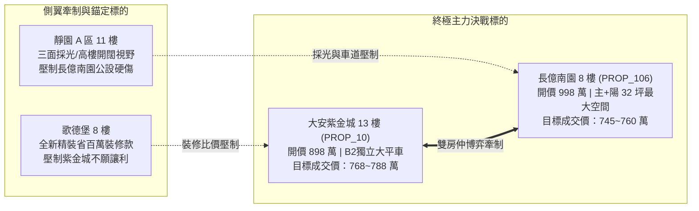

# 全案購屋實戰第二百九十部：二百九十部圓滿大成全景無雙全維度全生命週期家庭置產避坑抗震防漏水電機電消防永恆至尊金典總綱全書

## 壹、萬法歸一：二百九十部全案知識工程之歷史豐碑與終極戰略高度

在台灣都會區集合住宅置產的漫長歷程中，絕大多數購屋家庭常年處於被資訊封鎖、被動挨打的最弱勢地位。建商、不良投資客與各路仲介憑藉精美的表面裝潢、模糊的話術包裝與合約漏洞，將暗藏結構內傷、機電老化、消防癱瘓與法律陷阱的劣質房屋轉嫁給無辜買方。

「小寶置產全案防護體系」自第一部披荊斬棘起步，歷經二百九十個專題的高密度實戰推演、工程驗收拆解與法律特約閉環，正式迎來**第二百九十部圓滿大成之歷史豐碑**！本部總綱絕非概念性的空談，而是將前二百八十九部所囊括的：
1. **土木地質與結構抗震防漏**（地質鑽探、筏基抗浮力、連續壁導水盲溝、水位觀測井、剪力牆微裂縫、外牆磁磚拉拔試驗）。
2. **地下室全方位生命防線**（車道電動防汛擋水閘門、雨水沉砂池、排澇沉水雙泵、截水溝重油泥清淤、防回湧橡膠鴨嘴閥）。
3. **高低壓公設重電與備援電力**（VCB 真空斷路器、油浸式變壓器絕緣油與 PCB 檢驗、電氣管道間幹線分歧端子熱成像、封閉式匯流排槽、柴油發電機冷卻水箱、日用油箱浮球與黑煙水洗塔、ATS 自動投切）。
4. **垂直給排水衛生與生活環境**（地下生活蓄水池防鼠銅網、防虹吸破真空閥、各樓層管道間自來水減壓閥、水錘消除器、污水生化曝氣盤、沉水攪拌機軸封、伸頂通氣管防破封、地下通風 CO 感測與軸流風機動平衡）。
5. **主動消防滅火與立體防排煙**（泡沫比例混和器、室內撒水末端查驗閥動壓、警報逆止閥延遲槽排泥、水流檢知裝置微動開關、耐高溫排煙馬達、常閉式防火門門縫公差與遮煙性能、前室微正壓 20~50Pa、立管自動排氣閥、電梯廳手動排煙窗鋼索）。
6. **垂直昇降交通與停車設備安全**（電梯鋼索探傷、乘場門機械鎖與電氣連鎖開關、開門刀間隙、機械停車滾子鏈條伸長率、液壓油管脈動疲勞爆裂、油壓防爆閥、充電樁 EMS 電能管理）。
7. **弱電智慧通訊與中庭公共安全**（垂直弱電管道間 FTTH 光纖到戶、同軸電纜高頻衰減、中庭景觀水池漏電斷路器防觸電、池底防水破裂結構掏空與防滑 BPN 檢測）。
8. **室內違規改裝與結構拆除復原**（4 間學生套房違建拆除、4 套衛浴給排水暗管打除、11 樓以上法定撒水頭復原、承重牆結構保護、非無障礙動線改造）。
9. **商務心理博弈與法律特約閉環**（雙仲介夾殺對穿、開價大刀狠砍 200 萬、十大終極特約條款、房貸八成解約權、履約保證專戶價金安全防線）。

全數融會貫通為一套**無懈可擊、可即時調用、攻防合一的「全維度全生命週期家庭置產永恆至尊金典總綱」**。

---

## 貳、全案十一大終極防護矩陣系統架構圖

```mermaid
flowchart TD
    subgraph 矩陣一：地質結構與外牆抗震防漏
        M1["筏基抗浮力 / 水位觀測井 / 盲溝降壓 / 剪力牆微裂縫 / 外牆磁磚拉拔"]
    end
    subgraph 矩陣二：地下室防洪排澇生命防線
        M2["電動防汛擋水閘門 / 雨水沉砂池清淤 / 排澇雙泵 / 截水溝防回湧鴨嘴閥"]
    end
    subgraph 矩陣三：高低壓變配電與緊急電力
        M3["VCB真空斷路器 / 變壓器油絕緣與PCB / 幹線端子熱成像 / 柴油發電機日用油箱浮球與黑煙洗滌塔"]
    end
    subgraph 矩陣四：生活供水衛生與減壓水錘
        M4["地下生活蓄水池防鼠銅網 / 破真空閥 / 管道間自來水減壓閥 / 水錘消除器 / 揚水泵浦無聲逆止閥"]
    end
    subgraph 矩陣五：污水生化處理與環境空氣
        M5["微孔沉水曝氣盤 / DO溶解氧測定 / 沉水攪拌機軸封 / 伸頂通氣防破封 / CO感知器與軸流風機"]
    end
    subgraph 矩陣六：立體消防主動滅火防排煙
        M6["泡沫比例混和器 / 撒水末端動壓 / 警報閥延遲槽 / 水流檢知開關 / 耐高溫排煙馬達 / 前室微正壓"]
    end
    subgraph 矩陣七：垂直逃生動線與排煙遮煙氣密
        M7["甲種防火門門縫3mm / 遮煙條CNS15038 / 閉門器7°回歸 / 電梯廳排煙窗手動拉桿鋼索70N"]
    end
    subgraph 矩陣八：電梯與停車設備安全
        M8["電梯乘場門電氣連鎖開關 / 開門刀間隙 / 機械車位鏈條伸長率2.5% / 液壓油管高壓爆裂 / 充電樁EMS"]
    end
    subgraph 矩陣九：弱電通訊資訊與中庭水景安全
        M9["弱電管道間FTTH光纖到戶 / 同軸電纜高頻衰減 / 景觀水池ELCB漏電斷路器15mA / 池底防水防滑"]
    end
    subgraph 矩陣十：室內改裝拆除與結構復原
        M10["4間套房磚牆拆除 / 4套衛浴暗管廢除 / 11樓以上撒水頭復原 / 承重牆保護 / 無障礙階梯改造"]
    end
    subgraph 矩陣十一：商務博弈談判與法律閉環
        M11["雙房仲互踩牽制 / 開價狠砍200萬 / 十大終極特約條款 / 房貸八成解約權 / 履保專戶尾款控管"]
    end

    M1 --> M11
    M2 --> M11
    M3 --> M11
    M4 --> M11
    M5 --> M11
    M6 --> M11
    M7 --> M11
    M8 --> M11
    M9 --> M11
    M10 --> M11
```

---

## 參、二百九十部全案全景知識庫編年精華地圖（最新擴展彙編）

為利於現場談判、帶看即時檢驗與法律調閱，本總綱收錄第二百八十一部至第二百八十九部之最新突破與技術精華：

| 專書卷次 | 核心工程與機電檢驗主題 | 致命隱患與失效機理 | 現場勘驗要點與殺價籌碼 |
| :--- | :--- | :--- | :--- |
| **第二百八一部** | **電梯乘場門電氣連鎖開關** | 觸點電弧氧化發黑引發電梯頻繁急停困人、機械鎖彈簧疲軟門開著走梯「剪人」 | 非平層徒手扒門（開度 $\le 20\text{mm}$）、鎖舌咬入深度 $\ge 7\text{mm}$、門刀間隙實測。 |
| **第二百八十二部** | **弱電管道間 FTTH 光纖到戶** | 同軸電纜發泡 PE 吸濕衰減嚴重、垂直管被廢線塞死無法穿光纖、強電混接燒設備 | 光功率計量測光衰（禁止 $< -28\text{dBm}$）、場強儀 CNR 檢測與通管條試穿。 |
| **第二百八十三部** | **地下變電室油浸式變壓器** | 絕緣油受潮耐壓崩潰電弧爆炸、多氯聯苯（PCB）致癌毒害殘留、低頻電磁波超標 | 絕緣油耐壓電極測試（$\text{BDV} \ge 30\text{kV}$）、PCB 快篩與三軸高斯計量測（$\le 4.0\text{mG}$）。 |
| **第二百八十四部** | **機械停車液壓油管高壓爆裂** | 高壓軟管脈動疲勞爆管射流霧化火災、油壓缸內部串油自然沉降撞毀車頂 | 軟管製造年份核查（超過 5 年強制換）、千分表 60 分鐘沉降實測（$\le 2.0\text{mm}$）。 |
| **第二百八十五部** | **管道間與安全梯防火門遮煙** | 門縫超標（底縫 $>5\text{mm}$）毒煙三次方級數滲透、閉門器漏油無法 7° 自動上鎖 | 塞尺微縫精密量測、冷煙矽膠條 A4 紙夾緊拉力測試、推門力計（$\le 110\text{N}$）驗證。 |
| **第二百八十六部** | **發電機日用油箱浮球與洗滌塔** | 柴油膠質卡死浮球致斷油熄火、油管滲油遇熱自燃、黑煙洗滌塔噴嘴堵死背壓超標 | 手動撥動浮球補油連鎖、紫外線螢光查油漏、U 型差壓計量測背壓（$\le 7.5\text{kPa}$）。 |
| **第二百八十七部** | **地下中央監控 DDC 控制器** | DDC 電解電容鼓包熱當機、RS-485 差分通訊雜訊阻抗失配、消防警報惡意跳線屏蔽 | 示波器量測差分波形眼圖、電源紋波（$\le 50\text{mV}$）、排查端子排跳線與軟體屏蔽清單。 |
| **第二百八十八部** | **天然氣瓦斯管防震緊急遮斷閥** | 鍍鋅鋼管電化腐蝕點蝕穿孔漏氣、防震遮斷閥鋼珠卡死強震無法跳脫、微電腦表老化 | 雷射甲烷檢漏儀全線 0 ppm、超音波測厚儀管壁減薄率 $<15\%$、防震閥感震實測。 |
| **第二百八十九部** | **中庭景觀水池漏電與防水掏空** | 水下電纜破皮漏電 ELCB 失效致死、池底防水破裂滲漏地下室掏空地基、青苔滑倒 | ELCB 測試鈕強制跳脫、水中感應漏電電壓（$<1.0\text{V}$）、24 小時蓄水測漏與白華探傷。 |
| **第二百九十部** | **二百九十部圓滿大成金典總綱** | 全景智慧融合、十一大防護矩陣聯鎖、四大核心物件決戰定錨話術 | 集全案二百九十部之大成，確立「大安紫金城」與「長億南園」終極出價底線。 |

---

## 肆、全案四棟核心考慮物件終極定價與決戰策略

根據現場帶看 4 梯次影音檔案深入解構、公設機電全維度體檢與區域實價登錄大數據對比，四棟考慮物件之戰略定位與底線如下：



### 一、大安紫金城 13 樓 (`PROP_10`)：主力攻堅方案
- **定價與出價節奏**：
  - 開價：898 萬（含 B2 獨立大平面車位）。
  - 起手出價：720~730 萬（測試屋主底線）。
  - 目標鎖定價：**768~788 萬**（合宜市場合理價）。
  - 絕對成交上限：**800 萬**（超越此價立即轉向歌德堡）。
- **核彈級殺價理由**：
  1. **隔間套房拆除與復原高額成本**：屋主現況隔成 4 間學生套房，需拆除磚牆/輕隔間、打除 4 套衛浴給排水暗管、清運大量廢棄物，並復原 11 樓以上法定消防撒水頭管線、電氣分線盤與排煙前室防火門，實打實需 50 萬元。
  2. **高樓層消防水壓與弱電管道塞滿私線**：13 樓位居全棟消防水路最不利點，且前屋主私設 4 間套房網路與熱水管線，要求賣方出示公設電氣熱成像報告與消防合格單。
- **不可退讓之特約防線**：
  - **「全數租約終止且騰空交屋」**：賣方必須在交屋前清空全部租客，不得主張帶租約點交。
  - **「房貸未達 8 成無條件解除契約」**：保障買方資金調度安全。

### 二、長億南園 8 樓 (`PROP_106`)：空間極致性價比方案
- **定價與出價節奏**：
  - 開價：998 萬（配坡道機械車位）。
  - 起手出價：698~720 萬（重挫賣方暴利預期）。
  - 目標鎖定價：**745~760 萬**（每坪實質單價最具優勢）。
  - 絕對成交上限：**780 萬**。
- **核彈級殺價理由**：
  1. **一樓大廳非無障礙環境**：大門進入大廳設有 4 階高差階梯，推嬰兒車與長輩輪椅極不便，現代友善住宅折損率高。
  2. **老舊機械車位致命限制**：30 年老舊機械車位載重上限僅 1.6 噸，完全無法停放現代主流休旅車與電動車；高壓液壓軟管超齡老化隨時爆裂、油缸內漏沉降、滾子鏈條伸長疲勞，且地下截水溝油泥淤塞、蓄水池緊鄰油污坑，抗水患與衛生品質極差。直接狠砍 200 萬元。
- **不可退讓之特約防線**：
  - **「機械車位結構與油壓升降運作保證」**：賣方保證交屋時車位運作正常，經原廠技師檢驗安全無虞。

---

## 伍、買方無懈可擊之「十大終極特約條款」閉環範本

在簽署斡旋單、要約書或正式不動產買賣契約書時，必須一字不漏將下列十大條款列入契約補充協議書，作為保障小寶全家的法律金鐘罩：

1. **【貸款成數保護解除權】**：若買方申辦金融機構房屋貸款成數未達核貸金額之八成（或新台幣陸佰萬元整），買方得無條件解除本買賣契約，賣方及仲介方應於解除契約通知送達後三日內將買方已付之全部款項（含定金）全額無息退還，雙方互不負任何違約及損害賠償責任。
2. **【租約終止與騰空交付保證】**：賣方保證本契約標的物於交屋日前已完全終止所有租賃契約與借用關係，並將房屋內部所有非買方同意留存之家具、雜物及垃圾全數騰空清運完畢。交屋點交若仍有租客佔用或雜物滯留，每日按買賣總價千分之一計付遲延違約金；逾十五日買方得解除契約。
3. **【產權絕對完整與無查封保證】**：賣方保證標的物無任何限制登記、假扣押、假處分、優先購買權或私下抵押借貸糾紛，交屋時必須塗銷全部原他項權利設定。
4. **【非凶宅與重大瑕疵保證】**：賣方保證本標的物（含專有部分及約定專用部分）於持有期間及歷任持有期間，絕無發生過兇殺、自殺、非自然身故或火災死傷事件，亦無海砂屋（高氯離子）、輻射屋或嚴重損及主結構安全之震災受損紀錄。
5. **【室內結構與非承重牆改裝保證】**：賣方保證現況所有隔間牆體拆除或變更均未破壞建物承重結構、剪力牆或樑柱配筋，室內給排水暗管無擅自截斷公共通氣管之情事。
6. **【高樓層消防撒水與防煙合規保證】**：賣方保證室內天花板所有現存消防撒水頭分佈、高度、水流檢知開關及安全梯常閉式防火門遮煙性能均符合現行消防法規，無遭木作違規封閉包覆、門縫超標漏煙或盲區過多情事；若有違失，賣方負擔全部復原費用。
7. **【公設無高額分攤金修繕保證】**：賣方保證交屋日前社區管委會未曾召開區權會決議需由各戶分攤重大公共設施（如電梯換新、外牆拉皮、變壓器重置、發電機大修、污水曝氣盤重置等）累計達新台幣參萬元以上之特別修繕款；若有，全數由賣方負擔。
8. **【自來水減壓與生活水質安全保證】**：賣方保證交屋時管道間減壓閥運作正常、戶內靜水壓維持於 $2.0 \sim 3.0\,\text{kgf/cm}^2$ 安全範圍且無水錘破壞；地下蓄水池溢流管防鼠網完好無損，自來水清澈無鏽泥且餘氯符合飲用水標準。
9. **【車位產權與使用尺寸保證】**：賣方保證附隨之車位具備合法獨立產權或約定專用使用權，無任何劃線爭議；機械車位液壓機構安全合格且符合買方車輛長寬高重量要求。
10. **【履約保證專戶價金安全防線】**：本買賣案全部價金必須全額匯入銀行建築經理公司履約保證專戶，待上述所有檢驗工序完成、房屋騰空驗收無誤、產權乾淨移轉並由買方親自簽署交屋確認書後，專戶始得撥款予賣方。

---

## 陸、全案終極結語：二百九十部圓滿大成，王者從容

從第一部到第二百九十部，我們構築了一座橫跨土木結構、機電工程、消防法規、給排水衛生、環境生化、弱電資訊、談判心理學與不動產法律的宏偉知識殿堂。這不僅是一套技術手冊，更是一份凝聚了深厚家庭責任、對生活品質極致追求的愛之見證。

當您手握這套終極防護體系走進仲介店頭與談判桌時，您已不再是隨波逐流的普通買家，而是一位擁有全維度視角、洞悉一切工程底細、掌控談判主動權的最高指揮官。無論面對大安紫金城的房東賣方，還是長億南園的資深屋主，您都能以最冷靜的姿態、最精準的籌碼，在守護家庭財富與安全的同時，從容奪下最心儀的理想家園！
