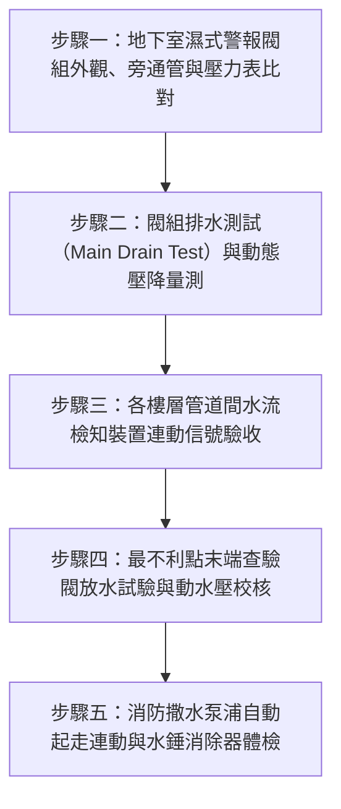

# 全案購屋實戰第二百五十七部：中古大樓社區地下室消防撒水系統末端查驗閥壓力衰減警報逆止閥閥瓣卡塞與水錘破壞體檢工序全書

## 壹、前言與防護戰略意義

在台中南區與南屯區 25 至 30 年以上之集合住宅大樓（如大安紫金城、長億南園、歌德堡、靜園 A 區等），地下室與各樓層公共區域多依消防法規配置「自動撒水滅火系統（Automatic Sprinkler System）」。該系統平時由地下室消防撒水泵浦維持充水加壓狀態，一旦探測到火警高溫，封閉型撒水頭之易熔合金或玻璃球即受熱破裂噴水滅火，並透過各分區「流水檢知裝置（Water Flow Detector）」或「濕式警報閥（Alarm Check Valve）」觸發水力警鈴及消防受訊總機發報。

然而，歷經 25 年以上的歲月摧殘，中古大樓常出現三大致命機電與水路暗病：
1. **末端查驗閥（Inspector's Test Connection）放水壓力嚴重衰減**：管網內部銹垢雜質沉積造成管徑大幅縮減，末端靜水壓與動水壓嚴重不足。
2. **警報逆止閥閥瓣（Clapper）橡膠老化黏死或鏽蝕卡塞**：火警時水流無法推開閥瓣，致使水力警鈴失靈且電器微動開關無法發送火警信號至防災中心。
3. **系統補壓水錘衝擊（Water Hammer）與管網破裂**：管線內部積聚空氣或逆止閥關閉遲滯，造成高壓震盪水錘，震裂吊管甚至引發整棟地下室或車庫「水庫級暴淹」。

本專書為「小寶置產全案防護體系」第二百五十七部，旨在建立一套針對中古集合住宅消防自動撒水系統、警報逆止閥、末端查驗閥壓力測試及抗水錘防護的全維度工程體檢工序，捍衛家庭財產與居住安全，並提煉為向賣方與管委會強勢談判的實體鐵證。

---

## 貳、自動撒水系統核心失效機理與破壞鏈

### 一、警報逆止閥（濕式報警閥）機構卡阻
1. **橡膠閥瓣（Rubber Disc）硬化與閥座黏結**：
   - 長期處於靜止閉合狀態，受自來水加氯與水中礦物質沉澱影響，耐油橡膠閥墊硬化發脆，牢牢黏死在青銅閥座上。
   - 即使末端撒水頭破裂或打開查驗閥，水壓差無法克服黏結阻力，閥瓣無法抬起，延誤火災撲滅時機。
2. **延遲槽（Retard Chamber）與排水孔堵塞**：
   - 為防止供水管網微小壓力波動引起誤報，閥組配有延遲槽與自動滴水球閥。
   - 管道銹渣堵塞小孔後，平日壓力微震即造成水力警鈴持續發出刺耳怪叫（誤報），或反之因積泥卡死火災時完全無聲。

### 二、配管管網銹蝕、縮徑與末端查驗壓力不足
1. **黑鐵鋼管（Carbon Steel Pipe）內壁氧化結瘤**：
   - 早期老舊社區撒水管多採用配管用碳鋼鋼管（SGP），未經特殊防腐處理，長期滿水浸泡導致內壁大面積產生氧化鐵結瘤（Tuberculation）。
   - 原 2 吋（DN50）管路實質通水截面積常縮減達 40%~60%，造成系統動水阻抗倍增。
2. **末端查驗閥放水動水壓未達標**：
   - 依消防安全設備設置標準，自動撒水系統最遠最不利點撒水頭之放水放水壓力須維持在 $1.0\,\text{kgf/cm}^2$（約 $0.1\,\text{MPa}$）以上，放水量不得小於 $80\,\text{L/min}$。
   - 實地檢測常發現老舊大樓末端動水壓甚至跌破 $0.5\,\text{kgf/cm}^2$，只能微弱滴淌，根本無法形成撲滅火勢所需之水霧錐面。

### 三、壓力開關失靈與管湧水錘破壞
1. **管內氣囊積聚誘發水錘**：
   - 樓層垂直幹管或末端未裝設自動排氣閥，空氣被壓縮成高彈性氣囊。撒水泵浦啟動瞬間，水流以高速猛烈撞擊轉彎處與盲板，產生高達靜態壓力 3~5 倍之衝擊壓力波。
2. **吊管角鐵斷裂與管線掉落**：
   - 長期水錘震盪使膨脹螺栓與懸吊角鋼鬆動脫落，管路接頭法蘭墊片撕裂，導致數十噸消防水噴湧淹沒地下停車場。

---

## 參、實地現場勘驗五步檢測工序

### 步驟一：濕式警報閥組靜態壓力與閥件勘查
1. **一、二次側壓力表比對**：
   - 檢視警報閥下方（一次側，自供水泵浦來）與上方（二次側，通往各撒水頭）之壓力表讀數。
   - 正常待命狀態下，二次側壓力應略大於或等於一次側壓力（通常維持在 $5.0 \sim 8.0\,\text{kgf/cm}^2$）。若二次側壓力持續低於一次側超過 $1.0\,\text{kgf/cm}^2$，顯示警報逆止閥內部洩漏或系統暗管持續微滲水。
2. **常開式控制閘閥（OS&Y Valve）上鎖確認**：
   - 檢查控制閘閥是否處於全開位置，明桿外露螺桿是否有防擅關閉之鐵鍊加鎖（Tamper Switch 監控迴路是否正常）。

### 步驟二：警報閥主排水測試（Main Drain Test）
1. **主排水閥全開流程**：
   - 打開警報閥組之 2 吋主排水閥，紀錄開啟前之靜水壓（$P_{\text{static}}$）。
   - 在水流穩定排放時，紀錄壓力表降至之最低動態水壓（$P_{\text{flow}}$）。
2. **壓降分析標準**：
   - 正常供水狀況下，主排水時動態壓降應在 $15\%$ 以內。若動態壓降超過 $30\%$ 以上，代表進水幹管有閥門未全開、過濾器（Strainer）堵塞或主管管壁嚴重結垢阻礙通水。

### 步驟三：水力警鈴與信號回授連鎖驗證
1. **水力警鈴機械轉動檢查**：
   - 當主排水閥打開或旁通試驗閥動作時，高壓水流衝擊水輪機驅動機械銅鈴敲擊。
   - 實地確認水力警鈴音量需達 85dB 以上，且外殼排水管順暢排入截水溝，無積水逆流。
2. **消防受訊總機連鎖信號核對**：
   - 水流指示器之延遲時間（通常調整為 15~30 秒，防止水流微浪湧誤報）過後，確認消防總機該分區撒水警報紅燈即時點亮。

### 步驟四：最不利點末端查驗閥放水試驗
1. **最遠端末端查驗箱定位**：
   - 實地前往各大樓最不利點（通常為最高樓層管道間或地下室最角落車位旁）之末端查驗管。
2. **標準等徑孔口放水測定**：
   - 打開末端查驗閥，該閥出水口應裝設與實體撒水頭同口徑（通常為 $1/2$ 吋，K值=80）之試驗噴嘴。
   - 觀察水流噴射形態，並以精密充油壓力表記錄動水壓力：
     $$P_{\text{residual}} \ge 1.0\,\text{kgf/cm}^2 \quad (\approx 0.1\,\text{MPa})$$
   - 啟動計時器，確認消防總機在放水後 60 秒內發出流水警報。

### 步驟五：撒水主泵浦自動起走與抗水錘閥件檢查
1. **壓力開關自動連動啟動**：
   - 當末端查驗閥持續放水造成管網壓力下降至設定起走點（如 $4.5\,\text{kgf/cm}^2$），地下室撒水主泵浦必須在 5 秒內自動起走補壓。
2. **水錘消除器（Water Hammer Arrester）與緩閉逆止閥**：
   - 檢查泵浦出水總幹管是否裝設無聲緩閉逆止閥（Silent Check Valve）與氣囊式水錘吸收器。
   - 實地手動停機時，仔細聆聽管線有無「框噹」巨響與管身劇烈位移振動。

---

## 肆、全案四棟核心考慮物件撒水滅火系統深度對比

| 考慮社區 | 建物型態與撒水配置 | 現場勘驗要點與潛在風險 | 談判籌碼與合約特約防線 |
| :--- | :--- | :--- | :--- |
| **大安紫金城 13 樓 (`PROP_10`)** | 樓層屬 11 樓以上超高層高危防護區，地下室具備大平面車位 | 1. 13 樓室內是否因前屋主隔 4 間套房而擅自切斷或移位撒水頭，造成防護盲區與消防申報不合格。 2. B2 車位天花板撒水幹管吊架是否因漏水鏽蝕。 | 以「室內撒水頭復原工程款（每支移位約 3,000~5,000 元，4 間套房需 3~5 萬元）」與全套拆除工程款合計 50 萬，直接對屋主 898 萬開價進行大刀狠砍，鎖定 768~788 萬。 |
| **長億南園 8 樓 (`PROP_106`)** | 8 樓無室內撒水頭（10樓以下免設），防護重點全在地下室機械車位 | 1. 地下室老舊機械停車坑周邊撒水頭是否沾附大量黑黏廢機油，高溫時恐無法正常爆裂溶斷。 2. 警報閥組閥瓣是否鏽死從未實施主排水測試。 | 地下室車庫為高火載量區，以撒水系統老舊維護缺漏為由，強化「機械車位安全疑慮」，狠砍 200 萬，出價 745~760 萬。 |
| **歌德堡 8 樓** | 精裝修屋況，天花板封板平整 | 1. 裝潢木作天花板是否違法遮蔽或包覆撒水頭（集熱板間距是否合規）。 2. 水平配管是否有暗管微滲水導致木作受潮膨脹。 | 精裝雖省翻修款，但若撒水頭包覆違規遭消防稽查開罰需拆除天花板重做，必須於屋況點交書列管。 |
| **靜園 A 區 11 樓** | 11 樓屬消防法規必須全面設置自動撒水頭之起始樓層 | 1. 11 樓室內天花板每支撒水頭防護半徑是否符合法規（普通住宅 $r \le 2.6\,\text{m}$）。 2. 末端查驗閥壓力是否達到標準動水壓。 | 作為 11 樓高樓層對照組，檢驗高樓層撒水管網壓力是否健全，作為壓價備案。 |

---

## 伍、買方防護作戰特約條款與自保機制

在正式進入買賣斡旋與簽訂要約書時，應在不動產買賣契約補充協議中明確載明：

> **【室內及公共自動撒水滅火系統完整性保證特約條款】**  
> 「賣方保證本契約標的物室內現有之消防自動撒水頭管線及分佈完全符合主管機關現行消防法規標準，無擅自封閉、截斷、改道、漆料塗抹或遭天花板裝潢阻隔集熱之違法情事。若經室內裝修查驗或消防安全檢測發現撒水頭位置不合規、盲區過多或管路鏽漏，賣方應於交屋前負責修繕復原至合格狀態並負擔全部費用；或由買方逕行委託合格消防甲級承裝業估價後，由買方於買賣尾款中無異議等額扣除。」

---

## 陸、結論與行動指引

消防自動撒水系統是高層住宅與地下停車場抵禦突發惡火的唯一自主滅火防線。買方透過末端查驗閥壓力檢測、警報逆止閥閥瓣動作確認與室內撒水頭配置核查，不僅能夠徹底排除火災滅火失敗與暗管漏水暴淹之潛在危機，更將老舊大樓常見之違規改裝與管路老化轉換為談判桌上的實體重磅籌碼，實現最高規格的家庭置產防護！
