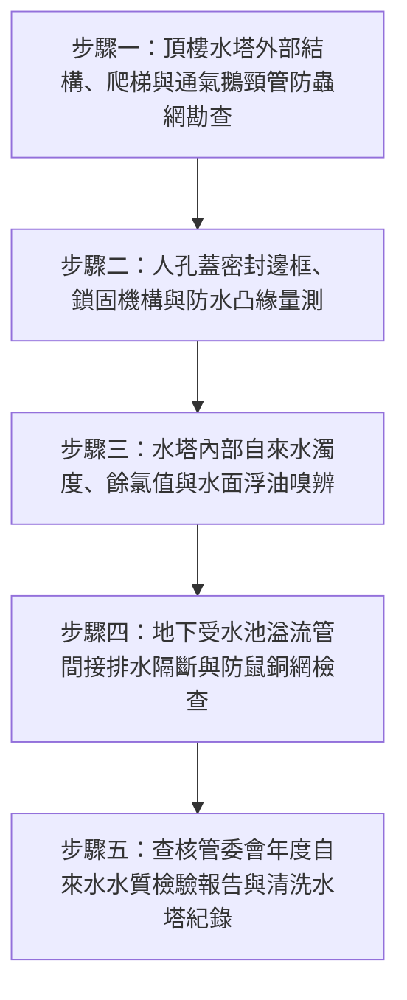

# 全案購屋實戰第二百五十九部：中古大樓社區自來水地下受水池與高架水塔通氣管防蟲防塵銅網破孔外來雨水污水滲漏與水質混濁體檢工序全書

## 壹、前言與防護戰略意義

在台中南區與南屯區 25 至 30 年以上中古集合住宅（例如：大安紫金城、長億南園、歌德堡、靜園 A 區等社區）的日常居住品質中，「飲用水與生活用水衛生」是家庭健康最脆弱卻常被忽視的命脈。集合住宅之給水系統多採「二段式重力供水架構」：自來水由自來水事業處幹管進入地下室「地下受水池（Ground Water Sump）」，再經由揚水泵浦抽送至頂樓之「高架水塔（Elevated Rooftop Water Tank）」，最後經由各戶分區重力管網配送至廚房與衛浴。

然而，歷經 25 年以上的風吹雨淋與管件老化，頂樓水塔與地下受水池普遍存在三大致命衛生與結構隱患：
1. **通氣管（Air Vent Pipe）防蟲不鏽鋼/黃銅細孔濾網老化破損、脫落**：
   - 通氣管係維持水槽內部大氣壓力平衡之關鍵。若濾網因氧化脆化破孔，鴿糞、鳥屍、蟑螂、壁虎及蚊蠅等害蟲直接爬入水箱溺斃腐爛，產生大量大腸桿菌群與致命沙門氏菌。
2. **通氣管口型式錯誤與外來暴雨/中庭污水倒灌**：
   - 頂樓通氣管若未施作下彎 $180^\circ$ 之「鵝頸管（Gooseneck）」或防雨罩（Rain Cap），風雨交加時夾帶酸雨與屋頂沉積積水直接灌入水塔；地下受水池之人孔蓋（Manhole Cover）未凸出地面 $20 \sim 30\,\text{cm}$，暴雨時停車場或中庭受污染之積水自人孔縫隙直瀉水池。
3. **水塔內部進水浮球破裂、防虹吸破真空閥失效導致污水回流**：
   - 管網水壓驟降產生負壓時，若無防虹吸破真空閥，外界污染水質極易經由微小漏點倒吸回潔淨水池內。

本專書為「小寶置產全案防護體系」第二百五十九部，旨在建立一套針對中古集合住宅地下受水池與頂樓高架水塔之通氣管濾網、人孔防水邊框、防鳥防蟲氣密性與清洗水質合格紀錄的全維度工程體檢工序，捍衛全家每日飲用水安全，並提煉為向賣方與管委會強勢談判的實體技術籌碼。

---

## 貳、蓄水池與水塔通氣管失效機理與污染路徑

### 一、通氣管老化破孔與生物污染路徑
1. **防蟲銅網/不鏽鋼網（Insect Mesh Screen）電化腐蝕與破洞**：
   - 頂樓水塔長期暴露於酸雨、紫外線及高濕環境下，若防蟲網採用劣質鐵絲網或低標號不鏽鋼（如 201 不鏽鋼），數年內即氧化鏽蝕穿孔。
   - 破孔孔徑大於 $1\,\text{mm}$ 時，蚊蟲（特別是登革熱白線斑蚊）即可自由進出水槽產卵孵化孑孓；禽鳥在水塔通氣管口棲息排泄，禽流感病毒與隱孢子蟲隨通氣氣流直接落入飲用水體中。
2. **直立開口型通氣管之雨水倒灌**：
   - 早期施工偷工減料，通氣管未施作標準倒 U 型鵝頸彎頭，僅以管帽鑽孔便宜行事，強降雨時雨水順著管壁逆流灌入水槽。

### 二、地下受水池人孔蓋與溢流管污染機理
1. **平齊式人孔蓋（Flush Type Manhole）無防水凸緣**：
   - 早期地下室受水池常將人孔蓋直接齊平安裝於地下室地坪。當地下室清洗地板、排污管溢流或暴雨路面逕流湧入時，地表滿佈廢機油與細菌之髒水直接自人孔蓋縫隙流入受水池。
   - 標準規範必須設有高出周圍地坪至少 $20\,\text{cm}$ 之 RC 防水凸台（Curved Curb），且蓋緣須有包覆向下至少 $5\,\text{cm}$ 之防水圍邊與耐候 EPDM 氣密密封墊片。
2. **溢流管（Overflow Pipe）與排水管直通無落水隔斷**：
   - 蓄水池溢流管若直接硬接插入地下室污水排水溝，未施作「間接排水（Air Gap，間距至少 15cm）」，當污水下水道阻塞回湧時，化糞池污水與沼氣將沿溢流管直衝受水池內部，造成全棟自來水嚴重污染。

---

## 參、實地現場勘驗五步檢測工序

### 步驟一：通氣管形式與防蟲網完整性檢驗
1. **鵝頸管彎折角度與防雨罩檢查**：
   - 檢視頂樓水塔頂部之通氣管，確認管口向下彎折 $180^\circ$ 且管口標高至少高出水塔頂板 $15\,\text{cm}$ 以上。
2. **不鏽鋼 SUS304 防蟲濾網目數（Mesh Size）檢查**：
   - 檢視通氣管口封堵之濾網材質，必須為耐腐蝕之 SUS304/SUS316 不鏽鋼或耐候黃銅網。
   - 濾網目數應介於 16 目至 24 目之間（孔徑約 $0.8 \sim 1.0\,\text{mm}$），網面緊密包覆無任何破洞、脫線或外翻縫隙。

### 步驟二：人孔蓋氣密、凸緣與通氣防污檢查
1. **防水凸台高度測量**：
   - 以捲尺測量地下受水池人孔蓋基礎座高出周圍地坪之垂直高度，標準數值應達 $20 \sim 30\,\text{cm}$。
2. **氣密墊圈與人孔鎖固結構**：
   - 掀開人孔蓋（或檢視人孔外框），檢查邊框內部是否附有完整無硬化發脆之橡膠迫緊（Gasket）。
   - 人孔蓋應具備防止外人任意掀開之重型鎖具或防盜螺栓，防範蓄意投毒或異物掉入。

### 步驟三：現場水質濁度、餘氯與感官檢測
1. **水面光學檢視與異味嗅辨**：
   - 以高流明強光手電筒照射水槽內部水面，水面應清澈見底、無漂浮油膜、泡沫、懸浮物或死昆蟲；無硫化氫（臭雞蛋味）或霉味。
2. **便攜式餘氯測定儀（Free Chlorine Tester）測試**：
   - 於各戶出水端或水塔取水樣，使用 DPD 試劑測定有效自由餘氯。
   - 自來水水質標準：末端有效餘氯值應維持在 $0.2 \sim 1.0\,\text{ppm}$（$\text{mg/L}$）。若餘氯低於 $0.1\,\text{ppm}$，顯示水體在槽內停滯時間過長或已消耗於分解槽內有機污染物。

### 步驟四：溢流管間接排水與防鼠網檢測
1. **物理空間落水斷（Air Gap）量測**：
   - 檢視地下受水池及頂樓水塔之溢流管與排水管末端，與受納排水溝或排水漏斗邊緣之垂直空間距離。
   - 空氣落差距離不得小於溢流管管徑之 2 倍，且最小不得低於 $15\,\text{cm}$，徹底切斷污水毛細或負壓虹吸逆流通道。
2. **溢流管口重型防鼠不鏽鋼濾網**：
   - 溢流管口必須裝設堅固之防鼠銅網或不鏽鋼金屬網罩，防止老鼠自排水溝逆行鑽入水箱。

### 步驟五：調閱管委會清洗紀錄與檢驗報告
1. **每半年定期清洗水塔水池核備單**：
   - 檢驗管委會是否委由具備台北市/台中市自來水事業處審查合格之專業水質清洗廠商，每六個月進行一次全面放空刷洗與高濃度加氯消毒。
2. **SGS 或環保局認證實驗室水質報告**：
   - 核對最新一期水質檢測報告之各項數值：大腸桿菌群（不得檢出）、總菌落數（$< 100\,\text{CFU/mL}$）、濁度（$< 2\,\text{NTU}$）、重金屬（鉛、鎘、砷等符合飲用水水質標準）。

---

## 肆、全案四棟核心考慮物件飲用水供水設施評估

| 考慮社區 | 建物水箱配置型態 | 現場勘驗要點與潛在風險 | 談判籌碼與合約特約防線 |
| :--- | :--- | :--- | :--- |
| **大安紫金城 13 樓 (`PROP_10`)** | 本戶位於 13 樓頂層次頂層，極為接近頂樓高架水塔 | 1. 13 樓頂樓水塔若通氣管破損，異物直灌頂樓戶管線；水壓是否需加裝獨立加壓馬達。 2. 檢視水塔下方頂板是否有滲漏水導致 13 樓天花板受潮。 | 本戶位居高樓層，以頂樓水塔震動、通氣管老化與水質安全作為檢驗點，要求管委會出示最新水質報告；作為壓價籌碼，嚴格定錨 768~788 萬。 |
| **長億南園 8 樓 (`PROP_106`)** | 8 樓為典型中高樓層，重力供水管線路徑長 | 1. 地下室受水池是否鄰近老舊機械車位油污坑，人孔蓋密封膠條是否硬化。 2. 垂直自來水幹管管齡已達 30 年，是否有鍍鋅鐵管生鏽出黃水現象。 | 針對 30 年老舊大樓地下受水池環境與管線鏽蝕疑慮，強化議價殺傷力，由 998 萬直接狠砍 200 萬，出價 745~760 萬。 |
| **歌德堡 8 樓** | 社區機電管委會維護精實，水塔每年定期發包清洗 | 1. 頂樓水塔通氣管是否均已更新為 SUS304 鵝頸管。 2. 戶內精美裝潢之廚房是否配有合格生飲前置淨水系統。 | 作為高品質保值對抗組，確認社區供水衛生無虞，無高額公共管線翻新分攤金隱患。 |
| **靜園 A 區 11 樓** | 高樓層 11 樓獨立棟別，採光通風好 | 1. 水塔頂樓露天平台防水層與通氣管高度是否合規。 2. 檢視末端龍頭放水水質清澈度與餘氯數值。 | 作為比價牽制籌碼，藉由優質水質與開闊採光壓制其他屋況不良標的。 |

---

## 伍、買方防護作戰特約條款與自保機制

在正式進入買賣斡旋與簽訂要約書時，應在不動產買賣契約補充協議中明確載明：

> **【社區公共蓄水池及自來水衛生安全保證特約條款】**  
> 「賣方保證本契約標的物所在社區大樓之地下受水池與頂樓高架水塔自來水供水系統運作正常，最近半年內完成法定清洗消毒作業且水質經合格檢驗機構檢驗合乎飲用水水質標準。若交屋前發現社區蓄水池存在結構裂縫滲漏、通氣管破損致遭有害生物污染、或自來水出水嚴重混濁鏽黃無法正常使用，賣方應促使管委會立即完成清洗修復至合格標準；若無法於交屋日前改善完成，買方得主張暫扣買賣尾款新台幣拾萬元，待管委會改善完成並出具合格水質報告後始予撥付。」

---

## 陸、結論與行動指引

潔淨安全的飲用水是家庭生命健康的絕對底線。中古大樓之受水池與水塔通氣管、防蟲網及人孔邊框雖隱身於地下與天台，卻是反映管委會日常管理細膩度與公設維護水準的「照妖鏡」。透過本工序之精準檢測，不僅為全家健康築起堅固屏障，更將公設潛在的修繕負擔精準轉化為合約特約與殺價籌碼，落實全勝置產戰略！
