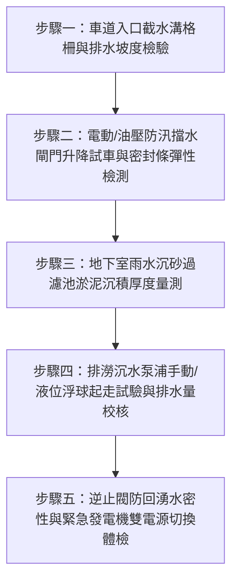

# 全案購屋實戰第二百五十八部：中古大樓社區地下室雨水沉砂過濾池淤泥板結抽水排澇泵浦過載與防暴雨倒灌電動防汛擋水閘門密封膠條老化體檢工序全書

## 壹、前言與防護戰略意義

在氣候變遷劇烈、極端暴雨與短延時強降雨（如颱風天、午後雷陣雨時雨量突破 100mm）頻發的今日，台中市南區及南屯區等發展成熟之舊市區，常面臨市區雨水下水道宣洩不及而形成路面逕流淹水之嚴峻考驗。對於 25 至 30 年以上之中古集合住宅大樓（如大安紫金城、長億南園、歌德堡、靜園 A 區等），其地下停車場通常為整棟大樓標高最低點，也是社區最昂貴之機電、變電、消防與自來水受水設備之集中地。

大樓地下室車道入口處之「電動/油壓防汛防洪擋水閘門」與地底筏基層之「雨水沉砂過濾池及排澇沉水泵浦（Rainwater Sump Pump）」，是保衛整棟大樓避免「水庫級暴淹滅頂」的最後兩道生死防線：
1. **車道防汛擋水閘門密封橡膠發泡條老化脆裂**：閘門升起閉合時無法抵禦洶湧路面積水，泥水自底縫與兩側滑軌瘋狂滲入。
2. **雨水沉砂池長年未清淤、泥沙板結**：暴雨沖刷夾帶之黃泥、砂石沉積將排澇泵浦之進水葉輪死死咬住，導致過載跳脫（Overload Trip），排澇功能瞬間歸零。
3. **止回逆止閥（Check Valve）卡砂逆流**：公共排水幹管水位暴漲，外界混濁泥水經由排水管逆流回灌地下室。

一旦地下室慘遭滅頂，每戶將面臨動輒數十萬至百萬之變電器泡水、電梯主機泡水、生活用水停供等災難性損失，社區二手房價更將直接打 7 折重挫。本專書為「小寶置產全案防護體系」第二百五十八部，旨在建立一套針對中古集合住宅地下防汛擋水閘門、雨水沉砂池清淤與排澇泵浦備援能力的完整驗收體檢工序，保護家庭核心資產免於水患侵襲。

---

## 貳、防洪排澇系統核心失效機理與災難路徑

### 一、車道防汛擋水閘門失效機理
1. **底座與兩側 EPDM 氣密橡膠條硬化變形**：
   - 暴露於車道口風吹日曬與汽機車頻繁碾壓，橡膠條彈性疲乏、撕裂脫落。
   - 閘門閉合壓緊後，每公尺縫隙在 $0.5\,\text{m}$ 水頭差下，每小時可滲漏高達數噸泥水。
2. **油壓驅動缸內部洩油或手動絞盤齒輪鏽死**：
   - 長期未進行定期升降試車，油壓動力單元（HPU）液壓油乳化、油封漏油失壓，閘門無法升至額定高度（一般規範須達車道截水溝上方 $0.9 \sim 1.2\,\text{m}$）；停電時缺乏手動強制閉合機構。

### 二、雨水沉砂池與排澇沉水泵浦癱瘓機理
1. **沉砂隔板（Baffle Plate）坍塌與淤泥板結**：
   - 沉砂池設計原理是以重力讓粗砂沉澱於第一沉砂槽，清水溢流至第二抽水槽。若管委會數年未實施高壓水刀吸泥清淤，泥砂完全堆滿溢流孔，整座池體硬化板結。
2. **葉輪（Impeller）卡砂鎖死與電機乾燒**：
   - 排澇沉水泵浦多採用旋渦式或雙渦流葉輪。泥沙顆粒直徑大於葉輪間隙時造成機械咬死，線圈短時間內產生超高堵轉電流（Locked-Rotor Current），熱動過載電驛跳脫或漆包線耐熱擊穿燒燬。
3. **雙泵自動交替切換控制器繼電器氧化**：
   - 潮濕腐蝕環境導致「交替繼電器（Alternating Relay）」接點碳化，導致一號泵故障時二號備援泵無法自動銜接起走，兩泵皆停擺。

---

## 參、實地現場勘驗五步檢測工序

### 步驟一：車道截水溝與防坡反坡量測
1. **車道入口反坡（Hump）高度測量**：
   - 以水平儀檢視車道口自人行道外緣向內是否有設置至少 $15 \sim 20\,\text{cm}$ 以上之防汛反坡凸起，避免路面表層逕流直接沿坡道傾瀉。
2. **第一道與第二道截水溝格柵開口率**：
   - 檢測鑄鐵格柵板有無變形斷裂，溝底沉積之落葉菸蒂雜物清除率；溝身縱向排水坡度必須大於 $1\%$，排水出口無阻礙。

### 步驟二：防汛擋水閘門動作試驗與水密性檢測
1. **動力升降全行程測試**：
   - 要求大樓管理室現場操作擋水閘門全開與全關行程。
   - 計時測量：電動閘門升起就位時間應在 60 秒以內；停電時利用手動搖桿或蓄壓瓶閉合時間應在 3 分鐘以內。
2. **密封膠條塞尺（Feeler Gauge）與透光檢查**：
   - 閘門閉合就位後，以手電筒從外側照射，內側檢視有無明顯透光縫隙。
   - 以 $0.5\,\text{mm}$ 塞尺檢測膠條壓縮緊密程度，正常壓下深度應達橡膠原厚度之 $30\% \sim 50\%$。

### 步驟三：沉砂池淤泥深度量測與水質勘查
1. **沉砂深槽探桿測量**：
   - 打開筏基層雨水沉砂池人孔蓋，以標尺探桿垂直插至池底。
   - 沉砂厚度若超過池深之三分之一（通常超過 $30\,\text{cm}$），即代表沉砂功能喪失，必須立即實施高壓水刀抽泥。
2. **沉砂池進水濾網籃（Basket Strainer）完整性**：
   - 檢視截水溝流入沉砂池之不鏽鋼防雜物濾籃是否破損脫落，避免粗硬碎石直接進入泵浦坑。

### 步驟四：排澇泵浦自動啟抽與液位浮球測試
1. **浮球液位開關逐級拉動**：
   - 在控制箱前，手動拉起排澇池內懸掛之四段浮球開關（停止水位、單泵起走水位、雙泵全開警報水位、超高水位溢流警報）。
   - 確認浮球仰角達 $45^\circ$ 時微動開關確實導通，泵浦瞬間起走，中央監控室發出蜂鳴警報。
2. **運轉電流與出水揚程驗證**：
   - 以鉤表量測三相運轉電流，比對銘牌額定電流；檢視出水管壓力表，確認出水動態揚程足以將排澇水克服靜水頭排至道路側溝。

### 步驟五：防回湧逆止閥水密性與 ATS 備援電力切換
1. **鑄鐵搖式逆止閥（Swing Check Valve）動作聲音**：
   - 泵浦停機瞬間，逆止閥閥瓣應迅速回擊關閉，無水流逆向倒流回沖池底之聲響。
2. **緊急發電機雙電源自動切換開關（ATS）聯鎖**：
   - 檢視排澇泵浦控制箱一次側供電迴路是否接於「緊急柴油發電機專用負載迴路」，避免市電停電時排澇泵浦同步停擺釀成滅頂。

---

## 肆、全案四棟核心考慮物件防汛排澇體檢實戰

| 考慮社區 | 車道地勢與防汛特徵 | 現場勘驗要點與潛在風險 | 談判籌碼與合約特約防線 |
| :--- | :--- | :--- | :--- |
| **大安紫金城 13 樓 (`PROP_10`)** | 地處南區主要幹道旁，車道直通地下 B1/B2 平面車位 | 1. 檢視 B2 獨立大平車位周邊是否有潮濕泥痕或歷史泡水水痕線。 2. 現場核查車道口防水閘門膠條是否完整更新。 | 本戶附帶獨立大平面車位，若地下防汛閘門老化不合格，車位價值直接大打折扣；藉此壓價 30 萬，堅定以 768~788 萬目標出價。 |
| **長億南園 8 樓 (`PROP_106`)** | 社區車道坡度較陡，地下室配置機械停車設備 | 1. 機械車位下層坑底（Pit）極易成為地下室積水第一受災區，廢油與泥水混合將嚴重腐蝕滾子鏈條。 2. 雨水沉砂池是否多年未清淤。 | 機械車位抗水患耐受度極低，以此結構性風險配合大廳階梯非無障礙，狠砍 200 萬，鎖定 745~760 萬。 |
| **歌德堡 8 樓** | 社區地下室坡道平緩，截水溝維護頻率高 | 1. 檢視沉砂池清潔維護紀錄表是否每年落實清淤。 2. 擋水閘門是否備妥組裝防汛插板或具備電動升降。 | 精裝優質標的，確認管委會有充裕修繕基金執行每季防汛演練，作為資產保值對照組。 |
| **靜園 A 區 11 樓** | 地下室出入口排水動線清晰，具備天然微地勢高差 | 1. 檢視雨水排澇泵浦雙電源 ATS 切換迴路是否定期保養。 2. 最低層車道積水警報感知器是否正常連線。 | 作為比價牽制籌碼，藉由地勢防汛優勢反壓低窪風險社區。 |

---

## 伍、買方防護作戰特約條款與自保機制

在正式進入買賣斡旋與簽訂要約書時，應在不動產買賣契約補充協議中明確載明：

> **【地下室公共防汛與排水設施正常運作保證特約條款】**  
> 「賣方保證本契約標的物所在社區大樓之車道防汛擋水閘門、地下室雨水沉砂池排澇泵浦系統及緊急備援供電迴路運作正常，且該社區地下停車場及公共機房於賣方持有期間絕無因暴雨淹水導致車輛受損或機電設備泡水之情事。若交屋前社區因防汛設備失靈遭暴雨積水倒灌，致使公共設施或附屬車位受損，賣方應無條件負責修復並賠償買方相應損失，買方亦得主張解除契約或由履約保證專戶暫扣修繕賠償金。」

---

## 陸、結論與行動指引

地下室防汛擋水閘門與雨水沉砂排澇系統是集合住宅面對極端氣候威脅的「水密甲冑」。透過專業的閘門橡膠密封檢驗、沉砂厚度探測與泵浦液位連鎖實測，不僅為家庭成員徹底屏除愛車與社區百萬機電泡水之滅頂之災，更將社區公設管理的良莠轉化為買方談判桌上的定錨重鎚！
