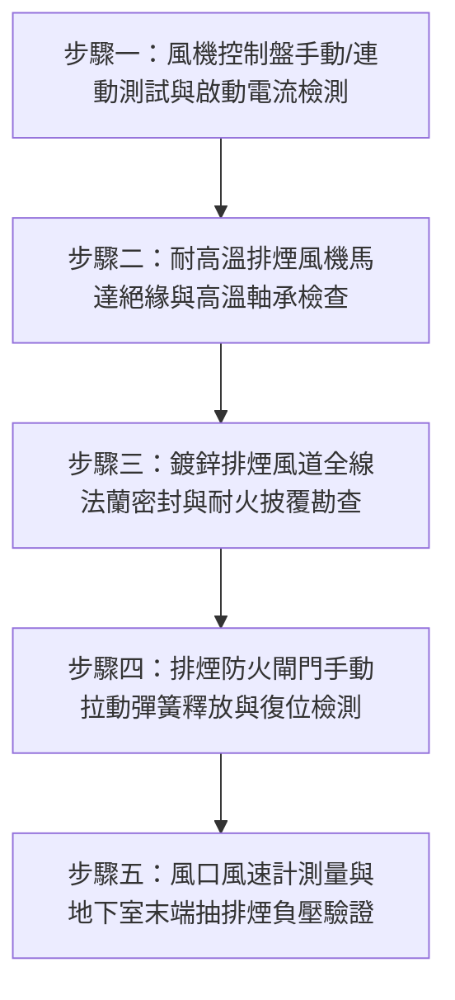

# 全案購屋實戰第二百五十六部：中古大樓社區地下室機械式排煙抽風機耐高溫馬達老化風管法蘭石棉墊片破損與強制排煙防火閘門熔斷手動復位體檢工序全書

## 壹、前言與防護戰略意義

在台中南區與南屯區 25 至 30 年以上中古集合住宅（例如：大安紫金城、長億南園、歌德堡、靜園 A 區等社區）的大樓公共安全體系中，「地下室機械強制防排煙系統」扮演著地下各層火災發生時唯一的生命通道守護者。地下室停車場因存放大量汽油、柴油車輛，更在近年陸續引進電動車（EV）充電設施，一旦發生電池熱失控或線路走火，將於數十秒內產生數千度高溫濃煙與大量致命毒性氣體（一氧化碳、氰化氫、氟化氫等）。

若地下室專用機械排煙風機（Smoke Exhaust Fan）耐高溫耐火馬達線圈老化絕緣擊穿、風管排煙法蘭連接處氣密墊片老化碳化破損漏煙、或排煙防火閘門（Fire/Smoke Damper）感溫熔斷片斷折誤動作卡死且缺乏手動復位機制，火災時排煙風機將無法啟動或在濃煙中抽力崩潰，將本應排至戶外的劇毒濃煙倒灌進入各棟逃生安全梯或各戶弱電管道間，釀成毀滅性重大傷亡。

本專書為「小寶置產全案防護體系」第二百五十六部，旨在建立一套針對中古大樓地下室排煙風機耐高溫運轉評估、風管法蘭耐火密封、排煙防火閘門熔斷連鎖與排煙控制盤手動/自動連線復位的全維度工程體檢工序，保護家庭成員在各類極端火災情境下的絕對人身安全，並作為向管委會調閱消防定檢缺失與對賣方強力議價之技術依據。

---

## 貳、地下室機械防排煙系統核心失效機理

### 一、耐高溫排煙馬達線圈與絕緣等級老化
1. **運轉溫度等級不足**：
   - 消防法規規定排煙風機馬達及葉輪必須承受至少 $250^\circ\text{C}$ 以上高溫持續連續運轉 60 分鐘至 120 分鐘以上（Class H 級絕緣）。
   - 早期中古大樓在維護修繕時，常有外包廠商以低成本之普通 Class B 或 Class F 耐溫馬達私自替換，在真實火災發生後 5 至 10 分鐘內即因馬達過熱燒燬、絕緣漆融化短路跳脫。
2. **軸承潤滑高溫乾涸與咬死**：
   - 長期處於地下室潮濕環境中，排煙風機軸承內部高溫牛油硬化、乳化變質。平日極少啟動運轉，一旦火災警報全負載啟動，軸承瞬間產生數倍劇烈摩擦阻力，導致啟動電流過大（Overload）引發熱過載電驛（O/L）跳脫。

### 二、排煙風道鍍鋅鐵皮法蘭與氣密墊片碳化破損
1. **法蘭連接處石棉/陶瓷纖維墊片粉化**：
   - 早期大樓風管法蘭多採用石棉或一般發泡橡膠條作為氣密密封，歷經 25 年以上時間老化，墊片硬化脆裂、脫落脫膠。
   - 當排煙風機啟動形成數百 Pa 負壓或正壓時，大量濃煙直接從風管接縫法蘭處漏出並充斥整個地下室或防空避難室。
2. **鍍鋅風管冷凝水銹穿與排煙壓降**：
   - 地下室濕度長期高達 80%~90%，風道底部凹陷處長期積聚冷凝水，導致鐵皮從內向外嚴重銹蝕穿孔，實測末端抽風負壓嚴重衰減達 50% 以上。

### 三、排煙防火閘門（Smoke Fire Damper, SFD）機構卡死
1. **易熔金屬片（Fusible Link）疲勞斷裂與灰塵卡塞**：
   - 正常熔斷動作溫度通常設定在 $280^\circ\text{C}$（排煙專用閘門）或 $72^\circ\text{C}$（一般空調防火閘門）。
   - 長期缺乏保養時，閘門轉軸軸套積滿重油污、油漆或灰塵結塊，即使熔斷片斷開，彈簧扭力亦無法克服轉軸阻力閉合；或反之，平日微震動導致連動機構誤卡死，無法強制全開排煙。
2. **連鎖微動開關（Limit Switch）接點氧化**：
   - 閘門開啟或閉合之信號無法正確回傳至中央監控室或消防總機，造成總機顯示連線異常或無法啟動連鎖送風風機。

---

## 參、實地現場勘驗五步檢測工序

### 步驟一：風機控制盤手動/自動啟動測試
1. **控制盤面板切換**：在地下室專用排煙風機控制箱前，將「手動/自動/停止」選擇開關打至手動位置，按下啟動按鈕。
2. **三相啟動電流監測**：使用鉤表（Clamp Meter）量測排煙馬達三相啟動突波電流（Inrush Current）與穩定運轉電流，確認三相電流不平衡率小於 $5\%$。
3. **欠相與過載跳脫機構檢查**：檢視控制箱內部電磁接觸器（MC）接點是否積碳嚴重、熱動過載電驛設定額定值是否正確吻合馬達銘牌數值。

### 步驟二：耐高溫排煙風機馬達與傳動皮帶檢查
1. **絕緣電阻測試（Megger Test）**：
   - 在斷電安全狀態下，以 500V 絕緣高阻計量測馬達線圈對機殼絕緣阻抗，實測值必須大於 $5\,\text{M}\Omega$（低於 $1\,\text{M}\Omega$ 即屬嚴重絕緣劣化，隨時有漏電燒毀風險）。
2. **皮帶鬆緊度與皮帶輪校正**：
   - 傳動皮帶以手指垂直施壓 10~15mm 撓度為標準；皮帶不可出現龜裂、脫線或沾附油污。雙輪中心線以雷射校正儀或直規檢視平整度。

### 步骤三：風管法蘭氣密與避震帆布耐高溫性檢查
1. **排煙風機出入口避震接頭（Flexible Connection）**：
   - 嚴格禁止使用普通 PVC 或氯丁橡膠帆布，必須採用矽膠玻璃纖維布（Silicone Coated Fiberglass Fabric）或不鏽鋼金屬波紋避震接頭，耐溫須達 $300^\circ\text{C}$ 以上且表面無破損撕裂。
2. **風管懸吊抗震吊架**：
   - 檢查風管每隔 2.5 米至 3 米之角鋼吊架與膨脹螺栓是否銹蝕鬆脫，在遭遇地震時避免大口徑風管崩塌砸毀車輛或堵塞逃生路徑。

### 步驟四：排煙防火閘門熔斷連鎖與復位機制檢驗
1. **手動測試拉繩與復位手柄**：
   - 現場扳動排煙防火閘門手動操作桿，觀察閘門葉片是否能在 1 秒內迅速順暢閉合或開啟。
   - 順利閉合後，旋轉手動復位棘輪手柄，測試是否能輕鬆回推上鎖並重新鎖定於待命位置。
2. **連鎖微動開關回授信號**：
   - 測試動作時，同步利用無線對講機與一樓管理室確認消防受訊總機上之「排煙閘門開啟」指示燈與蜂鳴警報是否同步亮起。

### 步驟五：風口出風風速量測與實測換氣率核算
1. **熱線式/葉輪式風速計（Anemometer）測量**：
   - 於地下停車場各分區排煙吸入口以多點網格法測量斷面平均風速（$V_{\text{avg}}$）。
   - 計算排風總風量：
     $$Q = A \times V_{\text{avg}} \times 3600 \quad (\text{m}^3/\text{hr})$$
2. **換氣次數驗證**：
   - 地下室排煙換氣次數依消防技術規範應達到每小時至少 6 次以上換氣量。若實測換氣量不足 4 次/小時，顯示風道漏風嚴重或風機效率嚴重衰退。

---

## 肆、全案四棟核心考慮物件防排煙專案評估

| 考慮社區 | 建物型態與排煙特徵 | 現場勘驗要點與潛在風險 | 談判籌碼與合約特約防線 |
| :--- | :--- | :--- | :--- |
| **大安紫金城 13 樓 (`PROP_10`)** | 挑高地下室兼附平面車位區，排煙風機獨立吊掛於 B2 | 1. 檢視排煙風管是否穿越車位上方且有冷凝水銹穿現象。 2. 確認風機控制盤是否具備手動復位與火警全連鎖功能。 | 要求管委會出示最近一年之消防安全申報「防排煙設備不合格改善核備函」；若需社區平攤風機大修費，直接要求賣方折價 5 萬元。 |
| **長億南園 8 樓 (`PROP_106`)** | 地下室附設機械停車設備，車輛密集且坑道深長 | 1. 機械停車坑底之油污是否堵塞排煙吸風口。 2. 排煙風機耐高溫馬達是否仍為原廠 30 年老舊設備未曾翻新。 | 藉由地下室機械車位重油氣揮發與排煙設備老舊兩項致命硬傷，對開價 998 萬強力狠砍 200 萬，以 745~760 萬定錨出價。 |
| **歌德堡 8 樓** | 中型社區地下室，管線集中於中央走道天花板 | 1. 風管避震帆布是否硬化脆裂。 2. 管道間穿越牆面之排煙閘門周邊防火泥填塞是否扎實。 | 作為屋況精修優勢社區，檢視公設機電維護水準，確認無公共安全修繕特別分攤金隱患。 |
| **靜園 A 區 11 樓** | 住宅區純地下室停車場，通風口多設於採光通風井 | 1. 排煙口防鳥防鼠鐵絲網是否積滿樹葉枯枝造成排風阻抗劇增。 2. 熔斷金屬片有無銹蝕誤動作。 | 納入比價對照組，藉由其外觀保養良好程度壓制其他物件之議價空間。 |

---

## 伍、買方防護作戰特約條款與自保機制

在正式進入買賣斡旋與簽訂要約書時，應在不動產買賣契約補充協議中明確載明：

> **【公共設施消防排煙與機電設備安全特約條款】**  
> 「賣方保證本契約標的物所在社區大樓之公共消防設施（含地下室機械防排煙風機、消防栓、自動灑水及受訊總機連鎖系統）在交付日前經主管機關消防安檢申報合格，且管委會無因重大消防缺失遭勒令限期改善或裁罰之情事。若簽約至交屋期間管委會召開區分所有權人會議決議需由各住戶分攤高額消防防排煙設備全面更新重置工程款（累計達新台幣參萬元以上者），該項工程款應全數由賣方負擔清償完畢，否則買方得逕行自履約保證專戶扣除該筆金額。」

---

## 陸、結論與行動指引

地下室機械排煙抽風機與耐高溫閘門是老舊集合住宅在災難時唯一能夠爭取黃金逃生時間的生命防護罩。透過本工序之專業勘查，不僅能夠一眼洞悉社區機電管委會的管理底層真實水準，更將這些不可見的隱藏風險轉化為談判桌上的強大殺價籌碼，落實「買得安心、住得安全、資產保值」之置產最高指導原則！
