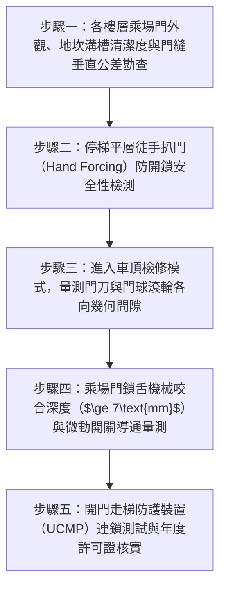

# 全案購屋實戰第二百八十一部：中古大樓社區各樓層電梯昇降路乘場門門鎖電氣連鎖開關接點氧化卡阻門刀間隙走位與防剪人安全體檢工序全書

## 壹、前言與防護戰略意義

在現代集合住宅高層與超高層大樓的垂直交通生命線中，「客貨用電梯昇降機（Elevator Traction System）」是全棟住戶每日進出家門最頻繁、也是安全風險最高的核心特種設備。依據我國建築物機械停車及昇降設備安全檢查規範與 CNS 10594 電梯國家標準，電梯乘場門（Hoistway Landing Doors）與車廂門（Car Door）配置了極為嚴密之「雙重機械鉤鎖（Mechanical Lock Hook）」與「電氣連鎖安全開關（Door Interlock Safety Switch）」。

電梯運作之絕對安全鐵律為：**「門未關好鎖死，絕對嚴禁通電起走」**。只有當每層樓之乘場門被機械彈簧與配重完全關閉、鎖舌咬入深度大於 $7\,\text{mm}$、且電氣安全觸點確實壓下導通時，整棟電梯安全迴路（Safety Circuit）方能接通允許煞車器（Brake）鬆閘起走。而車廂在抵達樓層時，車門上之「主動門刀（Door Vane / Clutch）」必須以精準之間隙穿入乘場門之「被動門球滾輪（Pick-up Rollers）」，將門鎖機械解扣並同步驅動兩扇門開啟。

然而，在台中市南區與南屯區屋齡 25 至 30 年以上的中古集合住宅（例如：大安紫金城、長億南園、歌德堡、靜園 A 區等社區），電梯乘場門系統常年承受住戶推擠、娃娃車碰撞、裝潢粉塵侵蝕與機械磨損，普遍陷入極度凶險的「防剪人防墜井安全黑洞」：
1. **乘場門門鎖電氣接點（Interlock Contacts）氧化發黑、接觸不良**：導致電梯在平層或運行途中頻繁突發緊急煞車鎖死，將長輩與孩童「反鎖困於車廂（Trapment）」引發恐慌甚至窒息事故。
2. **門鎖機械彈簧疲勞疲軟、滑軌（Door Hanger Track）積灰卡阻**：人離開車廂後，乘場門無法靠自重或彈簧「完全自動彈回關死」，留下數公分之致命門縫。更可怕的是部分不肖保養人員為圖省事，竟違法私自將安全迴路「短路跳線（Jumpering）」，導致電梯在門半開狀態下依然全速起走，釀成乘客被電梯活活「攔腰剪斷（Shearing Fatality）」的恐怖慘劇。
3. **車門門刀與乘場門球間隙走位偏斜**：門刀在車廂高速上下穿越時意外擦撞到某樓層門球，產生劇烈金屬撞擊巨響，甚至在非平層區域將乘場門強行撞開，造成乘客或兒童誤步踏空「直墜數十公尺深井（Falling into Shaft）」粉身碎骨。

本專書為「小寶置產全案防護體系」第二百八十一部，旨在建立一套針對中古集合住宅各樓層電梯乘場門鎖舌咬合深度、電氣安全開關接觸電阻、門刀與滾輪間隙塞尺量測及防開門走梯保護（UCMP）的全維度工程體檢工序，捍衛家庭成員垂直移動時的絕對生命安全，並轉化為對賣方與管委會強力議價的實體技術鐵證。

---

## 貳、電梯乘場門連鎖與門刀聯動核心失效機理

### 一、門鎖電氣安全開關接觸電阻激增與困人機理
1. **銀合金觸點電弧燒蝕與微振動氧化**：
   - 電梯門鎖開關每次閉合承受 DC 110V 或 AC 220V 控制電流。在數十萬次開關循環中，微弱電弧在觸點表面形成絕緣之氧化銀與硫化銀積碳黑斑。
   - 乘場門鎖舌上的動觸點與外框靜觸點之間的接觸電阻 $R_c$ 自正常的 $< 0.1\,\Omega$ 飆升至數十歐姆。
2. **車廂微晃引發安全迴路突發斷路**：
   - 當車廂在井道內高速運轉氣流擾動時，老舊乘場門受風壓輕微晃動，氧化的觸點瞬間接觸不良（微斷路），主控電腦 PLC 判定為「乘場門異常打開」，立即觸發安全繼電器落下機械抱閘，車廂以數個 G 的減速度急停頓挫，造成車內乘客跌倒骨折或受困黑暗之中。

### 二、門吊輪偏心磨損與自動回歸閉合失效
1. **吊門滾輪（Door Hanger Rollers）尼龍層剝落與偏心軸鬆脫**：
   - 懸掛門板之偏心吊輪在鋁合金軌道上滾動。25 年老舊滾輪外層聚氨酯/尼龍橡膠硬化碎裂，門板失去水平垂直度向下傾斜下垂。
   - 門板下部的導靴（Door Shoes）死死卡在地面地坎（Door Sill）溝槽中，滑動阻力暴增。
2. **重錘鋼索（Weight Cable）脫溝或螺旋彈簧疲軟**：
   - 乘場門在無外力時，仰賴重錘或回歸彈簧的拉力保持常閉狀態。若重錘鋼索脫落或彈簧斷裂，門扇被推開後無法自回位，門開著停在樓層，電梯全面停擺。

### 三、門刀與門球滾輪幾何間隙走位碰撞機理
1. **門刀與滾輪靜態/動態間隙極限**：
   - 依據 CNS 規範，當電梯在井道正常運行通過非平層乘場門時，車廂門刀兩外側與乘場門滾輪之間的單邊間隙必須嚴格維持在：
     $$\text{Clearance}_{\text{vane-roller}} = 5.0 \sim 8.0\,\text{mm}$$
2. **車廂導靴磨損引發擺動擦碰**：
   - 若車廂導靴襯墊（Guide Shoes）磨損間隙過大，車廂在井道內左右擺動晃度超過 $10\,\text{mm}$，門刀在高速通過時直接橫向砍擊乘場門滾輪，引發「炸刀事故」，門刀扭曲卡死在井道中，導致嚴重特大機械事故。

---

## 參、實地現場勘驗五步檢測工序

### 步驟一：乘場門外觀、地坎與門縫公差檢測
1. **門扇間隙與地坎（Sill）清潔度檢查**：
   - 檢視各樓層乘場門關閉時，雙扇門中縫及門扇與門框側縫，縫隙必須均勻且小於 $5.0\,\text{mm}$。
   - 檢視地面不鏽鋼地坎溝槽，槽內不可堆滿小石子、菸蒂或硬幣；滑靴（Sill Shoes）無斷裂鬆動。
2. **外力按壓門板晃動量測**：
   - 站在乘場外側，雙手向井道方向用力推按門扇中央，門扇位移曠量不得超過 $5.0\,\text{mm}$，且底邊導靴不得有脫出地坎溝槽之脫軌風險。

### 步驟二：乘場門機械鎖自鎖與徒手扒門檢驗
1. **非平層徒手扒門防開測試**：
   - 當車廂不在本樓層（電梯在其他樓層運行或停靠）時，徒手以雙手手掌嘗試將乘場門向左右用力扒開。
   - **合格標準**：門扇受內部機械鉤鎖牢牢鎖定，最大開度絕對不得超過 $20\,\text{mm}$，且一旦鬆手必須立即靠彈簧拉力完全彈回閉合。
   - 若能徒手輕易扒開大於 $100\,\text{mm}$ 甚至完全扒開，代表機械鉤鎖已嚴重斷裂或被違規拆除，隨時有住戶或小孩失足直墜底坑慘死的重大危機。

### 步驟三：車頂檢修量測門刀與門球滾輪間隙
1. **進入車頂檢修模式（Car Top Inspection Mode）**：
   - 由合格電梯維修技師操作，將電梯切換至車頂檢修慢速運轉，人員站立於車頂安全護欄內。
2. **厚薄規（Feeler Gauge）精密量測三維間隙**：
   - 當車廂慢速上下點動經過各樓層乘場門時，量測門刀（Door Clutch）與被動雙滾輪之間隙：
     - 門刀兩側與雙滾輪單邊間隙：必須介於 $5.0 \sim 8.0\,\text{mm}$。
     - 門刀底部與地坎金屬頂部垂直間隙：必須 $\ge 5.0\,\text{mm}$。
     - 門球咬入門刀深度：必須 $\ge 8.0\,\text{mm}$，確保平層開門時門刀能平順夾緊雙滾輪解鎖。

### 步驟四：鎖舌機械咬合深度與電氣開關量測
1. **鎖舌嚙合深度刻度測量**：
   - 檢視乘場門鎖箱內部機械鉤鎖，當門扇完全關閉時，主鎖舌咬入副鎖座孔之嚙合深度（Engagement Depth）：
     $$\text{Depth}_{\text{latch}} \ge 7.0\,\text{mm} \quad (\text{CNS 標準強制規範})$$
2. **電氣接點閉合接觸電阻量測**：
   - 使用數位三用電表量測門鎖電氣安全開關閉合時兩端電阻，實測值必須：
     $$R_{\text{contact}} \le 0.5\,\Omega \quad (\text{超過 } 2.0\,\Omega \text{ 必須更換開關觸點})$$
3. **電氣接點行程滯後（Contact Wipe）檢驗**：
   - 確保機械鎖舌咬入深度達到 $7\,\text{mm}$ 之後，電氣觸點方能閉合導通；嚴禁出現「電氣開關已導通，但機械鎖舌尚未咬入」的致命設計錯誤。

### 步驟五：開門走梯防護（UCMP）與保養合約核實
1. **意外移動保護裝置（Unintended Car Movement Protection, UCMP）**：
   - 檢視電梯控制盤是否配置 UCMP 安全保護模組。當車門處於開啟狀態時，若主機煞車失效導致車廂意外滑移超過 $150\,\text{mm}$，輔助煞車夾繩器（Rope Gripper）或雙抱閘必須在 0.2 秒內緊急卡死停梯，徹底防止乘客上下車時被剪切。
2. **年度安全檢查合格標章**：
   - 檢視車廂內部由內政部指定昇降設備協會核發之最新年度有效許可證，並調閱過去半年之每月半月保養表，確認門鎖調整為每次必檢項目。

---

## 肆、全案四棟核心考慮物件電梯乘場門深度評估

| 考慮社區 | 建物樓層型態與電梯配置 | 現場勘驗要點與潛在風險 | 談判籌碼與合約特約防線 |
| :--- | :--- | :--- | :--- |
| **大安紫金城 13 樓 (`PROP_10`)** | 13 樓位居高樓層次頂層，住戶與出租學生搭乘電梯頻繁 | 1. 13 樓乘場門門鎖接點是否因進出頻繁而磨損氧化，經常發生到站不開門或微震動急停。 2. 乘場門外側徒手扒門是否能完全鎖死。 | 以「13 樓電梯乘場門電氣接點氧化、門刀間隙磨損存重大困人與安全隱患，管委會需編列專案大修」為由，配合 4 間套房拆除款，狠砍開價，強烈鎖定 **768~788 萬**。 |
| **長億南園 8 樓 (`PROP_106`)** | 社區樓高約 12~14 層，電梯系統已高齡 30 年未曾全面重置 | 1. 30 年老舊電梯乘場門吊輪尼龍磨光、地坎嚴重磨損卡阻。 2. 門鎖機械彈簧疲軟，門經常關不緊導致整棟電梯停擺。 | 直指 30 年老舊電梯機件疲勞、門鎖安全迴路隨時引發困人或剪人特大安全事故之結構性缺陷，狠砍 200 萬，出價 **745~760 萬**。 |
| **歌德堡 8 樓** | 中型精品社區維護精良，電梯車廂整潔、開關門輕盈無聲 | 1. 乘場門開關行程平穩順暢，無金屬摩擦刮扯聲。 2. 門鎖安全許可證與保養簽單齊全無缺失。 | 精裝優質標的，確認全棟垂直交通安全達到最高規格，作為家人老弱婦孺搭乘安心之堅固對照組。 |
| **靜園 A 區 11 樓** | 雙拼格局梯廳採光良好，每層僅兩戶使用電梯負荷輕 | 1. 11 樓乘場門開關靈敏，門縫密封良好無風切噪音。 2. 電梯鋼索無跳動震顫。 | 作為比價牽制籌碼，藉由標準之電梯維護水準反壓紫金城與長億南園。 |

---

## 伍、買方防護作戰特約條款與自保機制

在正式進入買賣斡旋與簽訂要約書時，應在不動產買賣契約補充協議中明確載明：

> **【公共電梯昇降設備乘場門與連鎖安全正常運作特約條款】**  
> 「賣方保證本契約標的物所屬社區大樓之客用電梯昇降機設備運作正常，具備主管機關核發之有效安全檢查許可證，各樓層乘場門機械鉤鎖、門鎖電氣連鎖安全開關、開門刀間隙及自動回歸彈簧完全符合國家 CNS 電梯安全規範。電梯在門未完全關閉鎖死狀態下絕無通電起走之重大危險瑕疵，且標的物所在樓層乘場門在非平層狀態下絕對無法徒手扒開，車廂運轉中絕無頻繁異常急停頓挫或困人情事。若簽約至交屋期間經現場查驗發現電梯門鎖電氣接點氧化故障、安全迴路遭違法短接跳線或經昇降設備安檢列管限期改善者，賣方應促使管委會立即完成門鎖總成翻新校正；若逾期未改善，賣方同意由買方自買賣尾款中暫扣新台幣伍萬元整作為公共電梯安全修繕保證金。」

---

## 陸、結論與行動指引

電梯乘場門鎖與電氣連鎖開關是每天進出大樓時保護全家生命免於「墜井與剪切」的最關鍵第一道生死之門。鎖舌微小的咬合不足、觸點微小的一點電弧氧化，在重達數噸的高速電梯車廂旁，就是引發驚悚特大公安事故的致命引信。透過本工序之徒手扒門防開驗證、卡尺咬合深度量測與門刀間隙嚴格校核，小寶全家不僅能夠徹底掌握垂直移動通道的絕對真實安全，更能洞悉大樓管理維護的深層實力，將公設潛在修繕負擔轉化為談判桌上的定錨重鎚！
