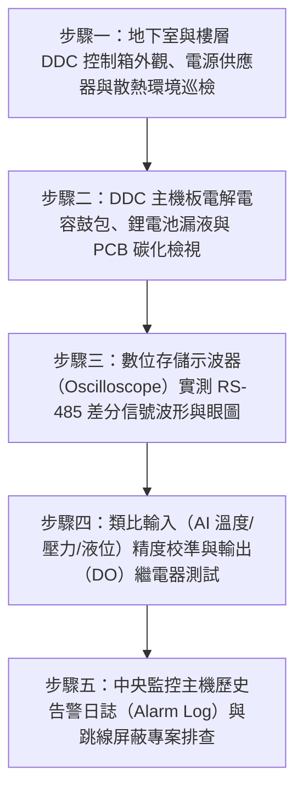

# 全案購屋實戰第二百八十七部：中古大樓社區地下室中央監控系統DDC直接數位控制器主板老化當機RS-485通訊迴路雜訊阻抗失配與消防警報跳線屏蔽體檢工序全書

## 壹、前言與防護戰略意義

在現代集合住宅高層與超高層大樓的現代化智慧建築工程中，「地下室中央監控系統（Building Management System, BMS / Building Automation, BA）」是大樓管理室與物業保全得以 24 小時掌控整棟大樓「給水揚水泵浦、污水排污泵浦、地下機械通風風機、排煙防火閘門、大樓公共照明、高低壓配電盤斷路器狀態及消防警報受信」的「中央智慧大腦神經系統」。

該系統由配置於地下室機房與各樓層管道間的「DDC 直接數位控制器（Direct Digital Controllers）」、串聯各控制器的「RS-485 差分通訊匯流排網路（Modbus / BACnet MS/TP）」、各類比/數位感測器（Sensors & Actuators），以及一樓中央防災監控主機（Central Supervisory Station）所構成。

然而，在台中市南區與南屯區屋齡 25 至 30 年以上的中古集合住宅（例如：大安紫金城、長億南園、歌德堡、靜園 A 區等社區），中央監控系統常年處於潮濕高溫的地底環境，歷經數十萬小時連續不間斷運行，普遍陷入極度嚴重的「大腦中風與神經麻痺」癱瘓危機：
1. **DDC 控制器主機板電解電容鼓包乾涸、微處理器（CPU）頻繁熱當機**：內部時鐘晶片（RTC）電池漏液腐蝕印刷電路板（PCB）走線，導致預設的「早晚尖峰通風排程」、「高低液位交替抽排」程式丟失，機電設備全數陷入失控混亂。
2. **RS-485 通訊屏蔽雙絞線（Shielded Twisted Pair）老化、末端匹配電阻（Termination Resistor, $120\,\Omega$）燒毀**：通訊迴路雜訊與高頻反射波干擾嚴重，封包遺失率飆破 $50\%$，中央螢幕顯示大量設備「連線超時中斷（Offline）」，形成嚴重的虛假監控。
3. **管委會或不良物業因警報頻繁「惡意跳線短接（Jumpering）或軟體屏蔽」**：當地下室排污池浮球故障或排煙閘門異常時，保全因嫌刺耳蜂鳴聲吵鬧，竟私自拿跳線將警報輸入點強行短路，或在監控軟體中將該警戒點「永久遮蔽（Alarm Masking）」，導致真實火災走火或地下室淹水滅頂時，中央主機完全無聲無息。

本專書為「小寶置產全案防護體系」第二百八十七部，旨在建立一套針對中古集合住宅中央監控 DDC 控制器主板健康度、RS-485 差分通訊信號示波器波形量測、類比輸入輸出（AI/AO）精度校核及惡意跳線屏蔽排查的全維度工程體檢工序，捍衛大樓機電智慧化監控的絕對真實性，並轉化為對賣方與管委會強力議價的實體技術鐵證。

---

## 貳、中央監控 DDC 控制器與 RS-485 網絡核心失效機理

### 一、DDC 硬體電解電容老化與熱當機機理
1. **電解電容電解液蒸發與等效串聯電阻（ESR）激增**：
   - DDC 控制箱內部因電源供應器（Switching Power Supply）長期發熱，箱內溫度常年高達 $45^\circ\text{C} \sim 55^\circ\text{C}$。
   - 依據阿倫尼烏斯法則（Arrhenius Rule），環境溫度每上升 $10^\circ\text{C}$，鋁電解電容壽命縮短一半。25 年老舊 DDC 主板上的濾波電容早已頂部鼓包（Bulging）或底部漏液，直流供電紋波（Ripple Voltage）自正常的 $< 50\,\text{mV}$ 飆升至數百毫伏，微處理器因低電壓復位（Brown-out Reset）頻繁反覆重啟或死當。
2. **EEPROM / Flash 記憶體細胞疲勞與程式損壞**：
   - 控制器非揮發性記憶體在數十萬次擦寫與斷電後，控制邏輯演算法指令碼丟失，輸出繼電器（DO）產生隨機性異常吸合，引發揚水泵浦乾燒或通風機逆向運轉。

### 二、RS-485 差分通訊雜訊與阻抗失配機理
1. **信號反射波（Signal Reflection）與終端電阻失效**：
   - RS-485 採用 A（$+$）、B（$-$）半雙工差分電壓傳輸（$V_{A-B} > +200\,\text{mV}$ 為邏輯 1，$V_{A-B} < -200\,\text{mV}$ 為邏輯 0）。
   - 傳輸線路特徵阻抗為 $120\,\Omega$。當匯流排最遠末端之 $120\,\Omega$ 匹配電阻燒毀脫落、或線路拓撲產生分支（Stubs）過長時，高速傳輸信號在末端產生強烈反射波，正向波與反射波疊加誘發嚴重過衝（Overshoot）與振鈴（Ringing），通訊位元誤碼率（BER）激增。
2. **接地電位差（Ground Potential Difference, GPD）與共模干擾**：
   - 串聯各樓層與地下室之通訊線長達數百公尺，若各控制箱接地未作等電位聯結，兩端地電位差可達數十伏特，超越 RS-485 收發器（Transceiver）之 $-7\text{V} \sim +12\text{V}$ 共模電壓極限，直接擊穿通訊晶片（MAX485/SN75176）。

### 三、惡意跳線短接與軟體警報屏蔽災難
1. **硬體端子跳線（Hardware Jumpering）**：
   - 維修人員將常開式警報接點直接以銅線短接至公共端（COM），或將常閉式故障接點短接跳過。
2. **中央軟體遮蔽（Software Masking & Bypassing）**：
   - 在中央 SCADA 監控主機中，將頻繁誤報之感測器標籤（Tags）設定為「維護中（In Maintenance）」或「抑制警報（Alarm Inhibit）」。
   - 真實災難爆發時，中央防災螢幕上一片綠色「正常祥和」，實質地下機房已火光沖天或污水漫延滅頂。

---

## 參、實地現場勘驗五步檢測工序

### 步驟一：DDC 控制箱環境與電源供應品質巡檢
1. **箱體外觀與防塵密封檢查**：
   - 檢視各樓層與地下室之 DDC 鋼製控制箱，箱門應有良好橡膠密封條並維持上鎖。
   - 箱體金屬外殼必須有黃綠雙色專用接地線牢固連接至大樓接地銅排。
2. **開關電源（SMPS）輸出直流電壓與紋波檢測**：
   - 使用數位三用電表量測供應 DDC 主機板之 DC 24V 電源：
     $$V_{\text{DC}} = 24.0\text{V} \pm 0.5\text{V}$$
   - 使用示波器交流耦合檔量測輸出紋波（Ripple）：
     $$V_{\text{ripple(p-p)}} \le 50\,\text{mV}$$
   - 若紋波大於 $200\,\text{mV}$，代表電源電容已完全失效，微處理器隨時當機。

### 步驟二：DDC 主機板電子元件微觀檢驗
1. **電解電容防爆閥鼓包與漏液檢視**：
   - 在斷電狀態下，以強光放大鏡檢視主板所有電解電容頂部防爆十字刻痕：
     - 健康狀態：頂部完全平整、無突起。
     - 嚴重老化：頂部隆起鼓包、底部橡膠塞突出並滲出棕黑色腐蝕性電解液（需立即更換整板）。
2. **RTC 即時時鐘備用鋰電池（CR2032 等）電壓測量**：
   - 量測板載記憶體備用鈕扣電池端子電壓：
     $$V_{\text{battery}} \ge 2.8\text{V} \quad (\text{低於 } 2.5\text{V} \text{ 必須更換})$$
   - 檢視電池座周邊有無綠色銅綠腐蝕走線跡象。

### 步驟三：RS-485 差分通訊波形示波器檢測
1. **可攜式數位存儲示波器（DSO）探頭接駁**：
   - 將示波器通道 1 探頭接至 RS-485 的 A 線，通道 2 接至 B 線，接地夾夾至信號地（GND）。
   - 設定數學運算檔位顯示差分電壓波形（$\text{CH1} - \text{CH2}$）。
2. **通訊波形品質與眼圖（Eye Diagram）評定**：
   - 檢視波形方波邊緣（Rise/Fall Time）：
     - 方波邊緣清晰陡峭、頂部平坦，過衝振鈴幅度小於信號幅值之 $15\%$。
     - 若波形嚴重變形呈正弦波狀、或帶有高頻劇烈毛刺雜訊，代表線路存在嚴重阻抗失配或未接 $120\,\Omega$ 終端電阻。
3. **末端匹配電阻阻抗實測**：
   - 斷電斷開主機狀態下，以電表量測 A、B 線間純電阻：
     $$R_{\text{bus}} \approx 60\,\Omega \quad (\text{兩端各並聯一隻 } 120\,\Omega \text{ 電阻之等效值})$$

### 步驟四：類比輸入校核與數位輸出繼電器動作
1. **類比輸入（AI）訊號精度實測**：
   - 檢視地下水塔壓力傳送器（$4 \sim 20\,\text{mA}$ 或 $0 \sim 10\text{V}$）：
     - 以標準精密數位壓力表對比 DDC 讀值，量測誤差必須：
       $$\text{Error} \le \pm 1.0\% \text{ FS}$$
2. **數位輸出（DO）繼電器吸合接點電阻**：
   - 手動強制下達輸出指令，量測板載小型繼電器常開接點導通電阻：
     $$R_{\text{contact}} \le 0.2\,\Omega$$

### 步驟五：中央監控軟體告警日誌與跳線屏蔽排查
1. **硬體端子排（Terminal Blocks）物理跳線排查**：
   - 仔細檢視 DDC 控制箱內部接線端子排，嚴禁出現任何未經標籤之「短路跨接跳線（Jumpers）」。
2. **SCADA 監控主機被屏蔽點（Masked Points）清單調閱**：
   - 要求大樓物業開啟中央監控軟體之「系統工程師權限（Admin Level）」。
   - 調閱「Disabled Points（停用點清單）」與「Alarm Inhibited List（警報抑制清單）」：
     - 若清單中包含地下室排污池溢流、排煙風機故障或發電機跳脫點，代表該系統正處於違法「半瞎運行狀態」。

---

## 肆、全案四棟核心考慮物件中央監控系統深度評估

| 考慮社區 | 建物型態與中央監控（BA/BMS）配置 | 現場勘驗要點與潛在風險 | 談判籌碼與合約特約防線 |
| :--- | :--- | :--- | :--- |
| **大安紫金城 13 樓 (`PROP_10`)** | 附屬之獨立 B2 大平面車位地處深層，全棟機電高度依賴中央監控 | 1. 檢視 B2 機電室 DDC 控制盤是否頻繁當機，RS-485 通訊連線是否正常。 2. 戶內改 4 間套房之用電與給水監控點是否遭私自切斷屏蔽。 | 本戶配置獨立 B2 大平車，以「地下室中央監控系統 DDC 老化當機、通訊失聯存重大機電失控隱患，全套升級需耗資數十萬」為由，配合 50 萬拆除款狠砍開價，強烈鎖定 **768~788 萬**。 |
| **長億南園 8 樓 (`PROP_106`)** | 社區樓高約 12~14 層，30 年老舊中央監控主機多已停擺報廢 | 1. 30 年老舊大樓監控螢幕早已黑屏，管委會改由保全純人工巡檢，效率低落。 2. 機械車位與抽水泵浦警報點全數被拔線短接屏蔽。 | 直指 30 年老舊大樓中央監控大腦神經全面壞死、地下室積水與火警完全無自動監控預警能力之結構性致命傷，狠砍 200 萬，出價 **745~760 萬**。 |
| **歌德堡 8 樓** | 中型精品社區，中央監控系統維護良好，界面清晰穩定 | 1. 檢視中央主機監控點全數在線（Online），無任何非法屏蔽點。 2. DDC 控制盤內部整潔乾爽，電容無鼓包。 | 精裝優質標的，確認全棟機電神經網絡健康健全，作為智慧管理與居住無憂之堅固對照組。 |
| **靜園 A 區 11 樓** | 雙拼格局設備單純，機電控制箱標示清晰規範 | 1. RS-485 通訊線路配置標準屏蔽雙絞線。 2. 警報連鎖反應即時零延遲。 | 作為比價牽制籌碼，藉由標準之機電監控維護水準反壓紫金城與長億南園。 |

---

## 伍、買方防護作戰特約條款與自保機制

在正式進入買賣斡旋與簽訂要約書時，應在不動產買賣契約補充協議中明確載明：

> **【公共中央監控系統正常運作與無惡意屏蔽保證特約條款】**  
> 「賣方保證本契約標的物所屬社區大樓地下室之中央監控系統（BMS/BA）、各分區 DDC 直接數位控制器、RS-485 數位通訊網路及中央防災監控主機運作正常。DDC 控制器主板無電容損壞熱當機、通訊網絡無嚴重雜訊中斷（所有機電監控點連線在線率達 $98\%$ 以上），且社區絕無因設備故障而私自進行硬體跳線短接、或於監控軟體中惡意屏蔽排煙、排污、給水及高低壓電氣之重大警報監控點。若簽約至交屋期間經現場查驗發現中央監控系統全面癱瘓、DDC 主板燒燬或重大警報點遭違法屏蔽列入機電安全缺失者，賣方應促使管委會立即完成控制器翻新與連線校正；若逾期未改善，賣方同意由買方自買賣尾款中暫扣新台幣伍萬元整作為公共智慧機電修繕準備金。」

---

## 陸、結論與行動指引

地下室中央監控系統與 DDC 控制器是大樓維持全天候安全運轉的「無形數位守護神」。主機板電容微小的一個鼓包、通訊線路微小的一處雜訊干擾，在機電設備複雜運行的集合住宅中，就是引發大樓水泵乾燒、風機罷工、甚至火警全面失察失聯的災難根源；惡意跳線短接更是嚴重踐踏住戶生命安全的瀆職行為。透過本工序之電容微觀檢驗、示波器差分波形實測與軟體屏蔽清單的深入調閱，小寶全家不僅能夠徹底掌握大樓機電智慧化監控的絕對真實生命力，更能洞悉大樓管委會物業管理的底層專業操守，將公設隱蔽瑕疵轉化為談判桌上的定錨重鎚！
