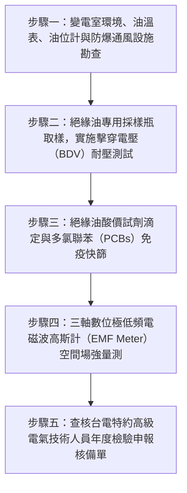

# 全案購屋實戰第二百八十三部：中古大樓社區地下室變電室油浸式變壓器絕緣油耐壓劣化油泥碳化PCB多氯聯苯殘留與低頻電磁波體檢工序全書

## 壹、前言與防護戰略意義

在現代集合住宅高層建築的重電供電體系中，「地下室高壓受變電室（High-Voltage Substation / Transformer Room）」是將台灣電力公司引入之 $11.4\,\text{kV}$ 或 $22.8\,\text{kV}$ 超高壓大電力，降壓轉換為家庭可用之低壓 $110\text{V}/220\text{V}/380\text{V}$ 的全棟供電動力心臟。在屋齡 25 至 30 年以上的中古集合住宅中，早期建商最廣泛採用的降壓設備即為成本較低、散熱效率高但潛在維護風險極大的「油浸式配電變壓器（Oil-Immersed Distribution Transformers）」。

油浸式變壓器仰賴箱體內部數百至上千公升的專用「變壓器絕緣油（Transformer Mineral Insulating Oil）」，同時扮演著**「相間/對地高壓電氣絕緣」**與**「線圈鐵芯冷卻散熱循環」**兩大不可或缺的生命角色。

然而，在台中市南區與南屯區屋齡 25 至 30 年以上的中古集合住宅（例如：大安紫金城、長億南園、歌德堡、靜園 A 區等社區），地下室高壓變電室長年處於高溫封閉、通風不良且潮濕的地底極限環境，油浸式變壓器普遍面臨極度凶險的「化學劣化、致癌毒害與爆炸公害」三大危機：
1. **絕緣油熱氧化劣解、介電耐壓崩潰（Dielectric Breakdown）**：受長期過載高溫烘烤，絕緣油酸價（Acid Number）飆升，生成深褐色黏稠油泥（Sludge）沉積於高壓線圈表層，冷卻受阻引發局部放電（Partial Discharge），隨時可能誘發高壓相間弧光短路引發變壓器「油氣大爆炸（Transformer Fire/Explosion）」。
2. **早期老舊絕緣油殘留「多氯聯苯（PCBs）」致癌劇毒物質**：25 年以上老舊變壓器在歷任修繕補油過程中，若使用來源不明之回收再生油，極可能含有被國際列為第一類致癌物、早已遭法規嚴格禁用的多氯聯苯，一旦洩漏或揮發將對地下室空氣與全棟水源造成不可逆的世紀劇毒污染。
3. **低頻電磁波（$60\,\text{Hz}$ EMF）輻射外洩超標與磁滯伸縮（Magnetostriction）低頻噪音**：變壓器矽鋼片鐵芯長年受電磁力振動鬆脫，產生 $120\,\text{Hz}$ 低頻轟鳴貫穿樓板，緊鄰變電室正上方之一樓住戶或地下專用車位處，低頻磁場強度常高達數十至上百毫高斯（$\text{mG}$），遠超世界衛生組織（WHO）建議之安全警戒值，長期暴露嚴重威脅幼兒發育與中樞神經健康。

本專書為「小寶置產全案防護體系」第二百八十三部，旨在建立一套針對中古集合住宅高壓受變電室油浸式變壓器絕緣油擊穿耐壓電極測試、酸價與油泥化驗、PCB 毒性快篩、低頻電磁波高斯計量測的全維度工程體檢工序，捍衛家庭居住安全與健康免受無形電磁輻射侵害，並轉化為對賣方與管委會強力議價的實體技術鐵證。

---

## 貳、油浸式變壓器與電磁輻射核心失效機理

### 一、絕緣油老化化學鏈與介電擊穿機理
1. **熱氧化反應與水分吸附（Moisture Ingress）**：
   - 變壓器隨日夜用電負載波動產生熱脹冷縮呼吸作用。若頂部乾燥吸濕器（Silica Gel Breather）變色失效，潮濕空氣被吸入油箱，水分子融入絕緣油中。
   - 礦物絕緣油含水量（Moisture Content）每增加 $10\,\text{ppm}$，其擊穿電壓（Breakdown Voltage）呈現斷崖式下降。微量水分在強電場作用下極化排列成「導電水橋」，誘發高壓繞組沿面閃絡放電（Flashover）。
2. **油泥沉積與熱失控循環（Sludging & Thermal Runaway）**：
   - 烴類油分子在高溫下氧化生成過氧化物、酸性物質及聚合物。酸值（Acid Value）大於 $0.4\,\text{mg KOH/g}$ 時，生成不溶性油泥。
   - 油泥黏附在散熱散片與高壓線圈冷卻油道（Oil Ducts）內部，熱阻劇增，線圈熱點溫度（Hot-Spot Temp）飆破 $140^\circ\text{C}$，加速絕緣紙（Kraft Paper）聚合度（DP）崩解碎裂，變壓器壽命提早終結。

### 二、多氯聯苯（PCBs）歷史毒害與法規稽查
1. **多氯聯苯的熱化學穩定性與致癌性**：
   - PCBs 具備優異的難燃性與介電性，早期曾被廣泛添加於變壓器油中。但其化學性質極其穩定，在環境中可殘留數百年，並在人體脂肪中生物蓄積，引發免疫系統損害、肝功能衰竭及惡性腫瘤。
2. **環保署列管毒性化學物質申報核查**：
   - 依據我國毒性及關注化學物質管理法，變壓器絕緣油中 PCB 含量嚴格限制在：
     $$\text{PCBs Concentration} < 50\,\text{ppm} \quad (\text{mg/kg})$$
   - 凡含量大於 50ppm 均屬法定列管毒物，必須專案向環保局申報並強制委由甲級清除機構廢棄更換。若大樓管委會隱匿未報，將面臨新台幣最高五百萬元巨額重罰並勒令停電改善。

### 三、低頻電磁場（ELF-EMF）與磁滯伸縮傳音
1. **矽鋼片磁滯伸縮（Magnetostriction）誘發低頻震動**：
   - 變壓器鐵芯之高導磁矽鋼片在 $60\,\text{Hz}$ 交流電磁場反覆磁化下，金屬長度產生百萬分之一的週期性微伸縮。
   - 產生以 $120\,\text{Hz}$ 為基頻之低頻結構振動，透過變壓器槽鋼底座直接傳入地下室 RC 樓板，化為難以消除的沉悶「嗡嗡」共鳴。
2. **高壓母線空間漏磁場（Leakage Magnetic Field）**：
   - 變壓器低壓側出線端因流經數百至上千安培的極大電流，三相母線若未作緊湊幾何對稱排列，空間中產生強烈的低頻磁感應強度 $B$（向量和無法抵消）。
   - 普通混凝土樓板完全無法阻擋磁力線，磁場無阻礙貫穿至正上方一樓客廳或地下車位。

---

## 參、實地現場勘驗五步檢測工序

### 步驟一：高壓變電室外觀與油箱狀態巡檢
1. **油箱密封與滲漏油檢查**：
   - 穿著合格絕緣防護裝備，在機電人員陪同下進入地下室高壓受變電室。
   - 檢視變壓器外殼波紋散熱片、高低壓套管（Bushings）法蘭及排油閥，表面不可有潤滑油滲漏、滴落至地面防油堤（Oil Retention Pit）的痕跡。
2. **油位計（Oil Level Gauge）與頂層油溫計**：
   - 檢視磁力油位計，油位指針應落在對應環境溫度（$25^\circ\text{C}$）之刻度範圍內。
   - 檢視雙金屬頂層油溫計，運轉最高油溫應嚴格維持在：
     $$T_{\text{oil}} \le 65^\circ\text{C} \sim 75^\circ\text{C} \quad (\text{超過 } 85^\circ\text{C} \text{ 屬重度過載})$$

### 步驟二：絕緣油採樣與擊穿電壓（BDV）耐壓實測
1. **專用油樣注射筒底閥採樣**：
   - 自變壓器底部取樣閥先排放 $1\,\text{L}$ 清洗管路雜質後，使用棕色高硼硅玻璃採樣瓶採集 $500\,\text{mL}$ 絕緣油樣，全程避光且無氣泡。
2. **全自動絕緣油耐壓測試儀（Oil Dielectric Tester）測定**：
   - 依據 ASTM D877 或 IEC 60156 規範，將油樣注入配備標準球形或球蓋電極（間距 $2.5\,\text{mm}$）之油杯中。
   - 以 $2.0\,\text{kV/s}$ 升壓速率施加交流高壓，連續測試 5 次取平均值：
     - **優良新油標準**：$\text{BDV} \ge 40\,\text{kV} / 2.5\text{mm}$。
     - **運轉合格警戒**：$\text{BDV} \ge 30\,\text{kV} / 2.5\text{mm}$。
     - **強制濾油或換油**：$\text{BDV} < 25\,\text{kV} / 2.5\text{mm}$（耐壓崩潰，極度危急）。

### 步驟三：酸值滴定與多氯聯苯（PCBs）化驗
1. **化學酸價滴定（Acid Number Test）**：
   - 檢測中和 1 克絕緣油中酸性物質所需之氫氧化鉀毫克數：
     $$\text{Acid Number} \le 0.2\,\text{mg KOH/g} \quad (\text{超過 } 0.4 \text{ 必須全面更換})$$
2. **PCBs 膠體金免疫層析快篩（Immunoassay Screening）**：
   - 取油樣經萃取後滴入 PCBs 快速檢測試劑條，確認多氯聯苯濃度嚴格小於 $50\,\text{ppm}$（合規無毒）。

### 步驟四：低頻電磁波（EMF）空間場強實測
1. **三軸等向性極低頻高斯計（Tri-axial Gauss Meter）量測**：
   - 使用通過 CNLA/TAF 校準之極低頻電磁場測定儀（頻率範圍 $30\,\text{Hz} \sim 2000\,\text{Hz}$）。
   - 在用電尖峰時段分別量測：
     - 變電室外牆外側 $1\,\text{公尺}$ 處。
     - 緊鄰變電室之地下專用車位內部。
     - 變電室正上方之一樓住戶客廳與臥室地面（離地 $1\,\text{m}$）。
2. **國際衛生安全標準判定**：
   - 台灣環保署非游離輻射環境建議值（短期）：$833\,\text{mG}$（毫高斯）。
   - **國際癌症研究機構（IARC）與 WHO 建議長期居住安全值**：
     $$B_{\text{EMF}} \le 2.0 \sim 4.0\,\text{mG}$$
   - 若一樓室內或專用車位處測得磁場強度超過 $10\,\text{mG}$（甚至達數十 $\text{mG}$），代表變電室未施作高導磁合金（Mu-Metal）或矽鋼電磁屏蔽，長期居住具重大健康隱憂。

### 步驟五：查核電氣法定檢驗申報與定檢報告
1. **每年定期高壓用電設備檢驗報告（大檢紀錄）**：
   - 查閱大樓依電業法規定，每年委託合法電氣技術顧問公司實施之全棟停電檢驗報告。
   - 核實變壓器絕緣油化驗紀錄、高壓斷路器動作秒數及絕緣電阻測試數據。

---

## 肆、全案四棟核心考慮物件變電設備深度評估

| 考慮社區 | 建物型態與變電室位置配置 | 現場勘驗要點與潛在風險 | 談判籌碼與合約特約防線 |
| :--- | :--- | :--- | :--- |
| **大安紫金城 13 樓 (`PROP_10`)** | 附屬之獨立 B2 大平面車位位於地下二層 | 1. 實測 B2 平面車位與地下高壓變電室之間的距離，確認車位處電磁波強度是否小於 4.0 mG。 2. 變壓器油位與接地銅排抗震阻抗檢驗。 | 本戶位居 13 樓高樓層，室內完全不受變電室電磁波干擾；但 B2 車位需確認無輻射熱點，以「公設油浸變壓器油質老化大修分攤」為由，配合 50 萬拆除款狠砍開價，強烈鎖定 **768~788 萬**。 |
| **長億南園 8 樓 (`PROP_106`)** | 社區屋齡達 30 年，地下室配電室變壓器多屬早期油浸老機組 | 1. 30 年老舊油浸變壓器是否長年未曾更換絕緣油，耐壓值是否嚴重劣化。 2. 變壓器油是否含有多氯聯苯（PCB）殘留，面臨環保重罰。 | 直指 30 年老舊變壓器存在高壓電弧爆炸與多氯聯苯致癌劇毒之重大結構性機電隱患，狠砍 200 萬，出價 **745~760 萬**。 |
| **歌德堡 8 樓** | 中型精品社區，機電維護精良，變壓器每年落實大檢濾油 | 1. 變電室環境乾燥整潔，排風散熱良好。 2. 車位與公設低頻電磁波實測均在 1.5 mG 以下。 | 精裝優質標的，確認全棟電力降壓核心健康無虞，作為生活品質與居住無毒之堅固對照組。 |
| **靜園 A 區 11 樓** | 雙拼格局變電室獨立分區，抗震基座設置完善 | 1. 變壓器運轉聲音平順無金屬雜音。 2. 絕緣油檢驗單合格齊全。 | 作為比價牽制籌碼，藉由標準之重電維護水準反壓紫金城與長億南園。 |

---

## 伍、買方防護作戰特約條款與自保機制

在正式進入買賣斡旋與簽訂要約書時，應在不動產買賣契約補充協議中明確載明：

> **【公共高壓變電設備安全無毒與低頻電磁波合規特約條款】**  
> 「賣方保證本契約標的物所屬社區大樓地下室之高壓受變電設備及油浸式變壓器運作正常，最近一次法定定期大檢申報合格，絕緣油擊穿耐壓強度符合法定運轉標準（$\text{BDV} \ge 30\,\text{kV}$），且絕緣油中多氯聯苯（PCBs）含量嚴格小於 50ppm，絕無法定列管毒性化學物質超標之情事。標的物室內及附屬車位空間之低頻電磁波輻射強度符合國際長期居住安全標準（$\le 4.0\,\text{mG}$）。若簽約至交屋期間經現場查驗發現變壓器嚴重漏油、絕緣油耐壓崩潰或管委會已決議由各戶分攤高額變壓器重置更新工程款（累計達新台幣參萬元以上者），該筆工程款全數由賣方負擔清償；賣方若拒絕履行，買方得逕自履約保證專戶扣除該筆費用或主張解除買賣契約。」

---

## 陸、結論與行動指引

地下室高壓油浸變壓器是大樓維持整棟照明、冷氣與電梯運轉的「高壓能量心臟」。絕緣油微小的水分吸附、微克級的多氯聯苯殘留，在破萬伏特的高壓電場下，就是引發高壓弧光爆炸、地底烈焰沖天與致癌毒害的毀滅引信；空間中看不見的低頻電磁波更是日夜侵蝕家庭健康的隱形殺手。透過本工序之絕緣油耐壓儀電極實測、PCB 快篩檢驗與三軸電磁波高斯計精準量測，小寶全家不僅能夠徹底掌握大樓重電核心的絕對安全與無毒環境，更能洞悉管委會大修基金的真實健全度，將公設重電潛在負擔轉化為談判桌上的定錨重鎚！
