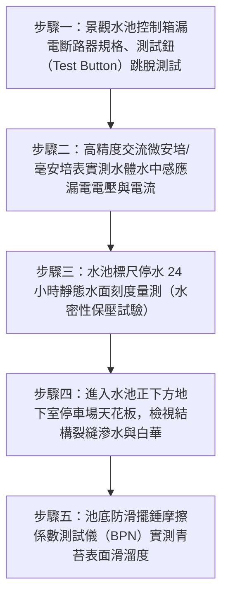

# 全案購屋實戰第二百八十九部：中古大樓社區中庭景觀水池循環過濾系統泵浦漏電斷路器失效池底防水破裂結構掏空與青苔滑倒體檢工序全書

## 壹、前言與防護戰略意義

在現代集合住宅大樓的中庭園林與公共開放空間設計中，「中庭景觀水池、生態親水池與噴泉水景（Courtyard Landscape Pools & Water Features）」是建商提升社區整體建案質感、營造豪宅休閒氛圍與促進住戶鄰里互動的最顯眼亮點公設。一座標準的景觀水景設施通常配置有：埋設於地下的「循環過濾沉水泵浦（Recirculating Submersible Pumps）」、石英砂過濾桶、紫外線或臭氧殺菌器，以及夜間景觀水下照明燈具（Underwater Lighting Fixtures）。

景觀水池之水體直接承載於一樓鋼筋混凝土樓板之上，其正下方往往即為大樓最核心的「地下停車場、機電變電室或公共走道」。

然而，在台中市南區與南屯區屋齡 25 至 30 年以上的中古集合住宅（例如：大安紫金城、長億南園、歌德堡、靜園 A 區等社區），中庭景觀水池歷經數十年風吹日曬與水質腐蝕，普遍淪為「吃電、漏水、奪命」的沉重公設負擔與法律訴訟重災區：
1. **水下沉水泵浦與水底照明電纜絕緣破皮、漏電斷路器（ELCB）生鏽卡死**：當孩童在中庭戲水或寵物落水時，高達 $110\text{V} \sim 220\text{V}$ 的市電在水中無阻礙傳導，引發致命的「池水漏電觸電致死（Electrocution）」慘劇。
2. **池體剛性結構微裂縫、聚氨酯（PU）防水層老化粉化**：水池每日無聲漏失數噸至數十噸潔淨自來水，滲漏水沿著結構樑柱持續侵蝕鋼筋，引發正下方地下室停車位「下小雨」與天花板鐘乳石白華，嚴重者甚至掏空車道下方級配地基，誘發地層塌陷。
3. **過濾系統長年停擺、池底積聚腐殖滑膩青苔（Algae & Biofilm）**：管委會因不堪高昂電費與維修費將過濾機關閉，水體惡臭優養化孳生登革熱病媒蚊孑孓，池底光滑如冰，住戶散步失足滑倒摔成重傷骨折，向管委會提出巨額民事侵權賠償。

本專書為「小寶置產全案防護體系」第二百八十九部，旨在建立一套針對中古集合住宅中庭景觀水池水下設備漏電毫安培微電流檢測、池底防水層蓄水保壓滲漏探測、地下室頂板鋼筋鏽蝕內視鏡掃描及公共意外責任險的全維度工程體檢工序，捍衛全家於中庭休憩時的生命安全與公設資產價值，並轉化為對賣方與管委會強力議價的實體技術鐵證。

---

## 貳、中庭景觀水池漏電與防水掏空核心失效機理

### 一、水下電氣絕緣破皮與水體跨步電壓觸電機理
1. **潛水電纜橡膠外皮硫化龜裂與水下接頭進水**：
   - 沉水泵浦與水下投光燈採用氯丁橡膠護套潛水電纜（H07RN-F）。在長期紫外線曝曬、水中加氯消毒劑及青苔生物黏泥腐蝕下，橡膠變脆龜裂。
   - 早期水電工在水下進行「電氣膠帶纏繞接線」，膠帶開膠後導電金屬直接浸泡在水中，產生強烈的接地漏電電流。
2. **漏電斷路器（ELCB）雙金屬片機構生鏽卡阻**：
   - 依據屋內線路裝置規則第 59 條，水下用電器具必須配置高感度高速型漏電斷路器（額定感應電流 $\le 15\,\text{mA}$，動作時間 $\le 0.03\,\text{秒}$）。
   - 老舊景觀控制箱內濕氣高達 $90\%$，ELCB 脫扣機構生鏽卡死。水體漏電時斷路器完全不跳脫，水池形成致命的「高電位帶電水域」，人體接觸瞬間心臟心室顫動（Ventricular Fibrillation）猝死。

### 二、池體微裂縫滲水與地下室混凝土結構中性化
1. **熱脹冷縮與差異沉陷拉裂池底混凝土**：
   - 露天景觀水池夏日水溫高達 $35^\circ\text{C}$，夜間降溫，熱應力循環使水池陰陽角產生貫穿性微裂縫。
   - 早期施作之彈性水泥或瀝青油毛氈防水層受水壓反覆頂托剝離，池水順著混凝土毛細孔及裂縫長驅直入。
2. **鋼筋膨脹銹爆（Spalling）與混凝土剝落**：
   - 水池滲漏水溶解混凝土內部之游離氫氧化鈣，生成大量碳酸鈣「白華結晶（Efflorescence）」。
   - 混凝土鹼性環境（$\text{pH} > 12.5$）被酸性滲水破壞中性化，內部高張力鋼筋表面鈍化膜崩潰，體積膨脹 3 至 6 倍，將水池底層與地下室天花板混凝土保護層直接「撐爆震裂」，造成水泥塊大面積掉落砸毀停放車輛。

### 三、藻類暴發、生物滑膜與管委會管理失能
1. **水體滯留與優養化惡臭**：
   - 過濾泵浦故障後，水體完全喪失循環擾動與加氧殺菌。大氣中的落葉灰塵提供豐富的氮、磷營養鹽，綠藻與藍綠菌在陽光照射下爆炸性繁殖。
2. **滑倒致殘與巨額法律賠償風險**：
   - 藻類死亡分解分泌高黏度多醣體滑膜（Biofilm），鋪滿池底石材與池畔階梯。
   - 依公寓大廈管理條例第 10 條，管委會對共用部分負有修繕管理維護之責。若因青苔滑倒致人死傷，全體區分所有權人（每戶住戶）將承擔連帶民事損害賠償責任。

---

## 參、實地現場勘驗五步檢測工序

### 步驟一：控制盤與漏電保護功能實測
1. **高感度高速型 ELCB 規格核實**：
   - 檢視景觀水池專用開關箱內部斷路器，必須標明「漏電斷路器（Earth Leakage Circuit Breaker）」，額定靈敏度電流必須標定為：
     $$I_{\Delta n} \le 15\,\text{mA} \quad (\text{動作時間 } \le 0.03\,\text{秒})$$
2. **機械測試按鈕（Push to Test）強制跳脫驗證**：
   - 用手指按壓 ELCB 面板上的黃色或紅色「TEST」測試鈕，斷路器開關柄必須在 0.03 秒內清脆彈跳至 OFF 位置，切斷水下電源。
   - 若按壓測試鈕無任何反應或手柄卡死，證實內部脫扣機構已完全損壞，必須立即強制更換。

### 步驟二：水中微漏電電壓與電流精密檢測
1. **水中感應電壓（Voltage Potential）實測**：
   - 將水池沉水泵浦與水下燈電源全數開啟運轉。
   - 使用數位三用電表交流電壓檔，黑色測試棒接地至大樓合格接地端子，紅色測試棒伸入水池中央水體中：
     - **合格標準**：水中感應電壓必須 $< 1.0\,\text{V AC}$。
     - **危險漏電**：若測得電壓 $> 12.0\,\text{V}$（甚至測得數十伏特市電），證實水下電纜絕緣已破皮，池水已帶有致命電位，必須立即斷電封閉水池。
2. **鉗形高靈敏漏電表（Leakage Clamp Meter）量測**：
   - 夾測水下設備進線電纜零序接地電流，漏電電流必須小於 $5\,\text{mA}$。

### 步驟三：池體 24 小時水密性蓄水測試（Water Retention Test）
1. **金屬精密標尺刻度安裝**：
   - 在水池邊緣垂直固定一支不鏽鋼毫米刻度鋼尺，記錄初始水面標高刻度（$H_0$）。
   - 關閉自動補水浮球閥，保持水池 24 小時無外來進水，同時在池畔放置標準蒸發皿比對自然蒸發量（$H_{\text{evap}}$）。
2. **靜態滲漏量計算與判定**：
   - 24 小時後讀取水面刻度 $H_{24}$，計算純滲漏深度：
     $$\Delta H_{\text{leak}} = (H_0 - H_{24}) - H_{\text{evap}}$$
   - 合格標準：$\Delta H_{\text{leak}} \le 2.0\,\text{mm/day}$。
   - 若扣除蒸發量後，水深下降超過 $10\,\text{mm/day}$（甚至下降數公分），代表池底防水層已徹底碎裂貫通，每日滲漏數噸水侵蝕大樓結構。

### 步驟四：地下室正下方結構滲漏與鋼筋銹爆探傷
1. **對應地下室投影區域天花板勘查**：
   - 依據大樓結構圖紙，精準定位中庭景觀水池正下方之地下停車場位置。
   - 使用高流明強光手電筒照射天花板樑底與樓板：
     - 檢視混凝土表面是否有黃褐色銹水滲痕、白色鐘乳石狀結晶白華（Stalactites）垂掛。
2. **混凝土脫層空鼓（Delamination）敲擊檢驗**：
   - 使用伸縮檢查槌（Test Hammer）輕輕敲擊白華滲水處四周混凝土，若發出沉悶「空空」空鼓聲，代表內部鋼筋已嚴重銹蝕膨脹，混凝土即將崩落砸車。

### 步驟五：池底與池畔表面防滑係數測試
1. **英式擺錘防滑儀（British Pendulum Tester）實測**：
   - 在水池周邊經常濕滑之石材走道與淺水區，使用擺錘儀量測表面防滑數值（BPN）：
     $$\text{BPN} \ge 55 \quad (\text{公共潮濕地面法定防滑安全門檻})$$
2. **藻類滑膜刮取與清潔評定**：
   - 徒手觸摸池底瓷磚與邊緣踏階，表面不可有黏稠滑溜的墨綠色青苔附著；水體透明度（Secchi Depth）應清澈見底（透明度 $\ge 1.0\,\text{m}$）。

---

## 肆、全案四棟核心考慮物件景觀公設深度評估

| 考慮社區 | 中庭公設與水景配置型態 | 現場勘驗要點與潛在風險 | 談判籌碼與合約特約防線 |
| :--- | :--- | :--- | :--- |
| **大安紫金城 13 樓 (`PROP_10`)** | 附屬之獨立 B2 大平面車位位於地下二層 | 1. 檢視中庭是否有景觀水池，水池正下方是否正對地下車位引發滲漏水與鐘乳石滴漆。 2. 實測公共漏電斷路器是否正常跳脫。 | 本戶位居 13 樓高樓層，以「若中庭水景防水老化引發地下車位結構滲水與修繕基金掏空」為由，配合 4 間套房拆除款，狠砍開價，強烈鎖定 **768~788 萬**。 |
| **長億南園 8 樓 (`PROP_106`)** | 30 年老舊中大型社區，早期中庭設有大型噴泉水景 | 1. 30 年老舊水景是否早已因漏水與漏電被迫抽乾廢棄，池內堆積落葉垃圾淪為衛生死角。 2. 若仍在放水，池底防水破裂是否直接滲入地下機械車位坑道。 | 直指老舊大樓中庭水景荒廢破敗、或漏電漏水威脅住戶生命之重大結構性公設管理死穴，狠砍 200 萬，出價 **745~760 萬**。 |
| **歌德堡 8 樓** | 中型精品社區，中庭花園植栽綠化維護精細，無漏水水池負擔 | 1. 公共走道石材鋪面防滑乾爽，排水順暢無積水。 2. 公設管理費專款專用無浪費。 | 精裝優質標的，確認公設零隱藏漏水漏電負擔，作為全家居住安心無虞之堅固對照組。 |
| **靜園 A 區 11 樓** | 雙拼格局環境純粹，中庭景觀設計簡潔大器 | 1. 地面排水暗溝通暢無蚊蟲孳生。 2. 公設責任保險投保落實。 | 作為比價牽制籌碼，藉由標準之低負擔公設維護水準反壓長億南園。 |

---

## 伍、買方防護作戰特約條款與自保機制

在正式進入買賣斡旋與簽訂要約書時，應在不動產買賣契約補充協議中明確載明：

> **【公共中庭景觀水景設施安全無漏水漏電特約條款】**  
> 「賣方保證本契約標的物所屬社區大樓中庭及公共開放空間之景觀水池、噴泉水景及循環過濾系統運作正常安全，水下用電器具配置之高感度漏電斷路器（ELCB）跳脫功能正常無卡阻，池水絕無漏電帶電之重大公共安全隱患，且水池結構池體水密良好，其正下方之地下停車場（特別是附屬車位區域）絕無因水池漏水引發之頂板滲漏、白華鐘乳石或鋼筋銹爆水泥剝落情事。賣方保證水池周邊符合防滑安全規範無嚴重青苔滑倒危險。若簽約至交屋期間經現場查驗發現中庭水池嚴重漏水滲入地下室、池水漏電或管委會已決議由各戶分攤高額水池敲除防水重置工程款（累計達新台幣參萬元以上者），該筆費用全數由賣方負擔清償；賣方若拒絕履行，買方得逕自履約保證專戶扣除該筆費用或主張解除買賣契約。」

---

## 陸、結論與行動指引

中庭景觀水池是大樓公共門面的「面子」，也是考驗大樓機電與防水施工水準的「裡子」。水下電纜微小的一處絕緣破損、池底微小的一道結構裂縫，在數十噸池水重壓與通電運轉下，就是奪走人命的觸電火種與掏空大樓結構地基的慢性毒藥。透過本工序之 ELCB 強制跳脫測試、水中微漏電精準量測與地下室天花板白華透視檢驗，小寶全家不僅能夠徹底為家人中庭活動築起絕對生命屏障，更能洞悉管委會大修基金的真實健全度，將公設潛在修繕負擔轉化為談判桌上的定錨重鎚！
