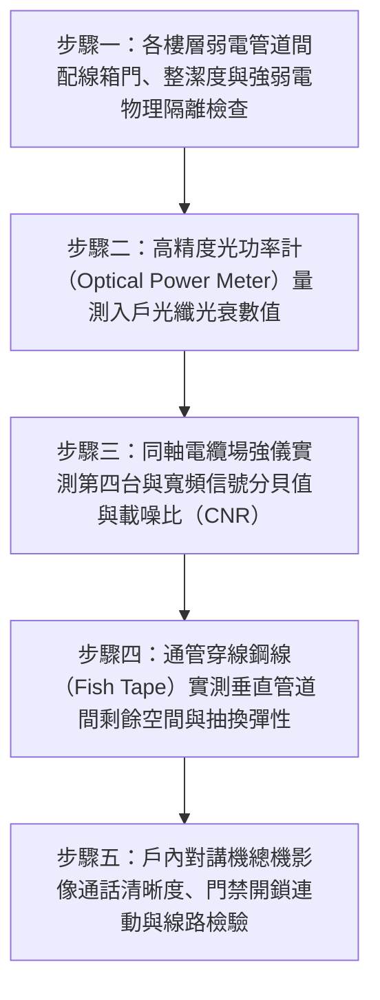

# 全案購屋實戰第二百八十二部：中古大樓社區各樓層弱電管道間同軸電纜信號嚴重衰減光纖到戶垂直星狀拓撲引進與弱電箱雜亂跳線短路體檢工序全書

## 壹、前言與防護戰略意義

在現代集合住宅高層與超高層大樓的現代化居住與遠距工作生活體系中，「各樓層弱電管道間與垂直通訊幹線（Telecommunication Shaft & Backbone Cabling）」是連接台電智慧電表通訊、中華電信/第四台光纖網路、大樓中央防盜保全監控、對講機影像門禁及智慧家庭物聯網的「資訊神經中樞大腦」。

依據國家通訊傳播委員會（NCC）建築物電信設備及空間設置使用管理規則，現代大樓應引進「光纖到戶（FTTH, Fiber to the Home）」架構，並建立垂直星狀拓撲（Vertical Star Topology）光纜幹線，透過各樓層弱電配線箱（Floor Telecom Box）直通各戶資訊整合箱。

然而，在台中市南區與南屯區屋齡 25 至 30 年以上的中古集合住宅（例如：大安紫金城、長億南園、歌德堡、靜園 A 區等社區），建築落成時普遍僅規劃傳統「RG-6/RG-11 銅軸同軸電纜（Coaxial Cables）」與「Cat.3/Cat.5 傳統語音雙絞線」，歷經 25 年以上各家第四台業者、寬頻廠商與水電工無秩序的私拉亂扯，弱電管道間普遍陷入極度嚴重的「資訊血栓與信號死寂」悲劇：
1. **銅軸同軸電纜外層編織網氧化粉化、中心銅芯發黑衰減**：電視影像雪花嚴重，寬頻訊號雜訊比（SNR）急遽惡化，斷線頻率極高，無法升級至 500M/1G 現代高速對稱光纖網路。
2. **各樓層弱電配線箱如「盤絲洞」亂成一團，未標示跳線短路**：歷任住戶報修時廠商便宜行事，舊線未抽、新線強塞，電纜自重拉扯導致端子脫落；更致命的是部分強電（$110\text{V}$ 監控電源）違規混穿混接弱電箱，誘發強電漏電串入對講機面板，燒毀室內昂貴弱電設備。
3. **無垂直光纖管道空間，光纖熔接盤（ODF）遭擠壓死折**：光纖引進時因管道間堵塞無法穿線，或施工粗糙導致單模光纖彎曲半徑小於 $30\,\text{mm}$，光衰（Optical Attenuation）暴增超過 $-30\,\text{dBm}$，全戶隨時面臨網路瞬斷。

本專書為「小寶置產全案防護體系」第二百八十二部，旨在建立一套針對中古集合住宅各樓層弱電管道間同軸電纜信號衰減度、光纖到戶光衰功率計實測、弱電箱強弱電物理隔離及垂直管線抽換充裕度的全維度工程體檢工序，捍衛家庭高速上網、遠距辦公與居家安防的生命線，並轉化為對賣方與管委會強力議價的實體技術鐵證。

---

## 貳、弱電通訊管道間與垂直幹線核心失效機理

### 一、同軸電纜老化與高頻衰減（Attenuation）機理
1. **發泡聚乙烯（Foam PE）絕緣介質吸濕老化**：
   - RG-6 同軸電纜仰賴中心單芯銅線與外層鋁箔/鍍錫銅網之間的發泡 PE 維持 $75\,\Omega$ 特性阻抗。
   - 弱電管道間受地下室潮氣上升與樓板滲漏水影響，發泡介質吸附微量水氣，介電常數（Dielectric Constant）改變，高頻電視與網路信號衰減率（dB/100m）飆升 2 至 3 倍。
2. **高頻信號邊界效應（Skin Effect）與接頭氧化**：
   - 高頻寬頻訊號僅在銅線表面極薄的「集膚深度（Skin Depth）」傳導。老舊銅芯氧化生成發黑的氧化銅薄膜，其電阻率劇增，引發數位電視封包遺失率（Packet Loss）突破 $15\%$。

### 二、弱電箱雜亂跳線與強電串入短路
1. **「蜘蛛網式」死線堆積與散熱不良**：
   - 25 年來歷經 5 至 8 家不同電信與寬頻業者施工，廢棄的舊線（Dead Lines）從未抽除，管道截面充填率（Conduit Fill Ratio）高達 $95\%$ 以上，管道間被塞死無法再穿入任何新光纖。
2. **強電感應雜訊（EMI）與漏電燒燬**：
   - 依據屋內線路裝置規則，強電（AC 110V/220V）與弱電（DC 48V以下通訊線）必須保持至少 $15 \sim 30\,\text{cm}$ 以上之物理間距或以金屬接地隔板隔離。
   - 老舊大樓常因監控攝影機電源不足，水電工私自將 AC 110V 電源線穿入弱電箱，絕緣破損時強電直接串入網路交換機（Switch）或對講總機，導致整棟弱電主機瞬間燒焦報廢。

### 三、光纖微彎損耗（Microbending Loss）與光衰超標
1. **光纖死折與全反射破壞**：
   - 現代引進之 G.652D 標準單模光纖（SMF），其臨界最小彎曲半徑（Bending Radius）不得小於 $30\,\text{mm}$（防彎曲光纖 G.657A 不得小於 $15\,\text{mm}$）。
   - 管道間狹窄推擠下，光纖常被重型電纜死死壓在箱體銳利邊緣，形成小於 $5\,\text{mm}$ 的銳角死折，光波在纖芯內部無法達成全反射（Total Internal Reflection），大量光能穿透包層洩漏。
2. **光衰超過接收靈敏度下限**：
   - 正常光纖到戶之光功率應維持在 $-15\,\text{dBm} \sim -22\,\text{dBm}$ 之間。若光衰劣化至 $-28\,\text{dBm}$ 以下，光化終端機（ONU / 小烏龜）將頻繁重啟、閃紅燈（LOS, Loss of Signal），網路完全癱瘓。

---

## 參、實地現場勘驗五步檢測工序

### 步驟一：弱電管道間箱體外觀與隔離檢查
1. **弱電箱上鎖管理與箱內整潔度**：
   - 檢視樓層弱電箱是否維持上鎖狀態，防止閒雜人等任意拔插跳線。
   - 箱內電纜應以整線槽（Wire Ducts）或尼龍束帶扎實整齊分束，每條線纜必須掛有明確標示房號之耐候標籤（Cable Tags）。
2. **強電隔離與接地線（Grounding Wire）檢驗**：
   - 檢視箱內是否有未經金屬導管保護之 AC 110V/220V 電源線穿入；強弱電共箱時必須有接地金屬隔板分開。
   - 量測弱電箱金屬外殼對大樓接地銅排之接地電阻，必須：
     $$R_{\text{ground}} \le 100\,\Omega \quad (\text{特別通信接地應 } \le 10\,\Omega)$$

### 步驟二：光纖到戶光功率（Optical Power）精密量測
1. **光化配線盤（ODF）或光纖插座（Wall Outlet）採樣**：
   - 拔開入戶光纖之 SC/APC（綠色）或 SC/UPC（藍色）光纖接頭。
   - 以光纖端面清潔筆（One-Click Cleaner）清潔接頭端面，避免灰塵刮傷陶瓷插芯。
2. **光功率計設定 1310nm/1490nm/1550nm 測定**：
   - 將光纖接頭插入校準合格之數位光功率計，讀取下行光功率（$\text{dBm}$）：
     - **優良標準**：$-15.0 \sim -20.0\,\text{dBm}$。
     - **合格標準**：$-20.0 \sim -24.0\,\text{dBm}$。
     - **重度衰減警戒**：$-24.0 \sim -27.0\,\text{dBm}$（網速嚴重衰退）。
     - **不合格中斷**：$< -28.0\,\text{dBm}$（光信號中斷或死折破裂）。

### 步驟三：同軸電纜場強儀與雜訊比（CNR）測定
1. **電視場強儀（Signal Level Meter）接駁實測**：
   - 在各戶客廳電視同軸電纜出線端，接上數位電視分析儀。
   - 測試低頻（$112\,\text{MHz}$）與高頻（$750\,\text{MHz}$）信號電平（$\text{dB}\mu\text{V}$）：
     $$\text{Level} = 65 \sim 75\,\text{dB}\mu\text{V}$$
2. **載噪比（Carrier-to-Noise Ratio, CNR）測定**：
   - 數位有線電視 CNR 必須 $\ge 38\,\text{dB}$，調變誤差率（MER）必須 $\ge 32\,\text{dB}$。若 CNR 低於 $32\,\text{dB}$，代表同軸電纜屏蔽層嚴重受損，雜訊已完全淹沒有效信號。

### 步驟四：垂直通訊管道穿線餘裕度實測
1. **通管條（Fish Tape）試穿測試**：
   - 自標的樓層弱電箱向地下室總電信室之垂直預埋 PVC 管（通常直徑為 2 吋至 3 吋，DN50~DN75）穿入高剛性玻璃纖維通管條。
2. **管線抽換餘裕率判定**：
   - 通管條應能輕鬆穿透全程，無堵死卡塞。若通管條穿入不到 2 米即遭遇死結死阻，代表管內已被廢線完全塞死，日後若欲拉設新光纖線路必須沿外牆或樓梯間「違規拉明線」，造成美觀與資產價值重大折損。

### 步驟五：室內對講機系統全功能驗收
1. **影像對話清晰度與夜視功能檢測**：
   - 由一樓大門門禁主機呼叫本戶室內對講機，檢視彩色 LCD 螢幕影像是否清晰穩定，無水平水波紋滾動（EMI 強電干擾指標）；雙向語音對話聲音洪亮無雜音、無回授嘯叫聲。
2. **大門電鎖（Electric Lock）開門連動**：
   - 按壓室內機「開門鍵」，一樓大門陽極鎖或磁力鎖必須在 0.5 秒內順暢釋放解鎖。

---

## 肆、全案四棟核心考慮物件弱電通訊深度評估

| 考慮社區 | 弱電垂直管網與網路架構型態 | 現場勘驗要點與潛在風險 | 談判籌碼與合約特約防線 |
| :--- | :--- | :--- | :--- |
| **大安紫金城 13 樓 (`PROP_10`)** | 13 樓位居高樓層次頂層，垂直弱電管線最長且穿越樓層最多 | 1. 13 樓原屋主改 4 間套房，4 間套房之寬頻網路線是否有私拉明線塞爆公共弱電箱。 2. 實測 13 樓中華電信光纖光衰是否超過 -25 dBm。 | 以「4 間套房私接雜亂網路線塞死弱電管道間、光纖衰減嚴重需重新抽換專用光纜」為由，配合 50 萬拆除款狠砍開價，堅定鎖定 **768~788 萬**。 |
| **長億南園 8 樓 (`PROP_106`)** | 社區屋齡達 30 年，弱電管道間多屬早期銅軸電纜與傳統電話線 | 1. 30 年老舊弱電箱廢線堆積如山，管內塞死無法引進現代高速 FTTH 光纖到戶。 2. 同軸電纜嚴重老化，電視影像雪花嚴重。 | 直指 30 年老舊大樓資訊基礎建設全面落後、無法申辦高速光纖寬頻之現代居住重大致命傷，狠砍 200 萬，出價 **745~760 萬**。 |
| **歌德堡 8 樓** | 中型精品社區，近年已完成全棟 FTTH 光纖到戶垂直星狀升級 | 1. 檢視管道間光纖熔接盒標示清晰，光衰低於 -18 dBm。 2. 精裝之室內資訊插座均為 Cat.6 規格。 | 精裝優質標的，確認全家高速上網與遠距辦公完全無障礙，作為高品質生活之核心對照組。 |
| **靜園 A 區 11 樓** | 雙拼格局弱電箱空間充沛，每層僅兩戶線路清晰單純 | 1. 弱電管內通暢無廢線堆積，光纖到戶升級容易。 2. 對講機影像清晰穩定。 | 作為比價牽制籌碼，藉由標準之資訊通訊基礎設施反壓紫金城與長億南園。 |

---

## 伍、買方防護作戰特約條款與自保機制

在正式進入買賣斡旋與簽訂要約書時，應在不動產買賣契約補充協議中明確載明：

> **【公共弱電管道通訊正常與光纖網路引進保證特約條款】**  
> 「賣方保證本契約標的物所在樓層公共弱電管道間及專有之資訊通訊配線系統運作正常，標的室內現存之電視同軸電纜、電話語音線、網路雙絞線及對講機門禁系統功能完整無信號中斷或雜訊干擾之情事。賣方保證公共弱電垂直管道通暢無阻，具備可順暢引進主流電信業者（中華電信等）FTTH 光纖到戶高速寬頻網路之物理管線空間，且管道間內絕無強電 AC 110V/220V 電源違規混接漏電之重大公安瑕疵。若簽約至交屋期間經專業電信技師檢驗發現弱電管路完全堵死無法引進光纖、對講系統燒毀或同軸訊號嚴重衰減無法正常收視者，賣方應負責限期改善修復或補償買方相應專線抽換工程款新台幣參萬元整。」

---

## 陸、結論與行動指引

弱電管道間與垂直通訊幹線是現代智慧家庭生活與遠距工作的「無形神經血管」。同軸電纜微小的氧化粉化、光纖微小的一個死折，在講求極致網速與即時安防的今日，就是引發網路瞬斷崩潰、生活寸步難行的隱形枷鎖。透過本工序之光功率計精密光衰量測、場強儀 CNR 化驗與通管餘裕度實測，小寶全家不僅能夠徹底掌握大樓通訊基礎設施的真實先進度，更能洞悉管委會物業管理的細膩功力，將公設落後缺陷精準化為談判桌上的定錨重鎚！
