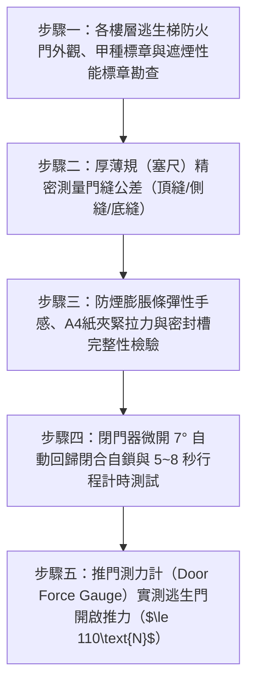

# 全案購屋實戰第二百八十五部：中古大樓社區各樓層管道間常閉式防火門遮煙性能老化漏煙地彈簧阻尼失效與梯間負壓抽吸毒煙倒灌體檢工序全書

## 壹、前言與防護戰略意義

在現代集合住宅高層與超高層大樓的防火防煙安全區劃中，「各樓層特別安全梯與管道間之常閉式防火門（Normally Closed Fire & Smoke Control Doors）」是火災發生時阻斷火勢蔓延、並將致命毒煙死死封鎖於起火區域內的絕對生命屏障。火場研究與內政部消防署統計數據證實，集合住宅火災超過 $85\%$ 的罹難者並非死於明火直接燒灼，而是在逃生動線上吸入含有高濃度一氧化碳（$\text{CO}$）、氰化氫（$\text{HCN}$）、戴奧辛及高溫有毒熱浮力的濃煙，在短短數十秒至數分鐘內窒息致死。

依據建築技術規則建築設計施工編第 76 條、第 79 條之 2 及 CNS 11227-1 防火門國家標準，集合住宅樓層通往安全梯之出入口，必須安裝具備一小時以上防火時效（$\text{F60A}$）、阻熱性，且必須具備通過 CNS 15038 規範之「遮煙性能標章（Smoke Control Performance）」之甲種防火門。該門扇平時必須仰賴高耐久度「液壓閉門器（Door Closer）」或「地面隱藏式地彈簧（Floor Spring）」保持緊密常閉，並透過門框周邊的「冷熱雙向防煙膨脹密封條」達成微氣壓差下的絕對氣密。

然而，在台中市南區與南屯區屋齡 25 至 30 年以上的中古集合住宅（例如：大安紫金城、長億南園、歌德堡、靜園 A 區等社區），各樓層常閉式防火門普遍淪為虛設的「擺設裝飾」，陷入極度凶險的「煙囪效應與毒煙倒灌」雙重致命危機：
1. **門框四周防煙條完全粉化、碳化脫膠，門縫公差嚴重超標**：門扇與門框、門底地坪之縫隙常高達 $8 \sim 15\,\text{mm}$（標準側頂縫 $\le 3\,\text{mm}$、底縫 $\le 5\,\text{mm}$），喪失所有遮煙氣密性。
2. **液壓閉門器內部阻尼油漏光洩壓、回歸扭簧金屬疲勞**：防火門無法在人員通過後自動回歸關死並扣入鎖舌，常年處於「虛掩微開（Ajar）」狀態；甚至有住戶為圖梯間通風，私自拿大理石、滅火器將防火門「長年卡在全開位置」。
3. **安全梯間煙囪效應引發之「負壓抽吸（Negative Pressure Infiltration）」**：當梯間因溫差產生強烈向上抽吸氣流時，若起火層防火門遮煙失效，梯間巨大的負壓差會如巨大抽風機般，將起火戶內的黑稠毒煙全速「抽入安全梯間」，將整座大樓唯一的逃生豎井化為直通天際的「人間焚屍爐」。

本專書為「小寶置產全案防護體系」第二百八十五部，旨在建立一套針對中古集合住宅各樓層逃生常閉式防火門塞尺微縫測量、遮煙條高溫耐候檢驗、閉門器微開 $7^\circ$ 自動自鎖及逃生推力測量的全維度工程體檢工序，捍衛全家於突發火災時唯一的生命逃生動線，並轉化為對賣方與管委會強力議價的實體技術鐵證。

---

## 貳、常閉式防火門遮煙失效與梯間毒煙倒灌核心機理

### 一、門縫幾何超標與毒煙滲透立體擴散機理
1. **氣體流動三次方法則（Cubic Flow Law）**：
   - 毒煙在微壓差下穿過縫隙的體積洩漏量 $Q$，與門縫間隙寬度 $w$ 的三次方成正比：
     $$Q \propto \frac{\Delta P \cdot L \cdot w^3}{12 \mu}$$
     其中 $\Delta P$ 為火場熱膨脹壓差，$L$ 為門縫總周長，$\mu$ 為高溫氣體動力黏度。
   - 當門底縫隙由合規的 $3\,\text{mm}$ 擴大至 $10\,\text{mm}$ 時，毒煙的滲透洩漏速度暴增超過 30 倍。起火後僅需 60 秒，安全梯間的一氧化碳濃度即可飆破 $3000\,\text{ppm}$（致人昏迷僅需數口）。
2. **門扇自重下垂（Door Sagging）與底邊卡阻**：
   - 鋼質甲種防火門自重達 $80 \sim 120\,\text{kg}$。上部合頁（Hinges）銷軸長年受重力單邊磨損，門扇向斜下方傾斜，門鎖下角摩擦地磚，產生巨大的機械阻力，閉門器推力被完全抵消，門扇停在距離門框 $5 \sim 10\,\text{cm}$ 處無法上鎖。

### 二、遮煙密封條化學老化與冷熱煙防護破口
1. **膨脹型石墨密封條（Intumescent Seal）失效**：
   - 門框凹槽內嵌之膨脹石墨條設計於 $180^\circ\text{C}$ 以上高溫受熱膨脹 20 至 30 倍填塞門縫。
   - 25 年老舊防火門的膨脹條因空氣中水分與清潔劑侵蝕，表面外包 PVC 膜脆裂，內部石墨粉結塊水解，遇火時膨脹倍率跌破 3 倍，無法阻斷火勢跳躍穿透。
2. **冷煙矽膠氣密條（Cold Smoke Elastomer Seal）脫落**：
   - 阻擋火災初期 $50^\circ\text{C} \sim 100^\circ\text{C}$ 低溫毒煙之彈性矽膠條，受日常碰撞撕裂脫膠，形成長達數十公分的貫通漏氣孔洞。

### 三、閉門器液壓阻尼洩漏與人為卡死災難鏈
1. **閉門器活塞油封（Piston O-Ring）硬化漏油**：
   - 閉門器內部高黏度阻尼液壓油受長期梯間高溫烘烤，油封硬化破裂，液壓油沿著輸出軸頸外洩，滴落至門扇表面發黑。
   - 閉門器喪失第二段緩衝鎖入（Latch Action）控制力，門扇在微開狀態下喪失初始閉合扭力，門鎖斜舌無法縮入受口盒（Strike Box）。
2. **常開違規卡死引發的骨牌式全毀**：
   - 住戶或清潔工將門檔、垃圾桶卡於門底，使閉門器連桿轉軸長期承受超額反向扭應力，導致連桿關節螺栓滑牙折斷，防火區劃徹底瓦解。

---

## 參、實地現場勘驗五步檢測工序

### 步驟一：防火門標章、平整度與門框檢查
1. **內政部遮煙防火門身分鋼印標牌核實**：
   - 檢視門扇鉸鏈側上方金屬銘牌，確認標示「甲種防火門（耐火 1 小時以上）」並具備「具遮煙性能（CNS 15038 檢驗合格）」雙標章。
2. **門框垂直度與框邊膨脹泥填實檢驗**：
   - 使用磁吸式水平尺檢驗門框垂直度，垂直偏差不得大於 $2.0\,\text{mm}$。
   - 用木槌輕敲鋼質門框四周，敲擊聲應清脆沉實，確認安裝時內部灌漿（Grouting）完全填實無空鼓，避免高溫時門框扭曲變形脫落。

### 步驟二：門縫公差階梯規與塞尺精密量測
1. **頂縫與鎖側/鉸鏈側門縫測量**：
   - 使用厚薄規（塞尺）或專用階梯規，沿門扇四周每隔 $30\,\text{cm}$ 插入量測：
     $$\text{Gap}_{\text{top/sides}} \le 3.0\,\text{mm} \quad (\text{嚴禁大於 } 4.0\,\text{mm})$$
2. **門底淨空縫隙（Undercut Clearance）量測**：
   - 測量門扇下緣金屬面至地磚完成面之垂直距離：
     $$\text{Gap}_{\text{bottom}} \le 5.0\,\text{mm}$$
   - 若未安裝「自動升降機械氣密底封（Automatic Drop Seal）」，且底縫大於 $8.0\,\text{mm}$，必須立即要求加裝耐火遮煙壓條。

### 步驟三：遮煙密封條彈性與氣密拉力檢測
1. **冷煙矽膠條彈性回彈手感檢測**：
   - 以拇指用力按壓門框四周嵌入之彈性矽膠密封條，釋放後應在 0.5 秒內瞬間彈回原狀，表面無硬化裂紋、無泛白粉化現象。
2. **A4 紙張夾緊抽拉阻力測試（Paper Trap Test）**：
   - 將一張標準 A4 影印紙夾在門扇與門框密封條之間，讓門自然鎖死。
   - 徒手抽取紙張：整周各測試點均應感受到強大夾緊阻力，紙張被拉扯甚至撕裂而無法輕易滑出，證明密封條完全壓實無縫隙。

### 步驟四：閉門器微開回歸與行程計時實測
1. **極限微開 7° 自動閉鎖測試（拳頭寬度測試）**：
   - 將防火門僅推開 $7^\circ \sim 10^\circ$（約一個拳頭寬度），然後完全鬆手。
   - 閉門器必須具備充沛之起始復位扭矩，平穩將門拉回，鎖舌（Latch）必須發出清脆「卡嗒」聲完全滑入受口板孔洞並完全鎖定。
   - 徒手向外推拉把手，門扇應完全卡死不動，嚴禁有虛掩或半卡死現象。
2. **全開 90° 關閉行程計時**：
   - 將門推至 $90^\circ$ 自然釋放，使用碼錶記錄全關閉時間：
     $$5\,\text{秒} \le t_{\text{close}} \le 8\,\text{秒}$$
   - 門扇在最後 $10^\circ$ 應具備明顯的緩衝減速，然後順暢上鎖，不可猛烈撞擊發出震耳巨響（防止震裂防煙條）。

### 步驟五：逃生推門力計（Door Force Gauge）實測
1. **推拉力計垂直施力測量**：
   - 將專用數位推拉力計垂直頂在門鎖把手邊緣處（距門軸最遠端操作點）。
   - 緩慢推開門扇，記錄鎖舌脫開門框瞬間的最大峰值推力（$F_{\text{push}}$）。
2. **法規人體工學標準核對**：
   $$F_{\text{push}} \le 110\,\text{N} \quad (\approx 11.2\,\text{kgf})$$
   - 確保火災發生時家中年邁長輩、婦女與幼童，在驚慌失措中均能單手輕鬆推開逃生門逃生。

---

## 肆、全案四棟核心考慮物件防火門遮煙深度評估

| 考慮社區 | 逃生梯防火門配置型態 | 現場勘驗要點與潛在風險 | 談判籌碼與合約特約防線 |
| :--- | :--- | :--- | :--- |
| **大安紫金城 13 樓 (`PROP_10`)** | 13 樓位居頂層次頂層，特別安全梯防火門為火警逃生唯一生命門戶 | 1. 13 樓原屋主改 4 間學生套房出入頻繁，逃生防火門是否被租客用門檔常開卡死，閉門器是否漏油。 2. 實測 13 樓防火門門縫是否超標、遮煙條是否粉化。 | 以「高樓層逃生梯防火門遮煙失效、火災煙囪效應毒煙直灌 13 樓之致命公安重大瑕疵」為籌碼，併同 50 萬拆除復原款，狠砍開價，強烈鎖定 **768~788 萬**。 |
| **長億南園 8 樓 (`PROP_106`)** | 社區樓高約 12~14 層，梯間防火門高齡 30 年未曾更換 | 1. 30 年老舊鐵門自重下垂嚴重摩擦地磚，底縫超過 15mm，完全無遮煙標章與防煙條。 2. 閉門器早已斷油失效，門長年敞開通風。 | 直指老舊大樓防火區劃完全瓦解、安全梯隨時化為毒煙煙囪之重大結構性致命缺陷，狠砍 200 萬，出價 **745~760 萬**。 |
| **歌德堡 8 樓** | 特別安全梯維護精實，甲種防火門具備最新遮煙標章 | 1. 門縫均嚴格小於 3mm，微開 7° 自動上鎖動作清脆。 2. 密封條柔軟飽滿，推門力道輕盈適中。 | 精裝優質標的，確認全棟垂直逃生通道具備最高規格防火防煙屏障，作為家人生命安全之堅固對照組。 |
| **靜園 A 區 11 樓** | 雙拼格局梯廳採光明亮，梯間防火門保養良好 | 1. 逃生梯防火門無人為卡開惡習，開關平順氣密良好。 2. 門框阻火填塞完備。 | 作為比價牽制籌碼，藉由標準之防火門遮煙維護水準反壓紫金城與長億南園。 |

---

## 伍、買方防護作戰特約條款與自保機制

在正式進入買賣斡旋與簽訂要約書時，應在不動產買賣契約補充協議中明確載明：

> **【公共逃生安全梯常閉式防火門遮煙性能正常保證特約條款】**  
> 「賣方保證本契約標的物所在樓層之特別安全梯及逃生通道常閉式防火門系統運作正常，具備合格之甲種防火時效及遮煙性能標章。門扇四周門縫公差符合法規標準（側頂縫 $\le 3\,\text{mm}$、底縫 $\le 5\,\text{mm}$），冷熱防煙膨脹密封條完整富彈性無脆裂脫落，自動閉門器運作正常無漏油、能自微開 7 度角度平穩自動回歸完全鎖死，且逃生開啟推力符合法規限制（$\le 110\,\text{N}$）。若簽約至交屋期間經現場查驗發現防火門下垂擦地、門縫超標漏煙、無法自動上鎖或經消防安檢列管限期改善者，賣方應促使管委會或自行負責於交屋日前完成五金校正、閉門器更新與防煙條重置；若逾期未改善，賣方同意由買方自買賣尾款中暫扣新台幣伍萬元整作為公共安全修繕準備金。」

---

## 陸、結論與行動指引

常閉式防火門與遮煙密封條是火災爆發時擋在家庭成員與死神之間的「最後一道氣密鋼盾」。門縫微差數公釐、閉門器微量的一點漏油，在起火層數百度高溫與猛烈煙囪抽吸下，就是決定能否生還的生死分界線。透過本工序之塞尺微縫精密量測、紙張夾緊抽拉檢驗與微開 7 度自鎖實測，小寶全家不僅能夠徹底掌握逃生動線上的真實生命防護力，更能洞悉大樓整體物業對消防公安的真實管理功力，將公設隱蔽瑕疵轉化為談判桌上的定錨重鎚！
