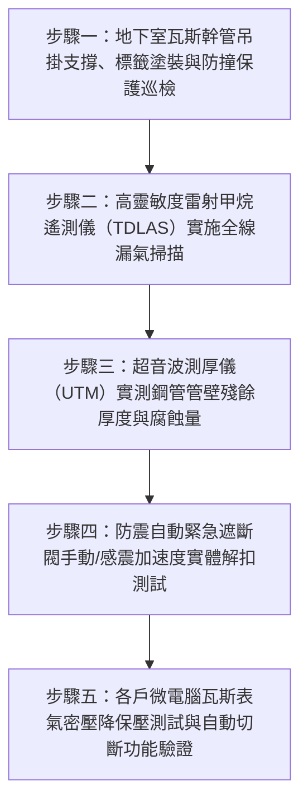

# 全案購屋實戰第二百八十八部：中古大樓社區地下室天然氣瓦斯管線防震自動緊急遮斷閥微電腦瓦斯表壓降管壁電化腐蝕漏氣體檢工序全書

## 壹、前言與防護戰略意義

在現代集合住宅高層與超高層大樓的深層公用事業管線工程中，「天然氣瓦斯管線系統（Natural Gas Piping System）」是全棟數百戶家庭每日洗澡熱水、冬季暖房與廚房明火烹飪最便利卻潛在危險性最高的「易燃易爆主動脈」。由天然氣公用事業公司（如欣中天然氣）鋪設之中壓或低壓鍍鋅鋼管，自大樓地界外緣穿越地下室外牆，貫穿整個地下停車場天花板，再分流垂直爬升至各樓層管道間與各戶陽台。

天然氣主要成分為高揮發性的「甲烷（$\text{CH}_4$）」，其空氣中之爆炸極限（Explosive Limits）僅為極狹窄卻極易觸發的 **$5.0\% \sim 15.0\%$**。

為了在突發大地震、管線斷裂或異常大漏氣時能於數秒內截斷氣源，防止整棟大樓發生毀滅性「連環氣爆火災」，依據建築技術規則建築設備編、天然氣事業法及消防法規，大樓地下室天然氣總進口端必須設置具備感震功能的「防震自動緊急遮斷閥（Earthquake-Actuated Gas Shutoff Valve）」、各戶配置「微電腦瓦斯表（Smart Microcomputer Gas Meter）」，並於各閥件與轉彎處配置嚴密之「防蝕被覆與電位絕緣防護」。

然而，在台中市南區與南屯區屋齡 25 至 30 年以上的中古集合住宅（例如：大安紫金城、長億南園、歌德堡、靜園 A 區等社區），地下室天然氣管線長年暴露於潮濕、高鹽分油氣與汽機車震動環境下，普遍面臨極度凶險的「電化腐蝕穿孔與防震遮斷卡死」雙重危機：
1. **鍍鋅無縫鋼管外壁電化腐蝕穿孔、螺紋接頭防漏填料碳化漏氣**：地下室冷凝水與汽車尾氣中的二氧化硫結合形成稀硫酸，腐蝕鋼管鍍鋅層。管壁銹蝕變薄甚至出現針孔狀微漏氣（Micro-leakage），甲烷氣體在地下室天花板凹陷死角長年聚積。
2. **防震自動緊急遮斷閥感震鋼珠氧化卡死、電磁脫扣閥芯咬死**：遭遇震度 5 弱以上強震時，遮斷閥無法於 5 秒內自動跳脫閉鎖，外界源源不斷的高壓瓦斯自斷裂管口瘋狂噴湧。
3. **傳統機械式瓦斯表無異常超流遮斷功能、微電腦表感應膜片老化**：室內或管道間發生瓦斯外洩時，無法自動感知微壓降而持續供氣，造成住戶或租客在密閉室內遭遇「瓦斯中毒窒息」或因隨手開燈電火花引發「整層炸裂崩塌」。

本專書為「小寶置產全案防護體系」第二百八十八部，旨在建立一套針對中古集合住宅地下室天然氣管線防震自動遮斷閥感震靈敏度實測、超音波管壁厚度與電化腐蝕探傷、雷射甲烷氣體遙測儀檢漏及微電腦表氣密壓降的全維度工程體檢工序，捍衛家庭資產與生命免受瓦斯爆燃威脅，並轉化為對賣方與管委會強力議價的實體技術鐵證。

---

## 貳、天然氣管線腐蝕與防震遮斷系統核心失效機理

### 一、鍍鋅鋼管電化學腐蝕與針孔漏氣機理
1. **大氣環境吸氧腐蝕（Oxygen Absorption Corrosion）**：
   - 地下室濕度長期大於 85%，在鋼管表面形成微觀電解質水膜。金屬鐵作為陽極溶解（$\text{Fe} \to \text{Fe}^{2+} + 2\text{e}^-$），氧氣在陰極還原。
   - 早期鍍鋅層厚度僅 $20 \sim 30\,\mu\text{m}$，歷經 25 年消耗殆盡，露出鐵基底產生點蝕（Pitting Corrosion）。點蝕向管壁深處呈漏斗狀穿透，形成肉眼難辨之微孔漏氣。
2. **螺紋連接處厭氧密封膠（Thread Sealant）老化硬化**：
   - 早期水電施工採麻絲白漆或傳統 PTFE 止洩帶。受溫度冷熱交變與瓦斯中微量芳香烴侵蝕，填料乾縮粉化，微量甲烷氣體自螺牙螺旋縫隙持續緩慢滲漏。

### 二、防震自動緊急遮斷閥（Earthquake Valve）機構失效機理
1. **感震機構（Seismic Sensor Mechanism）機械卡阻**：
   - 常見之防震閥採重力鋼珠（Steel Ball）平衡於錐形底座上之原理。當地震加速度達到法定之 $250 \sim 400\,\text{gal}$（相當於震度 5 級）時，鋼珠震落滾動釋放鎖扣，驅動強力彈簧將軟密封閥瓣砸向閥座關死。
   - 25 年老舊防震閥內部金屬導軌長滿銅綠鐵鏽，鋼珠被乾油泥黏死，即使強震震度達 6 級，鋼珠依舊「屹立不倒」，防震遮斷完全癱瘓。
2. **電磁脫扣線圈（Solenoid Release）受潮燒毀**：
   - 搭配瓦斯外洩警報器聯鎖之電磁閥，其 DC 12V/24V 電磁線圈長年通電發熱或受潮，絕緣漆包線短路，火警時無法輸出足夠電磁推力解扣閥門。

### 三、微電腦瓦斯表壓降感知膜片老化
1. **矽膠膜片疲勞硬化與微漏氣感知失靈**：
   - 微電腦瓦斯表內部配備微差壓感知器（Pressure Sensor），每隔數分鐘監控管內水壓降（$\Delta P$）。當偵測到持續 30 天之微小流量（如 $0.003\,\text{m}^3/\text{hr}$ 慢速漏氣）時，應自動閉鎖報警。
   - 膜片硬化後對微小壓降喪失感知能力，形成「長年慢性漏氣」盲區；或反之因溫度變化誤判定為漏氣而頻繁自動遮斷，造成洗澡水忽冷忽熱。

---

## 參、實地現場勘驗五步檢測工序

### 步驟一：地下管網外觀、管卡隔震與防撞巡檢
1. **管身外觀塗裝與標示核查**：
   - 依據法規，天然氣瓦斯管全線外表必須塗刷鮮明黃色（Yellow Color），並以黑色文字每隔 3 米標明「天然氣」字樣及流向箭頭。
   - 檢視車道轉彎處與車位上方之瓦斯管，必須具備重型防撞金屬護欄或防撞鋼管，防止休旅車頂或貨車倒車撞斷瓦斯管。
2. **管卡防電位腐蝕絕緣襯墊檢查**：
   - 瓦斯鋼管與建築懸吊角鋼管卡之間，必須墊有橡膠或耐候塑膠絕緣墊片（Insulating Pads），杜絕異種金屬接觸產生之「電偶腐蝕（Galvanic Action）」。

### 步驟二：雷射甲烷遙測儀（TDLAS）精確檢漏
1. **調諧半導體雷射吸收光譜儀檢測**：
   - 手持高科技光學雷射甲烷檢測儀（檢測下限達 $1\,\text{ppm}\cdot\text{m}$，反應時間 $< 0.1\,\text{秒}$）。
   - 自地下室總進口閥起，沿著天花板管線、所有三通、彎頭、法蘭及螺紋接頭逐一進行雷射光束掃描：
     - **合格標準**：空間甲烷濃度讀數為 $0\,\text{ppm}$。
     - **微漏警戒**：讀數介於 $1 \sim 10\,\text{ppm}$（需以發泡肥皂水複檢）。
     - **重大危險漏氣**：讀數 $> 50\,\text{ppm}$（必須立即通報天然氣公司緊急停氣搶修）。

### 步驟三：超音波金屬測厚儀（UTM）管壁量測
1. **點蝕好發部位探傷**：
   - 選擇地下室潮濕處、穿牆孔周圍及風口迎風面之鋼管，刮除表層局部剝落油漆，塗抹超音波耦合劑。
   - 使用數位超音波測厚儀量測鋼管殘餘壁厚（$t_{\text{actual}}$）：
     - 2 吋（DN50）Schedule 40 鋼管原始厚度：$t_0 = 3.9\,\text{mm}$。
     - 4 吋（DN100）鋼管原始厚度：$t_0 = 6.0\,\text{mm}$。
2. **腐蝕減薄率（Corrosion Allowance）判定**：
   $$\text{Thinning Ratio} = \frac{t_0 - t_{\text{actual}}}{t_0} \times 100\%$$
   - 合格標準：減薄率必須小於 $15\%$。若測得殘餘壁厚小於原始厚度之 $70\%$（減薄率 $> 30\%$），代表鋼管強度已嚴重受損，隨時有受壓爆管危險。

### 步驟四：防震自動緊急遮斷閥感震測試
1. **手動測試柄（Manual Test Lever）解扣動作**：
   - 扳動防震閥專用手動測試拉環，內部閥瓣應在強力彈簧推動下發出沉重清脆的「咚」一聲瞬間緊密閉合。
   - 檢視閥位指示窗口，標記應由綠色「OPEN」切換為紅色「SHUT」。
2. **微加速度感震釋放驗證**：
   - 以標準校準之橡膠槌輕敲防震閥外殼感震測試點，模擬震度 5 級衝擊，內部鋼珠必須順暢滾脫觸發閉鎖；復位手柄手動上鎖手感順暢無阻滯。

### 步驟五：微電腦瓦斯表氣密與壓降保壓實測
1. **各戶室內管線靜態氣密保壓試驗**：
   - 將室內熱水器、瓦斯爐旋鈕全數關閉，微電腦瓦斯表前總閥保持開啟。
   - 按壓微電腦表測試按鈕（紅燈閃爍進入 3 分鐘自動測漏程序）：
     - 若 3 分鐘後紅燈熄滅恢復常態，證實室內管路與接頭完全無微小洩漏。
     - 若紅燈持續閃爍並發出警報聲、液晶顯示「C」或「A」代碼，代表管路存在微壓降洩漏，微電腦表已自動切斷瓦斯。
2. **超流自動遮斷功能（Excess Flow Shutoff）**：
   - 人為模擬管線破裂之超大流量，微電腦表必須在 5 秒內毫秒級自動遮斷氣源。

---

## 肆、全案四棟核心考慮物件天然氣管線深度評估

| 考慮社區 | 建物型態與天然氣管網配置 | 現場勘驗要點與潛在風險 | 談判籌碼與合約特約防線 |
| :--- | :--- | :--- | :--- |
| **大安紫金城 13 樓 (`PROP_10`)** | 13 樓位居高樓層次頂層，原屋主改裝成 4 間學生套房 | 1. 13 樓原屋主改 4 間套房之熱水供應，是否有私接私拉天然氣明管穿過木作天花板。 2. 4 套熱水器同時用水時，瓦斯表是否嚴重超流跳脫。 3. 地下室 B2 車位天花板上方是否有天然氣幹管腐蝕漏氣。 | 以「4 間套房私設天然氣分歧管未經公用事業圖說審查、存重大氣爆公安隱患，需全套打除復原」為由，配合 50 萬拆除款狠砍開價，強烈鎖定 **768~788 萬**。 |
| **長億南園 8 樓 (`PROP_106`)** | 社區樓高約 12~14 層，地下室瓦斯幹管高齡 30 年未曾更換 | 1. 30 年老舊鍍鋅鋼管外壁大面積銹蝕起泡，螺紋處是否有微小洩漏。 2. 地下室防震緊急遮斷閥是否早已生鏽卡死失效。 | 直指 30 年老舊瓦斯管網腐蝕穿孔、強震時防震閥無法遮斷引發全棟連環氣爆之結構性致命傷，狠砍 200 萬，出價 **745~760 萬**。 |
| **歌德堡 8 樓** | 中型精品社區，天然氣管網全線採用無縫防蝕被覆鋼管 | 1. 地下室瓦斯防震遮斷閥標記如新，微電腦表普及率 100%。 2. 雷射甲烷檢漏實測全線 0 ppm。 | 精裝優質標的，確認全棟天然氣供應系統安全無虞，作為生活品質與居家防火之堅固對照組。 |
| **靜園 A 區 11 樓** | 雙拼格局每層僅兩戶，陽台通風良好無瓦斯積聚風險 | 1. 瓦斯管卡絕緣襯墊完整無電位腐蝕。 2. 戶內瓦斯管路配置規範齊全。 | 作為比價牽制籌碼，藉由標準之天然氣管線維護水準反壓紫金城與長億南園。 |

---

## 伍、買方防護作戰特約條款與自保機制

在正式進入買賣斡旋與簽訂要約書時，應在不動產買賣契約補充協議中明確載明：

> **【公共與專有天然氣瓦斯管線安全合規特約條款】**  
> 「賣方保證本契約標的物所在社區大樓地下室及公共管道間之天然氣瓦斯幹管、防震自動緊急遮斷閥系統運作正常，且完全符合現行天然氣事業法及建築安全規範。地下管線全線水密氣密良好、雷射甲烷檢漏實測讀數為零、管壁無嚴重腐蝕穿孔隱患，防震遮斷閥在感震狀態下能於 5 秒內自動閉鎖截斷氣源。賣方保證標的物室內現存之天然氣配管均為合格公用天然氣公司（如欣中天然氣）合法申請裝設，絕無擅自私接、私改暗管或穿過密閉居室之違法情事，微電腦瓦斯表氣密檢測完全合格無微漏。若簽約至交屋期間經現場查驗發現天然氣管線漏氣、防震閥故障卡死或室內管線私設違章遭瓦斯公司拒絕供氣者，賣方應負責限期改善修復並負擔全部工程費用；若逾期未改善，賣方同意由買方自買賣尾款中暫扣新台幣伍萬元整作為公共安全修繕準備金。」

---

## 陸、結論與行動指引

天然氣瓦斯管線與防震緊急遮斷閥是大樓抵禦突發強震與氣爆災難的「第一道防火生命閘門」。管壁微小的針孔點蝕、防震鋼珠微小的銹蝕卡阻，在甲烷氣體極易引爆的特性下，就是引發整座大樓瞬間崩塌瓦解的毀滅引信。透過本工序之光學雷射精準檢漏、超音波管壁探傷與防震閥實體解扣測試，小寶全家不僅能夠徹底掌握居家生命通道的絕對真實安全，更能洞悉大樓整體物業對公用事業管線維護的真實功力，將公設隱蔽瑕疵轉化為談判桌上的定錨重鎚！
