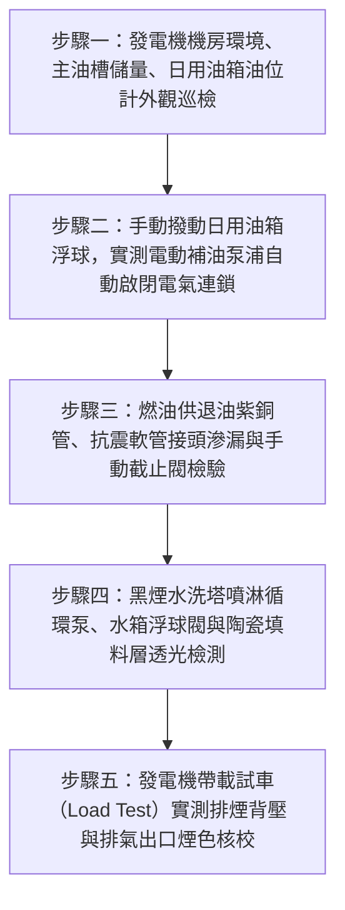

# 全案購屋實戰第二百八十六部：中古大樓社區地下室柴油緊急發電機雙迴路燃油日用油箱油位計浮球卡死油管銅管硬化滲漏與負載突加黑煙洗滌塔堵塞體檢工序全書

## 壹、前言與防護戰略意義

在現代集合住宅高層與超高層大樓的防災公共安全工程中，「地下室柴油緊急發電機系統（Basement Emergency Diesel Generator System）」是整棟大樓在遭遇台電大停電、夏季電網跳電、雷擊、地震或火災斷電時唯一的自主「生命保險中樞」。其供應之緊急備援電力，直接攸關「消防栓主泵浦、自動撒水泵浦、地下排煙風機、避難安全梯正壓送風風機、緊急昇降機（消防員專用電梯）及各樓層逃生照明」等極度關鍵負載之生死運轉。

柴油引擎發電機組之所以能持續穩定運轉數小時至數十小時，全仰賴其供油系統的核心配置：
1. **「主儲油槽（Main Fuel Storage Tank）」與「雙迴路日用燃油箱（Day Fuel Tank）」**：由主油槽透過防爆電動抽油泵浦自動為日用油箱補油，日用油箱再經由重力或自吸供油管路輸送至柴油引擎高壓噴射泵。
2. **「柴油排煙黑煙水洗洗滌塔（Wet Exhaust Gas Scrubber / Soot Trap）」**：將柴油燃燒產生之高溫碳煙微粒、硫化物與未燃碳氫化合物（HC）進行噴淋水洗與消音處理後排出戶外。

然而，在台中市南區與南屯區屋齡 25 至 30 年以上的中古集合住宅（例如：大安紫金城、長億南園、歌德堡、靜園 A 區等社區），柴油發電機燃油與排氣系統常年處於靜止備用盲區，普遍陷入極度凶險的「供油中斷熄火與排氣背壓爆炸」危機：
1. **日用燃油箱金屬/磁簧浮球開關（Magnetic Reed Float Switch）遭重柴油膠質卡死**：柴油長年存放氧化變質析出黏稠瀝青狀油膠，浮球死死黏在「滿油位」位置。當發電機因大停電緊急啟動消耗燃油時，自動補油泵浦拒絕起走，日用油箱在 15 至 30 分鐘內油料耗盡，引擎突發「斷油熄火」，整棟大樓陷入死寂黑洞。
2. **供油退油紫銅管/高壓油管接頭老化硬化滲漏**：地下室柴油長年慢速滴漏，在發電機底座聚積成易燃油池，遇發電機排氣歧管數百度高溫極易引發地下室「燃油大爆炸」。
3. **黑煙洗滌塔噴淋噴嘴鈣化堵塞、排煙背壓（Exhaust Backpressure）飆升**：停電負載突加（Step Load）瞬間，柴油燃燒不完全產生大量濃黑碳煙，因洗滌塔噴水失效無法沖刷，積碳在蜂巢式陶瓷濾芯或水洗管網結塊堵死。排氣背壓飆破引擎容許極限，引發引擎排氣閥燒穿、渦輪增壓器（Turbocharger）爆炸或發電機保護性熱跳脫。

本專書為「小寶置產全案防護體系」第二百八十六部，旨在建立一套針對中古集合住宅柴油發電機日用油箱浮球連鎖電阻測量、燃油銅管密封滲漏探傷、洗滌塔水洗噴嘴通暢度及全載排氣背壓的全維度工程體檢工序，捍衛大樓極端災難時的持續生命防禦，並轉化為對賣方與管委會強力議價的實體技術鐵證。

---

## 貳、柴油發電機燃油供給與排煙洗滌核心失效機理

### 一、柴油老化膠化與浮球開關卡死機理
1. **柴油氧化降解與膠質沉澱（Fuel Degradation & Gum Formation）**：
   - 商業柴油存放超過 6 至 12 個月即開始自然熱氧化，特別是台灣氣候高溫潮濕，油箱內部冷凝水促使厭氧真菌與硫酸鹽還原菌孳生，形成黑色油泥（Diesel Bug Sludge）。
   - 油泥黏附在日用油箱內部滑桿與不鏽鋼磁簧浮球表面，浮球摩擦阻力激增，卡死在中間或高位，喪失浮動感知能力。
2. **「假性滿油」引發的斷油癱瘓鏈**：
   - 消防法規規定日用油箱容量通常為 $200 \sim 500\,\text{公升}$，僅能供應全負載運轉約 1.5 至 3 小時。
   - 浮球卡死無法輸出「低水位啟動補油信號（Low Level Pump-On Signal）」，主油槽數千公升燃油無法注入，發電機在火災逃生最關鍵時刻因燃油耗盡悲劇熄火。

### 二、供油銅管接頭疲勞鬆脫與柴油氣化火災
1. **引擎高頻震動與銅管冷作硬化（Work Hardening）**：
   - 發電機運轉時產生的強烈震動傳遞至供油紫銅管。銅管在無適當彈簧軟管隔震下，喇叭口接頭（Flare Fittings）微位移磨損，管壁金屬疲勞脆裂。
2. **高壓柴油滲漏遇熱歧管自燃**：
   - 柴油閃火點約為 $55^\circ\text{C}$，自燃溫度約為 $210^\circ\text{C}$。柴油自老舊軟管接頭噴濺滴落在溫度高達 $450^\circ\text{C} \sim 600^\circ\text{C}$ 的渦輪排氣歧管上，瞬間氣化引燃爆燃烈火。

### 三、黑煙水洗噴淋塔堵塞與排氣背壓超標
1. **碳煙顆粒（Particulate Matter）與水霧結垢板結**：
   - 洗滌塔利用循環水泵經由螺旋噴嘴噴出霧化水滴，捕捉黑煙微粒。
   - 自來水中的鈣鎂離子在高溫煙氣加熱下迅速硬化，將噴嘴直徑 $3\,\text{mm}$ 的出水孔完全鈣化堵死。無水噴淋下，高溫乾碳煙直接堆積在填料層，形成緻密碳阻層。
2. **排氣背壓（Exhaust Backpressure）超壓毀滅**：
   - 引擎排氣背壓極限通常為 $5.0 \sim 10.0\,\text{kPa}$（約 $500 \sim 1000\,\text{mmAq}$）。
   - 填料層堵塞使背壓飆升至 $30\,\text{kPa}$ 以上，汽缸內部廢氣無法排淨，進氣充填效率暴跌，高溫燃氣倒灌回進氣歧管，引發活塞拉缸、氣閥熔斷或發電機過載跳脫停機。

---

## 參、實地現場勘驗五步檢測工序

### 步驟一：機房整體巡檢與燃油存量檢查
1. **日用油箱與主儲油槽容量核對**：
   - 檢視日用油箱外殼銘牌，額定容量必須能供應全負載連續運轉至少 2 小時以上（通常 $\ge 200\,\text{L}$）。
   - 檢視主油槽液位計，柴油儲存總量依消防法規必須滿足全負載運轉 6 至 8 小時以上需求。
2. **日用油箱透明視油管（Sight Glass）油質勘查**：
   - 檢視油箱側邊之石英玻璃或耐油透明視管：
     - 健康柴油：呈透明清澈金黃色或微黃帶綠色，無沉澱懸浮物。
     - 嚴重變質：呈黑褐色渾濁液體，管壁附著黑色黏稠油膠，底部沉積白色泥狀水分（需立即抽乾放空洗槽並換油）。

### 步驟二：日用油箱浮球開關連鎖動作測試
1. **多段式磁簧浮球開關功能驗收**：
   - 日用油箱配置之四段液位開關：
     - 超高水位溢流警報（High-High Alarm）。
     - 補油泵停止水位（Pump-OFF）。
     - 補油泵啟動水位（Pump-ON）。
     - 低水位緊急警報（Low-Low Alarm）。
2. **手動模擬水位升降檢測**：
   - 在控制盤切至「自動」狀態下，自檢修孔伸入清潔工具或手動扳動浮球：
     - 當浮球降至「Pump-ON」位置時，電動補油泵浦必須在 1 秒內自動起走抽油。
     - 當浮球升至「Pump-OFF」位置時，補油泵浦必須即刻平穩切斷停機。
     - 使用三用電表量測各段開關接點導通阻抗，必須 $R_{\text{contact}} \le 0.5\,\Omega$。

### 步驟三：供退油銅管與抗震軟管滲漏探傷
1. **紫外線螢光滲漏檢測（UV Dye Leak Detection）**：
   - 沿著供油紫銅管、金屬編織抗震軟管（Flexible Fuel Lines）及柴油粗細濾清器（Fuel Filters）進行全線檢驗。
   - 接頭處不可有柴油「出汗微滲」發黑痕跡；以手指觸摸管壁接頭，嚴禁帶有新鮮油漬。
2. **手動緊急切斷閥（Emergency Fuel Shutoff Valve）檢查**：
   - 日用油箱出口必須配置重力式或易熔金屬自動切斷閥。檢視手動拉索是否完好，確認火災時能瞬間截斷燃油。

### 步驟四：黑煙水洗洗滌塔噴淋與排渣體檢
1. **循環噴淋泵浦起抽與噴嘴水霧檢查**：
   - 啟動洗滌塔專用循環水泵，透過觀察視窗檢視內部螺旋不鏽鋼噴嘴：
     - 噴嘴必須噴出均勻錐形微細水霧，完全覆蓋整個煙氣截面。
     - 若噴嘴僅有微弱水流滴淌或局部射流，代表噴嘴內部已鈣化結垢，必須旋下浸泡草酸疏通。
2. **自動補水浮球閥與排水排渣溝**：
   - 檢視洗滌塔底部循環水箱之自來水自動補水浮球閥，確保運轉中水位恆定；排污球閥暢通，無大量黑色積碳泥漿淤死溢流口。

### 步驟五：帶載運轉排煙背壓與廢氣檢測
1. **U 型水柱差壓計量測排氣背壓**：
   - 在引擎排氣歧管後端預留之檢測孔接上 U 型管差壓計（Manometer）。
   - 發電機全載運轉時讀取背壓數值：
     $$\Delta P_{\text{exhaust}} \le 7.5\,\text{kPa} \quad (\approx 750\,\text{mmAq})$$
   - 若測得背壓超過 $12\,\text{kPa}$，證實洗滌塔消音陶瓷填料層已嚴重積碳堵死，引擎處於隨時排氣回火爆炸邊緣。
2. **林格曼黑度（Ringelmann Chart）煙色比對**：
   - 於頂樓排煙口觀察運轉廢氣，經洗滌塔淨化後之煙色應小於林格曼 1 度（呈微淡白色或透明水氣），嚴禁噴射濃滾黑煙。

---

## 肆、全案四棟核心考慮物件發電機燃油排氣深度評估

| 考慮社區 | 發電機與油槽配置型態 | 現場勘驗要點與潛在風險 | 談判籌碼與合約特約防線 |
| :--- | :--- | :--- | :--- |
| **大安紫金城 13 樓 (`PROP_10`)** | 附屬之獨立 B2 大平面車位地處地下二層，發電機房緊鄰車道 | 1. 13 樓高樓層火災逃生極度依賴發電機驅動特別安全梯正壓送風與緊急昇降機。 2. 現場核查 B2 發電機日用油箱浮球開關是否卡死、洗滌塔是否有落實每季清洗。 | 以「高樓層逃生絕對依賴緊急電力，但地下發電機日用油箱浮球卡阻、洗滌塔積碳存突發斷油熄火重大公安瑕疵」為籌碼，併同 50 萬拆除款狠砍開價，堅定鎖定 **768~788 萬**。 |
| **長億南園 8 樓 (`PROP_106`)** | 社區樓高約 12~14 層，30 年老舊柴油發電機油槽管線未曾翻新 | 1. 30 年老舊紫銅油管嚴重氧化滲油，機房地面油漬斑斑。 2. 日用油箱柴油已黑化變質發臭，黑煙洗滌塔噴嘴全部鈣化堵死。 | 直指老舊大樓柴油發電機供油系統嚴重失修、隨時因排氣背壓過高引發引擎炸裂之結構性機電硬傷，狠砍 200 萬，出價 **745~760 萬**。 |
| **歌德堡 8 樓** | 中型精品社區，機電發電機每年委外定期實施電阻假負載（Load Bank）測試 | 1. 檢視日用油箱柴油金黃清澈，補油泵浦雙迴路輪替靈敏。 2. 洗滌塔噴水充沛，排氣出口潔淨無黑煙。 | 精裝優質標的，確認大樓緊急備援供電心臟強韌健全，作為生活品質與極端災難防護之堅固對照組。 |
| **靜園 A 區 11 樓** | 雙拼格局發電機室通風良好，油槽排氣管高空引出規範合規 | 1. 浮球開關動作清脆無阻滯。 2. 油箱手動切斷閥保養完好。 | 作為比價牽制籌碼，藉由標準之柴油發電機維護品質反壓紫金城與長億南園。 |

---

## 伍、買方防護作戰特約條款與自保機制

在正式進入買賣斡旋與簽訂要約書時，應在不動產買賣契約補充協議中明確載明：

> **【公共柴油緊急發電機燃油系統與排煙設施正常運作特約條款】**  
> 「賣方保證本契約標的物所屬社區大樓地下室之公共柴油緊急發電機系統、主儲油槽、日用燃油箱、電動補油泵浦、燃油管路及黑煙排煙水洗洗滌塔運作正常，具備主管機關消防安檢合格核備單。日用油箱液位浮球開關連鎖靈敏無卡阻、供油管路全線水密氣密無柴油微滲漏火災隱患，且排煙洗滌塔噴淋暢通無碳煙堵塞致排氣背壓超標之情事，發電機在滿載測試下能持續穩定運轉 2 小時以上不熄火跳脫。若簽約至交屋期間經現場查驗發現發電機供油浮球故障、油管滲漏或排氣洗滌塔嚴重堵塞被列入公共安全缺失者，賣方應促使管委會立即完成管線整修、油箱洗槽換油與洗滌塔疏通；若逾期未改善，賣方同意由買方自買賣尾款中暫扣新台幣伍萬元整作為公共機電安全修繕準備金。」

---

## 陸、結論與行動指引

地下室柴油緊急發電機之燃油日用油箱與黑煙洗滌塔是集合住宅在面臨大規模停電與火災劫難時「唯一的自主電力臍帶與呼吸氣道」。浮球微小的一個油膠卡阻、噴嘴微小的鈣化結垢，在全大樓瞬間斷電陷入一片漆黑的恐慌時刻，就是引發發電機斷油熄火、全棟消防滅火與排煙電梯全面癱瘓的致命殺手。透過本工序之浮球開關手動位移實測、柴油油質採樣與排氣背壓差壓計精確量測，小寶全家不僅能夠徹底掌握大樓在極端情境下的真實生命防禦力，更能洞悉大樓物業對機電維護的真實基本功，將公設潛在修繕負擔轉化為談判桌上的定錨重鎚！
