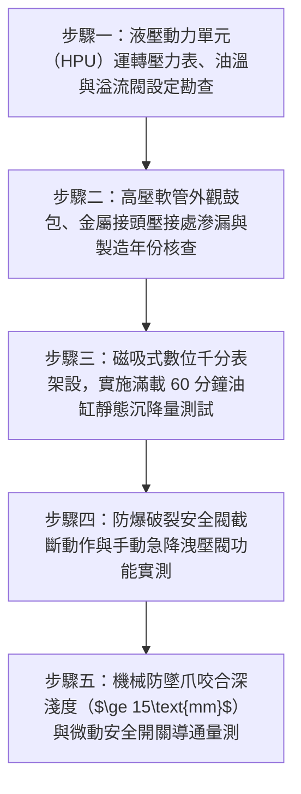

# 全案購屋實戰第二百八十四部：中古大樓社區地下室機械停車設備液壓油管高壓脈動疲勞爆裂油壓缸內漏沉降與安全聯鎖微動開關體檢工序全書

## 壹、前言與防護戰略意義

在現代集合住宅高層與超高層大樓的地下停車空間中，建商為在有限基地內塞入法定超量車位，廣泛引進「液壓驅動式機械停車設備（Hydraulic Elevator Parking Stacker）」。常見形式包含地下二層至三層之「坑道升降式（Pit Stacker）」與「二段油壓升降橫移式」。該系統的核心動力源於地下室專用液壓動力單元（Hydraulic Power Unit, HPU），透過高壓柱塞泵或齒輪泵，將高達 $140 \sim 210\,\text{kgf/cm}^2$（約 $14 \sim 21\,\text{MPa}$，相當於上百個大氣壓）的超高壓液壓油，經由雙層或四層高強度鋼絲編織高壓橡膠軟管（High-Pressure Wire Braided Hoses），注入單動或雙動重型油壓缸（Hydraulic Cylinders），以垂直頂升重達數噸的載車平台。

依據 CNS 13350 機械停車設備安全標準，液壓系統必須具備極為嚴密之「防超壓溢流保護」、「油壓防爆裂自鎖保護」及「物理安全防墜咬合機構」。

然而，在台中市南區與南屯區屋齡 25 至 30 年以上的中古集合住宅（例如：長億南園、大安紫金城周邊同級社區等），地下室環境長年處於潮濕、高溫、機油廢氣瀰漫與車輛頻繁碾壓的惡劣條件下，老舊油壓機械停車設備普遍陷入極度凶險的「高壓爆管與車台沉降崩塌」危機：
1. **高壓橡膠軟管長年承受高頻「脈動壓力疲勞（Pressure Pulsation Fatigue）」**：外層橡膠受熱硬化龜裂，內部增強鋼絲網受潮銹蝕斷絲。每次車台啟動升降時的高壓衝擊波，極易引發高壓油管「瞬間爆裂（Catastrophic Hose Burst）」，數十公升熱油如霧化高壓射流噴湧而出，引發車台瞬間失壓自由墜落，並構成極度嚴重的地下室「霧化油氣爆燃火災」隱患。
2. **油壓缸內部活塞密封圈（Piston V-Packing / U-Cup）老化磨損「內部洩漏（Internal Leakage）」**：高壓油自無桿腔悄悄越過活塞串漏至有桿腔，導致車台在停放車輛數小時後發生「緩慢自動沉降（Platform Creep / Drifting）」，引發車頂無聲撞毀於天花板大樑或下層車頂。
3. **安全防墜落電磁鐵線圈燒燬、微動檢知開關（Safety Pawl Limit Switch）走位**：車台升至定位後，安全掛鉤未確實咬合入柱，整座車台常年處於僅靠老舊油壓單點支撐的「懸空命懸一線」狀態。

本專書為「小寶置產全案防護體系」第二百八十四部，旨在建立一套針對中古集合住宅機械停車設備高壓液壓軟管鋼絲探傷、油缸沉降量千分表精密監測、防爆破裂閥阻斷試驗及機械防墜爪連鎖的全維度工程體檢工序，捍衛家庭資產與人身安全免遭滅頂之災，並轉化為對賣方與管委會強力議價的實體技術鐵證。

---

## 貳、機械車位油壓系統與防墜機構核心失效機理

### 一、高壓軟管脈動疲勞與高壓爆管射流機理
1. **應力交變與鋼絲網微裂紋擴展**：
   - 泵浦啟閉與換向閥切換瞬間會激發高達工作壓力 1.5 至 2.0 倍的液壓水錘脈動波。
   - 25 年老舊軟管經受數十萬次膨脹收縮循環，外層氯丁橡膠失去塑性硬化發脆，內部鍍銅高強度鋼絲編織層產生微觀應力腐蝕裂紋（Stress Corrosion Cracking）。
2. **針孔噴射（Pin-hole Jet）與霧化火災危機**：
   - 當鋼絲斷裂達到臨界極限時，管壁瞬間鼓包破裂。高達 $140\,\text{kgf/cm}^2$ 的液壓油以高達數百米每秒的速度自針孔或撕裂口噴出，形成直徑數微米的超微霧化油滴雲（Oil Mist Cloud）。
   - 該霧化油霧與空氣混合達到爆炸極限，遇排風機電火花或排氣管高溫即刻引發「蒸氣雲火災（Flash Fire）」，摧毀整個地下停車場。

### 二、油壓缸內部串油與車台自然沉降機理
1. **聚氨酯活塞封（Polyurethane Piston Seal）水解老化**：
   - 地下室濕度長期大於 85%，液壓油中微量水分促進聚氨酯密封圈水解脆化，唇口磨損開裂。
   - 封閉在油缸底部的承壓油在車重壓力下，持續穿過唇口縫隙流失至回油管，油缸有效支撐容積縮減。
2. **靜態沉降（Static Drift）的破壞鏈**：
   - 正常標準下，滿載停放 24 小時之沉降量應嚴格限制在：
     $$\text{Drift}_{24\text{hr}} \le 5.0\,\text{mm}$$
   - 老舊油缸沉降量常高達每小時數公分（$> 30\,\text{mm/hr}$）。若車台停於上層，車主離去後車台不知不覺向下沉降，當下層車台橫移時，兩台車輛金屬直接絞碎撞毀。

### 三、防爆閥與機械防墜掛鉤雙重失靈
1. **管路防爆閥（Hose Burst Valve / Velocity Fuse）閥芯卡阻**：
   - 當軟管爆裂流速驟增時，防爆閥應在 $0.1\,\text{秒}$ 內利用流體阻力推動閥芯閉鎖。但液壓油長期未過濾，金屬磨屑與油泥將閥芯導向桿死死卡住，爆管時液壓油暢通無阻噴射，防墜功能歸零。
2. **防墜安全爪（Safety Pawl）彈簧斷裂**：
   - 機械掛鉤仰賴拉簧拉入支撐孔。彈簧銹斷後掛鉤耷拉垂下，無法鉤入立柱，車台全靠單薄之鋼索或油壓缸「硬撐」。

---

## 參、實地現場勘驗五步檢測工序

### 步驟一：液壓泵站外觀與系統工作壓力檢測
1. **高壓柱塞泵運轉聲音與抗震壓力表校核**：
   - 啟動機械車位上升按鈕，檢視油箱總成出油端之抗震充油壓力表。
   - 記錄車台載重上升時的穩定工作壓力（通常為 $120 \sim 160\,\text{kgf/cm}^2$）。
   - 檢視主溢流閥（Main Relief Valve）動作，當車台升至頂點撞擊機械限位瞬間，壓力表應迅速穩定截斷於設定最高保護壓力（如 $180\,\text{kgf/cm}^2$），馬達溢流運轉平順無尖銳金屬嘯叫。
2. **油箱液壓油油溫檢測**：
   - 連續升降運轉 3 次後，量測油箱表面溫度，油溫不得超過 $60^\circ\text{C}$。

### 步驟二：高壓軟管總成與剛性硬管檢驗
1. **高壓軟管外觀與金屬接頭檢驗**：
   - 沿著升降立柱檢視連通油壓缸之高壓軟管全線。
   - 軟管表面嚴禁出現局部「鼓包（Blistering）」、鋼絲外露銹蝕、扭曲打結或外皮刮傷磨損。
   - 檢視金屬套筒壓接端面，金屬扣壓接頭周圍不可有液壓油滲出潮濕或滴落痕跡。
2. **軟管出廠年份標記核查（強制 5 年更換週期）**：
   - 檢視高壓軟管外皮連續噴印之出廠規格（如 SAE 100 R2AT 或 EN 853 2SN）及製造年份（如 2018, 2015...）。
   - 依據國際流體動力安全規範，承受高壓脈動之橡膠軟管使用年限最高為 5 年。若管身上印製年份距今超過 8 至 10 年以上，該軟管已處於隨時爆裂的「極度危險報廢狀態」。

### 步驟三：油缸靜態沉降量（Drift Test）精密量測
1. **千分表（Dial Gauge）磁吸架設**：
   - 將重達 1.5 噸以上之休旅車駛入車台，升至最高停放位置，將電磁防墜掛鉤手動人為撐開（僅由油壓缸獨立支撐）。
   - 將高精度數位千分表（解析度 $0.01\,\text{mm}$）磁吸於立柱鋼樑，量表測頭垂直頂在載車平台主橫樑受力面。
2. **計時 60 分鐘沉降量記錄**：
   - 歸零千分表，靜置 60 分鐘後讀取數值：
     $$\text{Drift}_{60\text{min}} \le 2.0\,\text{mm}$$
   - 若 60 分鐘內沉降量超過 $5.0\,\text{mm}$（甚至指針持續肉眼可見地向下旋轉），證實油壓缸內部活塞密封圈已嚴重磨損撕裂，油壓缸內部嚴重串油，必須立即實施油缸大修更換密封總成。

### 步驟四：油路防爆破裂閥與應急下降測試
1. **防爆破裂安全閥（Velocity Fuse）物理配置**：
   - 檢視油缸進出油口基座，必須以剛性螺紋直接鎖固金屬防爆閥體。
2. **手動應急下降閥（Manual Lowering Valve）動作**：
   - 模擬全大樓停電情境，手動旋開油壓站上的手動洩壓旋鈕，車台應在重力作用下以小於 $0.15\,\text{m/s}$ 的平緩均勻速度平穩下降至地面，絕不可有急速重擊卡頓。

### 步驟五：防墜機械爪咬合與安全開關電氣量測
1. **防墜安全爪（Safety Dog）咬入深度測量**：
   - 當車台升至定位後，檢視兩側機械安全爪在彈簧拉力下咬入立柱方孔的有效重疊深度（Engagement Depth）：
     $$\text{Depth}_{\text{pawl}} \ge 15.0\,\text{mm}$$
2. **防墜定位微動開關（Limit Switch）接點導通檢驗**：
   - 量測安裝於掛鉤後方之防水微動開關導通阻抗，實測值必須 $R \le 0.5\,\Omega$。
   - 唯有兩側防墜爪均確實咬合到位，控制盤方允許切斷油壓泵浦電源，確保車台重力完全由鋼柱承受。

---

## 肆、全案四棟核心考慮物件停車系統深度評估

| 考慮社區 | 車位型態與配設狀況 | 現場勘驗要點與潛在風險 | 談判籌碼與合約特約防線 |
| :--- | :--- | :--- | :--- |
| **大安紫金城 13 樓 (`PROP_10`)** | **配置獨立 B2 大平面車位（全平車）** | 1. 徹底遠離機械車位高壓油管爆裂、液壓油噴濺燒毀愛車之重大災難。 2. 毫無油缸漏油沉降、愛車車頂撞毀於大樑的恐慌。 3. 獨立平面產權大車位，停放現代大型純電休旅車從容自如。 | **全案最具升值與居住舒適的終極王牌**！以「大安紫金城附帶完美大平車」之無可比擬優勢，反向無情輾壓長億南園機械車位之巨大劣勢，作為壓價至 **768~788 萬** 之終極底牌。 |
| **長億南園 8 樓 (`PROP_106`)** | **配置坡道機械停車位（老舊機械台）** | 1. 30 年老舊液壓軟管超齡服役超過 20 年未曾更換，隨時面臨高壓爆管自由墜毀。 2. 油缸內部嚴重串油，載車平台沉降量超標，限重 1.6 噸停不下家庭休旅車。 | **直指 30 年老舊油壓機械車位為全棟最大定時炸彈，隨時面臨數十萬維修重置分攤**，以此為核彈級理由狠砍 200 萬，將開價 998 萬強力定錨於 **745~760 萬**。 |
| **歌德堡 8 樓** | 配設車位動線平順，車位設備維護紀錄齊全 | 1. 檢視保養紀錄均按月簽核，油路乾淨無滲漏痕跡。 2. 防墜機構動作平穩清脆。 | 精裝優質標的，確認停車設施安全運作良好，作為比價之高品質對照組。 |
| **靜園 A 區 11 樓** | 車道進出平緩，地下室通風明亮 | 1. 停車設備操作面板標示清晰無短路。 2. 車位升降平穩無震顫。 | 作為比價牽制籌碼，藉由標準之車位維護品質反壓長億南園之機械劣勢。 |

---

## 伍、買方防護作戰特約條款與自保機制

在正式進入買賣斡旋與簽訂要約書時，應在不動產買賣契約補充協議中明確載明：

> **【機械停車設備液壓系統安全與無滲漏沉降保證特約條款】**  
> 「賣方保證本契約標的物所附隨之機械停車位（車位編號：___）系統運作正常，具備主管機關核發之有效安全檢查許可證。液壓動力單元、高壓油管總成、油壓升降缸、防爆安全閥及機械防墜落掛鉤完全符合國家機械停車設備安全規範。油管無老化鼓包滲漏、油壓缸在滿載停放 24 小時內之自然沉降量嚴格小於 5.0 公釐，防爆閥具備瞬間閉鎖自鎖功能，且車位完全能安全容納並順暢升降買方之指定車輛（車長：___公分、車寬：___公分、車高：___公分、車重：___公斤）。若簽約至交屋期間經現場查驗發現高壓油管老化逾期未更換、油缸內漏沉降超標、防墜機構故障或因規格限制無法停放買方車輛者，買方得主張自買賣尾款中扣除新台幣伍拾萬元整（折合車位價值折損），或主張解除買賣契約，賣方不得異議。」

---

## 陸、結論與行動指引

機械停車設備之高壓液壓系統是托起全家愛車資產與乘員生命的「高壓液壓動脈」。高壓軟管微小的表面微裂紋、油缸微量的一點內部串油，在承受高達上百個大氣壓的交變衝擊下，就是引發高壓爆管噴油、車台自由墜落與車頂撞毀的毀滅引信。透過本工序之高壓軟管製造年份嚴格核查、千分表 60 分鐘沉降精密量測與防墜爪咬合深度的實測驗證，小寶全家不僅能夠徹底掌握停車設施的絕對真實安全，更能精準掌握「大安紫金城大平車 vs 長億南園老舊機械車位」的巨大性價比天平，在談判桌上以絕對優勢鎖定成交底線，贏得全勝置產戰果！
