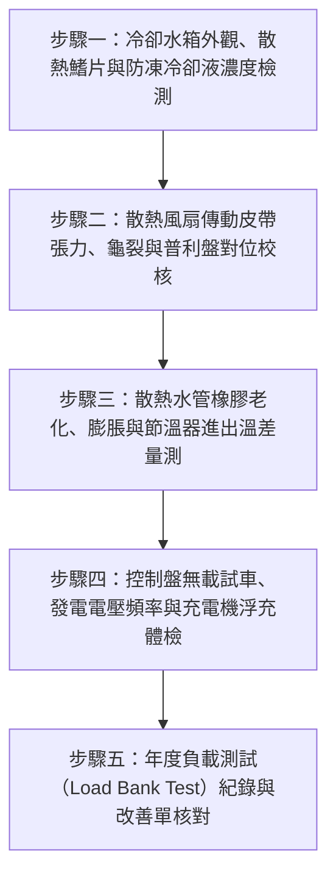

# 全案購屋實戰第二百六十一部：中古大樓社區地下室柴油緊急發電機冷卻水箱水道水垢堵塞冷卻風扇皮帶打滑過熱跳脫與停電備援負載自動投切體檢工序全書

## 壹、前言與防護戰略意義

在集合住宅的公共機電生命線中，地下室配置的「柴油緊急發電機（Emergency Diesel Generator Set）」是整棟大樓在面臨台電市電中斷、雷擊跳電、地震或火災斷電時唯一的自主電力心臟。它肩負著驅動「消防撒水泵浦、室內消防栓泵浦、地下室排煙風機、緊急昇降機（消防員電梯）、避難弱電通訊及各樓層緊急照明」等極度關鍵負載之重責大任。

然而，在台中南區與南屯區 25 至 30 年以上的中古集合住宅（例如：大安紫金城、長億南園、歌德堡、靜園 A 區等社區），柴油發電機平時僅處於備用狀態，普遍存在致命的維護盲區：
1. **冷卻水箱（Radiator）內部水道結垢堵塞與散熱鰭片白華粉化**：社區長期使用自來水代替防凍防腐水箱精，高溫鈣化水垢將水箱細微扁管死死堵塞，有效散熱面積萎縮 50% 以上。
2. **冷卻風扇皮帶（Fan Belt）老化龜裂與張力鬆弛打滑**：傳動皮帶經年累月受地下室油氣與高溫烘烤而硬化打滑，冷卻風量驟降。
3. **停電緊急負載全開時引發水溫過高跳脫（High Water Temperature Trip）**：平日無載（No-Load）空轉試車 5 分鐘看似正常，一旦遇大停電切入全負載（Full Load）運轉，引擎水溫在 3 至 5 分鐘內即飆破 $100^\circ\text{C}$，導致保護裝置緊急停機，整棟大樓瞬間陷入死寂黑洞與消防癱瘓。

本專書為「小寶置產全案防護體系」第二百六十一部，旨在建立一套針對中古集合住宅緊急柴油發電機散熱水箱、節溫器（Thermostat）、風扇傳動機構及自動負載轉移開關（ATS）的實戰檢測工序，確保極端斷電情境下的人身安全與逃生動線，並提煉為向賣方與管委會強力議價的實體技術鐵證。

---

## 貳、柴油發電機冷卻散熱系統核心失效機理

### 一、冷卻水箱內部結垢與外部熱阻劇增
1. **未添加防蝕防垢冷卻液之化學沉澱**：
   - 正規發電機應添加具備乙二醇（Ethylene Glycol）與防腐蝕抑制劑之專用冷卻液（濃度 30%~50%）。老舊社區常便宜行事直接補充硬度較高之自來水。
   - 自來水中的鈣、鎂離子在高溫運轉下結晶析出碳酸鈣水垢，附著於水箱銅管內壁，其熱傳導係數僅為銅材的數百分之一，造成散熱效率崩潰。
2. **散熱鰭片（Cooling Fins）積塵與倒伏**：
   - 地下室排風夾帶重油煙與粉塵，長期黏附於水箱散熱鰭片表面形成厚實隔熱泥層；外力碰撞致使鰭片倒伏閉合，阻斷冷卻氣流通過。

### 二、傳動機構與熱交換控制元件失效
1. **風扇皮帶張力衰退與共振打滑**：
   - 風扇皮帶老化伸長，運轉時在普利盤（Pulley）上產生高頻尖叫與打滑，實質轉速無法達到額定冷卻風量標準（通常需達數萬 CFM）。
2. **節溫器（水龜）卡阻於半開或全閉位置**：
   - 雙金屬片或石蠟式節溫器長年泡在生鏽冷卻水中，轉軸卡死無法順暢全開。冷卻水僅能在引擎本體內部進行「小循環」，無法進入散熱水箱進行「大循環」熱交換。

### 三、負載突加與熱跳脫骨牌效應
1. **水溫感知器（Coolant Temperature Sender）動作設定**：
   - 正常運轉水溫應維持在 $80^\circ\text{C} \sim 90^\circ\text{C}$。當散熱不良導致水溫觸及警報點（通常為 $95^\circ\text{C}$）與保護跳脫點（通常為 $105^\circ\text{C}$），發電機控制盤立即切斷燃油電磁閥（Solenoid Valve）強制熄火。
2. **ATS 自動切換開關機械卡死**：
   - 當市電中斷、發電機建立穩定電壓與頻率（$220\text{V}/380\text{V}$, $60\text{Hz}$）後，ATS 若因接點氧化或機械聯鎖卡塞無法於 10 秒內切入發電機側，所有消防抽水泵浦均無法起抽。

---

## 參、實地現場勘驗五步檢測工序

### 步驟一：散熱水箱與冷卻液品質檢測
1. **冷卻液光學比重計（Refractometer）檢測**：
   - 在引擎完全冷卻狀態下，打開水箱壓力蓋。取數滴冷卻液置於比重計上，檢視乙二醇濃度與冰點。
   - 正常防凍防蝕液濃度應在 $30\% \sim 50\%$，pH 值應維持在 $8.0 \sim 10.5$。若呈現鐵鏽紅褐色或透明無色，代表已退化為普通死水。
2. **散熱鰭片透光檢視**：
   - 以高流明強光手電筒自水箱後方照射，從前方檢視鰭片透光率。透光面積若低於 $70\%$，必須實施低壓藥水反向水刀清洗。

### 步驟二：傳動皮帶與冷卻風扇機構勘查
1. **皮帶撓度與表面微裂紋檢查**：
   - 用拇指在曲軸普利盤與風扇普利盤之中間跨距垂直施加約 $10\,\text{kgf}$ 力量，下壓撓度應介於 $10 \sim 15\,\text{mm}$。
   - 若皮帶內側齒牙出現連續橫向龜裂或側面鏡面硬化，必須立即要求更換整組配對皮帶（Matched Set）。
2. **風扇葉片固定螺栓與軸承游隙**：
   - 戴上手套手動搖晃風扇葉片，確認軸承無徑向鬆動曠量，固定螺栓無鬆弛鏽蝕。

### 步驟三：冷卻水管與節溫器大循環溫差測量
1. **上下水管手感彈性檢驗**：
   - 用手按壓進水軟管（上水管）與出水軟管（下水管），橡膠管壁應富有彈性且無鼓脹變形。若按壓時感覺硬化如石或有碎屑脆裂感，存在運轉爆管風險。
2. **紅外線熱成像儀測量節溫器進出口溫差**：
   - 啟動發電機運轉約 10 分鐘，以紅外線熱像儀量測節溫器外殼前後端溫度。
   - 節溫器開啟前，上水管溫度應顯著高於下水管；當引擎溫度達到約 $82^\circ\text{C}$ 節溫器完全開啟後，上下水管應迅速形成溫差在 $5^\circ\text{C} \sim 8^\circ\text{C}$ 以內之大循環，證實節溫器無卡阻。

### 步驟四：發電機控制盤與啟動電瓶體檢
1. **控制面板三相輸出參數核校**：
   - 運轉時檢視控制面板指針或數位顯示：
     - 線電壓：$380\text{V} \pm 2\%$ 或 $220\text{V} \pm 2\%$。
     - 頻率：$60\,\text{Hz} \pm 0.5\,\text{Hz}$（轉速約 $1800\,\text{rpm}$）。
     - 機油壓力：應穩定維持在 $3.0 \sim 5.0\,\text{kgf/cm}^2$（$40 \sim 70\,\text{psi}$）。
2. **啟動鉛酸蓄電池與浮充電壓**：
   - 發電機起走仰賴 $24\text{V}$ 啟動電瓶。檢測浮充充電機端子電壓，應穩定維持在 $27.0\text{V} \sim 27.6\text{V}$；電瓶極柱無白色硫酸化鉛結晶包覆。

### 步驟五：查核年度假負載測試（Load Bank）報告
1. **消防法規全載運轉測試**：
   - 詢問管理室發電機平日試車頻率。僅做「無載空轉」無法反映真實高溫散熱能力。
   - 檢驗近兩年消防安全申報書中，是否曾外接電阻負載箱（Load Bank）進行 $50\% \sim 100\%$ 額定容量、連續運轉 1 小時以上之實測紀錄。

---

## 肆、全案四棟核心考慮物件發電機備援能力評估

| 考慮社區 | 發電機機組配置型態 | 現場勘驗要點與潛在風險 | 談判籌碼與合約特約防線 |
| :--- | :--- | :--- | :--- |
| **大安紫金城 13 樓 (`PROP_10`)** | 獨立 B2 平車位與地下機房相鄰，為高樓層住宅社區 | 1. 13 樓若遇火警斷電，極度依賴發電機驅動緊急昇降機與排煙風機逃生。 2. 檢視發電機排氣黑煙淨化器（水洗塔）是否堵塞造成背壓過高。 | 以高樓層逃生絕對依賴緊急電力為由，要求出示發電機最近半年保養單與排氣檢測，作為壓價 20 萬籌碼，鎖定 768~788 萬。 |
| **長億南園 8 樓 (`PROP_106`)** | 社區屋齡達 30 年，發電機多屬早期美規或日規老機組 | 1. 散熱水箱鰭片是否長滿銅綠白華，水道結垢嚴重。 2. 柴油日用油箱油位計是否卡死，油路有無老化漏油。 | 直指 30 年老舊發電機若需大修或重置更換需動輒 80~120 萬元，強化公設沉重負擔，狠砍 200 萬，出價 745~760 萬。 |
| **歌德堡 8 樓** | 中型社區機電室整潔度高，發電機定期保養落實 | 1. 檢視自動充電機與電瓶更換日期是否在兩年內。 2. ATS 切換開關是否有原廠檢驗合格標籤。 | 精品級社區對照組，確認發電機保養無虞，無突發分攤修繕金風險。 |
| **靜園 A 區 11 樓** | 雙拼格局純住宅，地下室通風良好 | 1. 發電機散熱風道排風百葉窗是否受阻。 2. 運轉水溫保護開關動作靈敏度。 | 作為比價牽制籌碼，藉由完整機電維護狀態壓制其他缺失社區。 |

---

## 伍、買方防護作戰特約條款與自保機制

在正式進入買賣斡旋與簽訂要約書時，應在不動產買賣契約補充協議中明確載明：

> **【社區公共緊急備援發電系統安全合格特約條款】**  
> 「賣方保證本契約標的物所在社區之公共柴油緊急發電機系統運作正常，最近一次消防安全設備檢修申報合格，且啟動電瓶、冷卻水箱散熱系統及自動切換開關（ATS）均處於良好待命狀態。若簽約至點交期間經專業機電檢測發現發電機引擎冷卻系統嚴重結垢損壞、無法負載運轉、或管委會已決議需由各戶特別分攤高額發電機汰換重置工程費（累計達新台幣參萬元以上者），該筆費用全數由賣方負擔清償；賣方若拒絕履行，買方得逕自履約保證專戶扣除該筆費用或主張解除買賣契約。」

---

## 陸、結論與行動指引

柴油緊急發電機是中古大樓在大規模停電與火災劫難中的「最後定海神針」。散熱水箱內部水垢與皮帶打滑雖看似微小細節，卻是引發全負載跳脫停機、導致全棟逃生照明與排煙滅火全毀的隱形殺手。買方透過本工序之精確檢測，不僅能夠全面守護家庭居住時的極端生命安全，更能精準掌握老舊大樓公設維護的真實水準，將潛在的高額修繕風險轉化為談判桌上的強力定錨籌碼！
