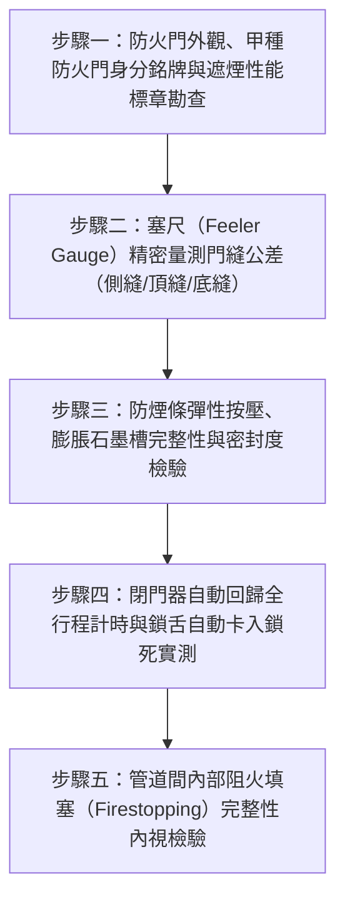

# 全案購屋實戰第二百六十七部：中古大樓社區各樓層管道間常閉式防火門門縫超標防煙條脆化地彈簧回歸失效與梯間濃煙隔絕體檢工序全書

## 壹、前言與防護戰略意義

在現代集合住宅高層建築的垂直動線與防火區劃設計中，貫穿整棟大樓的管道間（Pipe Chases / Utility Shafts）與安全逃生梯間，是火災發生時最容易產生致命「煙囪效應（Stack Effect）」的高危險廊道。依據我國建築技術規則建築設計施工編及各類場所消防安全設備設置標準，各樓層通往垂直管道間之檢修門、以及走道通往逃生安全梯之防火門，必須採用具備耐火一小時以上且具備阻熱、防煙性能之「常閉式防火門（Normally Closed Fire Door）」。

當某樓層發生火警時，常閉式防火門肩負著將數百度高溫、致命一氧化碳與毒煙阻絕於起火區劃內部的生死重任。一旦防火門失守，濃煙將於數分鐘內順著逃生梯與管道間迅速充斥全棟，奪走所有逃生者的呼吸生機。

然而，在台中南區與南屯區屋齡 25 至 30 年以上的中古集合住宅（例如：大安紫金城、長億南園、歌德堡、靜園 A 區等社區），各樓層常閉式防火門與管道間檢修門普遍存在極嚴重的「假裝安全」老化沉疴：
1. **門框周邊防火防煙膨脹密封條老化、硬化脫膠脆裂**：受日常溫濕度變化與紫外線照射，橡膠防煙條完全粉化，形成數毫米之貫通縫隙，火災時毒煙長驅直入。
2. **門扇變形、下垂，門縫間隙嚴重超越法定極限**：門扇受自重下垂或鉸鏈磨損，門扇與門框、門底與地坪之間隙高達 $8 \sim 15\,\text{mm}$（法規極限為門側及門頂 $\le 3\,\text{mm}$、門底 $\le 5\,\text{mm}$），完全喪失氣密阻煙功能。
3. **閉門器（Door Closer）漏油洩壓或鉸鏈回歸彈簧疲勞**：防火門無法在釋放後自動確實回歸關閉並「卡入鎖舌」，住戶為求通風甚至私自以門檔、滅火器或磚頭將防火門「長期卡開」，徹底瓦解大樓防火區劃防線。

本專書為「小寶置產全案防護體系」第二百六十七部，旨在建立一套針對中古集合住宅各樓層管道間檢修門及安全梯常閉式防火門門縫公差塞尺量測、防煙膨脹密封條耐候檢驗、自動閉門器回歸扭力校核與遮煙性能驗證的全維度工程體檢工序，捍衛家庭成員火災逃生時的絕對呼吸通道，並轉化為對賣方與管委會強力議價的實體技術鐵證。

---

## 貳、常閉式防火門與管道間檢修門核心失效機理

### 一、門扇幾何公差變形與毒煙滲透機理
1. **門縫超標引發之「煙囪吸啜效應」**：
   - 火災時起火層產生高達數十至數百 Pa 之熱膨脹正壓。毒煙分子會沿著阻力最小之路徑擴散。
   - 門縫間隙每增加 $1\,\text{mm}$，在高溫壓差驅動下的毒煙滲透量將呈「三次方（Cubic Relationship）」幾何級數暴增。若門底縫隙超過 $8\,\text{mm}$，僅需 90 秒即可將整座安全梯間充滿致盲且致命的濃煙。
2. **重力下垂（Door Sagging）與門框角位咬死**：
   - 鋼質防火門自重常達 $60 \sim 100\,\text{kg}$。上部旗鉸鏈（Flag Hinge）承重軸承長年磨損，門扇向外側傾斜下垂，導致門鎖側下角磨擦地坪，閉門器無法提供足夠推力克服摩擦力將門關死。

### 二、防煙密封條（Smoke Seal）化學老化與碳化
1. **熱膨脹防火石墨條（Intumescent Strip）剝落**：
   - 防火門框槽內嵌之膨脹石墨條在高溫（約 $200^\circ\text{C}$）時體積應膨脹 20~30 倍填滿縫隙。
   - 25 年老舊防火門之膨脹條外層 PVC 包覆脆化破裂，內部石墨粉遇潮結塊受損，高溫時完全喪失發泡膨脹功能。
2. **冷煙矽膠氣密條（Cold Smoke Seal）硬化發黏**：
   - 阻絕火災初期低溫濃煙之彈性矽膠條，受日常清潔劑擦拭與油煙侵蝕而變硬碎裂，甚至整條脫落遺失。

### 三、自動回歸機械機構（Door Closer）疲勞與人為破壞
1. **液壓閉門器內部活塞油封老化漏油**：
   - 閉門器內部之阻尼液壓油受長期高溫烘烤而自推桿軸封處滲出。一旦失油，閉門器喪失第二段緩衝閉鎖（Latch Action）調控能力，門扇若非「轟然重擊震裂牆體」，就是「懸空停滯無法上鎖」。
2. **人為違法固定門扇之骨牌災難**：
   - 住戶因梯間悶熱，習慣使用楔形木塊、拖把或重物將常閉式防火門長年卡在全開位置，此舉使閉門器連桿關節長年承受逆向扭力而扭曲金屬疲勞，一旦失火無人手動釋放，火勢直撲梯間。

---

## 參、實地現場勘驗五步檢測工序

### 步驟一：防火門認證標章與結構外觀勘查
1. **內政部建築新技術新工法性能認證銘牌**：
   - 檢視防火門扇側邊之金屬鋼印銘牌，確認標示「甲種防火門（具 1 小時以上防火時效及半小時以上阻熱時效）」及「具遮煙性能（Smoke Control Door）」。
2. **鋼板防腐蝕與門扇平整度檢查**：
   - 檢視門板表面有無大面積鏽蝕起泡、凹折撞擊變形，門鎖五金與防爆把手（Panic Hardware）牢固無鬆動。

### 步驟二：門縫公差精密量測（塞尺與階梯規）
1. **門側縫與門頂縫測量**：
   - 使用厚薄規（塞尺）或專用階梯式縫隙測量規，沿著門扇四周邊緣每隔 $30\,\text{cm}$ 進行量測。
   - 合格標準：門扇上方頂縫及左右兩側邊縫間隙必須：
     $$\text{Gap}_{\text{side/top}} \le 3.0\,\text{mm}$$
   - 若測得縫隙大於 $5.0\,\text{mm}$，即屬嚴重超標，防煙條無法緊密壓迫。
2. **門底縫隙（Undercut Clearance）量測**：
   - 測量門扇底緣與地面裝修面之垂直淨空：
     $$\text{Gap}_{\text{bottom}} \le 5.0\,\text{mm}$$
   - 若未安裝自動升降氣密壓條（Automatic Drop Seal）且底縫超過 $8.0\,\text{mm}$，必須立即要求補裝防煙壓條。

### 步驟三：防煙膨脹密封條檢驗
1. **彈性回彈手感檢測**：
   - 以手指沿門框四周用力按壓嵌入式防煙橡膠條，條身應柔軟富彈性並在釋放瞬間立即回彈就位。
   - 若按壓時感覺硬化如塑膠或有碳化碎屑掉落，顯示氣密性已徹底喪失。
2. **紙張抽取氣密阻力測試**：
   - 將一張 A4 紙夾於門扇與門框密封條之間，讓門自然閉合上鎖。
   - 徒手抽取紙張，整周各點均應感受強大夾緊阻力，紙張不得輕易滑動抽出。

### 步驟四：自動閉門器回歸行程與鎖入測試
1. **微角度開門自動閉合能力（7° 閉合極限測試）**：
   - 將防火門微開 $7^\circ \sim 10^\circ$（約離門框一個拳頭寬度）後鬆手。
   - 閉門器必須具備足夠起始扭矩克服氣壓與合頁阻力，將門扇平順推回，鎖舌（Latch Bolt）必須發出清脆「卡嗒」聲完全推入鎖扣受口板（Strike Plate）中。
2. **全開角度自動關閉時間測定**：
   - 將門扇推開至 $90^\circ$ 後自然釋放，使用碼錶計時。
   - 正常關閉全行程時間應控制在 $5 \sim 8\,\text{秒}$ 之間；不可過快猛擊傷人，亦不可過慢停滯。

### 步驟五：管道間檢修門與內部阻火填塞檢驗
1. **各樓層管道間門框氣密與上鎖管理**：
   - 檢修門應維持常時上鎖狀態，避免閒雜人等堆放雜物形成縱火隱患。
   - 門框四周同樣須配置合格防火防煙密封條。
2. **管線貫穿樓板防火泥阻火填塞（Firestop System）**：
   - 打開檢修門，以強光手電筒檢視垂直水電管線、弱電匯流排穿越鋼筋混凝土樓板之開孔處。
   - 樓板貫穿孔洞必須以經過 UL 認證之防火泥、防火包或膨脹型阻火發泡劑完全封堵嚴實，孔洞不得透光，徹底阻絕火勢在管道間產生煙囪效應。

---

## 肆、全案四棟核心考慮物件防火門與管道間防護評估

| 考慮社區 | 梯間與管道間防火門配置型態 | 現場勘驗要點與潛在風險 | 談判籌碼與合約特約防線 |
| :--- | :--- | :--- | :--- |
| **大安紫金城 13 樓 (`PROP_10`)** | 13 樓為高樓層次頂層，特別安全梯防火門為火警唯一生命通道 | 1. 13 樓逃生梯防火門是否因出租學生頻繁進出而長期用門檔卡開，閉門器是否漏油。 2. 戶內改裝 4 間套房之分間牆是否擅自打通公共管道間造成漏煙。 | 以「高樓層逃生梯防火門閉合失效與管道間未阻火填塞之重大公安瑕疵」為籌碼，要求賣方限期更新閉門器與密封條，併同 50 萬拆除款狠砍開價，堅定鎖定 **768~788 萬**。 |
| **長億南園 8 樓 (`PROP_106`)** | 社區屋齡達 30 年，管道間檢修門多屬早期無遮煙認證鐵門 | 1. 30 年老舊鐵門門縫嚴重變形下垂，底縫超過 15mm，完全不具防煙效果。 2. 管道間貫穿樓板多處未施作防火填塞。 | 揭露老舊大樓各樓層防火區劃完全瓦解、失火時毒煙直灌戶內的結構性致命傷，狠砍 200 萬，出價 **745~760 萬**。 |
| **歌德堡 8 樓** | 特別安全梯維護精實，甲種防火門標章齊全 | 1. 檢視門縫均小於 3mm，自動回歸動作平順。 2. 管道間維護良好且常時上鎖。 | 精裝優質標的，確認梯間防火區劃扎實，作為家人生命安全無虞之堅定對照組。 |
| **靜園 A 區 11 樓** | 高樓層梯間採光明亮，雙拼戶數單純 | 1. 防火門無人為卡開惡習，地彈簧與閉門器運作良好。 2. 門框防煙條彈性飽滿。 | 作為比價牽制籌碼，藉由標準之防火門維護水準反壓紫金城與長億南園。 |

---

## 伍、買方防護作戰特約條款與自保機制

在正式進入買賣斡旋與簽訂要約書時，應在不動產買賣契約補充協議中明確載明：

> **【公共逃生防火門與管道間防火區劃合規保證特約條款】**  
> 「賣方保證本契約標的物所在樓層之安全逃生梯常閉式防火門及管道間檢修門系統運作正常，且完全符合現行建築防火法規與遮煙性能標準。門扇閉門器運作正常無漏油、能自微開角度完全自動回歸閉鎖，門框周邊防煙密封條無脆裂脫落，且垂直管道間穿越各樓層之孔洞均有合格之阻火填塞。若簽約至交屋期間經現場查驗發現防火門下垂卡阻、門縫超標或未具自動回歸功能者，賣方應促使管委會或自行負責於交屋日前完成五金校正及防煙條更新；若逾期未改善，賣方同意由買方自買賣尾款中暫扣新台幣參萬元整作為修繕保證金。」

---

## 陸、結論與行動指引

常閉式防火門與管道間阻火填塞是火災肆虐時保護大樓住戶免於窒息滅頂的「立體防火閘門」。門縫微差數公釐、防煙條微小脆裂，在數百度高溫與毒煙狂湧之下，就是生與死的絕對分界線。透過本工序之塞尺量測、回歸實測與阻火檢查，小寶全家不僅能夠徹底掌握逃生通道路線的真實防護力，更能洞悉大樓整體物業管理的落實程度，將隱形公安風險化為談判桌上的定錨重鎚！
