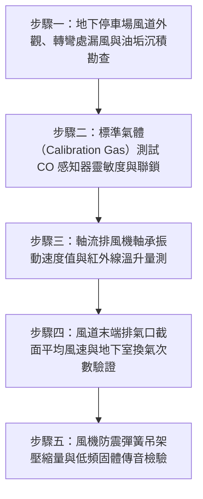

# 全案購屋實戰第二百六十三部：中古大樓社區地下室機械通風換氣系統排風管道油污粉塵沉積一氧化碳濃度感知器校準失效與軸流風機靜態動態平衡體檢工序全書

## 壹、前言與防護戰略意義

在現代集合住宅大樓的立體化工程體系中，地下停車場（Basement Parking）不僅是用以容納家庭車輛的停放空間，更是整棟大樓人流進出、管線轉折與設備集中的中樞區域。汽柴油車輛在地下室啟動、倒車與怠速行駛期間，會持續排放大量高危害廢氣，其中包括無色無味卻具致命劇毒的「一氧化碳（$\text{CO}$）」、促發呼吸道病變的「碳氫化合物（$\text{HC}$）」、致癌懸浮微粒（$\text{PM}_{2.5}$），以及近年電動車日益普及所衍生的鋰電池微量揮發氣體。

為了維持地下空間空氣清新並符合建築技術規則建築設備編規範，社區必須仰賴配置於各分區的「地下室機械通風換氣系統（Basement Mechanical Ventilation System）」——包含進風風機、排風軸流/箱型風機（Exhaust Fans）、排風金屬風道（Ducts），以及自動監控氣體濃度的「一氧化碳感知器連鎖控制迴路（$\text{CO}$ Sensor Interlock System）」。

然而，在台中市南區與南屯區屋齡 25 至 30 年以上的中古集合住宅（例如：大安紫金城、長億南園、歌德堡、靜園 A 區等社區），地下室機械通風系統歷經數十年運轉，普遍淪為「無人聞問的重度慢性病患」：
1. **排風風道內部厚積重油污與炭疽狀粉塵**：多年未實施風管清洗，內部沉積物增加風阻，引發氣流風量嚴重衰退 40% 以上，並構成極度危險之二次火災延燒路徑。
2. **$\text{CO}$ 一氧化碳感測器探頭老化失效、零點漂移（Zero Drift）**：長期受油氣毒化，感測探頭靈敏度歸零，地下室即使煙霧迷漫毒氣超標，排風機依然「紋風不動」；或反之整日無休狂轉浪費公費電力。
3. **軸流風機（Axial Fan）葉輪動靜平衡失調與軸承磨損**：運轉時產生強烈的低頻振動與刺耳轟鳴，透過建築鋼筋混凝土樑柱向上傳遞，導致 1 樓、2 樓甚至 3 樓低樓層住戶長年罹患神經衰弱與睡眠障礙。

本專書為「小寶置產全案防護體系」第二百六十三部，旨在建立一套針對中古集合住宅地下停車場機械通風系統風道油塵沉積、$\text{CO}$ 氣體感測器靈敏度校驗、軸流風機動態平衡振動及換氣率計算的全維度工程體檢工序，保護全家上下車時的呼吸生命安全，並化為對賣方與管委會強力議價的實體技術籌碼。

---

## 貳、地下室機械通風系統核心失效機理

### 一、風道內部油塵積累與阻抗激增機理
1. **排風管道沉降效應與邊界層摩擦阻抗**：
   - 汽機車排氣含有大量未完全燃燒的重油分子與碳煙，與空氣中的塵埃結合後，具備極強的附著黏性。
   - 歷經 25 年沉澱，鍍鋅鐵皮風管底部與轉彎處積塵厚度常達 $5 \sim 15\,\text{mm}$。根據流體力學達西–威斯巴哈公式（Darcy-Weisbach Equation），管道粗糙度 $\epsilon$ 增加導致沿程阻力係數 $\lambda$ 急遽上升，在風機輸出全壓不變下，末端排風口的實測風量呈現斷崖式衰減。
2. **防火排煙閘門（FD）葉片沾黏半閉**：
   - 風道貫穿地下室防火區劃牆體之防火閘門，轉軸遭黏稠油垢死死卡住，常年處於 $30^\circ \sim 45^\circ$ 半開閉狀態，形成巨大的氣流節流孔，風切噪音高達 80dB 以上。

### 二、一氧化碳感知器電化學傳感器毒化與失效
1. **電化學感測器電解液乾涸與催化劑中毒**：
   - $\text{CO}$ 感測器多採電化學反應原理（Electrochemical Sensor），其內部電解液壽命一般僅為 3 至 5 年。
   - 超過 20 年未曾校正更換的老舊感知器，感應極板表面被揮發性有機物（VOCs）與硫化物覆蓋毒化，對環境中 50ppm 以上之高濃度 $\text{CO}$ 完全喪失化學反應，無法輸出 $4 \sim 20\,\text{mA}$ 控制信號。
2. **控制盤 PLC/繼電器邏輯錯亂**：
   - 控制盤內部微電腦當機或時鐘電池漏液，設定之「早晚尖峰時段定時強制抽風」程式丟失，通風系統全面癱瘓。

### 三、軸流風機偏心運轉與固體結構傳音
1. **葉片積垢不均誘發動不平衡（Dynamic Unbalance）**：
   - 高速旋轉之風機葉片（通常為鋁合金或模壓玻璃鋼材質）因迎風面與背風面吸附油垢厚度不一，產生離心偏心力 $F = m \cdot r \cdot \omega^2$。
   - 偏心力引發風機主軸劇烈徑向晃動，實測振幅常突破 $7.1\,\text{mm/s}$（超越 ISO 10816-3 振動危害警戒值）。
2. **減震彈簧懸吊器（Spring Isolator）金屬疲勞壓死**：
   - 吊掛風機之防震吊架彈簧彈性疲乏，橡膠襯墊硬化碎裂，風機機框直接與天花板混凝土接觸，產生無阻尼「金屬對混凝土」剛性傳遞，整棟大樓底層結構體化身為巨大低頻共鳴箱。

---

## 參、實地現場勘驗五步檢測工序

### 步驟一：風管油塵積累與氣密性內視檢驗
1. **工業內視鏡探測風管內部**：
   - 卸下風管末端或檢修清潔孔（Cleanout Door），伸入高解析度工業內視鏡光纖探頭。
   - 檢視風管內壁沉積物厚度；沉積油垢若超過 $3\,\text{mm}$，或呈現黑色瀝青狀黏稠物，即屬重大衛生與消防隱患，需進行專業旋轉毛刷負壓清淤。
2. **法蘭連接處漏風煙霧測試**：
   - 啟動排風風機，以煙霧筆（Smoke Pen）沿風管各分段插條法蘭（TDC/TDF Flange）接縫滑行，觀察煙霧是否被吸入（負壓段）或被吹散（正壓段），評估漏風率。

### 步驟二：CO 一氧化碳感測器精度與自動起走測試
1. **便攜式多用氣體檢測儀現場基準比對**：
   - 攜帶校正合格之便攜式複合氣體檢測儀，於地下停車場車道交會處與死角測量環境底層 $\text{CO}$ 濃度（標準環境應 $< 5\,\text{ppm}$）。
2. **標準檢驗氣體（50ppm CO 標氣）噴測**：
   - 使用含有 50ppm 濃度的一氧化碳標準校正氣體噴罐，對準壁掛式 $\text{CO}$ 感知器探頭進行微量釋放。
   - 檢測感知器反應時間：合格感知器應在 30 秒內數字飆升並輸出警報；當濃度超過 35ppm（環保署室內空氣品質標準 8 小時值為 9ppm，1 小時值為 35ppm）時，排風風機控制箱必須在 10 秒內自動受控起跳進入全速運轉。

### 步驟三：軸流風機振動分析與溫度監測
1. **數位振動儀（Vibration Meter）多點量測**：
   - 於運轉中的風機馬達驅動端（DE）、非驅動端（NDE）及風機主軸承座表面，分別量測水平、垂直與軸向之振動速度有效值（RMS Velocity, $\text{mm/s}$）。
   - 評定標準（依據 ISO 10816 規範）：
     - 良好（Class A）：$< 1.8\,\text{mm/s}$。
     - 尚可（Class B）：$1.8 \sim 4.5\,\text{mm/s}$。
     - 警戒（Class C）：$4.5 \sim 7.1\,\text{mm/s}$（需排程動平衡校正）。
     - 危險（Class D）：$> 7.1\,\text{mm/s}$（隨時有軸承咬死或葉片斷裂飛脫風險）。
2. **紅外線熱像儀軸承溫升檢測**：
   - 運轉 30 分鐘後量測軸承座表面溫度，最高溫度不得超過 $75^\circ\text{C}$，且與周圍環境溫差不得大於 $35^\circ\text{C}$。

### 步驟四：排風斷面風速量測與實測換氣率核算
1. **多點等面積網格法測量風速**：
   - 在地下室主要吸風百葉口，以葉輪式風速儀測量格柵斷面各點風速，計算平均風速 $V_{\text{avg}}$（正常百葉面風速應在 $2.0 \sim 3.5\,\text{m/s}$）。
2. **總排風量與地下室體積換氣率計算**：
   - 計算總排風量：
     $$Q = \sum (A_{\text{eff}} \times V_{\text{avg}} \times 3600) \quad (\text{m}^3/\text{hr})$$
   - 核算地下室每小時換氣次數（Air Changes per Hour, ACH）：
     $$\text{ACH} = \frac{Q}{\text{地下室總容積 } V} \ge 6 \sim 8 \text{ 次/小時}$$
   - 若實測 ACH 低於 4 次/小時，顯示換氣量嚴重匱乏，地下室毒氣將持續滯留。

### 步驟五：防震懸吊裝置與低頻噪音體檢
1. **彈簧吊架靜態壓縮量（Static Deflection）測量**：
   - 檢查每組天花板風機防震彈簧吊架，彈簧有效壓縮量應維持在 $20 \sim 25\,\text{mm}$。若彈簧已被完全壓實到底（Solid Height），代表避震功能全失。
2. **車位與上一樓層室內低頻噪音（$31.5\,\text{Hz} \sim 63\,\text{Hz}$）測定**：
   - 在風機正下方車位與正上方一樓住戶室內關閉門窗測量低頻噪音，低頻音量不得超過 $35\,\text{dB(A)}$，杜絕長期噪音公害。

---

## 肆、全案四棟核心考慮物件地下通風環境深度評估

| 考慮社區 | 地下室格局與通風系統型態 | 現場勘驗要點與潛在風險 | 談判籌碼與合約特約防線 |
| :--- | :--- | :--- | :--- |
| **大安紫金城 13 樓 (`PROP_10`)** | 附屬之獨立 B2 大平面車位地處地下二層深處 | 1. B2 平面車位周邊是否有軸流排風機直吹之高溫油塵污染，車身表面是否易落黑粉。 2. 現場核查 B2 一氧化碳感知器連鎖是否正常動作。 | 以「B2 停車位鄰近老舊通風風道噪音與油塵干擾，需加裝獨立通風濾清防護」為由，配合本戶 4 間套房拆除款，狠砍開價，強烈鎖定 768~788 萬。 |
| **長億南園 8 樓 (`PROP_106`)** | 地下室車道深、樓高矮，配設機械停車位 | 1. 機械車位下層坑道通風死角極度嚴重，汽油揮發物與 CO 長期沉積，對下坑取車人體極為危險。 2. 30 年老舊排風風機馬達軸承異音劇烈。 | 直指地下室機械停車區通風嚴重不良與發電機排氣倒灌之致命隱患，作為大砍 200 萬的又一重錘，出價 745~760 萬。 |
| **歌德堡 8 樓** | 中型社區地下室空間方正，通風風道維護良好 | 1. 檢視管理室中央監控系統是否有定時通風監控排程。 2. 車位周邊無任何排風機異常振動傳遞。 | 精裝優質標的，確認地下室通風符合現代健康標準，作為資產保值對照組。 |
| **靜園 A 區 11 樓** | 地下停車場設有自然採光通風天井輔助 | 1. 自然通風與機械通風交替運作順暢，環境乾爽無霉味油氣。 2. 檢視天井排風口有無防護阻隔。 | 作為比價牽制籌碼，藉由優質地下室環境反壓紫金城與長億南園。 |

---

## 伍、買方防護作戰特約條款與自保機制

在正式進入買賣斡旋與簽訂要約書時，應在不動產買賣契約補充協議中明確載明：

> **【地下停車場公共通風與空氣品質合規保證特約條款】**  
> 「賣方保證本契約標的物所屬社區之地下停車場公共機械通風換氣系統、一氧化碳感知器連鎖設備及排風風道運作正常，且地下室平日無一氧化碳濃度嚴重超標、廢氣滯留不退、或排風風機產生嚴重低頻結構振動公害之情事。若簽約至交屋期間經公正第三方室內空氣品質檢測或機電檢驗發現地下室一氧化碳濃度持續超越環保法規標準且風機設備損壞，賣方應促使管委會於交屋前完成修繕校正；若逾期未改善，賣方應補償買方相關車位環境折損新台幣參萬元整。」

---

## 陸、結論與行動指引

地下停車場不僅是車輛停泊的庇護所，更是每天出門與歸家時家庭成員呼吸健康的第一道關卡。中古集合住宅常見之「地下室空氣污濁令人頭暈胸悶」或「夜間低頻嗡嗡共振」，核心病灶往往源自排風管道長年油塵淤塞、$\text{CO}$ 感知器失效與軸流風機失衡振動。透過本工序之精確儀器檢驗，小寶全家不僅能夠確保無毒無害的地下行車環境，更能洞悉管委會機電維護之底層實力，將潛藏公設風險化為談判桌上的定錨重鎚！
