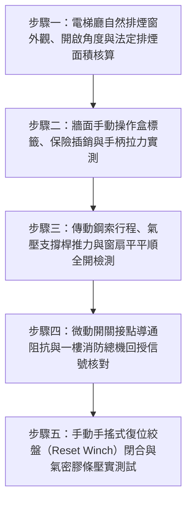

# 全案購屋實戰第二百六十九部：中古大樓社區各樓層電梯廳排煙窗手動拉桿鋼索卡死微動開關定位失效與機械自然排煙窗換氣體檢工序全書

## 壹、前言與防護戰略意義

在現代集合住宅大樓的垂直動線與立體逃生工程中，「各樓層電梯廳與排煙室（Elevator Lobbies & Smoke Compartments）」是連接各住戶大門、公共走道與緊急逃生電梯的樞紐節點。火災發生時，電梯昇降路垂直管道往往會產生極為劇烈的「煙囪效應（Stack Effect）」，將大量高溫有毒濃煙從低樓層迅速抽吸蔓延至高樓層。

為了防止濃煙在各樓層電梯廳內積聚致人昏厥窒息，依據建築技術規則建築設計施工編及各類場所消防安全設備設置標準，集合住宅之電梯廳、特別安全梯前室或走道末端，若未配置強制機械排煙風管，則必須設置具備法定排煙面積之「自然排煙窗（Natural Smoke Vent Windows）」。該排煙窗平時緊閉以維持大樓氣密與防風雨，火警時則仰賴牆面之「手動強制開啟手柄（Manual Pull Station）」或消防總機連動之電磁推桿，在數秒內迅速向外推開窗扇，利用熱浮力將高溫濃煙排出戶外。

然而，在台中市南區與南屯區屋齡 25 至 30 年以上的中古集合住宅（例如：大安紫金城、長億南園、歌德堡、靜園 A 區等社區），各樓層電梯廳排煙窗系統普遍面臨嚴重的「機械癱瘓與失修」慘狀：
1. **手動拉桿內襯鋼索（Flexible Push-Pull Cable）生鏽卡死斷裂**：管內鋼絲受潮氧化結鏽，住戶即使使出全身力氣扳動手柄，窗扇依舊「紋風不動」。
2. **連動微動開關（Limit Switch）接點氧化失效**：窗扇開啟後無法正確回傳定位信號至一樓中央防災總機，造成總機持續發出誤動作警報或無法連動關閉其他空調防火風門。
3. **鉸鏈滑軌積塵乾涸與氣密橡膠發泡條黏死**：窗扇長年未曾開啟，四周氣密膠條受紫外線與高溫烘烤黏死在窗框上，阻斷窗扇自動彈開之重力或彈簧釋放行程。

本專書為「小寶置產全案防護體系」第二百六十九部，旨在建立一套針對中古集合住宅各樓層電梯廳排煙窗手動拉桿開啟力、傳動鋼索順暢度、連鎖信號定位回授及排煙有效淨面積的全維度工程體檢工序，捍衛家庭成員火災逃生時的生命呼吸通道，並轉化為對賣方與管委會強力議價的實體技術鐵證。

---

## 貳、電梯廳自然排煙窗核心失效機理

### 一、傳動鋼索系統摩擦阻抗激增與卡阻機理
1. **鍍鋅鋼索內芯氧化與潤滑油乾涸**：
   - 自然排煙窗多採用外包 PVC 護套、內穿多股不鏽鋼或鍍鋅鋼索之鮑登纜（Bowden Cable）傳遞拉力。
   - 歷經 25 年時光，鋼索內部潤滑防鏽油完全乾涸揮發。雨水與濕氣自外側窗框滲入護套內部，金屬鋼絲產生大量紅褐色氧化鐵膨脹，鋼索與護套內壁緊密咬死，拉伸阻力劇增數十倍。
2. **預埋轉彎處折角過小與外管破裂**：
   - 早期泥作施工時，將排煙窗傳動管線預埋於混凝土牆體內部，若轉彎半徑小於管徑之 10 倍（$R < 10D$），鋼索長年承受高集中剪應力，內襯鐵氟龍管被磨穿，鋼絲直接拉鋸外層鋼帶，最終導致拉索崩斷。

### 二、手動拉桿機構與彈簧釋放失效
1. **釋放棘輪（Ratchet & Pawl）與鎖舌銹蝕**：
   - 牆面操作盒內部之脫扣機械爪因長年受濕氣侵蝕而咬死，當扳動手柄或拉出破玻按鈕時，鎖舌無法順利脫離，彈簧無法彈出拉動鋼索。
2. **窗扇氣動彈簧（Gas Spring）/ 扭簧（Torsion Spring）洩壓失效**：
   - 推開窗扇之動力主要來自窗側之氣壓支撐桿或重力扭簧。氣壓桿內部高壓氮氣因密封油封老化而漏光，脫扣後窗扇喪失自推動力，無法自動彈開至 $70^\circ$ 法定開啟角度。

### 三、微動開關定位與消防連鎖信號中斷
1. **機械式定位開關簧片變形與氧化**：
   - 排煙窗窗框頂部安裝之防水微動開關，在窗扇推開時彈起導通電路。
   - 老舊開關銀合金接點覆蓋厚層硫化銀黑斑，接觸電阻大於數百歐姆，一樓消防總機無法偵測到閉合信號，顯示為「線路斷線（Open Loop）」。
2. **管委會消極斷線屏蔽**：
   - 社區因老舊微動開關頻繁誤報或回傳異常，機電廠商常私自在受訊總機背板將排煙窗監控迴路拔除或短接電阻「強行屏蔽」，導致真實火災時無任何監控與紀錄。

---

## 參、實地現場勘驗五步檢測工序

### 步驟一：排煙窗外觀與有效排煙面積計算
1. **安裝位置與窗型檢驗**：
   - 檢視各樓層電梯廳上方之排煙窗型式（通常為上懸外開窗、中懸轉窗或百葉排煙窗）。
   - 排煙窗之開口下緣標高必須在天花板或防煙垂壁下方 $80\,\text{cm}$ 以上之有效蓄煙區範圍內。
2. **有效開口淨面積（Effective Aerodynamic Area）核算**：
   - 量測窗框開口長寬，並計算最大推開角度（通常需 $\ge 45^\circ \sim 70^\circ$）。
   - 依據消防法規，排煙窗有效排煙面積不得小於該電梯廳樓地板面積之 $2\%$（且最小不得低於 $1.0\,\text{m}^2$），確保火警時具備足夠熱浮力排煙通道。

### 步驟二：牆面手動操作盒拉力測試
1. **操作盒標示與人體工學高度**：
   - 手動操作盒應安裝於走道避難方向明顯處，操作手柄中心標高應介於地面上 $80 \sim 150\,\text{cm}$，具備醒目的「排煙窗手動開啟裝置」紅色中英文標示。
2. **手拉力計（Tension Force Gauge）測定開啟力**：
   - 拔除操作盒之防誤觸保險插銷，將拉力計勾住手動操作環或拉柄。
   - 沿操作方向水平拉動，記錄拉脫瞬間之最大拉力值（$F_{\text{pull}}$）。
   - 法規標準：手動開啟拉力不得超過 $70\,\text{N}$（約 $7.1\,\text{kgf}$）。若測得拉力超過 $120\,\text{N}$，代表鋼索嚴重卡死，婦孺長輩在緊急時完全無法拉開。

### 步驟三：傳動鋼索行程與窗扇自推彈開檢驗
1. **窗扇自動彈開角度與時間測定**：
   - 拉下手柄脫扣瞬間，窗扇側邊之氣壓支撐桿或配重彈簧應在 2 秒內將窗扇推至最大設計角度（通常為 $70^\circ$）。
   - 觀察窗扇開啟全程應順暢無金屬撞擊爆鳴，滑軌滾輪無跳軌卡滯。
2. **氣密膠條黏結檢查**：
   - 檢視脫扣瞬間膠條是否有撕裂或發出強烈黏滯扯開聲；若需外力推撞窗扇方能開啟，即屬嚴重不合格。

### 步驟四：微動開關定位與總機連動回授測試
1. **接點導通電阻量測**：
   - 在窗扇完全推開狀態下，使用三用電表量測微動開關常開（NO）接點兩端電阻，實測值必須小於 $1.0\,\Omega$。
2. **消防受訊總機回授信號確認**：
   - 現場開啟排煙窗時，以對講機與一樓警衛室核對：
     - 總機對應樓層之「電梯廳排煙窗開啟」專用指示燈應即時點亮。
     - 總機內部警報蜂鳴器應同步響起，確認未被消音屏蔽。

### 步驟五：手動手搖復位裝置（Reset Winch）體檢
1. **手搖柄閉合操作順暢度**：
   - 取出手動復位搖柄插入手動操作盒之六角驅動孔。
   - 順時針旋轉手柄，透過鋼索將外開之排煙窗緩慢平穩拉回閉合位置。搖轉過程手感阻力應均勻，無鋼絲斷股產生的刮扯感。
2. **窗扇氣密壓實度塞尺檢驗**：
   - 窗扇完全閉合鎖扣後，使用 $0.5\,\text{mm}$ 塞尺檢測窗框四周氣密橡膠條的壓縮量，確認無大於 $0.5\,\text{mm}$ 之透光或漏風隙縫，防範颱風暴雨時雨水滲入電梯廳。

---

## 肆、全案四棟核心考慮物件電梯廳排煙窗實戰評估

| 考慮社區 | 電梯廳與排煙設施型態 | 現場勘驗要點與潛在風險 | 談判籌碼與合約特約防線 |
| :--- | :--- | :--- | :--- |
| **大安紫金城 13 樓 (`PROP_10`)** | 13 樓位處頂層次頂層，若發生火災，昇降機道煙囪效應極為凶猛 | 1. 13 樓電梯廳排煙窗手動拉桿是否生鏽卡死，氣壓桿是否漏氣無法彈開。 2. 4 間學生套房出入頻繁，電梯廳排煙窗是否遭住戶私自拆除或鎖死。 | 以「13 樓高樓層電梯廳自然排煙窗完全卡阻、火災時濃煙充斥昇降路阻斷逃生之致命公安缺失」為籌碼，併同 50 萬拆除款狠砍開價，堅定鎖定 **768~788 萬**。 |
| **長億南園 8 樓 (`PROP_106`)** | 30 年老舊中大型社區，8 樓電梯走道排煙窗多屬早期手動鋼索型 | 1. 30 年老舊鋼索內芯是否早已生鏽斷裂，拉柄形同虛設。 2. 外框氣密條粉化，遇颱風豪雨是否有滲漏水痕跡。 | 揭露老舊排煙窗完全喪失逃生排煙功能、颱風雨水滲漏破壞梯間裝潢之硬傷，狠砍 200 萬，出價 **745~760 萬**。 |
| **歌德堡 8 樓** | 特別安全梯與電梯廳採光通風良好，排煙窗維護落實 | 1. 檢視排煙窗五金鋼索定期潤滑，拉動阻力輕盈。 2. 窗框膠條密封無老化。 | 精裝優質標的，確認梯廳消防排煙動線完備合規，作為家人逃生無後顧之憂之核心對照組。 |
| **靜園 A 區 11 樓** | 雙拼格局梯廳大面採光開窗，通風極度良好 | 1. 電梯廳開窗手動手柄動作靈敏。 2. 窗扇氣壓桿推力充足。 | 作為比價牽制籌碼，藉由標準之電梯廳採光排煙品質反壓紫金城與長億南園。 |

---

## 伍、買方防護作戰特約條款與自保機制

在正式進入買賣斡旋與簽訂要約書時，應在不動產買賣契約補充協議中明確載明：

> **【公共電梯廳自然排煙窗系統正常運作保證特約條款】**  
> 「賣方保證本契約標的物所在樓層之公共電梯廳與逃生走道自然排煙窗系統運作正常，且完全符合現行消防法規標準。排煙窗手動拉桿鋼索傳動順暢無卡死、拉開力符合法規限制（$\le 70\,\text{N}$），氣壓彈簧推開角度確實達標，微動開關能即時回傳定位信號至一樓消防總機，且窗扇閉合時水密氣密良好絕無滲漏雨水之情事。若簽約至交屋期間經現場查驗發現排煙窗卡死無法開啟或信號故障列入消防安檢缺失者，賣方應促使管委會或自行負責於交屋日前修復至合格驗收狀態；若逾期未改善，賣方同意由買方自買賣尾款中暫扣新台幣參萬元整作為公共安全修繕保證金。」

---

## 陸、結論與行動指引

電梯廳自然排煙窗是火災肆虐時阻絕電梯垂直昇降路「煙囪殺戮」的最後逃生安全閥。鋼索微小的生鏽卡阻、手柄多出的數公斤阻力，在黑煙瀰漫、驚慌逃生的火場中，就是能否順利生還的生死一線。透過本工序之拉力計實測、彈開角度檢驗與總機信號連線核實，小寶全家不僅能夠徹底掌握逃生動線上的真實生命屏障，更能精準洞察大樓物業日常保養之真實功力，將公設隱蔽瑕疵轉化為談判桌上的定錨重鎚！
