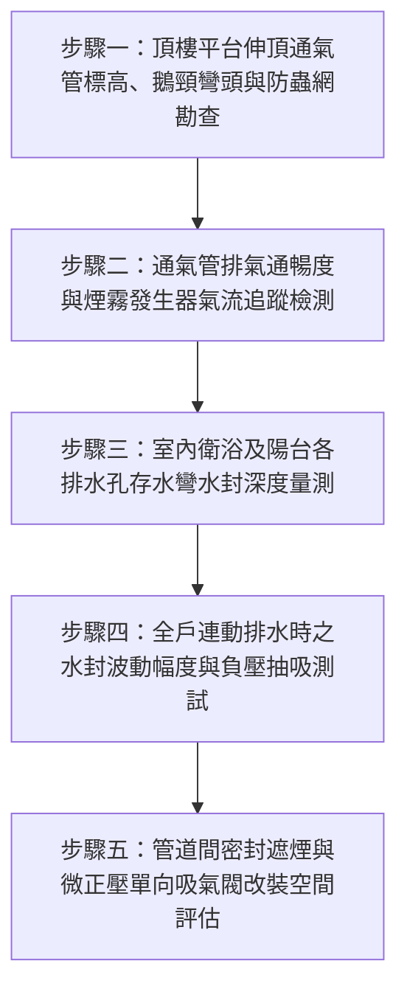

# 全案購屋實戰第二百六十二部：中古大樓社區各樓層管道間污水幹管透氣管頂端防蟲鳥網淤塞正負氣壓震盪水封乾涸與臭氣小黑蚊倒灌體檢工序全書

## 壹、前言與防護戰略意義

在集合住宅的垂直管線工程體系中，「管道間排水與透氣系統（Drainage and Venting System）」是維護室內衛生環境與空氣品質最關鍵的無形防線。自高樓層垂直貫穿至地下室的污水與廢水垂直幹管（Soil and Waste Stacks），在大量排水瞬間會產生劇烈的活塞效應（Piston Effect），誘發管內正壓衝擊與負壓抽吸。

為平衡管內壓力、確保各戶衛浴排水口之存水彎（Trap Seal）水封不被破壞，大樓頂樓必須依建築技術規則設置貫穿屋頂平台之「通氣幹管與伸頂通氣管（Stack Vent / Vent Terminal）」。

然而，在台中市南區與南屯區屋齡 25 至 30 年以上的中古集合住宅（例如：大安紫金城、長億南園、歌德堡、靜園 A 區等社區），頂樓通氣管長期承受日曬雨淋、酸雨侵蝕與鳥類築巢，普遍存在以下三大致命衛生與居住品質危機：
1. **伸頂通氣管口防蟲防鳥金屬網罩銹蝕破損或落葉淤塞**：管口缺乏阻絕，鴿子、麻雀於管內築巢，甚至死鳥屍體卡入幹管，導致通氣管完全喪失平衡氣壓功能。
2. **管內正負壓劇烈震盪引發「破封（Siphonage）」**：樓上住戶沖水時產生強大負壓吸力，將本戶馬桶與地排之存水彎水封直接抽乾；或底層產生正壓回湧，將含有致命沼氣、糞臭氣體與硫化氫之污水泡沫噴出地面。
3. **蛾蚋（污水小黑蚊）、蜚蠊（蟑螂）沿管道長驅直入**：水封一旦乾涸消失，化糞池與污水管內孳生之大量蛾蚋、細菌及病毒，24 小時不間斷倒灌進入各戶室內，嚴重威脅幼童與長輩呼吸道及腸道健康。

本專書為「小寶置產全案防護體系」第二百六十二部，旨在建立一套針對中古集合住宅頂樓伸頂通氣管排氣通暢度、管口防蟲網完整性、室內各排水存水彎水封深度與防正負壓抗衝擊能力的實戰檢驗工序，守護全家無毒無臭的清爽居住環境，並轉化為對賣方與管委會強力交涉的實體技術籌碼。

---

## 貳、管道間排水與通氣系統核心失效機理

### 一、垂直排水活塞效應與水封破壞機理
1. **誘導虹吸抽吸（Induced Siphonage）**：
   - 當上層住戶大量排水時，高速下落之水柱如活塞般在管內帶動空氣下沉，在其後方產生劇烈負壓區。
   - 若頂樓伸頂通氣管堵塞無法及時自大氣中補氣，管內負壓將直接從各戶存水彎強行抽吸空氣，將 $50 \sim 100\,\text{mm}$ 之有效封水高度在數秒內「吸乾」，形成水封破裂。
2. **正壓逆流噴濺（Back Pressure Siphonage）**：
   - 當落水接近垂直幹管底部轉向水平懸吊管時，水流因阻力減速形成水塞，其前方空氣受到極度壓縮產生高達數百 Pa 之瞬態正壓。
   - 若低樓層（特別是 2 樓、3 樓或轉折層）通氣不良，正壓氣體將直接擊穿地排與馬桶水封，將惡臭污水與氣體噴入室內。

### 二、頂樓伸頂通氣管管口老化與結構缺陷
1. **管口高度不足與排氣逆流**：
   - 依建築給排水規範，伸頂通氣管口應高出屋頂面至少 $15 \sim 30\,\text{cm}$ 以上；若鄰近屋頂花園或露天曬衣場，標高更須高出人體呼吸線（$2\,\text{m}$ 以上）。
   - 早期老舊社區常將通氣管口截短齊平於女兒牆或直接隱匿於花台內，排出之濃烈沼氣受風向倒灌回頂樓各戶之對外窗或冷氣吸風口。
2. **防蟲銅網/不鏽鋼網材質退化**：
   - 長期受高濃度硫化氫（$\text{H}_2\text{S}$，具強烈腐蝕性）熏蒸，普通鐵絲網或低標號不鏽鋼快速脆斷脫落，形成大口徑直通孔洞。

### 三、存水彎蒸發與微正壓吸氣閥（AAV）缺失
1. **自然蒸發乾涸**：
   - 閒置未使用的客用衛浴或乾濕分離之外側地排，存水彎水分因自然蒸發約 15 至 30 天即見底失效。
2. **老舊社區缺乏吸氣閥改裝**：
   - 傳統中古大樓並未在室內各支管裝設「微正壓單向吸氣閥（Air Admittance Valve, AAV）」，完全依賴公共管道間垂直通氣，一旦公共通氣管堵塞，整棟各戶同時受害。

---

## 參、實地現場勘驗五步檢測工序

### 步驟一：頂樓伸頂通氣管外觀與防蟲網檢驗
1. **管口形式與防雨防蟲網檢查**：
   - 登上大樓屋頂平台，尋找各棟垂直管道間延伸出屋頂之通氣管（直徑通常為 3 吋至 4 吋，DN75~DN100）。
   - 管口上方應裝設耐腐蝕之防雨防蟲金屬罩（Vent Cap）或倒 U 型鵝頸彎頭；檢視防蟲網面，孔徑應小於 $1.5\,\text{mm}$，且無銹斷破孔或蛛網雜物覆蓋。
2. **周邊環境與距離量測**：
   - 測量通氣管口與最近之採光天井、各戶對外窗或電梯機房進風口之水平距離，標準距離應保持 $3\,\text{m}$ 以上，高出門窗上緣 $60\,\text{cm}$ 以上。

### 步驟二：排氣通暢度與氣流檢測
1. **風速風向感應檢測**：
   - 將熱線式風速儀置於通氣管口上方，要求室內助理同時連續沖洗兩座馬桶。
   - 正常狀態下管口應有明顯之空氣吸入（負壓吸氣）或排擠氣流（風速應達 $1.5 \sim 3.0\,\text{m/s}$），證實垂直幹管氣路通暢無卡阻。
2. **環保煙霧發生器（Smoke Tester）追蹤**：
   - 若懷疑管路堵塞，自管口注入微量無毒彩色煙霧，觀察室內各排水孔是否有煙霧溢出（若有煙霧溢出代表室內存水彎破封）。

### 步驟三：室內存水彎水封深度（Water Seal Depth）實測
1. **水封深度探尺量測**：
   - 拆卸衛浴地板落水頭金屬格柵，使用 L 型壓克力標尺或內視鏡探頭深入存水彎（P-Trap 或 S-Trap）。
   - 測量存水彎最低隔板至水面之垂直高度（有效水封高度），標準數值必須介於 $50 \sim 100\,\text{mm}$ 之間。若測得低於 $30\,\text{mm}$ 或完全無水，代表隨時有破封臭氣倒灌之危險。
2. **防臭落水頭（自閉式防臭閥芯）配置檢視**：
   - 檢查落水頭內部是否裝設彈簧自閉式或磁吸式單向防臭內芯，做為水封蒸發時之第二道物理屏障。

### 步驟四：全載排水壓力衝擊與水封波動測試
1. **多點同時排水激發活塞效應**：
   - 將主臥浴缸放滿水、客衛浴缸放滿水，同時拔開水塞全速放水，並連續按壓馬桶沖水閥。
2. **觀察地板落水頭與馬桶水面波動**：
   - 仔細觀察地排內部水封是否有「咕嚕咕嚕」空氣被抽走之吸啜聲（Gurgling Sound），水面震盪幅度不得超過 $\pm 10\,\text{mm}$。
   - 若伴隨劇烈氣泡翻滾與沼氣臭味噴出，證實該社區公共透氣幹管存在嚴重堵塞或通氣斷面不足。

### 步驟五：管道間檢修口氣密與 AAV 吸氣閥改裝評估
1. **衛浴管道間維修孔（Access Panel）氣密檢查**：
   - 掀開衛浴天花板檢修孔，以強光手電筒檢視管道間貫穿各樓層之 RC 樓板開孔處，是否有依防火法規以防火泥完全填塞密封（Firestopping）。
   - 若管道間為完全暢通之「大通管」，鄰居沖水之惡臭將直接自天花板上方灌入室內。
2. **戶內加裝 AAV 單向吸氣閥空間勘查**：
   - 檢視洗手台下部、流理台下方或衛浴排氣幹管末端，是否有足夠空間加裝通過 NSF/ANSI 14 認證之單向吸氣閥，建立自主抗負壓防線。

---

## 肆、全案四棟核心考慮物件透氣系統實戰評估

| 考慮社區 | 建物管道間與通氣型態 | 現場勘驗要點與潛在風險 | 談判籌碼與合約特約防線 |
| :--- | :--- | :--- | :--- |
| **大安紫金城 13 樓 (`PROP_10`)** | 本戶位於 13 樓頂層次頂層，垂直落水負壓抽吸最劇烈處 | 1. 13 樓原屋主改為 4 間學生套房，衛浴數量暴增為 4 套，其排水管是否有私自亂接且未配置通氣管造成嚴重破封。 2. 頂樓伸頂通氣管是否緊鄰 13 樓對外採光窗。 | 以「4 間套房私設排水管缺乏通氣破封臭氣瀰漫，全面拆除重新配置標準雙管通氣需耗資 10 萬元」為由，併入 50 萬拆除復原款，對開價 898 萬狠砍，鎖定 768~788 萬。 |
| **長億南園 8 樓 (`PROP_106`)** | 社區樓高約 12~14 層，8 樓居中高樓層，管齡已屆 30 年 | 1. 30 年老舊鑄鐵或 PVC 污水幹管通氣管口防蟲網是否早已爛光，導致鳥糞昆蟲掉入。 2. 地排是否有長期乾涸反溢惡臭。 | 藉由老舊大樓垂直排水管通氣不良、小黑蚊孳生之居住健康隱憂，強化生活品質折損，狠砍 200 萬，出價 745~760 萬。 |
| **歌德堡 8 樓** | 精裝修屋況，衛浴天花板已封板美化 | 1. 檢修孔內部管道間樓板是否有完整阻火填塞與密封。 2. 精裝之落水頭是否均已升級為磁吸防臭閥芯。 | 精裝標的確認室內無任何反臭暗病，作為抗衡紫金城賣方讓利之優質籌碼。 |
| **靜園 A 區 11 樓** | 11 樓高樓層三面採光，衛浴皆有開窗 | 1. 衛浴自然通風良好，但仍需確認沖水時地排無咕嚕吸啜聲。 2. 屋頂通氣管口防蟲網是否更新為 SUS304 不鏽鋼網。 | 作為比價對照組，藉由優質通風與無異味環境，壓制其他標的。 |

---

## 伍、買方防護作戰特約條款與自保機制

在正式進入買賣斡旋與簽訂要約書時，應在不動產買賣契約補充協議中明確載明：

> **【排水系統暢通與無臭氣反溢保證特約條款】**  
> 「賣方保證本契約標的物室內各處衛浴、廚房及陽台之排水管線、存水彎水封及專有排水幹管功能正常，在正常排水或大量沖水時絕無存水彎水封破裂、排水受阻回湧、沼氣臭味反溢或污水昆蟲（如蛾蚋、蟑螂）沿管倒灌之重大瑕疵。若交屋前或驗收時發現排水管路存在通氣不良破封或異味瀰漫情事，賣方應負責限期改善修復（包含加裝微正壓吸氣閥或修繕公共管道間通氣口）並負擔全部費用；若逾期未改善完成，買方得暫扣買賣尾款新台幣伍萬元直至改善驗收合格為止。」

---

## 陸、結論與行動指引

伸頂通氣管與存水彎水封是阻絕化糞池致命沼氣與病毒害蟲進入家庭的「最後一道水密氣門」。中古大樓常見之「不知名浴室悶臭」或「莫名其妙孳生的小黑蚊」，其罪魁禍首往往不是清潔問題，而是頂樓通氣管淤塞與水封破裂引發的系統性故障。透過本工序之精確量測與現場實測，買方不僅能替全家掃除難纏的居住健康殺手，更能將隱蔽的管線工程缺失化為談判桌上的實質殺價利器！
