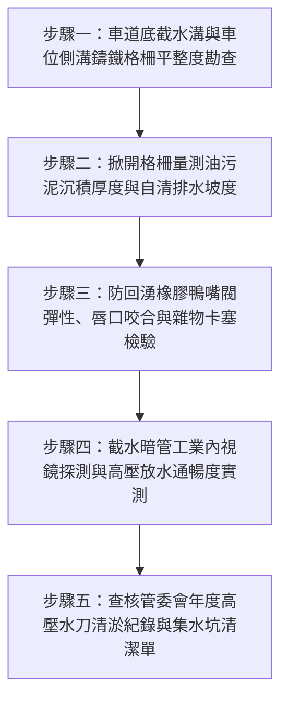

# 全案購屋實戰第二百六十五部：中古大樓社區地下室截水溝重油污泥沉積堵塞防回湧鴨嘴閥橡膠硬化與高壓水刀清淤體檢工序全書

## 壹、前言與防護戰略意義

在集合住宅的地下土木與排水工程結構中，「地下室截水溝系統（Basement Trench Drain & Sump System）」是守衛整座大樓地底安全、防範地表逕流暴淹與廢水排出的第一線水土屏障。通常設置於：
1. **車道出入口下坡坡底**：攔截車道暴雨沖刷而下的大量雨水。
2. **地下各層停車格周邊與車道兩側**：排除洗車廢水、地面凝結水與消防撒水測試排水。
3. **機械停車設備坑底（Pit）周圍**：攔截沉降機油與油泥。

截水溝所收集的污水最終匯流進入地下室「排污集水坑（Sump Pit）」，並透過「防回湧橡膠鴨嘴閥（Duckbill Check Valve）」或擺錘式逆止閥阻隔外界市政排水管回湧，再由沉水泵浦抽送至市政雨水/污水下水道。

然而，在台中南區與南屯區屋齡 25 至 30 年以上的中古集合住宅（例如：大安紫金城、長億南園、歌德堡、靜園 A 區等社區），地下截水溝與防回湧系統普遍陷入「重度血栓狀態」：
1. **重機油、黑泥與砂石沉積板結**：汽機車滴漏之黏稠潤滑油與輪胎泥沙長期混合，在 U 型截水溝底硬化成厚達數公分的油膏瀝青層，水流通水截面積縮減 70% 以上。
2. **防回湧橡膠鴨嘴閥老化硬化失去彈性**：長期浸泡於油污腐蝕性廢水中，EPDM 或氯丁橡膠材質硬化龜裂、無法自動閉合咬合。當夏季午後暴雨市區下水道水位暴漲時，大量黑濁泥水直接經由截水溝倒灌逆流，將整層地下室瞬間淹成「化糞池」。
3. **管委會缺乏高壓水刀（Hydro Jetting）清淤預算**：多數老舊社區僅以掃把清掃溝面鐵格柵表面，從未動用高壓水刀車貫通地底暗管，形成嚴重的地下室惡臭根源與積水隱患。

本專書為「小寶置產全案防護體系」第二百六十五部，旨在建立一套針對中古集合住宅地下截水溝沉積厚度、鴨嘴閥密封彈性、集水坑沉泥及清淤保養紀錄的全維度工程體檢工序，捍衛家庭車輛與地下機電資產的安全，並轉化為對賣方與管委會強力議價的實體技術籌碼。

---

## 貳、地下截水溝與防回湧系統核心失效機理

### 一、油泥板結與水力坡降崩潰機理
1. **重油與礦物泥砂之絮凝沉積（Flocculation & Siltation）**：
   - 車輛底盤滴漏之機油、剎車油含有大量黏結性聚合物。當遇上洗地水與雨水夾帶之石粉細砂時，油滴包裹砂粒迅速沉降於溝底，形成比混凝土更難鏟除的「硬化油膏」。
   - 溝身底部的原始設計重力排水坡度（通常僅 $0.5\% \sim 1\%$）完全被油泥覆蓋撫平，水流喪失自清流速（Self-Cleansing Velocity, $< 0.6\,\text{m/s}$），微小降雨即引發溝水溢流至車位地面。
2. **截水溝鑄鐵格柵板（Grate）鏽蝕變形塌陷**：
   - 長期受高鹽分廢水浸泡與重車碾壓，球狀石墨鑄鐵格柵斷裂、卡死於溝框中，導致清理人員無法掀起格柵施工，惡性循環加劇淤塞。

### 二、橡膠鴨嘴閥老化與倒灌逆流機理
1. **鴨嘴閥唇口（Lips）受油污膨脹變形**：
   - 鴨嘴閥利用流體正向壓力推開橡膠唇口排水，背壓逆向推擠時唇口自動壓緊密封。
   - 若橡膠未具備耐礦物油特性，吸附重機油後橡膠發生溶脹（Swelling），唇邊波浪狀翹曲變形，背向密封間隙高達數公分，防逆流功能徹底歸零。
2. **雜物夾塞於唇口閉合縫隙**：
   - 枯枝、落葉、塑膠袋碎片卡在鴨嘴閥咬合處，使閥門處於「常開狀態」，外界泥水長驅直入。

### 三、排污集水坑暗管氣阻與沉泥結塊
1. **落水管底口未設間接排水斷（Air Gap）**：
   - 截水溝落水幹管若直通集水坑深水層，當坑內水位上升時管口被水封死，管內空氣無法排出形成「氣阻（Air Lock）」，造成截水溝排水受阻冒泡。
2. **高壓水刀清淤週期嚴重脫節**：
   - 正規社區每 1 至 2 年應委由專業環保公司使用 200~300 bar 超高壓水刀配合吸泥車，對地下全線截水暗管進行拉洗；若 10 年以上未洗，暗管內徑常由 6 吋縮減至 2 吋以下。

---

## 參、實地現場勘驗五步檢測工序

### 步驟一：截水溝外觀與鑄鐵格柵穩固性檢查
1. **格柵承重與晃動量測**：
   - 檢視車道坡底受衝擊最大之重型格柵板，車輛駛過時是否產生金屬撞擊劇烈匡噹巨響或跳動（代表座框變形或防震橡膠墊脫落）。
   - 格柵表面不可有裂紋或大面積掉塊，格柵縫隙不得被口香糖、菸蒂完全堵死。
2. **溝框防護角鐵防腐檢查**：
   - 檢視預埋於混凝土中之鍍鋅角鋼邊框，不可有嚴重銹蝕鼓脹造成周邊地坪混凝土崩裂。

### 步驟二：溝底油泥厚度與積水殘留量測
1. **掀開格柵深度探測**：
   - 隨機掀開車道坡底與轉折處之格柵板，使用鋼尺垂直插至溝底量測油泥深度。
   - 標準狀態：溝底沉積厚度應小於溝深之 $10\%$（通常 $< 1.5\,\text{cm}$）。若沉泥厚度超過 $5\,\text{cm}$，甚至覆蓋整個排水管孔口，即屬重度淤積失修。
2. **排水坡度與積水檢驗**：
   - 在晴天無雨狀態下，檢視溝底是否有大面積長條形黑油積水無法排出。若長期積水超過 $2\,\text{cm}$，代表溝底坡度反坡或暗管堵塞。

### 步驟三：橡膠鴨嘴閥密封與回湧阻絕檢驗
1. **鴨嘴閥唇口外觀與彈性按壓**：
   - 戴上手套進入集水坑（或自檢修孔伸手），觸摸按壓橡膠鴨嘴閥唇部。
   - 橡膠應具備良好韌性與回彈力，表面無網狀微裂紋；雙唇閉合線應完全緊密貼合，無波浪翹曲或破洞。
2. **逆向水壓背壓密閉性測試**：
   - 於鴨嘴閥出水端（集水坑側）注水或模擬高水位，觀察截水溝內側是否有泥水逆向滲漏湧出。

### 步驟四：截水暗管內視鏡探測與水流沖刷測試
1. **光纖內視鏡探查暗管縮徑**：
   - 將管徑檢測內視鏡深入截水溝落水管內部 3 至 5 米，檢視橫向暗管內壁。
   - 內壁不可有厚實之鈣化結晶結塊或油泥垢層；管內截面積通水率必須大於 $80\%$。
2. **大水量連續放水沖刷試驗**：
   - 以消防水帶或水桶向截水溝上游注水約 200 公升，觀察水流能否迅速順暢排空，溝內水深在注水停止後 30 秒內應全數退去。

### 步驟五：查核管委會高壓水刀清淤工程合約
1. **高壓水刀拉洗履約證明**：
   - 向管理室查閱過去 3 年之大樓機電保養紀錄與支出明細，核實是否有編列「地下室截水溝高壓水刀通管清淤」之專業廠商施工發票與照片。
2. **集水坑底沉泥吸除清運單**：
   - 確認地下室集水坑是否每年定期僱用抽泥車抽取池底重油固體沉渣，避免沉水泵浦葉輪咬死。

---

## 肆、全案四棟核心考慮物件截水排水系統深度對比

| 考慮社區 | 地下室車道與截水溝配置型態 | 現場勘驗要點與潛在風險 | 談判籌碼與合約特約防線 |
| :--- | :--- | :--- | :--- |
| **大安紫金城 13 樓 (`PROP_10`)** | 附屬之獨立 B2 大平面車位地處深層，坡道長且截水溝多道 | 1. B2 平車位前方截水溝是否長滿黑油污泥散發刺鼻異味。 2. 暴雨時車道底鴨嘴閥是否曾失效導致 B2 車位積水。 | 本戶附帶高價值獨立大平車，若截水溝油泥淤塞倒灌，車位價值直接重挫；以此為由要求賣方負擔清淤分攤，併同 50 萬拆除款狠砍開價，堅定鎖定 **768~788 萬**。 |
| **長億南園 8 樓 (`PROP_106`)** | 配設坡道機械車位，機械坑底（Pit）極易受截水溝溢流波及 | 1. 機械車位下坑排水溝是否完全被廢機油與鐵屑泥膏堵死。 2. 鴨嘴閥硬化導致積水回湧直接淹沒機械台座油壓馬達。 | 直指機械停車位抗積水能力為零、截水溝失修隨時引發百萬機械台泡水毀損之硬傷，狠砍 200 萬，出價 **745~760 萬**。 |
| **歌德堡 8 樓** | 中型社區車道坡度合宜，截水溝維護頻率高 | 1. 檢視坡底格柵固定良好無噪音。 2. 截水溝底乾淨見底無厚積黑泥。 | 精裝優質標的，確認地下室排水設施管理嚴謹，作為家庭愛車停放安全之核心對照組。 |
| **靜園 A 區 11 樓** | 出入口地勢較高，截水動線短且順暢 | 1. 車道截水溝水流自清能力良好。 2. 集水坑泵浦啟抽靈敏。 | 作為比價牽制籌碼，藉由地勢排水分流優勢反壓低窪風險社區。 |

---

## 伍、買方防護作戰特約條款與自保機制

在正式進入買賣斡旋與簽訂要約書時，應在不動產買賣契約補充協議中明確載明：

> **【地下停車場公共截水與排水設施正常運作特約條款】**  
> 「賣方保證本契約標的物所屬社區大樓地下停車場之車道截水溝、排水暗管、防回湧鴨嘴閥及排污集水坑系統運作順暢，溝底無嚴重油泥沉積板結致排水受阻，且地下室停車空間（特別是附屬車位周邊）於賣方持有期間絕無因暴雨溢流或下水道逆流發生積水泡車之情事。若簽約至交屋期間經現場查驗發現截水系統堵塞癱瘓或車位周邊有嚴重積水反溢瑕疵，賣方應促使管委會立即完成高壓水刀清淤與閥門更換；若逾期未改善，賣方應等額補償買方相應車位清潔修復損失新台幣參萬元整。」

---

## 陸、結論與行動指引

地下室截水溝是抵禦地底水患與車道逕流的「隱形壕溝」。黑油沉積與鴨嘴閥硬化雖常年隱匿於鐵格柵之下，卻是引發地下室大暴淹與車位百萬財損的致命引信。透過本工序之精確量測、內視鏡探測與回湧防護實測，小寶全家不僅能夠徹底確保愛車停泊的安全，更能洞悉大樓物業管理之深層實力，將公設潛在瑕疵精準化為談判桌上的定錨重鎚！
