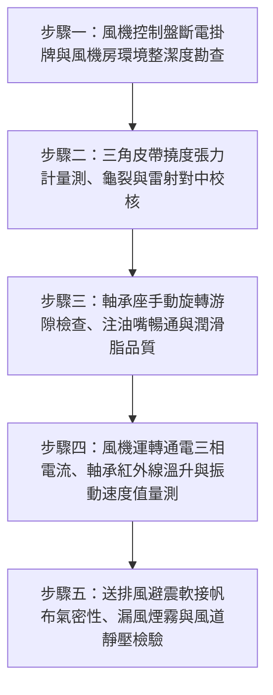

# 全案購屋實戰第二百六十八部：中古大樓社區地下室機械通風送排風機皮帶張力衰減軸承缺油異音與風管法蘭軟接帆布破損體檢工序全書

## 壹、前言與防護戰略意義

在現代集合住宅高層建築的地下工程中，地下停車場（Basement Parking）與大型機電空間常年處於封閉、無自然採光及自然對流的地底環境。為了維持地下室空氣含氧量、排除汽機車排放之有害廢氣與燃油油氣、並避免高濕度環境引發機電控制盤受潮短路，整座社區必須仰賴龐大的「地下室機械通風送排風系統（Basement Mechanical Supply & Exhaust Air System）」。

該系統由分佈於地下各層的進風風機（Fresh Air Supply Fans）、排風風機（Exhaust Fans）、鍍鋅風道（Ductwork），以及串聯風機與風道之「耐高溫避震軟接帆布（Flexible Duct Connectors）」所構成。風機主要透過電動馬達經由「V 型三角皮帶（V-Belts）」驅動雙吸前向或後傾式離心葉輪高速旋轉，產生龐大的風量與靜壓。

然而，在台中南區與南屯區屋齡 25 至 30 年以上的中古集合住宅（例如：大安紫金城、長億南園、歌德堡、靜園 A 區等社區），地下室機械通風風機往往因常年隱身於天花板上方或專用風機房內，淪為物業保養極度忽視的「機電未爆彈」：
1. **傳動皮帶（V-Belt）張力嚴重衰減、打滑發熱甚至斷裂**：皮帶鬆弛打滑引發轉速驟降，風機實際排風量萎縮 50% 以上，伴隨刺耳金屬摩擦尖叫聲。
2. **馬達與風機主軸軸承（Bearings）長年缺油乾磨、滾珠麻點剝落**：產生強烈的金屬撞擊雜音與劇烈低頻震動，透過大樓樑柱向上傳遞，成為 1 樓至 3 樓低樓層住戶夜間失眠的結構傳音兇手。
3. **風機進出口避震軟接帆布受潮霉爛、破裂穿孔**：帆布接頭撕裂形成巨大通氣破口，送排風在風機房內部形成「短路自循環（Air Short-Circuiting）」，地下停車場深處與各車位完全無新鮮空氣進入，廢氣與油氣持續滯留。

本專書為「小寶置產全案防護體系」第二百六十八部，旨在建立一套針對中古集合住宅地下通風送排風機皮帶張力規量測、軸承潤滑與振動頻譜分析、避震軟接帆布氣密性及風道風壓的全維度工程體檢工序，捍衛家庭地下車位與居住環境品質，並轉化為對賣方與管委會強力議價的實體技術鐵證。

---

## 貳、送排風機驅動機構與風道軟接核心失效機理

### 一、傳動三角皮帶老化與滑差（Slip）機理
1. **皮帶張力衰減與摩擦係數崩潰**：
   - V 型皮帶仰賴皮帶兩側梯形斜面與普利盤（Sheave）溝槽的楔形擠壓摩擦力傳遞扭矩。
   - 橡膠皮帶受地下室高溫與機油油霧長期浸潤，橡膠分子鏈老化硬化，摩擦係數急遽下降。當皮帶張力不足時，主動輪與從動輪產生高達 $10\% \sim 25\%$ 之相對滑差，皮帶溫度飆升至 $80^\circ\text{C}$ 以上，加速龜裂斷裂。
2. **滑輪溝槽偏磨與不平行對準（Misalignment）**：
   - 25 年老舊風機之馬達底座調整螺栓鏽蝕鬆動，造成馬達軸心與風機主軸產生「角度偏差（Angular Misalignment）」或「平行位移（Parallel Offset）」。
   - 皮帶單側受力異常，皮帶邊緣尼龍拉力線脫落斷線，運轉時產生劇烈橫向鞭擊現象。

### 二、滾動軸承缺油乾磨與金屬疲勞剝落
1. **高溫鋰基牛油（Grease）皂化結焦與乾涸**：
   - 風機枕式軸承座（Pillow Block Bearing）內部潤滑脂若 2 年以上未補充注入，基礎油揮發殆盡，殘留之增稠劑結成黑色硬塊，軸承滾珠處於完全金屬乾摩擦狀態。
2. **外環軌道剝落（Spalling）與點蝕**：
   - 滾珠在高轉速下撞擊微小麻點，產生高達數千赫茲（kHz）之高頻衝擊波，進而誘發軸承座異常升溫（超過 $85^\circ\text{C}$），最終引發軸承咬死（Seizure）、主軸磨損甚至馬達過載燒燬。

### 三、避震軟接帆布撕裂與氣流短路
1. **氯丁橡膠/矽膠玻璃纖維布老化硬化**：
   - 隔離風機震動傳入鍍鋅風管之柔性軟接頭，長年承受正負風壓脈動疲勞衝擊。老舊帆布硬化後產生網狀龜裂，在喉箍（Drawband）卡箍固定處沿縫撕裂。
2. **通風短路與車道死角毒化**：
   - 排風機排出的污濁空氣直接自破損帆布漏回風機房，並被相鄰的進風風機重新吸入送回地下室，形成污染短路閉環，地下停車場各死角之一氧化碳與揮發油氣濃度持續積聚。

---

## 參、實地現場勘驗五步檢測工序

### 步驟一：安全斷電與風機房整體巡檢
1. **安全隔離（Lockout/Tagout, LOTO）**：
   - 進入地下室專用送排風機房，在進行任何機械接觸前，將風機專用無熔線斷路器（NFB）切至 OFF 位置並掛牌警示，確認風機葉輪完全停止旋轉。
2. **基座螺栓與彈簧避震器檢查**：
   - 檢視風機整體槽鋼基礎底座，4 處地面防震彈簧是否生鏽壓死、橡膠減震墊有無硬化擠出。

### 步驟二：皮帶張力與滑輪雷射對準檢測
1. **鉛筆式皮帶張力計（Belt Tension Tester）量測**：
   - 將張力計垂直置於兩普利盤中心跨距的中點處施力。
   - 記錄達到標準下壓撓度（每 100mm 跨距下壓約 $1.5\,\text{mm}$）時之指針測力值（$F_{\text{deflect}}$）。
   - 標準規範：A 型皮帶撓曲力應維持在 $1.5 \sim 2.5\,\text{kgf}$，B 型皮帶應維持在 $2.5 \sim 4.0\,\text{kgf}$。若測得力量低於 $1.0\,\text{kgf}$，代表皮帶過鬆必須調整馬達滑軌推拉螺栓。
2. **滑輪共平面（Coplanar）雷射對中量測**：
   - 將磁吸式雷射對中儀吸附於馬達皮帶輪端面，投射雷射線至風機皮帶輪端面。
   - 兩輪端面之平行位移偏差不得大於 $1.0\,\text{mm}$，角度偏差不得大於 $0.2^\circ$。

### 步驟三：風機主軸軸承手動感官與潤滑檢測
1. **手動盤車（Hand Turning）順暢度檢驗**：
   - 以雙手徒手盤動風機葉輪旋轉 3 至 5 圈。主軸旋轉應輕盈滑順、阻力均勻，無任何卡滯點，無「沙沙」或「喀啦」金屬摩擦聲。
   - 雙手上下扳動風機主軸，檢驗軸承徑向游隙（Radial Clearance），晃動量不得大於 $0.05\,\text{mm}$。
2. **黃油注油嘴（Grease Nipple）勘查**：
   - 檢視軸承座頂端之黃油嘴是否有長期按壓注油痕跡；若注油嘴被厚積乾油泥完全封死，代表已數年未曾保養注油。

### 步驟四：通電動態運轉電流、溫度與振動測試
1. **三相運轉電流與馬達溫升**：
   - 恢復通電啟動風機，以鉤表量測馬達三相平衡電流，數值不得超過馬達銘牌之滿載電流（FLA）。
   - 運轉 30 分鐘後以紅外線測溫儀量測馬達外殼散熱鰭片與前後軸承蓋溫度，馬達外殼溫度應 $< 75^\circ\text{C}$。
2. **風機軸承座振動速度有效值（RMS Velocity）測定**：
   - 於風機兩端軸承座上方量測振動值，依據 ISO 10816 規範：
     $$V_{\text{rms}} \le 2.8\,\text{mm/s} \quad (\text{優良標準})$$
   - 若 $V_{\text{rms}} > 4.5\,\text{mm/s}$，代表皮帶動平衡失調或軸承嚴重磨損，需列管維修。

### 步驟五：避震軟接帆布氣密性與漏風檢驗
1. **帆布外觀與卡箍固定檢查**：
   - 檢視風機出風口與回風口之軟接帆布，材質應為具備阻燃防火標章之矽膠耐溫布，表面無破孔撕裂、無油漬滲透發黑。
   - 喉箍扁鋼壓板螺栓緊固無鬆脫。
2. **漏風煙霧與風管靜壓檢驗**：
   - 在風機高速運轉下，使用煙霧筆沿軟接帆布接縫滑行，不可有任何煙霧被吸入或噴散吹散；以微差壓計量測風道靜壓，確認無異常壓降。

---

## 肆、全案四棟核心考慮物件通風機組深度評估

| 考慮社區 | 地下室送排風機配置型態 | 現場勘驗要點與潛在風險 | 談判籌碼與合約特約防線 |
| :--- | :--- | :--- | :--- |
| **大安紫金城 13 樓 (`PROP_10`)** | 配置獨立 B2 大平面車位，地下機房設有大型排風機組 | 1. B2 車位天花板上方風機之避震帆布是否撕裂，造成熱濁空氣直吹車身。 2. 風機運轉皮帶打滑尖叫聲是否干擾地下室環境。 | 以「B2 車位上方風機帆布破損漏油風、軸承磨損異音嚴重，需全面翻新保養」為由，配合 4 間套房拆除款，狠砍開價，堅定鎖定 **768~788 萬**。 |
| **長億南園 8 樓 (`PROP_106`)** | 配設坡道機械車位，地下室樓高低矮，通風機房緊鄰車道 | 1. 30 年老舊風機軸承嚴重缺油發熱，產生低頻震動。 2. 帆布接頭早已破爛不堪，機械坑底長年油氣不散。 | 直指老舊大樓通風排氣系統徹底失修、機械車位區空氣品質惡劣危害健康之結構性缺陷，狠砍 200 萬，出價 **745~760 萬**。 |
| **歌德堡 8 樓** | 中型社區機電設備維護完善，風機房常態上鎖清潔 | 1. 皮帶張力良好無打滑，軸承注油保養紀錄完整。 2. 避震帆布外觀乾淨無裂痕。 | 精裝優質標的，確認公設機電維護水準極高，作為資產保值與居住安寧之核心對照組。 |
| **靜園 A 區 11 樓** | 雙拼戶數單純，地下室採光通風井輔助自然進風 | 1. 送排風機啟動平穩，無金屬尖銳摩擦異音。 2. 軟接帆布定期更新。 | 作為比價牽制籌碼，藉由標準通風維護品質反壓紫金城與長億南園。 |

---

## 伍、買方防護作戰特約條款與自保機制

在正式進入買賣斡旋與簽訂要約書時，應在不動產買賣契約補充協議中明確載明：

> **【地下公共機械通風機組運作正常與無噪音公害保證特約條款】**  
> 「賣方保證本契約標的物所屬社區大樓地下停車場之進風排風風機、傳動皮帶、軸承潤滑系統及風道避震軟接帆布運作正常，且風機運轉時絕無皮帶打滑尖叫、軸承磨損異音或產生嚴重低頻結構傳音公害之情事。若簽約至交屋期間經現場查驗發現地下通風機組嚴重故障、帆布破裂短路或噪音超標經環保開罰列管者，賣方應促使管委會立即完成更換校正；若逾期未改善，賣方同意由買方自買賣尾款中暫扣新台幣參萬元整作為公共機電修繕準備金。」

---

## 陸、結論與行動指引

地下室機械送排風機是老舊集合住宅維持地底空氣品質與行車安全的「公共人工肺」。傳動皮帶打滑看似小節，實則讓大樓排風量攔腰折半；帆布破裂更讓新鮮空氣化為虛妄烏有。透過本工序之張力量測、軸承盤車與帆布氣密實測，小寶全家不僅能夠徹底確保地下車位環境的健康舒適，更能精準看穿大樓機電保養的底層基本功，將潛藏的公設維修成本化為談判桌上的定錨重鎚！
