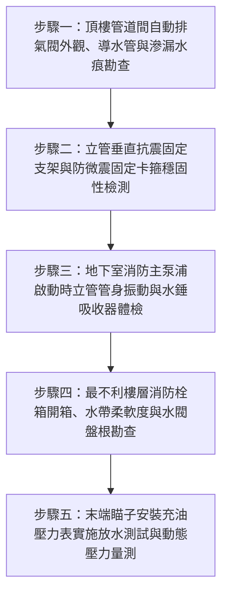

# 全案購屋實戰第二百六十六部：中古大樓社區各樓層消防送水幹管排氣閥橡膠塞老化洩漏立管水錘震盪與末端放水試驗壓力體檢工序全書

## 壹、前言與防護戰略意義

在集合住宅高層建築的消防水路生命線中，「消防送水幹管與連結送水管系統（Fire Standpipe and Siamese Connection System）」是火災發生時消防隊員抵達現場實施火場灌救、以及大樓內部室內消防栓主動滅火的唯一垂直動脈。垂直貫穿各大樓管道間的鋼管幹管，平時維持高壓滿水待命狀態，而在幹管最高頂端必須配置「自動排氣閥（Automatic Air Release Valve）」用以排除管內積存的微小氣泡，確保管網全滿水水力平衡。

然而，在台中市南區與南屯區屋齡 25 至 30 年以上的中古集合住宅（例如：大安紫金城、長億南園、歌德堡、靜園 A 區等社區），消防垂直立管與排氣系統歷經數十年高壓浸泡與冷熱交替，普遍潛藏著以下三大毀滅性機電暗病：
1. **立管頂端自動排氣閥橡膠塞老化硬化、慢速滲漏水**：排氣閥內部浮球機構卡塞或密封面受水垢腐蝕，導致排氣閥無法密閉，微量高壓消防水常年自管道間頂端持續滲漏，順著垂直管道間下流，將各樓層弱電電纜、電梯機房牆面甚至頂樓住戶天花板滲透泡爛。
2. **管網內部積聚「壓縮空氣囊」誘發劇烈水錘（Water Hammer）**：當排氣閥失效無法排氣時，管頂積聚彈性極高的高壓氣囊。消防泵浦啟動瞬間或消防栓閘閥開啟時，水柱高速撞擊氣囊產生數倍於工作壓力的破壞性壓力波（高達 $15 \sim 25\,\text{kgf/cm}^2$），震斷立管固定吊架、震裂管件法蘭接頭，甚至引發管道間「爆管暴淹」。
3. **最不利樓層消防栓末端放水壓力不足**：黑鐵立管內壁嚴重氧化結瘤縮徑，加上管網洩漏失壓，實測末端放水壓力未達法定最低標準 $1.7\,\text{kgf/cm}^2$（約 $0.17\,\text{MPa}$），火警時消防栓水帶僅能噴出微弱水流，完全喪失壓制火勢能力。

本專書為「小寶置產全案防護體系」第二百六十六部，旨在建立一套針對中古集合住宅消防送水立管排氣閥水密性、抗水錘吸收裝置、立管抗震固定支架及最不利點消防栓放水動態壓力的完整工程體檢工序，捍衛家庭居住安全，並轉化為對賣方與管委會強力交涉的實體技術籌碼。

---

## 貳、消防送水幹管與排氣系統核心失效機理

### 一、自動排氣閥結構老化與慢性滲漏機理
1. **不鏽鋼/黃銅排氣閥內部浮球橡膠密封面碳化**：
   - 自動排氣閥利用槓桿與浮球（Float Ball）升降控制排氣口。當管內有氣體時浮球下沉開啟排氣；管內充水時浮球浮起、推動橡膠閥塞（Rubber Seat）封閉排氣孔。
   - 歷經 25 年高壓浸泡與水中氯離子侵蝕，橡膠塞硬化變脆或表面覆蓋厚層碳酸鈣水垢，浮球浮起時無法達成完全水密，每分鐘滲漏數十滴高壓水，沿著管道間立管外壁常年無聲滲流。
2. **排氣口未接引專用排水銅管**：
   - 早期老舊大樓施工偷工減料，頂樓排氣閥出口未配接引至排水明溝之銅管或不鏽鋼導水軟管，一旦洩漏即直接噴濺於管道間 RC 樓板上，滲漏至下一層住戶戶內。

### 二、氣囊積聚、水錘破壞與固定支架鬆脫機理
1. **高彈性氣囊引發之空穴與壓力巨震**：
   - 氣體之壓縮係數為水之數萬倍。管頂若積存 $0.1\,\text{m}^3$ 的壓縮空氣，在消防泵浦啟動瞬間，水流以數米每秒高速衝擊氣囊，氣囊被劇烈壓縮後反彈，產生高頻劇烈的「管湧水錘波」。
   - 水錘波反射衝擊在彎頭（Elbow）與三通處，產生垂直與水平方向的強烈剪應力，長期震動導致垂直管道間角鋼固定吊架（Riser Clamps）膨脹螺栓拔出鬆脫。
2. **法蘭石棉墊片撕裂與溝槽卡箍（Grooved Coupling）膠圈老化**：
   - 早期法蘭墊片受震動扯裂，現代大樓採用的無焊接壓扣（Victaulic）卡箍之 EPDM 密封膠圈老化彈性疲乏，在水錘衝擊下瞬間脫位爆開，造成管道間噴水浩劫。

### 三、管道結瘤與最不利點放水動水壓衰退
1. **碳鋼鋼管（SGP）內壁嚴重銹蝕**：
   - 老舊社區消防水質長期未循環更新，死水滋生厭氧菌與硫酸鹽還原菌，管壁產生大面積「生物銹瘤（Tubercles）」，原 4 吋（DN100）送水立管有效流通孔徑縮減至不足 2.5 吋。
2. **末端動水壓衰退與水帶爆裂風險**：
   - 依據消防法規，最頂層最遠端之室內消防栓，在配備 $13\,\text{mm}$ 瞄子口徑放水時，放水壓力必須達到 $1.7 \sim 7.0\,\text{kgf/cm}^2$，放水量需達 $130\,\text{L/min}$ 以上。管壁結瘤引發沿程水頭損失急遽暴增，實測動態壓力常跌破 $1.0\,\text{kgf/cm}^2$。

---

## 參、實地現場勘驗五步檢測工序

### 步驟一：頂樓排氣閥外觀與水密性檢驗
1. **排氣閥閥體與排氣孔檢視**：
   - 進入頂樓管道間檢修口或天台管線區，尋找直徑 4 吋消防立管頂部之自動排氣閥（口徑通常為 $1/2$ 吋至 1 吋）。
   - 檢視排氣閥外殼是否有黃褐色銅綠、白色鈣化水垢痕跡，排氣孔是否有持續滴水或微噴水霧現象。
2. **導水銅管引流配置**：
   - 排氣閥出口應裝設專用排氣引流管（銅管或高壓軟管）直通戶外落水頭或屋頂排水天溝，杜絕滲水浸濕管道間。

### 步驟二：立管固定支架與膨脹螺栓抗震檢驗
1. **垂直立管管卡（Riser Clamp）間距測量**：
   - 依據給排水及消防規範，垂直立管每層樓至少應設置一處重型角鋼固定管卡，且卡箍與管身之間應墊有阻燃橡膠減震墊片。
2. **螺栓鬆脫與管身位移檢查**：
   - 檢查固定於 RC 剪力牆上之膨脹螺栓有無銹斷、拉拔鬆動跡象。
   - 用雙手用力搖晃立管，管身應穩固如磐石，不可有超過 $2\,\text{mm}$ 的晃動曠量。

### 步驟三：消防泵浦起走立管水錘與震動測試
1. **地下室主泵浦手動啟動衝擊測試**：
   - 於地下室消防泵浦控制箱手動按下「室內消防栓主泵浦」啟動按鈕。
   - 站在中間樓層管道間旁，仔細聆聽立管內部是否有「金屬敲擊聲（Metallic Clang）」或低頻悶響；觀察立管管身有無瞬間劇烈橫向跳動。
2. **水錘吸收器（Water Hammer Arrester）氣囊壓力檢測**：
   - 檢查立管頂端與泵浦出水端是否配置活塞式或氣囊式水錘消除器，以胎壓表檢測充氣氣嘴，預充氮氣壓力應為系統靜水壓之 $80\% \sim 90\%$。

### 步驟四：最不利樓層消防栓箱箱體體檢
1. **水帶（Fire Hose）柔軟度與接頭耐壓檢查**：
   - 打開標的物所在樓層（特別是 13 樓或 8 樓）之公設室內消防栓箱。
   - 檢查水帶是否折疊硬化、發霉脆裂；快速接頭（Machino Coupling）橡膠密封圈是否老化脫落。
2. **閘閥（Angle Valve）盤根填料與螺桿潤滑**：
   - 檢查消防水栓銅閘閥之盤根壓蓋是否有滴漏水漬，螺桿旋轉手柄是否能平順轉動，無生鏽咬死。

### 步驟五：末端瞄子放水試驗與動水壓測定
1. **外接充油防震壓力表測試組**：
   - 在最不利點（大樓最高樓層）消防栓箱出口接上附有壓力表之標準測試瞄子口（孔徑 $13\,\text{mm}$）。
2. **全開閘閥實測動態放水壓力**：
   - 將水帶拉展至安全排水區域（如安全梯間排水分流天溝或露台），完全旋開消防栓閘閥全速放水。
   - 讀取放水時之動態壓力表數值：
     $$P_{\text{dynamic}} \ge 1.7\,\text{kgf/cm}^2 \quad (\approx 0.17\,\text{MPa})$$
   - 同時檢視水柱噴射射程，有效射程應達到 10 公尺以上，確認管路暢通無阻且水壓充沛。

---

## 肆、全案四棟核心考慮物件消防立管系統深度評估

| 考慮社區 | 建物樓層型態與立管特徵 | 現場勘驗要點與潛在風險 | 談判籌碼與合約特約防線 |
| :--- | :--- | :--- | :--- |
| **大安紫金城 13 樓 (`PROP_10`)** | 13 樓位居頂層次頂層，屬全棟消防給水管網「最不利水壓點」 | 1. 13 樓消防栓放水動態壓力是否達標；頂樓排氣閥是否老化漏水滲入 13 樓天花板。 2. 4 間套房改裝是否曾破壞管道間消防幹管防護。 | 以「頂層消防水壓最弱且排氣閥老化具漏水暗病」為由，要求管委會出示最新消防立管耐壓合格單，併同 50 萬拆除款狠砍開價，堅定鎖定 **768~788 萬**。 |
| **長億南園 8 樓 (`PROP_106`)** | 社區屋齡達 30 年，管道間垂直消防幹管管齡極老 | 1. 30 年老舊黑鐵立管內壁結瘤是否導致 8 樓消防栓出水量枯竭。 2. 立管固定吊架螺栓是否鏽蝕脫落，水錘震動劇烈。 | 揭露老舊大樓消防管道嚴重結瘤、失火時救命水帶無水噴出的公共安全致命隱患，狠砍 200 萬，出價 **745~760 萬**。 |
| **歌德堡 8 樓** | 中型社區維護精良，管道間防水密封嚴密 | 1. 檢視梯間消防栓箱內水帶外觀如新，接頭配件齊全。 2. 頂樓排氣閥均設有標準排水導管。 | 精裝優質標的，確認消防立管健全無漏水水錘風險，作為全家生命安全之堅固對照組。 |
| **靜園 A 區 11 樓** | 高樓層 11 樓，梯間明亮通風良好 | 1. 消防栓箱整潔度高，閥門無滲水銹蝕。 2. 11 樓消防栓放水壓力實測充沛。 | 作為比價牽制籌碼，藉由優質消防機電維護水平反壓紫金城與長億南園。 |

---

## 伍、買方防護作戰特約條款與自保機制

在正式進入買賣斡旋與簽訂要約書時，應在不動產買賣契約補充協議中明確載明：

> **【公共消防垂直供水管網與室內消防栓安全合規特約條款】**  
> 「賣方保證本契約標的物所在樓層及社區公共之消防送水立管、頂樓自動排氣閥、水錘消除裝置及室內消防栓箱系統運作正常，且完全符合現行消防法規標準。頂樓排氣閥及立管管道間絕無滲漏水至標的室內之暗病，標的所在樓層消防栓之末端放水動態壓力確達法定合格標準（$\ge 1.7\,\text{kgf/cm}^2$）。若簽約至交屋期間經現場查驗發現消防立管有爆裂漏水隱患或消防栓水壓不足經消防安檢開罰列管者，賣方應促使管委會立即完成修繕改善；若逾期未改善完成，賣方同意由買方自買賣尾款中暫扣新台幣伍萬元整作為公共安全保證金。」

---

## 陸、結論與行動指引

消防送水立管與頂樓排氣閥是老舊集合住宅在突發火災時「唯一能自救救人的生命水脈」。排氣閥微漏看似不痛不癢，卻常年毀滅大樓弱電與天花板裝潢；氣囊引發的水錘震動更是摧毀整棟大樓給水管網的隱形炸彈。透過本工序之精確儀器量測、水錘檢驗與放水動壓實測，小寶全家不僅能夠徹底掌握居家生命通道的真實防禦力，更能將隱蔽的公設管線風險轉化為談判桌上的定錨重鎚！
